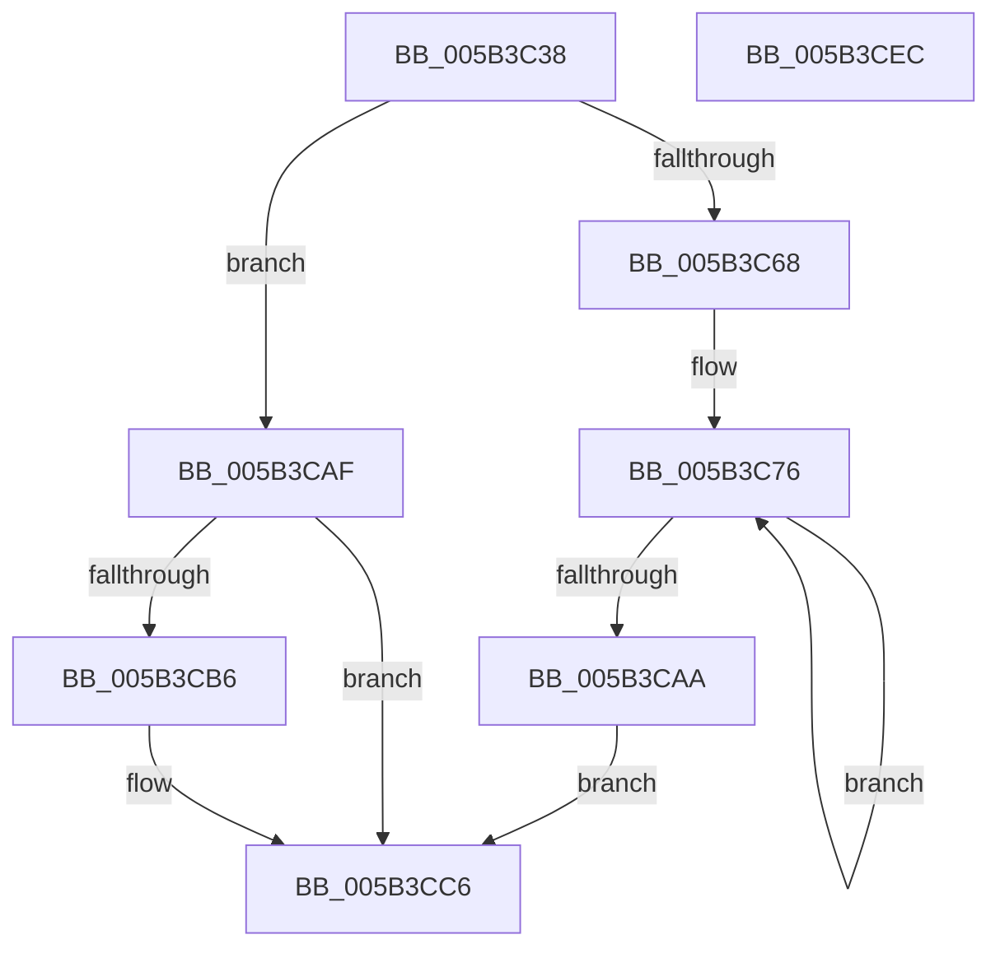

# KiBugCheckConvertParameterValueToUnicodeString

- RVA: `0x005B3C38`–`0x005B3CED` (길이 `181` bytes)
- VA: `0x00000001405B3C38`
- 실행 섹션: `.text`
- PDB 이름 있음: `예`; PDB Function 태그: `아니요`
- unwind 정보 RVA: `0x000A5A38`
- 디코드: `52`개 명령, `181/181` bytes 표시
- 미해석 바이트: `0` (있으면 어셈블리에 `.byte`로 보존)

> 이 문서는 커널 이미지의 기계어와 PDB 기호를 분석해 생성했습니다. 4번과 5번은 함수 원형과 자료형을 바이너리 사용 방식에서 추정한 C 해석이며 원본 소스 복구 결과는 아닙니다.

## 1. Dependencies

- 직접 호출 지점: **0**; 고유 호출 대상: **0**
- 직접 호출자로 확인된 함수: **1**
- RIP 상대 이미지 참조: **0**

### Outgoing calls
- 직접 디코드된 call 명령이 없습니다.

### Direct callers
- [KiDisplayBlueScreen](KiDisplayBlueScreen_function_005B494C.md) at `0x005B4C0D`

### Static image references
- 디코드된 RIP-relative 메모리 참조가 없습니다.

## 2. Other-region calls and transfers

- 다른 실행 섹션으로 향하는 call: **0**
- 별도 외부 분기/꼬리 이동을 확인하지 못했습니다.

## 3. Assembly (complete function range)

```asm
005B3C38  48 8B C4                        mov rax, rsp
005B3C3B  48 89 58 08                     mov qword ptr [rax + 8], rbx
005B3C3F  48 89 68 10                     mov qword ptr [rax + 0x10], rbp
005B3C43  48 89 70 18                     mov qword ptr [rax + 0x18], rsi
005B3C47  48 89 78 20                     mov qword ptr [rax + 0x20], rdi
005B3C4B  0F B7 7A 02                     movzx edi, word ptr [rdx + 2]
005B3C4F  45 33 C9                        xor r9d, r9d
005B3C52  4C 8B 42 08                     mov r8, qword ptr [rdx + 8]
005B3C56  4C 8B D2                        mov r10, rdx
005B3C59  D1 EF                           shr edi, 1
005B3C5B  48 8B F1                        mov rsi, rcx
005B3C5E  BD 02 00 00 00                  mov ebp, 2
005B3C63  83 FF 13                        cmp edi, 0x13
005B3C66  75 47                           jne 0x1405b3caf
005B3C68  41 C7 00 30 00 78 00            mov dword ptr [r8], 0x780030
005B3C6F  49 8D 58 04                     lea rbx, [r8 + 4]
005B3C73  45 8B D9                        mov r11d, r9d
005B3C76  B9 3C 00 00 00                  mov ecx, 0x3c
005B3C7B  48 8B D6                        mov rdx, rsi
005B3C7E  41 2B CB                        sub ecx, r11d
005B3C81  48 D3 EA                        shr rdx, cl
005B3C84  66 83 E2 0F                     and dx, 0xf
005B3C88  66 83 FA 0A                     cmp dx, 0xa
005B3C8C  66 1B C0                        sbb ax, ax
005B3C8F  41 83 C3 04                     add r11d, 4
005B3C93  66 25 F9 FF                     and ax, 0xfff9
005B3C97  66 83 C0 37                     add ax, 0x37
005B3C9B  66 03 C2                        add ax, dx
005B3C9E  66 89 03                        mov word ptr [rbx], ax
005B3CA1  48 03 DD                        add rbx, rbp
005B3CA4  41 83 FB 40                     cmp r11d, 0x40
005B3CA8  72 CC                           jb 0x1405b3c76
005B3CAA  8D 57 FF                        lea edx, [rdi - 1]
005B3CAD  EB 17                           jmp 0x1405b3cc6
005B3CAF  8D 57 FF                        lea edx, [rdi - 1]
005B3CB2  85 D2                           test edx, edx
005B3CB4  74 10                           je 0x1405b3cc6
005B3CB6  B8 2D 00 00 00                  mov eax, 0x2d
005B3CBB  8B CA                           mov ecx, edx
005B3CBD  0F B7 C0                        movzx eax, ax
005B3CC0  49 8B F8                        mov rdi, r8
005B3CC3  66 F3 AB                        rep stosw word ptr [rdi], ax
005B3CC6  48 8B 5C 24 08                  mov rbx, qword ptr [rsp + 8]
005B3CCB  48 8B 74 24 18                  mov rsi, qword ptr [rsp + 0x18]
005B3CD0  48 8B 7C 24 20                  mov rdi, qword ptr [rsp + 0x20]
005B3CD5  66 45 89 0C 50                  mov word ptr [r8 + rdx*2], r9w
005B3CDA  41 0F B7 42 02                  movzx eax, word ptr [r10 + 2]
005B3CDF  66 2B C5                        sub ax, bp
005B3CE2  48 8B 6C 24 10                  mov rbp, qword ptr [rsp + 0x10]
005B3CE7  66 41 89 02                     mov word ptr [r10], ax
005B3CEB  C3                              ret
005B3CEC  CC                              int3
```

## 4. C-style interpretation (structured pseudocode)

```c
__int64 __fastcall KiBugCheckConvertParameterValueToUnicodeString(__int64 a1, __int64 a2, __int64 a3, int a4)
{
    __int64 result;
    __int64 v_r11;
    __int64 v_rbx;
    __int64 v_rdi;
    unsigned __int64 v_stack_p10;
    unsigned __int64 v_stack_p18;
    unsigned __int64 v_stack_p20;
    unsigned __int64 v_stack_p8;

    *(unsigned __int64 *)(v_rsp + 8) = v_rbx;
    *(unsigned __int64 *)(v_rsp + 16) = v_rbp;
    *(unsigned __int64 *)(v_rsp + 24) = v_rsi;
    *(unsigned __int64 *)(v_rsp + 32) = v_rdi;
    a4 = 0;
    v_rdi = (unsigned int)((*(unsigned __int16 *)(a2 + 2)) >> (1));
    if (((unsigned int)(v_rdi)) != 19) goto loc_005B3CAF;
    *(unsigned int *)(*(unsigned __int64 *)(a2 + 8)) = 0x780030ULL;
loc_005B3C76:
    a1 = (unsigned int)((60) - (0));
    a2 = (a1) >> ((unsigned __int8)(a1));
    a2 = (unsigned __int16)((a2) & (15));
    v_r11 = (unsigned int)((0) + (4));
    result = (unsigned __int16)((v_rsp) & (0xFFF9ULL));
    result = (unsigned __int16)((result) + (55));
    result = (unsigned __int16)((result) + ((unsigned __int16)(a2)));
    *(unsigned __int16 *)(*(unsigned __int64 *)(a2 + 8) + 4) = (unsigned __int16)(result);
    v_rbx = (*(unsigned __int64 *)(a2 + 8) + 4) + (2);
    if (((unsigned int)(v_r11)) < 64) goto loc_005B3C76;
    goto loc_005B3CC6;
loc_005B3CAF:
    if ((unsigned int)(v_rdi - 1) != 0) {
        result = 45;
        a1 = (unsigned int)(v_rdi - 1);
        result = (unsigned __int16)(result);
        v_rdi = *(unsigned __int64 *)(a2 + 8);
    }
    *(unsigned __int16 *)(*(unsigned __int64 *)(a2 + 8) + v_rdi - 1 * 2) = 0;
    result = (unsigned __int16)((*(unsigned __int16 *)(a2 + 2)) - (2));
    *(unsigned __int16 *)(a2) = (unsigned __int16)(result);
    return result;
}
```

## 5. (Beta) C Style

```c
int64_t KiBugCheckConvertParameterValueToUnicodeString(int64_t Arg1, void *Arg2, int64_t Arg3, int32_t Arg4)
{
    uint8_t *arg2 = (uint8_t *)Arg2;

    int64_t result;
    int64_t local_r11;
    int64_t local_rbx;
    int64_t local_rdi;
    uint64_t v_stack_p10;
    uint64_t v_stack_p18;
    uint64_t v_stack_p20;
    uint64_t v_stack_p8;

    *(uint64_t *)(local_rsp + 0x8) = local_rbx;
    *(uint64_t *)(local_rsp + 0x10) = local_rbp;
    *(uint64_t *)(local_rsp + 0x18) = local_rsi;
    *(uint64_t *)(local_rsp + 0x20) = local_rdi;
    Arg4 = 0;
    local_rdi = (uint32_t)((*(uint16_t *)(arg2 + 0x2)) >> (1));
    if (((uint32_t)(local_rdi)) != 19) goto loc_005B3CAF;
    *(uint32_t *)(*(uint64_t *)(arg2 + 0x8)) = 0x780030ULL;
loc_005B3C76:
    Arg1 = (uint32_t)((60) - (0));
    Arg2 = (Arg1) >> ((uint8_t)(Arg1));
    Arg2 = (uint16_t)((Arg2) & (15));
    local_r11 = (uint32_t)((0) + (4));
    result = (uint16_t)((local_rsp) & (0xFFF9ULL));
    result = (uint16_t)((result) + (55));
    result = (uint16_t)((result) + ((uint16_t)(Arg2)));
    *(uint16_t *)(*(uint64_t *)(arg2 + 0x8) + 0x4) = (uint16_t)(result);
    local_rbx = (*(uint64_t *)(arg2 + 0x8) + 4) + (2);
    if (((uint32_t)(local_r11)) < 64) goto loc_005B3C76;
    goto loc_005B3CC6;
loc_005B3CAF:
    if ((uint32_t)(local_rdi - 1) != 0) {
        result = 45;
        Arg1 = (uint32_t)(local_rdi - 1);
        result = (uint16_t)(result);
        local_rdi = *(uint64_t *)(arg2 + 0x8);
    }
    *(uint16_t *)(*(uint64_t *)(arg2 + 0x8) + local_rdi - 0x1 * 2) = 0;
    result = (uint16_t)((*(uint16_t *)(arg2 + 0x2)) - (2));
    *(uint16_t *)(arg2) = (uint16_t)(result);
    return result;
}
```

### 관측된 메모리 오프셋

구조체 형식이 확인되지 않은 접근은 인자 기준의 오프셋으로만 기록했습니다.

| 기준 인자 | 오프셋 표현 | 폭 (bit) | 접근 |
|---|---:|---:|---|
| `Arg2` | `+ 0x0` | `16` | `W` |
| `Arg2` | `+ 0x2` | `16` | `R` |
| `Arg2` | `+ 0x8` | `64` | `R` |

## 6. Execution-region graph

[열기: 2D/3D 그래프와 함수 탐색 컨트롤 패널](../../../control-panel.html?section=text&rva=0x005B3C38&view=graph)

- 2D 그래프는 위에서 아래로 흐르고, 3D 그래프는 빈 공간을 드래그해 회전합니다. Shift+드래그는 이동, 휠은 확대·축소, 함수 노드 선택은 대상 보고서 이동입니다.

### Static fallback


