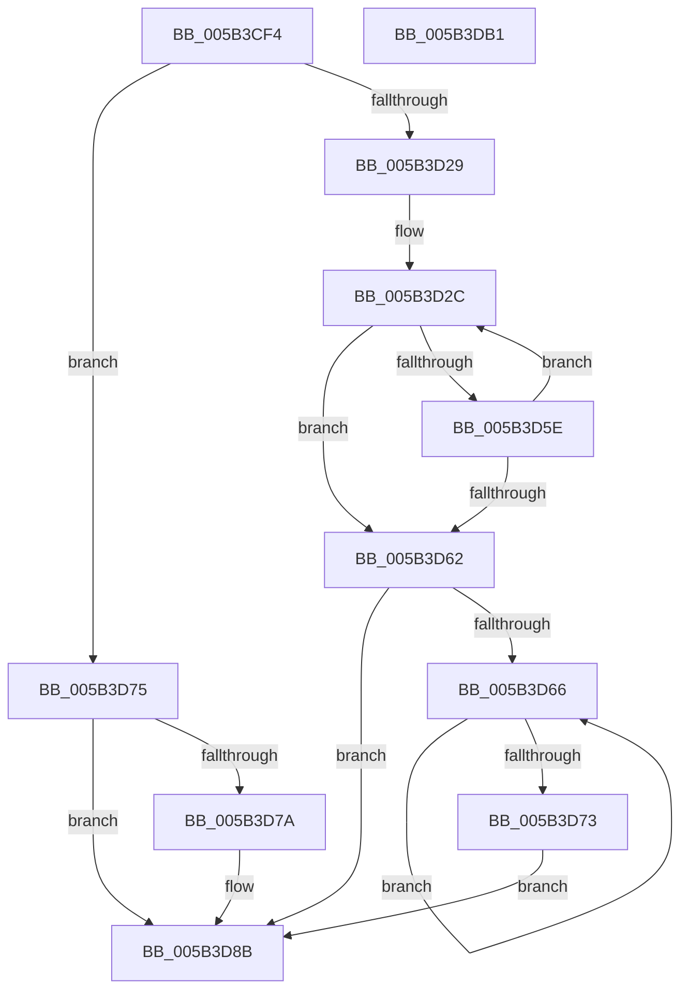

# KiBugCheckConvertProgressValueToUnicodeString

- RVA: `0x005B3CF4`–`0x005B3DB2` (길이 `190` bytes)
- VA: `0x00000001405B3CF4`
- 실행 섹션: `.text`
- PDB 이름 있음: `예`; PDB Function 태그: `아니요`
- unwind 정보 RVA: `0x000A5A38`
- 디코드: `57`개 명령, `190/190` bytes 표시
- 미해석 바이트: `0` (있으면 어셈블리에 `.byte`로 보존)

> 이 문서는 커널 이미지의 기계어와 PDB 기호를 분석해 생성했습니다. 4번과 5번은 함수 원형과 자료형을 바이너리 사용 방식에서 추정한 C 해석이며 원본 소스 복구 결과는 아닙니다.

## 1. Dependencies

- 직접 호출 지점: **0**; 고유 호출 대상: **0**
- 직접 호출자로 확인된 함수: **1**
- RIP 상대 이미지 참조: **0**

### Outgoing calls
- 직접 디코드된 call 명령이 없습니다.

### Direct callers
- [KiBugCheckProgress](KiBugCheckProgress_function_005B3E90.md) at `0x005B3F7F`

### Static image references
- 디코드된 RIP-relative 메모리 참조가 없습니다.

## 2. Other-region calls and transfers

- 다른 실행 섹션으로 향하는 call: **0**
- 별도 외부 분기/꼬리 이동을 확인하지 못했습니다.

## 3. Assembly (complete function range)

```asm
005B3CF4  48 8B C4                        mov rax, rsp
005B3CF7  48 89 58 08                     mov qword ptr [rax + 8], rbx
005B3CFB  48 89 68 10                     mov qword ptr [rax + 0x10], rbp
005B3CFF  48 89 70 18                     mov qword ptr [rax + 0x18], rsi
005B3D03  48 89 78 20                     mov qword ptr [rax + 0x20], rdi
005B3D07  44 0F B7 4A 02                  movzx r9d, word ptr [rdx + 2]
005B3D0C  45 33 C0                        xor r8d, r8d
005B3D0F  48 8B 72 08                     mov rsi, qword ptr [rdx + 8]
005B3D13  4C 8B D2                        mov r10, rdx
005B3D16  41 D1 E9                        shr r9d, 1
005B3D19  44 8B D9                        mov r11d, ecx
005B3D1C  41 FF C9                        dec r9d
005B3D1F  BD 02 00 00 00                  mov ebp, 2
005B3D24  83 F9 64                        cmp ecx, 0x64
005B3D27  77 4C                           ja 0x1405b3d75
005B3D29  41 8B F9                        mov edi, r9d
005B3D2C  FF CF                           dec edi
005B3D2E  B8 CD CC CC CC                  mov eax, 0xcccccccd
005B3D33  41 F7 E3                        mul r11d
005B3D36  48 8D 1C 7E                     lea rbx, [rsi + rdi*2]
005B3D3A  C1 EA 03                        shr edx, 3
005B3D3D  0F B7 C2                        movzx eax, dx
005B3D40  66 C1 E0 02                     shl ax, 2
005B3D44  8D 0C 10                        lea ecx, [rax + rdx]
005B3D47  66 03 C9                        add cx, cx
005B3D4A  66 44 2B D9                     sub r11w, cx
005B3D4E  66 41 83 C3 30                  add r11w, 0x30
005B3D53  66 44 89 1B                     mov word ptr [rbx], r11w
005B3D57  44 8B DA                        mov r11d, edx
005B3D5A  85 D2                           test edx, edx
005B3D5C  74 04                           je 0x1405b3d62
005B3D5E  85 FF                           test edi, edi
005B3D60  75 CA                           jne 0x1405b3d2c
005B3D62  85 FF                           test edi, edi
005B3D64  74 25                           je 0x1405b3d8b
005B3D66  48 2B DD                        sub rbx, rbp
005B3D69  66 C7 03 20 00                  mov word ptr [rbx], 0x20
005B3D6E  83 C7 FF                        add edi, -1
005B3D71  75 F3                           jne 0x1405b3d66
005B3D73  EB 16                           jmp 0x1405b3d8b
005B3D75  45 85 C9                        test r9d, r9d
005B3D78  74 11                           je 0x1405b3d8b
005B3D7A  B8 2D 00 00 00                  mov eax, 0x2d
005B3D7F  41 8B C9                        mov ecx, r9d
005B3D82  0F B7 C0                        movzx eax, ax
005B3D85  48 8B FE                        mov rdi, rsi
005B3D88  66 F3 AB                        rep stosw word ptr [rdi], ax
005B3D8B  48 8B 5C 24 08                  mov rbx, qword ptr [rsp + 8]
005B3D90  48 8B 7C 24 20                  mov rdi, qword ptr [rsp + 0x20]
005B3D95  66 46 89 04 4E                  mov word ptr [rsi + r9*2], r8w
005B3D9A  41 0F B7 42 02                  movzx eax, word ptr [r10 + 2]
005B3D9F  48 8B 74 24 18                  mov rsi, qword ptr [rsp + 0x18]
005B3DA4  66 2B C5                        sub ax, bp
005B3DA7  48 8B 6C 24 10                  mov rbp, qword ptr [rsp + 0x10]
005B3DAC  66 41 89 02                     mov word ptr [r10], ax
005B3DB0  C3                              ret
005B3DB1  CC                              int3
```

## 4. C-style interpretation (structured pseudocode)

```c
__int64 __fastcall KiBugCheckConvertProgressValueToUnicodeString(int a1, __int64 a2, int a3)
{
    __int64 result;
    __int64 v_r11;
    __int64 v_rbx;
    __int64 v_rdi;
    unsigned __int64 v_stack_p10;
    unsigned __int64 v_stack_p18;
    unsigned __int64 v_stack_p20;
    unsigned __int64 v_stack_p8;

    *(unsigned __int64 *)(v_rsp + 8) = v_rbx;
    *(unsigned __int64 *)(v_rsp + 16) = v_rbp;
    *(unsigned __int64 *)(v_rsp + 24) = v_rsi;
    *(unsigned __int64 *)(v_rsp + 32) = v_rdi;
    a3 = 0;
    a4 = (unsigned int)((*(unsigned __int16 *)(a2 + 2)) >> (1));
    a4 = (unsigned int)((a4) - 1);
    if (a1 > 100) goto loc_005B3D75;
loc_005B3D2C:
    v_rdi = (unsigned int)(((unsigned int)((unsigned int)(a4))) - 1);
    a2 = (unsigned int)((a2) >> (3));
    result = (unsigned __int16)(((unsigned __int16)(a2)) << (2));
    a1 = (unsigned __int16)((result + a2 * 1) + ((unsigned __int16)(result + a2 * 1)));
    v_r11 = (unsigned __int16)(((unsigned int)(a1)) - ((unsigned __int16)(a1)));
    v_r11 = (unsigned __int16)((v_r11) + (48));
    *(unsigned __int16 *)(*(unsigned __int64 *)(a2 + 8) + v_rdi * 2) = (unsigned __int16)(v_r11);
    if ((unsigned int)(a2) == 0) goto loc_005B3D62;
    if ((unsigned int)(v_rdi) != 0) goto loc_005B3D2C;
loc_005B3D62:
    if ((unsigned int)(v_rdi) == 0) goto loc_005B3D8B;
loc_005B3D66:
    v_rbx = (*(unsigned __int64 *)(a2 + 8) + v_rdi * 2) - (2);
    *(unsigned __int16 *)(v_rbx) = 32;
    v_rdi = (unsigned int)((v_rdi) + (-1));
    if (condition_is_not_equal) goto loc_005B3D66;
    goto loc_005B3D8B;
loc_005B3D75:
    if ((unsigned int)(a4) != 0) {
        result = 45;
        a1 = (unsigned int)(a4);
        result = (unsigned __int16)(result);
        v_rdi = *(unsigned __int64 *)(a2 + 8);
    }
    *(unsigned __int16 *)(*(unsigned __int64 *)(a2 + 8) + a4 * 2) = 0;
    result = (unsigned __int16)((*(unsigned __int16 *)(a2 + 2)) - (2));
    *(unsigned __int16 *)(a2) = (unsigned __int16)(result);
    return result;
}
```

## 5. (Beta) C Style

```c
int64_t KiBugCheckConvertProgressValueToUnicodeString(int32_t Arg1, void *Arg2, int32_t Arg3)
{
    uint8_t *arg2 = (uint8_t *)Arg2;

    int64_t result;
    int64_t local_r11;
    int64_t local_rbx;
    int64_t local_rdi;
    uint64_t v_stack_p10;
    uint64_t v_stack_p18;
    uint64_t v_stack_p20;
    uint64_t v_stack_p8;

    *(uint64_t *)(local_rsp + 0x8) = local_rbx;
    *(uint64_t *)(local_rsp + 0x10) = local_rbp;
    *(uint64_t *)(local_rsp + 0x18) = local_rsi;
    *(uint64_t *)(local_rsp + 0x20) = local_rdi;
    Arg3 = 0;
    a4 = (uint32_t)((*(uint16_t *)(arg2 + 0x2)) >> (1));
    a4 = (uint32_t)((a4) - 1);
    if (Arg1 > 100) goto loc_005B3D75;
loc_005B3D2C:
    local_rdi = (uint32_t)(((uint32_t)((uint32_t)(a4))) - 1);
    Arg2 = (uint32_t)((Arg2) >> (3));
    result = (uint16_t)(((uint16_t)(Arg2)) << (2));
    Arg1 = (uint16_t)((result + Arg2 * 1) + ((uint16_t)(result + Arg2 * 1)));
    local_r11 = (uint16_t)(((uint32_t)(Arg1)) - ((uint16_t)(Arg1)));
    local_r11 = (uint16_t)((local_r11) + (48));
    *(uint16_t *)(*(uint64_t *)(arg2 + 0x8) + local_rdi * 2) = (uint16_t)(local_r11);
    if ((uint32_t)(Arg2) == 0) goto loc_005B3D62;
    if ((uint32_t)(local_rdi) != 0) goto loc_005B3D2C;
loc_005B3D62:
    if ((uint32_t)(local_rdi) == 0) goto loc_005B3D8B;
loc_005B3D66:
    local_rbx = (*(uint64_t *)(arg2 + 0x8) + local_rdi * 2) - (2);
    *(uint16_t *)(local_rbx) = 32;
    local_rdi = (uint32_t)((local_rdi) + (-1));
    if (condition_is_not_equal) goto loc_005B3D66;
    goto loc_005B3D8B;
loc_005B3D75:
    if ((uint32_t)(a4) != 0) {
        result = 45;
        Arg1 = (uint32_t)(a4);
        result = (uint16_t)(result);
        local_rdi = *(uint64_t *)(arg2 + 0x8);
    }
    *(uint16_t *)(*(uint64_t *)(arg2 + 0x8) + a4 * 2) = 0;
    result = (uint16_t)((*(uint16_t *)(arg2 + 0x2)) - (2));
    *(uint16_t *)(arg2) = (uint16_t)(result);
    return result;
}
```

### 관측된 메모리 오프셋

구조체 형식이 확인되지 않은 접근은 인자 기준의 오프셋으로만 기록했습니다.

| 기준 인자 | 오프셋 표현 | 폭 (bit) | 접근 |
|---|---:|---:|---|
| `Arg2` | `+ 0x0` | `16` | `W` |
| `Arg2` | `+ 0x2` | `16` | `R` |
| `Arg2` | `+ 0x8` | `64` | `R` |

## 6. Execution-region graph

[열기: 2D/3D 그래프와 함수 탐색 컨트롤 패널](../../../control-panel.html?section=text&rva=0x005B3CF4&view=graph)

- 2D 그래프는 위에서 아래로 흐르고, 3D 그래프는 빈 공간을 드래그해 회전합니다. Shift+드래그는 이동, 휠은 확대·축소, 함수 노드 선택은 대상 보고서 이동입니다.

### Static fallback


