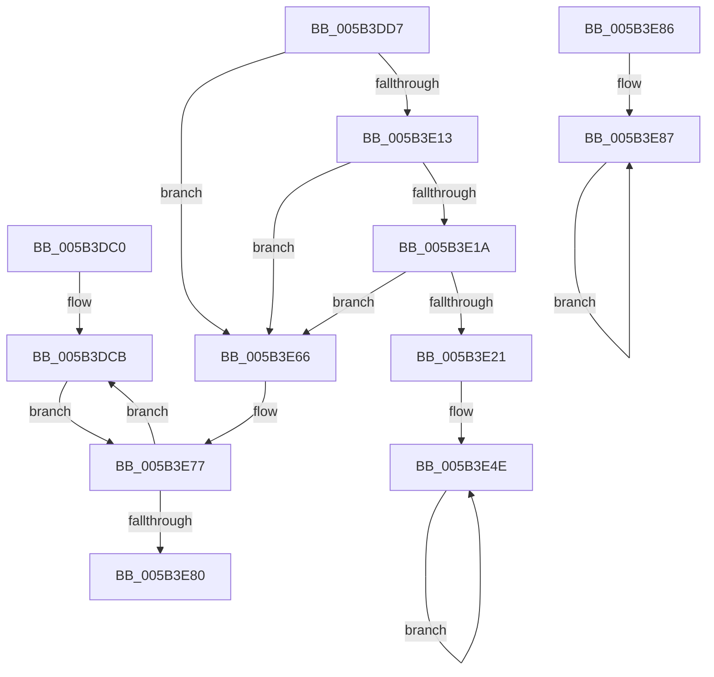

# KiBugCheckDebugBreak

- RVA: `0x005B3DC0`–`0x005B3E89` (길이 `201` bytes)
- VA: `0x00000001405B3DC0`
- 실행 섹션: `.text`
- PDB 이름 있음: `예`; PDB Function 태그: `아니요`
- unwind 정보 RVA: `0x000C9CC4`
- 디코드: `53`개 명령, `201/201` bytes 표시
- 미해석 바이트: `0` (있으면 어셈블리에 `.byte`로 보존)

> 이 문서는 커널 이미지의 기계어와 PDB 기호를 분석해 생성했습니다. 4번과 5번은 함수 원형과 자료형을 바이너리 사용 방식에서 추정한 C 해석이며 원본 소스 복구 결과는 아닙니다.

## 1. Dependencies

- 직접 호출 지점: **6**; 고유 호출 대상: **4**
- 직접 호출자로 확인된 함수: **3**
- RIP 상대 이미지 참조: **3**

### Outgoing calls
- `0x005B3DCD` → [DbgBreakPointWithStatus](../4F/DbgBreakPointWithStatus_function_004FE4E0.md) (function, `0x004FE4E0`)
- `0x005B3E0A` → [HeadlessDispatch](../65/HeadlessDispatch_function_00655C40.md) (function, `0x00655C40`)
- `0x005B3E38` → [HeadlessDispatch](../65/HeadlessDispatch_function_00655C40.md) (function, `0x00655C40`)
- `0x005B3E49` → [KiHeadlessDisplayString](KiHeadlessDisplayString_function_005B4F54.md) (function, `0x005B4F54`)
- `0x005B3E5F` → [HeadlessDispatch](../65/HeadlessDispatch_function_00655C40.md) (function, `0x00655C40`)
- `0x005B3E6D` → [guard_dispatch_icall](../6B/guard_dispatch_icall_function_006BAAD0.md) (function, `0x006BAAD0`)

### Direct callers
- [KeBugCheck2](KeBugCheck2_function_005B27D0.md) at `0x005B32F9`
- [KeBugCheck2](KeBugCheck2_function_005B27D0.md) at `0x005B3481`
- [KeBugCheck2](KeBugCheck2_function_005B27D0.md) at `0x005B37A8`
- [KeEnterKernelDebugger](KeEnterKernelDebugger_function_005B3880.md) at `0x005B38D7`
- [KiAttemptBugcheckRecovery](../5C/KiAttemptBugcheckRecovery_function_005C6D24.md) at `0x005C6F67`

### Static image references
- `0x005B3E2E` → RVA `0x006CB4D0` (` ?? ::FNODOBFM::`string'`; read)
- `0x005B3E42` → RVA `0x006CB530` (` ?? ::FNODOBFM::`string'`; read)
- `0x005B3E66` → RVA `0x00E00838` (`.data`; read)

## 2. Other-region calls and transfers

- 다른 실행 섹션으로 향하는 call: **0**
- 별도 외부 분기/꼬리 이동을 확인하지 못했습니다.

## 3. Assembly (complete function range)

```asm
005B3DC0  89 4C 24 08                     mov dword ptr [rsp + 8], ecx
005B3DC4  53                              push rbx
005B3DC5  48 83 EC 50                     sub rsp, 0x50
005B3DC9  8B D9                           mov ebx, ecx
005B3DCB  8B CB                           mov ecx, ebx
005B3DCD  E8 0E A7 F4 FF                  call 0x1404fe4e0
005B3DD2  E9 A0 00 00 00                  jmp 0x1405b3e77
005B3DD7  33 C0                           xor eax, eax
005B3DD9  0F 57 C0                        xorps xmm0, xmm0
005B3DDC  0F 11 44 24 30                  movups xmmword ptr [rsp + 0x30], xmm0
005B3DE1  48 89 44 24 40                  mov qword ptr [rsp + 0x40], rax
005B3DE6  89 44 24 48                     mov dword ptr [rsp + 0x48], eax
005B3DEA  48 C7 44 24 68 20 00 00 00      mov qword ptr [rsp + 0x68], 0x20
005B3DF3  48 8D 44 24 68                  lea rax, [rsp + 0x68]
005B3DF8  48 89 44 24 20                  mov qword ptr [rsp + 0x20], rax
005B3DFD  4C 8D 4C 24 30                  lea r9, [rsp + 0x30]
005B3E02  45 33 C0                        xor r8d, r8d
005B3E05  33 D2                           xor edx, edx
005B3E07  8D 4A 10                        lea ecx, [rdx + 0x10]
005B3E0A  E8 31 1E 0A 00                  call 0x140655c40
005B3E0F  85 C0                           test eax, eax
005B3E11  78 53                           js 0x1405b3e66
005B3E13  83 7C 24 30 01                  cmp dword ptr [rsp + 0x30], 1
005B3E18  75 4C                           jne 0x1405b3e66
005B3E1A  80 7C 24 38 00                  cmp byte ptr [rsp + 0x38], 0
005B3E1F  74 45                           je 0x1405b3e66
005B3E21  48 83 64 24 20 00               and qword ptr [rsp + 0x20], 0
005B3E27  45 33 C9                        xor r9d, r9d
005B3E2A  45 8D 41 03                     lea r8d, [r9 + 3]
005B3E2E  48 8D 15 9B 76 11 00            lea rdx, [rip + 0x11769b]
005B3E35  41 8B C8                        mov ecx, r8d
005B3E38  E8 03 1E 0A 00                  call 0x140655c40
005B3E3D  BA 0C 00 00 00                  mov edx, 0xc
005B3E42  48 8D 0D E7 76 11 00            lea rcx, [rip + 0x1176e7]
005B3E49  E8 06 11 00 00                  call 0x1405b4f54
005B3E4E  48 83 64 24 20 00               and qword ptr [rsp + 0x20], 0
005B3E54  45 33 C9                        xor r9d, r9d
005B3E57  45 33 C0                        xor r8d, r8d
005B3E5A  33 D2                           xor edx, edx
005B3E5C  8D 4A 0F                        lea ecx, [rdx + 0xf]
005B3E5F  E8 DC 1D 0A 00                  call 0x140655c40
005B3E64  EB E8                           jmp 0x1405b3e4e
005B3E66  48 8B 05 CB C9 84 00            mov rax, qword ptr [rip + 0x84c9cb]
005B3E6D  E8 5E 6C 10 00                  call 0x1406baad0
005B3E72  90                              nop
005B3E73  8B 5C 24 60                     mov ebx, dword ptr [rsp + 0x60]
005B3E77  83 FB 03                        cmp ebx, 3
005B3E7A  0F 85 4B FF FF FF               jne 0x1405b3dcb
005B3E80  48 83 C4 50                     add rsp, 0x50
005B3E84  5B                              pop rbx
005B3E85  C3                              ret
005B3E86  CC                              int3
005B3E87  EB FE                           jmp 0x1405b3e87
```

## 4. C-style interpretation (structured pseudocode)

```c
__int64 __fastcall KiBugCheckDebugBreak(int a1, int a2, int a3)
{
    __int64 result;
    __int64 v_rsp;
    unsigned int v_stack_m10;
    unsigned __int64 v_stack_m18;
    unsigned __int8 v_stack_m20;
    unsigned __int64 v_stack_m28;
    unsigned __int64 v_stack_m38;
    unsigned __int64 v_stack_p10;
    unsigned int v_stack_p8;

    v_stack_p8 = a1;
    v_rsp = (v_rsp) - (80);
loc_005B3DCB:
    result = DbgBreakPointWithStatus((unsigned int)((unsigned int)((unsigned int)(a1))), a2, a3, a4);
    goto loc_005B3E77;
loc_005B3E77:
    if (((unsigned int)((unsigned int)(a1))) != 3) goto loc_005B3DCB;
    v_rsp = (v_rsp) + (80);
    return result;
}
```

## 5. (Beta) C Style

```c
int64_t KiBugCheckDebugBreak(int32_t Arg1, int32_t Arg2, int32_t Arg3)
{
    int64_t result;
    int64_t local_rsp;
    uint32_t v_stack_m10;
    uint64_t v_stack_m18;
    uint8_t v_stack_m20;
    uint64_t v_stack_m28;
    uint64_t v_stack_m38;
    uint64_t v_stack_p10;
    uint32_t v_stack_p8;

    v_stack_p8 = Arg1;
    local_rsp = (local_rsp) - (80);
loc_005B3DCB:
    result = DbgBreakPointWithStatus((uint32_t)((uint32_t)((uint32_t)(Arg1))), Arg2, Arg3, a4);
    goto loc_005B3E77;
loc_005B3E77:
    if (((uint32_t)((uint32_t)(Arg1))) != 3) goto loc_005B3DCB;
    local_rsp = (local_rsp) + (80);
    return result;
}
```

## 6. Execution-region graph

[열기: 2D/3D 그래프와 함수 탐색 컨트롤 패널](../../../control-panel.html?section=text&rva=0x005B3DC0&view=graph)

- 2D 그래프는 위에서 아래로 흐르고, 3D 그래프는 빈 공간을 드래그해 회전합니다. Shift+드래그는 이동, 휠은 확대·축소, 함수 노드 선택은 대상 보고서 이동입니다.

### Static fallback


