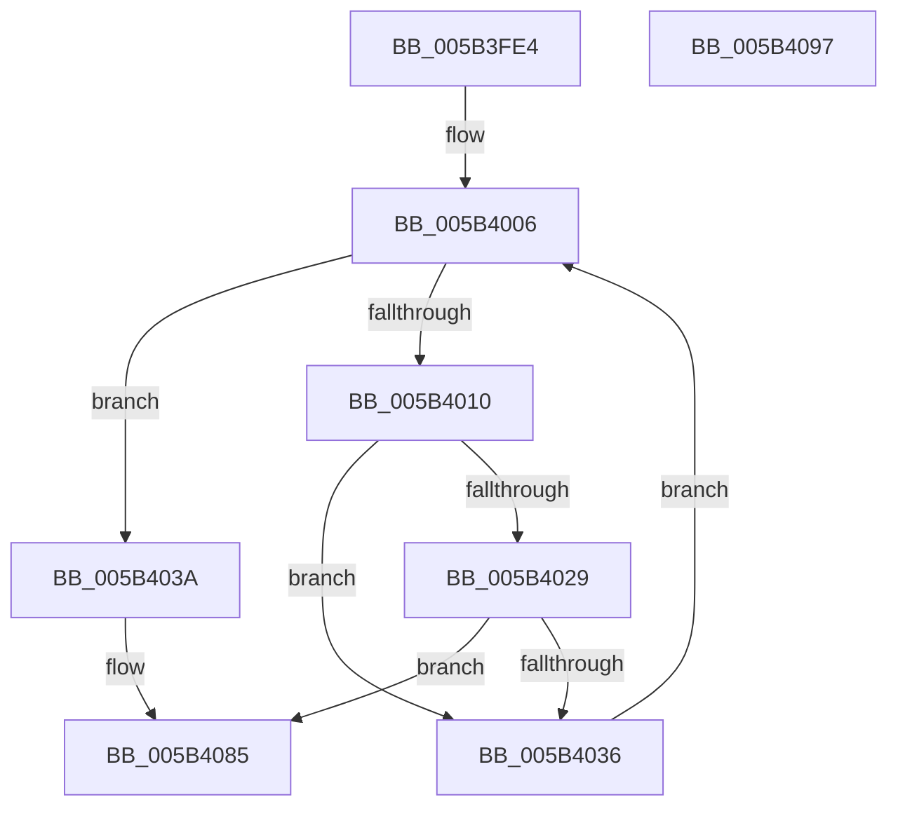

# KiBugCheckProgressCpusFrozen

- RVA: `0x005B3FE4`–`0x005B4098` (길이 `180` bytes)
- VA: `0x00000001405B3FE4`
- 실행 섹션: `.text`
- PDB 이름 있음: `예`; PDB Function 태그: `아니요`
- unwind 정보 RVA: `0x00060904`
- 디코드: `42`개 명령, `180/180` bytes 표시
- 미해석 바이트: `0` (있으면 어셈블리에 `.byte`로 보존)

> 이 문서는 커널 이미지의 기계어와 PDB 기호를 분석해 생성했습니다. 4번과 5번은 함수 원형과 자료형을 바이너리 사용 방식에서 추정한 C 해석이며 원본 소스 복구 결과는 아닙니다.

## 1. Dependencies

- 직접 호출 지점: **2**; 고유 호출 대상: **2**
- 직접 호출자로 확인된 함수: **1**
- RIP 상대 이미지 참조: **3**

### Outgoing calls
- `0x005B4080` → [WheaLogInternalEvent](../66/WheaLogInternalEvent_function_006605B0.md) (function, `0x006605B0`)
- `0x005B408D` → [_security_check_cookie](../6A/_security_check_cookie_function_006AC640.md) (function, `0x006AC640`)

### Direct callers
- [KeBugCheck2](KeBugCheck2_function_005B27D0.md) at `0x005B353F`

### Static image references
- `0x005B3FE8` → RVA `0x00E0A740` (`.data`; read)
- `0x005B4006` → RVA `0x00FC6A80` (`ALMOSTRO`; read)
- `0x005B4019` → RVA `0x00FC8C40` (`ALMOSTRO`; read)

## 2. Other-region calls and transfers

- 다른 실행 섹션으로 향하는 call: **0**
- 별도 외부 분기/꼬리 이동을 확인하지 못했습니다.

## 3. Assembly (complete function range)

```asm
005B3FE4  48 83 EC 58                     sub rsp, 0x58
005B3FE8  48 8B 05 51 67 85 00            mov rax, qword ptr [rip + 0x856751]
005B3FEF  48 33 C4                        xor rax, rsp
005B3FF2  48 89 44 24 40                  mov qword ptr [rsp + 0x40], rax
005B3FF7  0F 57 C0                        xorps xmm0, xmm0
005B3FFA  33 D2                           xor edx, edx
005B3FFC  0F 11 44 24 20                  movups xmmword ptr [rsp + 0x20], xmm0
005B4001  0F 11 44 24 30                  movups xmmword ptr [rsp + 0x30], xmm0
005B4006  8B 05 74 2A A1 00               mov eax, dword ptr [rip + 0xa12a74]
005B400C  3B D0                           cmp edx, eax
005B400E  73 2A                           jae 0x1405b403a
005B4010  65 48 8B 04 25 20 00 00 00      mov rax, qword ptr gs:[0x20]
005B4019  4C 8D 05 20 4C A1 00            lea r8, [rip + 0xa14c20]
005B4020  4D 8B 04 D0                     mov r8, qword ptr [r8 + rdx*8]
005B4024  4C 3B C0                        cmp r8, rax
005B4027  74 0D                           je 0x1405b4036
005B4029  41 8B 80 88 2D 00 00            mov eax, dword ptr [r8 + 0x2d88]
005B4030  24 0F                           and al, 0xf
005B4032  3C 02                           cmp al, 2
005B4034  75 4F                           jne 0x1405b4085
005B4036  FF C2                           inc edx
005B4038  EB CC                           jmp 0x1405b4006
005B403A  83 64 24 2C 00                  and dword ptr [rsp + 0x2c], 0
005B403F  F6 D9                           neg cl
005B4041  C7 44 24 20 57 68 4C 67         mov dword ptr [rsp + 0x20], 0x674c6857
005B4049  48 8D 4C 24 20                  lea rcx, [rsp + 0x20]
005B404E  C7 44 24 24 01 00 00 00         mov dword ptr [rsp + 0x24], 1
005B4056  1B C0                           sbb eax, eax
005B4058  C7 44 24 28 20 00 00 00         mov dword ptr [rsp + 0x28], 0x20
005B4060  83 64 24 3C 00                  and dword ptr [rsp + 0x3c], 0
005B4065  F7 D8                           neg eax
005B4067  05 60 00 00 80                  add eax, 0x80000060
005B406C  C7 44 24 34 60 00 00 80         mov dword ptr [rsp + 0x34], 0x80000060
005B4074  89 44 24 30                     mov dword ptr [rsp + 0x30], eax
005B4078  C7 44 24 38 18 00 00 00         mov dword ptr [rsp + 0x38], 0x18
005B4080  E8 2B C5 0A 00                  call 0x1406605b0
005B4085  48 8B 4C 24 40                  mov rcx, qword ptr [rsp + 0x40]
005B408A  48 33 CC                        xor rcx, rsp
005B408D  E8 AE 85 0F 00                  call 0x1406ac640
005B4092  48 83 C4 58                     add rsp, 0x58
005B4096  C3                              ret
005B4097  CC                              int3
```

## 4. C-style interpretation (structured pseudocode)

```c
__int64 __fastcall KiBugCheckProgressCpusFrozen(unsigned __int8 a1, int a2)
{
    __int64 result;
    __int64 v_rsp;
    unsigned __int64 v_stack_m18;
    unsigned int v_stack_m1C;
    unsigned int v_stack_m20;
    unsigned int v_stack_m24;
    unsigned __int64 v_stack_m28;
    unsigned int v_stack_m2C;
    unsigned int v_stack_m30;
    unsigned int v_stack_m34;
    unsigned __int64 v_stack_m38;

    v_rsp = (v_rsp) - (88);
    result = (*(unsigned __int64 *)(v_rip + 8742737)) ^ (v_rsp);
    v_stack_m18 = result;
    a2 = 0;
    v_stack_m38 = v_xmm0;
    v_stack_m28 = v_xmm0;
loc_005B4006:
    if (0 >= ((unsigned int)((unsigned int)(*(unsigned int *)(v_rip + 10562164))))) goto loc_005B403A;
    if ((*(unsigned __int64 *)(v_rip + 10570784 + a2 * 8)) == (*(unsigned __int64 *)(gs_base + (0 + 32)))) goto loc_005B4036;
    result = (unsigned __int8)(((unsigned int)(*(unsigned int *)(*(unsigned __int64 *)(v_rip + 10570784 + a2 * 8) + 11656))) & (15));
    if (((unsigned __int8)(result)) != 2) goto loc_005B4085;
loc_005B4036:
    a2 = (unsigned int)((a2) + 1);
    goto loc_005B4006;
loc_005B403A:
    a1 = (unsigned __int8)(-(a1));
    v_stack_m38 = 0x674C6857ULL;
    v_stack_m34 = 1;
    v_stack_m30 = 32;
    result = (unsigned int)(-(result));
    result = (unsigned int)((result) + (0x80000060ULL));
    v_stack_m24 = 0x80000060ULL;
    v_stack_m28 = (unsigned int)(result);
    v_stack_m20 = 24;
    result = WheaLogInternalEvent(v_stack_m38, a2, *(unsigned __int64 *)(v_rip + 10570784 + a2 * 8), a4);
loc_005B4085:
    a1 = (v_stack_m18) ^ (v_rsp);
    result = _security_check_cookie(a1, a2, *(unsigned __int64 *)(v_rip + 10570784 + a2 * 8), a4);
    v_rsp = (v_rsp) + (88);
    return result;
}
```

## 5. (Beta) C Style

```c
int64_t KiBugCheckProgressCpusFrozen(uint8_t Arg1, int32_t Arg2)
{
    int64_t result;
    int64_t local_rsp;
    uint64_t v_stack_m18;
    uint32_t v_stack_m1C;
    uint32_t v_stack_m20;
    uint32_t v_stack_m24;
    uint64_t v_stack_m28;
    uint32_t v_stack_m2C;
    uint32_t v_stack_m30;
    uint32_t v_stack_m34;
    uint64_t v_stack_m38;

    local_rsp = (local_rsp) - (88);
    result = (*(uint64_t *)(v_rip + 0x856751)) ^ (local_rsp);
    v_stack_m18 = result;
    Arg2 = 0;
    v_stack_m38 = v_xmm0;
    v_stack_m28 = v_xmm0;
loc_005B4006:
    if (0 >= ((uint32_t)((uint32_t)(*(uint32_t *)(v_rip + 0xA12A74))))) goto loc_005B403A;
    if ((*(uint64_t *)(v_rip + 0xA14C20 + Arg2 * 8)) == (*(uint64_t *)(gs_base + (0 + 0x20)))) goto loc_005B4036;
    result = (uint8_t)(((uint32_t)(*(uint32_t *)(*(uint64_t *)(v_rip + 0xA14C20 + Arg2 * 8) + 0x2D88))) & (15));
    if (((uint8_t)(result)) != 2) goto loc_005B4085;
loc_005B4036:
    Arg2 = (uint32_t)((Arg2) + 1);
    goto loc_005B4006;
loc_005B403A:
    Arg1 = (uint8_t)(-(Arg1));
    v_stack_m38 = 0x674C6857ULL;
    v_stack_m34 = 1;
    v_stack_m30 = 32;
    result = (uint32_t)(-(result));
    result = (uint32_t)((result) + (0x80000060ULL));
    v_stack_m24 = 0x80000060ULL;
    v_stack_m28 = (uint32_t)(result);
    v_stack_m20 = 24;
    result = WheaLogInternalEvent(v_stack_m38, Arg2, *(uint64_t *)(v_rip + 0xA14C20 + Arg2 * 8), a4);
loc_005B4085:
    Arg1 = (v_stack_m18) ^ (local_rsp);
    result = _security_check_cookie(Arg1, Arg2, *(uint64_t *)(v_rip + 0xA14C20 + Arg2 * 8), a4);
    local_rsp = (local_rsp) + (88);
    return result;
}
```

## 6. Execution-region graph

[열기: 2D/3D 그래프와 함수 탐색 컨트롤 패널](../../../control-panel.html?section=text&rva=0x005B3FE4&view=graph)

- 2D 그래프는 위에서 아래로 흐르고, 3D 그래프는 빈 공간을 드래그해 회전합니다. Shift+드래그는 이동, 휠은 확대·축소, 함수 노드 선택은 대상 보고서 이동입니다.

### Static fallback


