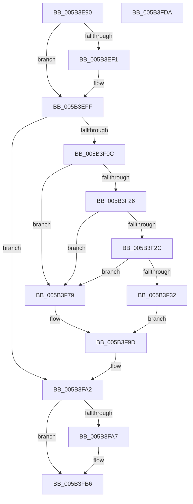

# KiBugCheckProgress

- RVA: `0x005B3E90`–`0x005B3FDB` (길이 `331` bytes)
- VA: `0x00000001405B3E90`
- 실행 섹션: `.text`
- PDB 이름 있음: `예`; PDB Function 태그: `아니요`
- unwind 정보 RVA: `0x000C9C84`
- 디코드: `85`개 명령, `331/331` bytes 표시
- 미해석 바이트: `0` (있으면 어셈블리에 `.byte`로 보존)

> 이 문서는 커널 이미지의 기계어와 PDB 기호를 분석해 생성했습니다. 4번과 5번은 함수 원형과 자료형을 바이너리 사용 방식에서 추정한 C 해석이며 원본 소스 복구 결과는 아닙니다.

## 1. Dependencies

- 직접 호출 지점: **13**; 고유 호출 대상: **6**
- 직접 호출자로 확인된 함수: **0**
- RIP 상대 이미지 참조: **7**

### Outgoing calls
- `0x005B3EE2` → [BgpFwAcquireLock](../4B/BgpFwAcquireLock_function_004B3AA4.md) (function, `0x004B3AA4`)
- `0x005B3EFA` → [BgpFwDisplayBugCheckProgressUpdate](../6A/BgpFwDisplayBugCheckProgressUpdate_function_006A0E1C.md) (function, `0x006A0E1C`)
- `0x005B3EFF` → [BgpFwReleaseLock](../4B/BgpFwReleaseLock_function_004B357C.md) (function, `0x004B357C`)
- `0x005B3F18` → [KiHeadlessDisplayString](KiHeadlessDisplayString_function_005B4F54.md) (function, `0x005B4F54`)
- `0x005B3F39` → [KiHeadlessDisplayString](KiHeadlessDisplayString_function_005B4F54.md) (function, `0x005B4F54`)
- `0x005B3F4A` → [KiHeadlessDisplayString](KiHeadlessDisplayString_function_005B4F54.md) (function, `0x005B4F54`)
- `0x005B3F5A` → [KiHeadlessDisplayString](KiHeadlessDisplayString_function_005B4F54.md) (function, `0x005B4F54`)
- `0x005B3F67` → [KiHeadlessDisplayString](KiHeadlessDisplayString_function_005B4F54.md) (function, `0x005B4F54`)
- `0x005B3F7F` → [KiBugCheckConvertProgressValueToUnicodeString](KiBugCheckConvertProgressValueToUnicodeString_function_005B3CF4.md) (function, `0x005B3CF4`)
- `0x005B3F8C` → [KiHeadlessDisplayString](KiHeadlessDisplayString_function_005B4F54.md) (function, `0x005B4F54`)
- `0x005B3F9D` → [KiHeadlessDisplayString](KiHeadlessDisplayString_function_005B4F54.md) (function, `0x005B4F54`)
- `0x005B3FB1` → [KiHeadlessDisplayString](KiHeadlessDisplayString_function_005B4F54.md) (function, `0x005B4F54`)
- `0x005B3FBF` → [_security_check_cookie](../6A/_security_check_cookie_function_006AC640.md) (function, `0x006AC640`)

### Direct callers
- 이 함수 시작 RVA로 연결되는 직접 call은 확인되지 않았습니다. 간접 호출은 완전히 역산할 수 없습니다.

### Static image references
- `0x005B3EA7` → RVA `0x00E0A740` (`.data`; read)
- `0x005B3EBA` → RVA `0x00E660B8` (`.data`; read)
- `0x005B3EE7` → RVA `0x00EF0450` (`.data`; read)
- `0x005B3F11` → RVA `0x006CB4F0` (` ?? ::FNODOBFM::`string'`; read)
- `0x005B3F43` → RVA `0x006CB4E0` (` ?? ::FNODOBFM::`string'`; read)
- `0x005B3F96` → RVA `0x006CB510` (` ?? ::FNODOBFM::`string'`; read)
- `0x005B3FAA` → RVA `0x006CB500` (` ?? ::FNODOBFM::`string'`; read)

## 2. Other-region calls and transfers

- 다른 실행 섹션으로 향하는 call: **0**
- 별도 외부 분기/꼬리 이동을 확인하지 못했습니다.

## 3. Assembly (complete function range)

```asm
005B3E90  48 89 5C 24 10                  mov qword ptr [rsp + 0x10], rbx
005B3E95  48 89 74 24 18                  mov qword ptr [rsp + 0x18], rsi
005B3E9A  48 89 7C 24 20                  mov qword ptr [rsp + 0x20], rdi
005B3E9F  55                              push rbp
005B3EA0  48 8B EC                        mov rbp, rsp
005B3EA3  48 83 EC 60                     sub rsp, 0x60
005B3EA7  48 8B 05 92 68 85 00            mov rax, qword ptr [rip + 0x856892]
005B3EAE  48 33 C4                        xor rax, rsp
005B3EB1  48 89 45 F0                     mov qword ptr [rbp - 0x10], rax
005B3EB5  33 F6                           xor esi, esi
005B3EB7  0F 57 C0                        xorps xmm0, xmm0
005B3EBA  39 35 F8 21 8B 00               cmp dword ptr [rip + 0x8b21f8], esi
005B3EC0  8B D9                           mov ebx, ecx
005B3EC2  0F 11 45 D8                     movups xmmword ptr [rbp - 0x28], xmm0
005B3EC6  48 89 75 D0                     mov qword ptr [rbp - 0x30], rsi
005B3ECA  40 0F 95 C7                     setne dil
005B3ECE  8D 46 08                        lea eax, [rsi + 8]
005B3ED1  66 89 45 DA                     mov word ptr [rbp - 0x26], ax
005B3ED5  48 8D 45 E8                     lea rax, [rbp - 0x18]
005B3ED9  48 89 45 E0                     mov qword ptr [rbp - 0x20], rax
005B3EDD  F3 0F 7F 45 C0                  movdqu xmmword ptr [rbp - 0x40], xmm0
005B3EE2  E8 BD FB EF FF                  call 0x1404b3aa4
005B3EE7  8B 05 63 C5 93 00               mov eax, dword ptr [rip + 0x93c563]
005B3EED  A8 02                           test al, 2
005B3EEF  74 0E                           je 0x1405b3eff
005B3EF1  44 8A C7                        mov r8b, dil
005B3EF4  48 8D 55 C0                     lea rdx, [rbp - 0x40]
005B3EF8  8B CB                           mov ecx, ebx
005B3EFA  E8 1D CF 0E 00                  call 0x1406a0e1c
005B3EFF  E8 78 F6 EF FF                  call 0x1404b357c
005B3F04  85 DB                           test ebx, ebx
005B3F06  0F 84 96 00 00 00               je 0x1405b3fa2
005B3F0C  BA 0E 00 00 00                  mov edx, 0xe
005B3F11  48 8D 0D D8 75 11 00            lea rcx, [rip + 0x1175d8]
005B3F18  E8 37 10 00 00                  call 0x1405b4f54
005B3F1D  48 8B 4D C0                     mov rcx, qword ptr [rbp - 0x40]
005B3F21  48 85 C9                        test rcx, rcx
005B3F24  74 53                           je 0x1405b3f79
005B3F26  48 39 75 C8                     cmp qword ptr [rbp - 0x38], rsi
005B3F2A  74 4D                           je 0x1405b3f79
005B3F2C  48 39 75 D0                     cmp qword ptr [rbp - 0x30], rsi
005B3F30  74 47                           je 0x1405b3f79
005B3F32  0F B7 11                        movzx edx, word ptr [rcx]
005B3F35  48 8B 49 08                     mov rcx, qword ptr [rcx + 8]
005B3F39  E8 16 10 00 00                  call 0x1405b4f54
005B3F3E  BA 04 00 00 00                  mov edx, 4
005B3F43  48 8D 0D 96 75 11 00            lea rcx, [rip + 0x117596]
005B3F4A  E8 05 10 00 00                  call 0x1405b4f54
005B3F4F  48 8B 4D C8                     mov rcx, qword ptr [rbp - 0x38]
005B3F53  0F B7 11                        movzx edx, word ptr [rcx]
005B3F56  48 8B 49 08                     mov rcx, qword ptr [rcx + 8]
005B3F5A  E8 F5 0F 00 00                  call 0x1405b4f54
005B3F5F  0F B7 55 D8                     movzx edx, word ptr [rbp - 0x28]
005B3F63  48 8B 4D E0                     mov rcx, qword ptr [rbp - 0x20]
005B3F67  E8 E8 0F 00 00                  call 0x1405b4f54
005B3F6C  48 8B 4D D0                     mov rcx, qword ptr [rbp - 0x30]
005B3F70  0F B7 11                        movzx edx, word ptr [rcx]
005B3F73  48 8B 49 08                     mov rcx, qword ptr [rcx + 8]
005B3F77  EB 24                           jmp 0x1405b3f9d
005B3F79  48 8D 55 D8                     lea rdx, [rbp - 0x28]
005B3F7D  8B CB                           mov ecx, ebx
005B3F7F  E8 70 FD FF FF                  call 0x1405b3cf4
005B3F84  0F B7 55 D8                     movzx edx, word ptr [rbp - 0x28]
005B3F88  48 8B 4D E0                     mov rcx, qword ptr [rbp - 0x20]
005B3F8C  E8 C3 0F 00 00                  call 0x1405b4f54
005B3F91  BA 04 00 00 00                  mov edx, 4
005B3F96  48 8D 0D 73 75 11 00            lea rcx, [rip + 0x117573]
005B3F9D  E8 B2 0F 00 00                  call 0x1405b4f54
005B3FA2  83 FB 64                        cmp ebx, 0x64
005B3FA5  75 0F                           jne 0x1405b3fb6
005B3FA7  8D 53 A2                        lea edx, [rbx - 0x5e]
005B3FAA  48 8D 0D 4F 75 11 00            lea rcx, [rip + 0x11754f]
005B3FB1  E8 9E 0F 00 00                  call 0x1405b4f54
005B3FB6  33 C0                           xor eax, eax
005B3FB8  48 8B 4D F0                     mov rcx, qword ptr [rbp - 0x10]
005B3FBC  48 33 CC                        xor rcx, rsp
005B3FBF  E8 7C 86 0F 00                  call 0x1406ac640
005B3FC4  4C 8D 5C 24 60                  lea r11, [rsp + 0x60]
005B3FC9  49 8B 5B 18                     mov rbx, qword ptr [r11 + 0x18]
005B3FCD  49 8B 73 20                     mov rsi, qword ptr [r11 + 0x20]
005B3FD1  49 8B 7B 28                     mov rdi, qword ptr [r11 + 0x28]
005B3FD5  49 8B E3                        mov rsp, r11
005B3FD8  5D                              pop rbp
005B3FD9  C3                              ret
005B3FDA  CC                              int3
```

## 4. C-style interpretation (structured pseudocode)

```c
__int64 __fastcall KiBugCheckProgress(int a1)
{
    __int64 result;
    __int64 v_rdi;
    __int64 v_rsi;
    __int64 v_rsp;
    unsigned __int64 v_stack_m18;
    unsigned __int64 v_stack_m20;
    unsigned __int64 v_stack_m28;
    unsigned __int16 v_stack_m2E;
    unsigned __int64 v_stack_m30;
    unsigned __int64 v_stack_m38;
    unsigned __int64 v_stack_m40;
    unsigned __int64 v_stack_m48;
    unsigned __int64 v_stack_m8;
    unsigned __int64 v_stack_p10;
    unsigned __int64 v_stack_p18;
    unsigned __int64 v_stack_p20;

    v_stack_p10 = v_rbx;
    v_stack_p18 = v_rsi;
    v_stack_p20 = v_rdi;
    v_rsp = (v_rsp) - (96);
    result = (*(unsigned __int64 *)(v_rip + 8743058)) ^ (v_rsp);
    v_stack_m18 = result;
    v_rsi = 0;
    v_stack_m30 = v_xmm0;
    v_stack_m38 = 0;
    v_rdi = ((*(unsigned int *)(v_rip + 9118200)) != 0) ? 1 : 0;
    v_stack_m2E = (unsigned __int16)(v_rsi + 8);
    v_stack_m28 = v_stack_m20;
    v_stack_m48 = v_xmm0;
    result = BgpFwAcquireLock(a1, a2, a3, a4);
    result = (unsigned int)(*(unsigned int *)(v_rip + 9684323));
    if ((((unsigned __int8)((unsigned int)(*(unsigned int *)(v_rip + 9684323)))) & (2)) != 0) {
        a3 = (unsigned __int8)(v_rdi);
        a2 = v_stack_m48;
        a1 = (unsigned int)((unsigned int)(a1));
        result = BgpFwDisplayBugCheckProgressUpdate(a1, a2, a3, a4);
    }
    result = BgpFwReleaseLock(a1, a2, a3, a4);
    if ((unsigned int)((unsigned int)(a1)) == 0) goto loc_005B3FA2;
    result = KiHeadlessDisplayString(v_rip + 1144280, 14, a3, a4);
    if (v_stack_m48 == 0) goto loc_005B3F79;
    if (v_stack_m40 == 0) goto loc_005B3F79;
    if (v_stack_m38 == 0) goto loc_005B3F79;
    result = KiHeadlessDisplayString(*(unsigned __int64 *)(v_stack_m48 + 8), *(unsigned __int16 *)(v_stack_m48), a3, a4);
    result = KiHeadlessDisplayString(v_rip + 1144214, 4, a3, a4);
    result = KiHeadlessDisplayString(*(unsigned __int64 *)(v_stack_m40 + 8), *(unsigned __int16 *)(v_stack_m40), a3, a4);
    result = KiHeadlessDisplayString(v_stack_m28, v_stack_m30, a3, a4);
    goto loc_005B3F9D;
loc_005B3F79:
    result = KiBugCheckConvertProgressValueToUnicodeString((unsigned int)((unsigned int)((unsigned int)(a1))), v_stack_m30, a3, a4);
    result = KiHeadlessDisplayString(v_stack_m28, v_stack_m30, a3, a4);
loc_005B3F9D:
    result = KiHeadlessDisplayString(v_rip + 1144179, 4, a3, a4);
loc_005B3FA2:
    if (((unsigned int)((unsigned int)(a1))) == 100) {
        a2 = (unsigned int)(a1) - 94;
        a1 = v_rip + 1144143;
        result = KiHeadlessDisplayString(a1, a2, a3, a4);
    }
    result = 0;
    a1 = (v_stack_m18) ^ (v_rsp);
    result = _security_check_cookie(a1, a2, a3, a4);
    return result;
}
```

## 5. (Beta) C Style

```c
int64_t KiBugCheckProgress(int32_t Arg1)
{
    int64_t result;
    int64_t local_rdi;
    int64_t local_rsi;
    int64_t local_rsp;
    uint64_t v_stack_m18;
    uint64_t v_stack_m20;
    uint64_t v_stack_m28;
    uint16_t v_stack_m2E;
    uint64_t v_stack_m30;
    uint64_t v_stack_m38;
    uint64_t v_stack_m40;
    uint64_t v_stack_m48;
    uint64_t v_stack_m8;
    uint64_t v_stack_p10;
    uint64_t v_stack_p18;
    uint64_t v_stack_p20;

    v_stack_p10 = local_rbx;
    v_stack_p18 = local_rsi;
    v_stack_p20 = local_rdi;
    local_rsp = (local_rsp) - (96);
    result = (*(uint64_t *)(v_rip + 0x856892)) ^ (local_rsp);
    v_stack_m18 = result;
    local_rsi = 0;
    v_stack_m30 = v_xmm0;
    v_stack_m38 = 0;
    local_rdi = ((*(uint32_t *)(v_rip + 0x8B21F8)) != 0) ? 1 : 0;
    v_stack_m2E = (uint16_t)(local_rsi + 8);
    v_stack_m28 = v_stack_m20;
    v_stack_m48 = v_xmm0;
    result = BgpFwAcquireLock(Arg1, a2, a3, a4);
    result = (uint32_t)(*(uint32_t *)(v_rip + 0x93C563));
    if ((((uint8_t)((uint32_t)(*(uint32_t *)(v_rip + 0x93C563)))) & (2)) != 0) {
        a3 = (uint8_t)(local_rdi);
        a2 = v_stack_m48;
        Arg1 = (uint32_t)((uint32_t)(Arg1));
        result = BgpFwDisplayBugCheckProgressUpdate(Arg1, a2, a3, a4);
    }
    result = BgpFwReleaseLock(Arg1, a2, a3, a4);
    if ((uint32_t)((uint32_t)(Arg1)) == 0) goto loc_005B3FA2;
    result = KiHeadlessDisplayString(v_rip + 1144280, 14, a3, a4);
    if (v_stack_m48 == 0) goto loc_005B3F79;
    if (v_stack_m40 == 0) goto loc_005B3F79;
    if (v_stack_m38 == 0) goto loc_005B3F79;
    result = KiHeadlessDisplayString(*(uint64_t *)(v_stack_m48 + 0x8), *(uint16_t *)(v_stack_m48), a3, a4);
    result = KiHeadlessDisplayString(v_rip + 1144214, 4, a3, a4);
    result = KiHeadlessDisplayString(*(uint64_t *)(v_stack_m40 + 0x8), *(uint16_t *)(v_stack_m40), a3, a4);
    result = KiHeadlessDisplayString(v_stack_m28, v_stack_m30, a3, a4);
    goto loc_005B3F9D;
loc_005B3F79:
    result = KiBugCheckConvertProgressValueToUnicodeString((uint32_t)((uint32_t)((uint32_t)(Arg1))), v_stack_m30, a3, a4);
    result = KiHeadlessDisplayString(v_stack_m28, v_stack_m30, a3, a4);
loc_005B3F9D:
    result = KiHeadlessDisplayString(v_rip + 1144179, 4, a3, a4);
loc_005B3FA2:
    if (((uint32_t)((uint32_t)(Arg1))) == 100) {
        a2 = (uint32_t)(Arg1) - 94;
        Arg1 = v_rip + 1144143;
        result = KiHeadlessDisplayString(Arg1, a2, a3, a4);
    }
    result = 0;
    Arg1 = (v_stack_m18) ^ (local_rsp);
    result = _security_check_cookie(Arg1, a2, a3, a4);
    return result;
}
```

## 6. Execution-region graph

[열기: 2D/3D 그래프와 함수 탐색 컨트롤 패널](../../../control-panel.html?section=text&rva=0x005B3E90&view=graph)

- 2D 그래프는 위에서 아래로 흐르고, 3D 그래프는 빈 공간을 드래그해 회전합니다. Shift+드래그는 이동, 휠은 확대·축소, 함수 노드 선택은 대상 보고서 이동입니다.

### Static fallback


