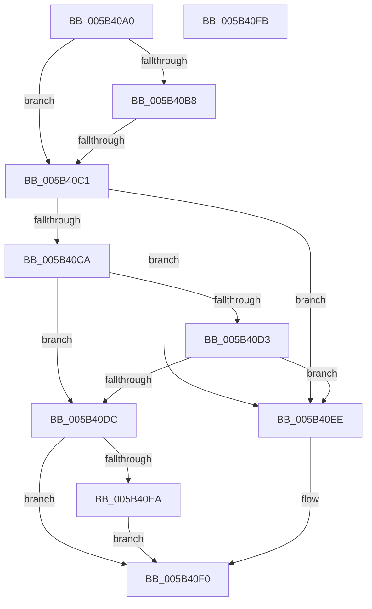

# KiBugCheckShouldEnterPostBugCheckDebugger

- RVA: `0x005B40A0`–`0x005B40FC` (길이 `92` bytes)
- VA: `0x00000001405B40A0`
- 실행 섹션: `.text`
- PDB 이름 있음: `예`; PDB Function 태그: `아니요`
- unwind 정보 RVA: `0x0005CAAC`
- 디코드: `28`개 명령, `92/92` bytes 표시
- 미해석 바이트: `0` (있으면 어셈블리에 `.byte`로 보존)

> 이 문서는 커널 이미지의 기계어와 PDB 기호를 분석해 생성했습니다. 4번과 5번은 함수 원형과 자료형을 바이너리 사용 방식에서 추정한 C 해석이며 원본 소스 복구 결과는 아닙니다.

## 1. Dependencies

- 직접 호출 지점: **1**; 고유 호출 대상: **1**
- 직접 호출자로 확인된 함수: **2**
- RIP 상대 이미지 참조: **4**

### Outgoing calls
- `0x005B40CA` → [KdRefreshDebuggerNotPresent](../4B/KdRefreshDebuggerNotPresent_function_004BA420.md) (function, `0x004BA420`)

### Direct callers
- [KeBugCheck2](KeBugCheck2_function_005B27D0.md) at `0x005B3230`
- [KiAttemptBugcheckRecovery](../5C/KiAttemptBugcheckRecovery_function_005C6D24.md) at `0x005C6EC4`

### Static image references
- `0x005B40AA` → RVA `0x00F475F8` (`.data`; read)
- `0x005B40B8` → RVA `0x00F59CC8` (`.data`; read)
- `0x005B40C1` → RVA `0x00E667E8` (`.data`; read)
- `0x005B40D3` → RVA `0x00F55CB3` (`.data`; read)

## 2. Other-region calls and transfers

- 다른 실행 섹션으로 향하는 call: **0**
- 별도 외부 분기/꼬리 이동을 확인하지 못했습니다.

## 3. Assembly (complete function range)

```asm
005B40A0  48 89 5C 24 08                  mov qword ptr [rsp + 8], rbx
005B40A5  57                              push rdi
005B40A6  48 83 EC 20                     sub rsp, 0x20
005B40AA  80 3D 47 35 99 00 00            cmp byte ptr [rip + 0x993547], 0
005B40B1  48 8B DA                        mov rbx, rdx
005B40B4  8B F9                           mov edi, ecx
005B40B6  75 09                           jne 0x1405b40c1
005B40B8  80 3D 09 5C 9A 00 00            cmp byte ptr [rip + 0x9a5c09], 0
005B40BF  74 2D                           je 0x1405b40ee
005B40C1  80 3D 20 27 8B 00 00            cmp byte ptr [rip + 0x8b2720], 0
005B40C8  75 24                           jne 0x1405b40ee
005B40CA  E8 51 63 F0 FF                  call 0x1404ba420
005B40CF  84 C0                           test al, al
005B40D1  74 09                           je 0x1405b40dc
005B40D3  80 3D D9 1B 9A 00 00            cmp byte ptr [rip + 0x9a1bd9], 0
005B40DA  74 12                           je 0x1405b40ee
005B40DC  81 FF E2 00 00 00               cmp edi, 0xe2
005B40E2  0F 95 C0                        setne al
005B40E5  48 85 DB                        test rbx, rbx
005B40E8  74 06                           je 0x1405b40f0
005B40EA  8A 03                           mov al, byte ptr [rbx]
005B40EC  EB 02                           jmp 0x1405b40f0
005B40EE  32 C0                           xor al, al
005B40F0  48 8B 5C 24 30                  mov rbx, qword ptr [rsp + 0x30]
005B40F5  48 83 C4 20                     add rsp, 0x20
005B40F9  5F                              pop rdi
005B40FA  C3                              ret
005B40FB  CC                              int3
```

## 4. C-style interpretation (structured pseudocode)

```c
__int64 __fastcall KiBugCheckShouldEnterPostBugCheckDebugger(int a1, __int64 a2)
{
    __int64 result;
    __int64 v_rsp;
    unsigned __int64 v_stack_p8;

    v_stack_p8 = v_rbx;
    v_rsp = (v_rsp) - (32);
    if ((*(unsigned __int8 *)(v_rip + 10040647)) != 0) goto loc_005B40C1;
    if ((*(unsigned __int8 *)(v_rip + 10116105)) == 0) goto loc_005B40EE;
loc_005B40C1:
    if ((*(unsigned __int8 *)(v_rip + 9119520)) != 0) goto loc_005B40EE;
    result = KdRefreshDebuggerNotPresent(a1, a2, a3, a4);
    if ((unsigned __int8)(result) == 0) goto loc_005B40DC;
    if ((*(unsigned __int8 *)(v_rip + 10099673)) == 0) goto loc_005B40EE;
loc_005B40DC:
    result = (((unsigned int)((unsigned int)(a1))) != 226) ? 1 : 0;
    if (a2 == 0) goto loc_005B40F0;
    goto loc_005B40F0;
loc_005B40EE:
    result = 0;
loc_005B40F0:
    v_rsp = (v_rsp) + (32);
    return result;
}
```

## 5. (Beta) C Style

```c
int64_t KiBugCheckShouldEnterPostBugCheckDebugger(int32_t Arg1, int64_t Arg2)
{
    int64_t result;
    int64_t local_rsp;
    uint64_t v_stack_p8;

    v_stack_p8 = local_rbx;
    local_rsp = (local_rsp) - (32);
    if ((*(uint8_t *)(v_rip + 0x993547)) != 0) goto loc_005B40C1;
    if ((*(uint8_t *)(v_rip + 0x9A5C09)) == 0) goto loc_005B40EE;
loc_005B40C1:
    if ((*(uint8_t *)(v_rip + 0x8B2720)) != 0) goto loc_005B40EE;
    result = KdRefreshDebuggerNotPresent(Arg1, Arg2, a3, a4);
    if ((uint8_t)(result) == 0) goto loc_005B40DC;
    if ((*(uint8_t *)(v_rip + 0x9A1BD9)) == 0) goto loc_005B40EE;
loc_005B40DC:
    result = (((uint32_t)((uint32_t)(Arg1))) != 226) ? 1 : 0;
    if (Arg2 == 0) goto loc_005B40F0;
    goto loc_005B40F0;
loc_005B40EE:
    result = 0;
loc_005B40F0:
    local_rsp = (local_rsp) + (32);
    return result;
}
```

## 6. Execution-region graph

[열기: 2D/3D 그래프와 함수 탐색 컨트롤 패널](../../../control-panel.html?section=text&rva=0x005B40A0&view=graph)

- 2D 그래프는 위에서 아래로 흐르고, 3D 그래프는 빈 공간을 드래그해 회전합니다. Shift+드래그는 이동, 휠은 확대·축소, 함수 노드 선택은 대상 보고서 이동입니다.

### Static fallback


