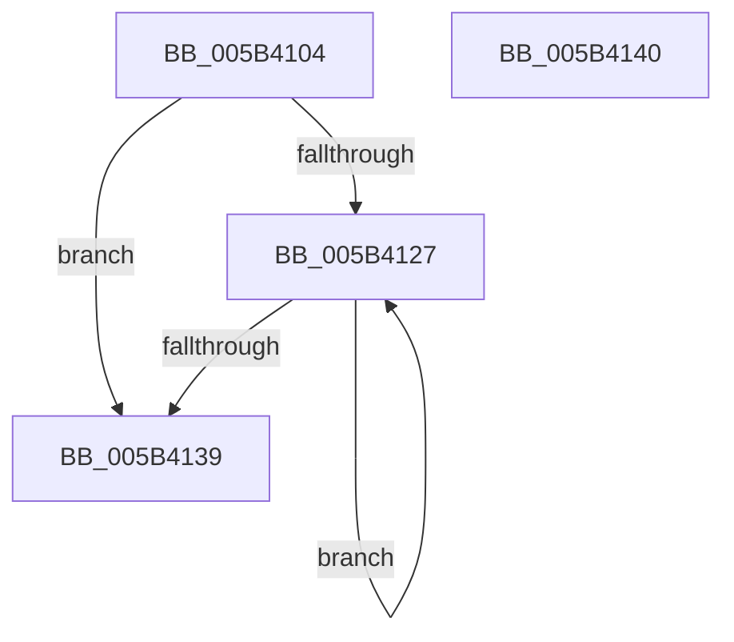

# KiBugCheckUnicodeToAnsi

- RVA: `0x005B4104`–`0x005B4141` (길이 `61` bytes)
- VA: `0x00000001405B4104`
- 실행 섹션: `.text`
- PDB 이름 있음: `예`; PDB Function 태그: `아니요`
- unwind 정보 RVA: `0x000DB714`
- 디코드: `19`개 명령, `61/61` bytes 표시
- 미해석 바이트: `0` (있으면 어셈블리에 `.byte`로 보존)

> 이 문서는 커널 이미지의 기계어와 PDB 기호를 분석해 생성했습니다. 4번과 5번은 함수 원형과 자료형을 바이너리 사용 방식에서 추정한 C 해석이며 원본 소스 복구 결과는 아닙니다.

## 1. Dependencies

- 직접 호출 지점: **0**; 고유 호출 대상: **0**
- 직접 호출자로 확인된 함수: **2**
- RIP 상대 이미지 참조: **0**

### Outgoing calls
- 직접 디코드된 call 명령이 없습니다.

### Direct callers
- [KeBugCheck2](KeBugCheck2_function_005B27D0.md) at `0x005B2D06`
- [KiDumpParameterImages](KiDumpParameterImages_function_005B4CE0.md) at `0x005B4DC5`

### Static image references
- 디코드된 RIP-relative 메모리 참조가 없습니다.

## 2. Other-region calls and transfers

- 다른 실행 섹션으로 향하는 call: **0**
- 별도 외부 분기/꼬리 이동을 확인하지 못했습니다.

## 3. Assembly (complete function range)

```asm
005B4104  44 0F B7 01                     movzx r8d, word ptr [rcx]
005B4108  B8 7F 00 00 00                  mov eax, 0x7f
005B410D  4C 8B 49 08                     mov r9, qword ptr [rcx + 8]
005B4111  48 8B CA                        mov rcx, rdx
005B4114  41 D1 E8                        shr r8d, 1
005B4117  41 81 F8 80 00 00 00            cmp r8d, 0x80
005B411E  44 0F 43 C0                     cmovae r8d, eax
005B4122  45 85 C0                        test r8d, r8d
005B4125  74 12                           je 0x1405b4139
005B4127  41 8A 01                        mov al, byte ptr [r9]
005B412A  4D 8D 49 02                     lea r9, [r9 + 2]
005B412E  88 01                           mov byte ptr [rcx], al
005B4130  48 FF C1                        inc rcx
005B4133  41 83 C0 FF                     add r8d, -1
005B4137  75 EE                           jne 0x1405b4127
005B4139  C6 01 00                        mov byte ptr [rcx], 0
005B413C  48 8B C2                        mov rax, rdx
005B413F  C3                              ret
005B4140  CC                              int3
```

## 4. C-style interpretation (structured pseudocode)

```c
__int64 __fastcall KiBugCheckUnicodeToAnsi(__int64 a1, __int64 a2)
{
    a3 = (unsigned int)((*(unsigned __int16 *)(a1)) >> (1));
    if (((unsigned int)(a3)) >= 128) { a3 = 127; }
    if ((unsigned int)(a3) == 0) goto loc_005B4139;
loc_005B4127:
    *(unsigned __int8 *)(a2) = (unsigned __int8)(*(unsigned __int8 *)(*(unsigned __int64 *)(a1 + 8)));
    a1 = (a2) + 1;
    a3 = (unsigned int)((a3) + (-1));
    if (condition_is_not_equal) goto loc_005B4127;
loc_005B4139:
    *(unsigned __int8 *)(a1) = 0;
    return a2;
}
```

## 5. (Beta) C Style

```c
int64_t KiBugCheckUnicodeToAnsi(void *Arg1, int64_t Arg2)
{
    uint8_t *arg1 = (uint8_t *)Arg1;

    a3 = (uint32_t)((*(uint16_t *)(arg1)) >> (1));
    if (((uint32_t)(a3)) >= 128) { a3 = 127; }
    if ((uint32_t)(a3) == 0) goto loc_005B4139;
loc_005B4127:
    *(uint8_t *)(Arg2) = (uint8_t)(*(uint8_t *)(*(uint64_t *)(arg1 + 0x8)));
    Arg1 = (Arg2) + 1;
    a3 = (uint32_t)((a3) + (-1));
    if (condition_is_not_equal) goto loc_005B4127;
loc_005B4139:
    *(uint8_t *)(arg1) = 0;
    return Arg2;
}
```

### 관측된 메모리 오프셋

구조체 형식이 확인되지 않은 접근은 인자 기준의 오프셋으로만 기록했습니다.

| 기준 인자 | 오프셋 표현 | 폭 (bit) | 접근 |
|---|---:|---:|---|
| `Arg1` | `+ 0x0` | `16` | `R` |
| `Arg1` | `+ 0x8` | `64` | `R` |

## 6. Execution-region graph

[열기: 2D/3D 그래프와 함수 탐색 컨트롤 패널](../../../control-panel.html?section=text&rva=0x005B4104&view=graph)

- 2D 그래프는 위에서 아래로 흐르고, 3D 그래프는 빈 공간을 드래그해 회전합니다. Shift+드래그는 이동, 휠은 확대·축소, 함수 노드 선택은 대상 보고서 이동입니다.

### Static fallback


