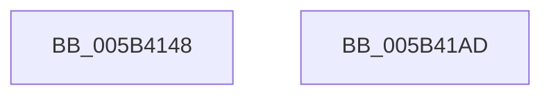

# KiBugCheckWriteCrashDump

- RVA: `0x005B4148`–`0x005B41AE` (길이 `102` bytes)
- VA: `0x00000001405B4148`
- 실행 섹션: `.text`
- PDB 이름 있음: `예`; PDB Function 태그: `아니요`
- unwind 정보 RVA: `0x000AF0B0`
- 디코드: `26`개 명령, `102/102` bytes 표시
- 미해석 바이트: `0` (있으면 어셈블리에 `.byte`로 보존)

> 이 문서는 커널 이미지의 기계어와 PDB 기호를 분석해 생성했습니다. 4번과 5번은 함수 원형과 자료형을 바이너리 사용 방식에서 추정한 C 해석이며 원본 소스 복구 결과는 아닙니다.

## 1. Dependencies

- 직접 호출 지점: **2**; 고유 호출 대상: **2**
- 직접 호출자로 확인된 함수: **2**
- RIP 상대 이미지 참조: **5**

### Outgoing calls
- `0x005B4194` → [IoWriteCrashDump](../59/IoWriteCrashDump_function_005936D8.md) (function, `0x005936D8`)
- `0x005B41A0` → [IoSaveBugCheckProgress](../59/IoSaveBugCheckProgress_function_00592E10.md) (function, `0x00592E10`)

### Direct callers
- [KeBugCheck2](KeBugCheck2_function_005B27D0.md) at `0x005B3711`
- [KiDeferredBugcheckRecoveryWorker](../5C/KiDeferredBugcheckRecoveryWorker_function_005C75A0.md) at `0x005C76D3`

### Static image references
- `0x005B4153` → RVA `0x00F47598` (`.data`; read)
- `0x005B415A` → RVA `0x00F47590` (`.data`; read)
- `0x005B4161` → RVA `0x00F47588` (`.data`; read)
- `0x005B417F` → RVA `0x00F47580` (`.data`; read)
- `0x005B4189` → RVA `0x00F475A0` (`.data`; read)

## 2. Other-region calls and transfers

- 다른 실행 섹션으로 향하는 call: **0**
- 별도 외부 분기/꼬리 이동을 확인하지 못했습니다.

## 3. Assembly (complete function range)

```asm
005B4148  4C 8B DC                        mov r11, rsp
005B414B  53                              push rbx
005B414C  48 83 EC 50                     sub rsp, 0x50
005B4150  8A 41 20                        mov al, byte ptr [rcx + 0x20]
005B4153  4C 8B 0D 3E 34 99 00            mov r9, qword ptr [rip + 0x99343e]
005B415A  4C 8B 05 2F 34 99 00            mov r8, qword ptr [rip + 0x99342f]
005B4161  48 8B 15 20 34 99 00            mov rdx, qword ptr [rip + 0x993420]
005B4168  88 44 24 40                     mov byte ptr [rsp + 0x40], al
005B416C  48 8B 41 10                     mov rax, qword ptr [rcx + 0x10]
005B4170  49 89 43 E0                     mov qword ptr [r11 - 0x20], rax
005B4174  48 8B 41 08                     mov rax, qword ptr [rcx + 8]
005B4178  49 89 43 D8                     mov qword ptr [r11 - 0x28], rax
005B417C  48 8B 01                        mov rax, qword ptr [rcx]
005B417F  8B 0D FB 33 99 00               mov ecx, dword ptr [rip + 0x9933fb]
005B4185  49 89 43 D0                     mov qword ptr [r11 - 0x30], rax
005B4189  48 8B 05 10 34 99 00            mov rax, qword ptr [rip + 0x993410]
005B4190  49 89 43 C8                     mov qword ptr [r11 - 0x38], rax
005B4194  E8 3F F5 FD FF                  call 0x1405936d8
005B4199  B9 03 00 00 00                  mov ecx, 3
005B419E  8A D8                           mov bl, al
005B41A0  E8 6B EC FD FF                  call 0x140592e10
005B41A5  8A C3                           mov al, bl
005B41A7  48 83 C4 50                     add rsp, 0x50
005B41AB  5B                              pop rbx
005B41AC  C3                              ret
005B41AD  CC                              int3
```

## 4. C-style interpretation (structured pseudocode)

```c
__int64 __fastcall KiBugCheckWriteCrashDump(__int64 a1)
{
    __int64 result;
    __int64 v_rsp;
    unsigned __int8 v_stack_m18;

    v_rsp = (v_rsp) - (80);
    v_stack_m18 = (unsigned __int8)(*(unsigned __int8 *)(a1 + 32));
    *(unsigned __int64 *)(v_rsp - 32) = *(unsigned __int64 *)(a1 + 16);
    *(unsigned __int64 *)(v_rsp - 40) = *(unsigned __int64 *)(a1 + 8);
    *(unsigned __int64 *)(v_rsp - 48) = *(unsigned __int64 *)(a1);
    *(unsigned __int64 *)(v_rsp - 56) = *(unsigned __int64 *)(v_rip + 10040336);
    result = IoWriteCrashDump((unsigned int)(*(unsigned int *)(v_rip + 10040315)), *(unsigned __int64 *)(v_rip + 10040352), *(unsigned __int64 *)(v_rip + 10040367), *(unsigned __int64 *)(v_rip + 10040382));
    result = IoSaveBugCheckProgress(3, *(unsigned __int64 *)(v_rip + 10040352), *(unsigned __int64 *)(v_rip + 10040367), *(unsigned __int64 *)(v_rip + 10040382));
    v_rsp = (v_rsp) + (80);
    return (unsigned __int8)((unsigned __int8)(result));
}
```

## 5. (Beta) C Style

```c
int64_t KiBugCheckWriteCrashDump(void *Arg1)
{
    uint8_t *arg1 = (uint8_t *)Arg1;

    int64_t result;
    int64_t local_rsp;
    uint8_t v_stack_m18;

    local_rsp = (local_rsp) - (80);
    v_stack_m18 = (uint8_t)(*(uint8_t *)(arg1 + 0x20));
    *(uint64_t *)(local_rsp - 0x20) = *(uint64_t *)(arg1 + 0x10);
    *(uint64_t *)(local_rsp - 0x28) = *(uint64_t *)(arg1 + 0x8);
    *(uint64_t *)(local_rsp - 0x30) = *(uint64_t *)(arg1);
    *(uint64_t *)(local_rsp - 0x38) = *(uint64_t *)(v_rip + 0x993410);
    result = IoWriteCrashDump((uint32_t)(*(uint32_t *)(v_rip + 0x9933FB)), *(uint64_t *)(v_rip + 0x993420), *(uint64_t *)(v_rip + 0x99342F), *(uint64_t *)(v_rip + 0x99343E));
    result = IoSaveBugCheckProgress(3, *(uint64_t *)(v_rip + 0x993420), *(uint64_t *)(v_rip + 0x99342F), *(uint64_t *)(v_rip + 0x99343E));
    local_rsp = (local_rsp) + (80);
    return (uint8_t)((uint8_t)(result));
}
```

### 관측된 메모리 오프셋

구조체 형식이 확인되지 않은 접근은 인자 기준의 오프셋으로만 기록했습니다.

| 기준 인자 | 오프셋 표현 | 폭 (bit) | 접근 |
|---|---:|---:|---|
| `Arg1` | `+ 0x0` | `64` | `R` |
| `Arg1` | `+ 0x8` | `64` | `R` |
| `Arg1` | `+ 0x10` | `64` | `R` |
| `Arg1` | `+ 0x20` | `8` | `R` |

## 6. Execution-region graph

[열기: 2D/3D 그래프와 함수 탐색 컨트롤 패널](../../../control-panel.html?section=text&rva=0x005B4148&view=graph)

- 2D 그래프는 위에서 아래로 흐르고, 3D 그래프는 빈 공간을 드래그해 회전합니다. Shift+드래그는 이동, 휠은 확대·축소, 함수 노드 선택은 대상 보고서 이동입니다.

### Static fallback


