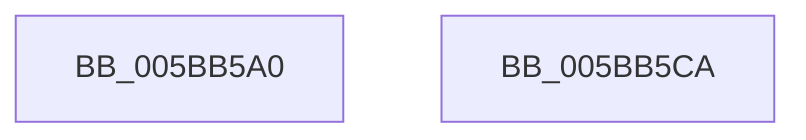

# KiCancelClockTimerKTimerDeadlines

- RVA: `0x005BB5A0`–`0x005BB5CB` (길이 `43` bytes)
- VA: `0x00000001405BB5A0`
- 실행 섹션: `.text`
- PDB 이름 있음: `예`; PDB Function 태그: `아니요`
- unwind 정보 RVA: `0x0005CF00`
- 디코드: `14`개 명령, `43/43` bytes 표시
- 미해석 바이트: `0` (있으면 어셈블리에 `.byte`로 보존)

> 이 문서는 커널 이미지의 기계어와 PDB 기호를 분석해 생성했습니다. 4번과 5번은 함수 원형과 자료형을 바이너리 사용 방식에서 추정한 C 해석이며 원본 소스 복구 결과는 아닙니다.

## 1. Dependencies

- 직접 호출 지점: **2**; 고유 호출 대상: **1**
- 직접 호출자로 확인된 함수: **2**
- RIP 상대 이미지 참조: **0**

### Outgoing calls
- `0x005BB5B0` → [KiCancelClockTimer](../47/KiCancelClockTimer_function_004743CC.md) (function, `0x004743CC`)
- `0x005BB5BF` → [KiCancelClockTimer](../47/KiCancelClockTimer_function_004743CC.md) (function, `0x004743CC`)

### Direct callers
- [KePrepareClockTimerForIdle](KePrepareClockTimerForIdle_function_005BA49C.md) at `0x005BA613`
- [KePrepareClockTimerForPlatformIdle](KePrepareClockTimerForPlatformIdle_function_005BA820.md) at `0x005BAC21`

### Static image references
- 디코드된 RIP-relative 메모리 참조가 없습니다.

## 2. Other-region calls and transfers

- 다른 실행 섹션으로 향하는 call: **0**
- 별도 외부 분기/꼬리 이동을 확인하지 못했습니다.

## 3. Assembly (complete function range)

```asm
005BB5A0  40 53                           push rbx
005BB5A2  48 83 EC 20                     sub rsp, 0x20
005BB5A6  45 33 C0                        xor r8d, r8d
005BB5A9  48 8B D9                        mov rbx, rcx
005BB5AC  41 8D 50 01                     lea edx, [r8 + 1]
005BB5B0  E8 17 8E EB FF                  call 0x1404743cc
005BB5B5  45 33 C0                        xor r8d, r8d
005BB5B8  48 8B CB                        mov rcx, rbx
005BB5BB  41 8D 50 02                     lea edx, [r8 + 2]
005BB5BF  E8 08 8E EB FF                  call 0x1404743cc
005BB5C4  48 83 C4 20                     add rsp, 0x20
005BB5C8  5B                              pop rbx
005BB5C9  C3                              ret
005BB5CA  CC                              int3
```

## 4. C-style interpretation (structured pseudocode)

```c
__int64 __fastcall KiCancelClockTimerKTimerDeadlines(__int64 a1, __int64 a2, int a3)
{
    __int64 result;
    __int64 v_rsp;

    v_rsp = (v_rsp) - (32);
    a3 = 0;
    result = KiCancelClockTimer(a1, a3 + 1, a3, a4);
    a3 = 0;
    result = KiCancelClockTimer(a1, a3 + 2, a3, a4);
    v_rsp = (v_rsp) + (32);
    return result;
}
```

## 5. (Beta) C Style

```c
int64_t KiCancelClockTimerKTimerDeadlines(int64_t Arg1, int64_t Arg2, int32_t Arg3)
{
    int64_t result;
    int64_t local_rsp;

    local_rsp = (local_rsp) - (32);
    Arg3 = 0;
    result = KiCancelClockTimer(Arg1, Arg3 + 1, Arg3, a4);
    Arg3 = 0;
    result = KiCancelClockTimer(Arg1, Arg3 + 2, Arg3, a4);
    local_rsp = (local_rsp) + (32);
    return result;
}
```

## 6. Execution-region graph

[열기: 2D/3D 그래프와 함수 탐색 컨트롤 패널](../../../control-panel.html?section=text&rva=0x005BB5A0&view=graph)

- 2D 그래프는 위에서 아래로 흐르고, 3D 그래프는 빈 공간을 드래그해 회전합니다. Shift+드래그는 이동, 휠은 확대·축소, 함수 노드 선택은 대상 보고서 이동입니다.

### Static fallback


