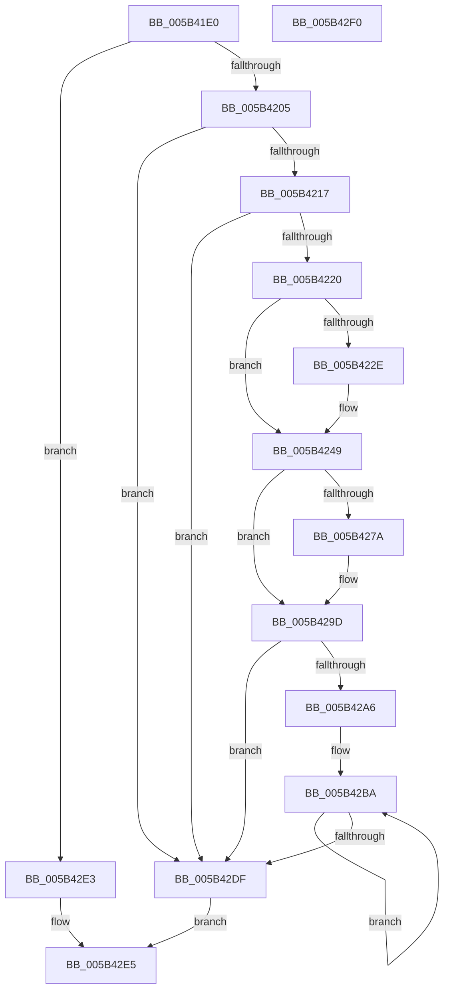

# KiCheckForFreezeExecution

- RVA: `0x005B41E0`–`0x005B42F1` (길이 `273` bytes)
- VA: `0x00000001405B41E0`
- 실행 섹션: `.text`
- PDB 이름 있음: `예`; PDB Function 태그: `아니요`
- unwind 정보 RVA: `0x0006E5F8`
- 디코드: `60`개 명령, `273/273` bytes 표시
- 미해석 바이트: `0` (있으면 어셈블리에 `.byte`로 보존)

> 이 문서는 커널 이미지의 기계어와 PDB 기호를 분석해 생성했습니다. 4번과 5번은 함수 원형과 자료형을 바이너리 사용 방식에서 추정한 C 해석이며 원본 소스 복구 결과는 아닙니다.

## 1. Dependencies

- 직접 호출 지점: **2**; 고유 호출 대상: **2**
- 직접 호출자로 확인된 함수: **2**
- RIP 상대 이미지 참조: **4**

### Outgoing calls
- `0x005B4205` → [KiFreezeTargetExecution](../5C/KiFreezeTargetExecution_function_005C30A0.md) (function, `0x005C30A0`)
- `0x005B4298` → [VslKernelShadowStackAssist](../3D/VslKernelShadowStackAssist_function_003D5BA0.md) (function, `0x003D5BA0`)

### Direct callers
- [KiYieldWaitForDebugger](KiYieldWaitForDebugger_function_005B56DC.md) at `0x005B56F2`
- [KiProcessNMI](KiProcessNMI_function_005B8950.md) at `0x005B899D`
- [KiProcessNMI](KiProcessNMI_function_005B8950.md) at `0x005B8A20`

### Static image references
- `0x005B420A` → RVA `0x00E66890` (`.data`; read)
- `0x005B4263` → RVA `0x005B8AD0` (`KiWaitForReboot`; read)
- `0x005B4271` → RVA `0x01201841` (`CFGRO`; read)
- `0x005B429D` → RVA `0x01201840` (`CFGRO`; read)

## 2. Other-region calls and transfers

- 다른 실행 섹션으로 향하는 call: **0**
- 별도 외부 분기/꼬리 이동을 확인하지 못했습니다.

## 3. Assembly (complete function range)

```asm
005B41E0  48 89 5C 24 08                  mov qword ptr [rsp + 8], rbx
005B41E5  57                              push rdi
005B41E6  48 83 EC 30                     sub rsp, 0x30
005B41EA  65 48 8B 3C 25 20 00 00 00      mov rdi, qword ptr gs:[0x20]
005B41F3  48 8B D9                        mov rbx, rcx
005B41F6  8B 87 88 2D 00 00               mov eax, dword ptr [rdi + 0x2d88]
005B41FC  83 F8 05                        cmp eax, 5
005B41FF  0F 85 DE 00 00 00               jne 0x1405b42e3
005B4205  E8 96 EE 00 00                  call 0x1405c30a0
005B420A  80 3D 7F 26 8B 00 00            cmp byte ptr [rip + 0x8b267f], 0
005B4211  0F 84 C8 00 00 00               je 0x1405b42df
005B4217  48 85 DB                        test rbx, rbx
005B421A  0F 84 BF 00 00 00               je 0x1405b42df
005B4220  B8 10 00 00 00                  mov eax, 0x10
005B4225  66 39 83 70 01 00 00            cmp word ptr [rbx + 0x170], ax
005B422C  74 1B                           je 0x1405b4249
005B422E  66 89 83 70 01 00 00            mov word ptr [rbx + 0x170], ax
005B4235  66 C7 83 88 01 00 00 18 00      mov word ptr [rbx + 0x188], 0x18
005B423E  48 8B 47 28                     mov rax, qword ptr [rdi + 0x28]
005B4242  48 89 83 80 01 00 00            mov qword ptr [rbx + 0x180], rax
005B4249  0F BA B3 78 01 00 00 09         btr dword ptr [rbx + 0x178], 9
005B4251  B9 01 01 00 C0                  mov ecx, 0xc0000101
005B4256  0F 32                           rdmsr
005B4258  48 C1 E2 20                     shl rdx, 0x20
005B425C  48 0B C2                        or rax, rdx
005B425F  48 89 43 68                     mov qword ptr [rbx + 0x68], rax
005B4263  48 8D 05 66 48 00 00            lea rax, [rip + 0x4866]
005B426A  48 89 83 68 01 00 00            mov qword ptr [rbx + 0x168], rax
005B4271  80 3D C9 D5 C4 00 00            cmp byte ptr [rip + 0xc4d5c9], 0
005B4278  74 23                           je 0x1405b429d
005B427A  48 8B 93 D8 00 00 00            mov rdx, qword ptr [rbx + 0xd8]
005B4281  45 33 C9                        xor r9d, r9d
005B4284  C7 44 24 28 04 00 00 00         mov dword ptr [rsp + 0x28], 4
005B428C  45 33 C0                        xor r8d, r8d
005B428F  48 89 44 24 20                  mov qword ptr [rsp + 0x20], rax
005B4294  41 8D 49 03                     lea ecx, [r9 + 3]
005B4298  E8 03 19 E2 FF                  call 0x1403d5ba0
005B429D  80 3D 9C D5 C4 00 00            cmp byte ptr [rip + 0xc4d59c], 0
005B42A4  74 39                           je 0x1405b42df
005B42A6  4C 8B 87 80 FE FF FF            mov r8, qword ptr [rdi - 0x180]
005B42AD  41 B9 07 00 00 00               mov r9d, 7
005B42B3  49 81 C0 30 14 00 00            add r8, 0x1430
005B42BA  0F 20 D9                        mov rcx, cr3
005B42BD  49 89 48 08                     mov qword ptr [r8 + 8], rcx
005B42C1  B9 01 01 00 C0                  mov ecx, 0xc0000101
005B42C6  0F 32                           rdmsr
005B42C8  48 C1 E2 20                     shl rdx, 0x20
005B42CC  48 0B C2                        or rax, rdx
005B42CF  49 89 00                        mov qword ptr [r8], rax
005B42D2  4D 8D 80 00 02 00 00            lea r8, [r8 + 0x200]
005B42D9  49 83 E9 01                     sub r9, 1
005B42DD  75 DB                           jne 0x1405b42ba
005B42DF  B0 01                           mov al, 1
005B42E1  EB 02                           jmp 0x1405b42e5
005B42E3  32 C0                           xor al, al
005B42E5  48 8B 5C 24 40                  mov rbx, qword ptr [rsp + 0x40]
005B42EA  48 83 C4 30                     add rsp, 0x30
005B42EE  5F                              pop rdi
005B42EF  C3                              ret
005B42F0  CC                              int3
```

## 4. C-style interpretation (structured pseudocode)

```c
__int64 __fastcall KiCheckForFreezeExecution(__int64 a1, __int64 a2, int a3, int a4)
{
    __int64 result;
    __int64 v_rsp;
    unsigned int v_stack_m10;
    unsigned __int64 v_stack_m18;
    unsigned __int64 v_stack_p8;

    v_stack_p8 = v_rbx;
    v_rsp = (v_rsp) - (48);
    if (((unsigned int)((unsigned int)(*(unsigned int *)(*(unsigned __int64 *)(gs_base + (0 + 32)) + 11656)))) != 5) goto loc_005B42E3;
    result = KiFreezeTargetExecution(a1, a2, a3, a4);
    if ((*(unsigned __int8 *)(v_rip + 9119359)) == 0) goto loc_005B42DF;
    if (a1 == 0) goto loc_005B42DF;
    result = 16;
    if ((*(unsigned __int16 *)(a1 + 368)) != 16) {
        *(unsigned __int16 *)(a1 + 368) = 16;
        *(unsigned __int16 *)(a1 + 392) = 24;
        result = *(unsigned __int64 *)(*(unsigned __int64 *)(gs_base + (0 + 32)) + 40);
        *(unsigned __int64 *)(a1 + 384) = result;
    }
    a2 = (a2) << (32);
    result = (result) | (a2);
    *(unsigned __int64 *)(a1 + 104) = result;
    *(unsigned __int64 *)(a1 + 360) = v_rip + 18534;
    result = v_rip + 18534;
    if ((*(unsigned __int8 *)(v_rip + 12899785)) != 0) {
        a2 = *(unsigned __int64 *)(a1 + 216);
        a4 = 0;
        v_stack_m10 = 4;
        a3 = 0;
        v_stack_m18 = v_rip + 18534;
        a1 = a4 + 3;
        result = VslKernelShadowStackAssist(a1, a2, a3, a4);
    }
    if ((*(unsigned __int8 *)(v_rip + 12899740)) == 0) goto loc_005B42DF;
    a3 = (*(unsigned __int64 *)(*(unsigned __int64 *)(gs_base + (0 + 32)) - 384)) + (0x1430ULL);
loc_005B42BA:
    *(unsigned __int64 *)(a3 + 8) = v_cr3;
    a2 = (a2) << (32);
    result = (result) | (a2);
    *(unsigned __int64 *)(a3) = result;
    a4 = (7) - (1);
    if (condition_is_not_equal) goto loc_005B42BA;
loc_005B42DF:
    goto loc_005B42E5;
loc_005B42E3:
    result = 0;
loc_005B42E5:
    v_rsp = (v_rsp) + (48);
    return result;
}
```

## 5. (Beta) C Style

```c
int64_t KiCheckForFreezeExecution(int64_t Arg1, int64_t Arg2, int32_t Arg3, int32_t Arg4)
{
    int64_t result;
    int64_t local_rsp;
    uint32_t v_stack_m10;
    uint64_t v_stack_m18;
    uint64_t v_stack_p8;

    v_stack_p8 = local_rbx;
    local_rsp = (local_rsp) - (48);
    if (((uint32_t)((uint32_t)(*(uint32_t *)(*(uint64_t *)(gs_base + (0 + 0x20)) + 0x2D88)))) != 5) goto loc_005B42E3;
    result = KiFreezeTargetExecution(Arg1, Arg2, Arg3, Arg4);
    if ((*(uint8_t *)(v_rip + 0x8B267F)) == 0) goto loc_005B42DF;
    if (Arg1 == 0) goto loc_005B42DF;
    result = 16;
    if ((*(uint16_t *)(Arg1 + 0x170)) != 16) {
        *(uint16_t *)(Arg1 + 0x170) = 16;
        *(uint16_t *)(Arg1 + 0x188) = 24;
        result = *(uint64_t *)(*(uint64_t *)(gs_base + (0 + 0x20)) + 0x28);
        *(uint64_t *)(Arg1 + 0x180) = result;
    }
    Arg2 = (Arg2) << (32);
    result = (result) | (Arg2);
    *(uint64_t *)(Arg1 + 0x68) = result;
    *(uint64_t *)(Arg1 + 0x168) = v_rip + 18534;
    result = v_rip + 18534;
    if ((*(uint8_t *)(v_rip + 0xC4D5C9)) != 0) {
        Arg2 = *(uint64_t *)(Arg1 + 0xD8);
        Arg4 = 0;
        v_stack_m10 = 4;
        Arg3 = 0;
        v_stack_m18 = v_rip + 18534;
        Arg1 = Arg4 + 3;
        result = VslKernelShadowStackAssist(Arg1, Arg2, Arg3, Arg4);
    }
    if ((*(uint8_t *)(v_rip + 0xC4D59C)) == 0) goto loc_005B42DF;
    Arg3 = (*(uint64_t *)(*(uint64_t *)(gs_base + (0 + 0x20)) - 0x180)) + (0x1430ULL);
loc_005B42BA:
    *(uint64_t *)(Arg3 + 0x8) = v_cr3;
    Arg2 = (Arg2) << (32);
    result = (result) | (Arg2);
    *(uint64_t *)(Arg3) = result;
    Arg4 = (7) - (1);
    if (condition_is_not_equal) goto loc_005B42BA;
loc_005B42DF:
    goto loc_005B42E5;
loc_005B42E3:
    result = 0;
loc_005B42E5:
    local_rsp = (local_rsp) + (48);
    return result;
}
```

## 6. Execution-region graph

[열기: 2D/3D 그래프와 함수 탐색 컨트롤 패널](../../../control-panel.html?section=text&rva=0x005B41E0&view=graph)

- 2D 그래프는 위에서 아래로 흐르고, 3D 그래프는 빈 공간을 드래그해 회전합니다. Shift+드래그는 이동, 휠은 확대·축소, 함수 노드 선택은 대상 보고서 이동입니다.

### Static fallback


