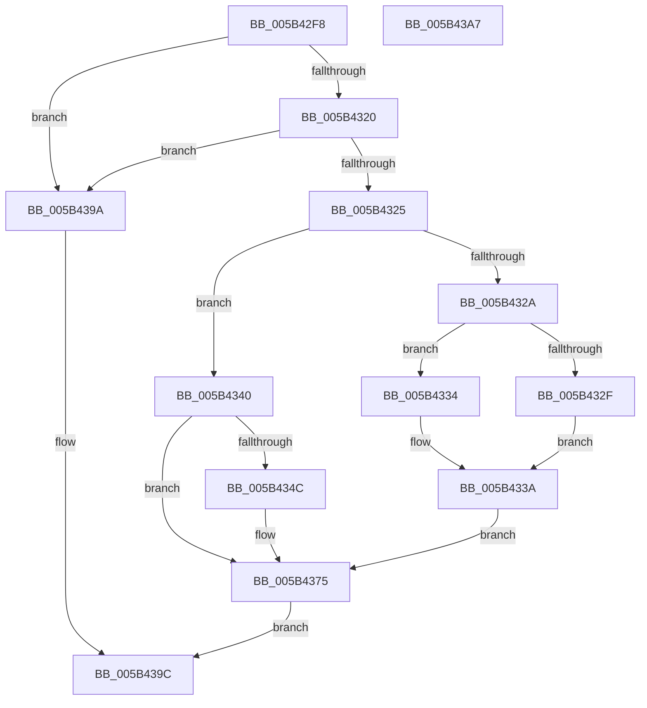

# KiCheckRangeOverlap

- RVA: `0x005B42F8`–`0x005B43A8` (길이 `176` bytes)
- VA: `0x00000001405B42F8`
- 실행 섹션: `.text`
- PDB 이름 있음: `예`; PDB Function 태그: `아니요`
- unwind 정보 RVA: `0x0006E5F8`
- 디코드: `54`개 명령, `176/176` bytes 표시
- 미해석 바이트: `0` (있으면 어셈블리에 `.byte`로 보존)

> 이 문서는 커널 이미지의 기계어와 PDB 기호를 분석해 생성했습니다. 4번과 5번은 함수 원형과 자료형을 바이너리 사용 방식에서 추정한 C 해석이며 원본 소스 복구 결과는 아닙니다.

## 1. Dependencies

- 직접 호출 지점: **2**; 고유 호출 대상: **1**
- 직접 호출자로 확인된 함수: **2**
- RIP 상대 이미지 참조: **2**

### Outgoing calls
- `0x005B4370` → [DbgPrintEx](../35/DbgPrintEx_function_00359290.md) (function, `0x00359290`)
- `0x005B4390` → [DbgPrintEx](../35/DbgPrintEx_function_00359290.md) (function, `0x00359290`)

### Direct callers
- [KiAddTriageDumpDataBlock](KiAddTriageDumpDataBlock_function_005B3AB8.md) at `0x005B3B65`
- [KiDeduplicateTriageDumpDataArrays](KiDeduplicateTriageDumpDataArrays_function_005B4748.md) at `0x005B47D0`

### Static image references
- `0x005B435E` → RVA `0x006CB660` (` ?? ::FNODOBFM::`string'`; read)
- `0x005B4386` → RVA `0x006CB8B0` (` ?? ::FNODOBFM::`string'`; read)

## 2. Other-region calls and transfers

- 다른 실행 섹션으로 향하는 call: **0**
- 별도 외부 분기/꼬리 이동을 확인하지 못했습니다.

## 3. Assembly (complete function range)

```asm
005B42F8  48 89 5C 24 08                  mov qword ptr [rsp + 8], rbx
005B42FD  57                              push rdi
005B42FE  48 83 EC 30                     sub rsp, 0x30
005B4302  4C 8B 11                        mov r10, qword ptr [rcx]
005B4305  48 8B D9                        mov rbx, rcx
005B4308  4C 8B 49 08                     mov r9, qword ptr [rcx + 8]
005B430C  33 FF                           xor edi, edi
005B430E  48 8B 0A                        mov rcx, qword ptr [rdx]
005B4311  4D 03 CA                        add r9, r10
005B4314  48 8B 52 08                     mov rdx, qword ptr [rdx + 8]
005B4318  48 03 D1                        add rdx, rcx
005B431B  4C 3B D2                        cmp r10, rdx
005B431E  73 7A                           jae 0x1405b439a
005B4320  4C 3B C9                        cmp r9, rcx
005B4323  76 75                           jbe 0x1405b439a
005B4325  4C 3B D1                        cmp r10, rcx
005B4328  72 16                           jb 0x1405b4340
005B432A  4C 3B CA                        cmp r9, rdx
005B432D  77 05                           ja 0x1405b4334
005B432F  44 8B CF                        mov r9d, edi
005B4332  EB 06                           jmp 0x1405b433a
005B4334  48 89 13                        mov qword ptr [rbx], rdx
005B4337  4C 2B CA                        sub r9, rdx
005B433A  4C 89 4B 08                     mov qword ptr [rbx + 8], r9
005B433E  EB 35                           jmp 0x1405b4375
005B4340  49 2B CA                        sub rcx, r10
005B4343  48 89 4B 08                     mov qword ptr [rbx + 8], rcx
005B4347  4C 3B CA                        cmp r9, rdx
005B434A  76 29                           jbe 0x1405b4375
005B434C  4C 2B CA                        sub r9, rdx
005B434F  49 89 10                        mov qword ptr [r8], rdx
005B4352  4D 89 48 08                     mov qword ptr [r8 + 8], r9
005B4356  40 B7 01                        mov dil, 1
005B4359  4C 89 4C 24 20                  mov qword ptr [rsp + 0x20], r9
005B435E  4C 8D 05 FB 72 11 00            lea r8, [rip + 0x1172fb]
005B4365  4C 8B CA                        mov r9, rdx
005B4368  BA 03 00 00 00                  mov edx, 3
005B436D  8D 4A 02                        lea ecx, [rdx + 2]
005B4370  E8 1B 4F DA FF                  call 0x140359290
005B4375  4C 8B 43 08                     mov r8, qword ptr [rbx + 8]
005B4379  BA 03 00 00 00                  mov edx, 3
005B437E  4C 8B 0B                        mov r9, qword ptr [rbx]
005B4381  4C 89 44 24 20                  mov qword ptr [rsp + 0x20], r8
005B4386  4C 8D 05 23 75 11 00            lea r8, [rip + 0x117523]
005B438D  8D 4A 02                        lea ecx, [rdx + 2]
005B4390  E8 FB 4E DA FF                  call 0x140359290
005B4395  40 8A C7                        mov al, dil
005B4398  EB 02                           jmp 0x1405b439c
005B439A  32 C0                           xor al, al
005B439C  48 8B 5C 24 40                  mov rbx, qword ptr [rsp + 0x40]
005B43A1  48 83 C4 30                     add rsp, 0x30
005B43A5  5F                              pop rdi
005B43A6  C3                              ret
005B43A7  CC                              int3
```

## 4. C-style interpretation (structured pseudocode)

```c
__int64 __fastcall KiCheckRangeOverlap(__int64 a1, __int64 a2, __int64 a3)
{
    __int64 result;
    __int64 v_rdi;
    __int64 v_rsp;
    unsigned __int64 v_stack_m18;
    unsigned __int64 v_stack_p8;

    v_stack_p8 = v_rbx;
    v_rsp = (v_rsp) - (48);
    v_rdi = 0;
    a4 = (*(unsigned __int64 *)(a1 + 8)) + (*(unsigned __int64 *)(a1));
    a2 = (*(unsigned __int64 *)(a2 + 8)) + (*(unsigned __int64 *)(a2));
    if ((*(unsigned __int64 *)(a1)) >= a2) goto loc_005B439A;
    if (a4 <= (*(unsigned __int64 *)(a2))) goto loc_005B439A;
    if ((*(unsigned __int64 *)(a1)) < (*(unsigned __int64 *)(a2))) goto loc_005B4340;
    if (a4 > a2) goto loc_005B4334;
    goto loc_005B433A;
loc_005B4334:
    *(unsigned __int64 *)(a1) = a2;
    a4 = (0) - (a2);
loc_005B433A:
    *(unsigned __int64 *)(a1 + 8) = a4;
    goto loc_005B4375;
loc_005B4340:
    a1 = (*(unsigned __int64 *)(a2)) - (*(unsigned __int64 *)(a1));
    *(unsigned __int64 *)(a1 + 8) = a1;
    if (a4 >= = a2) {
        a4 = (a4) - (a2);
        *(unsigned __int64 *)(a3) = a2;
        *(unsigned __int64 *)(a3 + 8) = a4;
        v_rdi = 1;
        v_stack_m18 = a4;
        a3 = v_rip + 1143547;
        a4 = a2;
        a2 = 3;
        a1 = a2 + 2;
        result = DbgPrintEx(a1, a2, a3, a4);
    }
    v_stack_m18 = *(unsigned __int64 *)(a1 + 8);
    result = DbgPrintEx(3 + 2, 3, v_rip + 1144099, *(unsigned __int64 *)(a1));
    goto loc_005B439C;
loc_005B439A:
    result = 0;
loc_005B439C:
    v_rsp = (v_rsp) + (48);
    return result;
}
```

## 5. (Beta) C Style

```c
int64_t KiCheckRangeOverlap(void *Arg1, void *Arg2, void *Arg3)
{
    uint8_t *arg1 = (uint8_t *)Arg1;
    uint8_t *arg2 = (uint8_t *)Arg2;
    uint8_t *arg3 = (uint8_t *)Arg3;

    int64_t result;
    int64_t local_rdi;
    int64_t local_rsp;
    uint64_t v_stack_m18;
    uint64_t v_stack_p8;

    v_stack_p8 = local_rbx;
    local_rsp = (local_rsp) - (48);
    local_rdi = 0;
    a4 = (*(uint64_t *)(arg1 + 0x8)) + (*(uint64_t *)(arg1));
    Arg2 = (*(uint64_t *)(arg2 + 0x8)) + (*(uint64_t *)(arg2));
    if ((*(uint64_t *)(arg1)) >= Arg2) goto loc_005B439A;
    if (a4 <= (*(uint64_t *)(arg2))) goto loc_005B439A;
    if ((*(uint64_t *)(arg1)) < (*(uint64_t *)(arg2))) goto loc_005B4340;
    if (a4 > Arg2) goto loc_005B4334;
    goto loc_005B433A;
loc_005B4334:
    *(void **)(arg1) = Arg2;
    a4 = (0) - (Arg2);
loc_005B433A:
    *(uint64_t *)(arg1 + 0x8) = a4;
    goto loc_005B4375;
loc_005B4340:
    Arg1 = (*(uint64_t *)(arg2)) - (*(uint64_t *)(arg1));
    *(void **)(arg1 + 0x8) = Arg1;
    if (a4 >= = Arg2) {
        a4 = (a4) - (Arg2);
        *(void **)(arg3) = Arg2;
        *(uint64_t *)(arg3 + 0x8) = a4;
        local_rdi = 1;
        v_stack_m18 = a4;
        Arg3 = v_rip + 1143547;
        a4 = Arg2;
        Arg2 = 3;
        Arg1 = Arg2 + 2;
        result = DbgPrintEx(Arg1, Arg2, Arg3, a4);
    }
    v_stack_m18 = *(uint64_t *)(arg1 + 0x8);
    result = DbgPrintEx(3 + 2, 3, v_rip + 1144099, *(uint64_t *)(arg1));
    goto loc_005B439C;
loc_005B439A:
    result = 0;
loc_005B439C:
    local_rsp = (local_rsp) + (48);
    return result;
}
```

### 관측된 메모리 오프셋

구조체 형식이 확인되지 않은 접근은 인자 기준의 오프셋으로만 기록했습니다.

| 기준 인자 | 오프셋 표현 | 폭 (bit) | 접근 |
|---|---:|---:|---|
| `Arg1` | `+ 0x0` | `64` | `R` |
| `Arg1` | `+ 0x0` | `64` | `W` |
| `Arg1` | `+ 0x8` | `64` | `R` |
| `Arg1` | `+ 0x8` | `64` | `W` |
| `Arg2` | `+ 0x0` | `64` | `R` |
| `Arg2` | `+ 0x8` | `64` | `R` |
| `Arg3` | `+ 0x0` | `64` | `W` |
| `Arg3` | `+ 0x8` | `64` | `W` |

## 6. Execution-region graph

[열기: 2D/3D 그래프와 함수 탐색 컨트롤 패널](../../../control-panel.html?section=text&rva=0x005B42F8&view=graph)

- 2D 그래프는 위에서 아래로 흐르고, 3D 그래프는 빈 공간을 드래그해 회전합니다. Shift+드래그는 이동, 휠은 확대·축소, 함수 노드 선택은 대상 보고서 이동입니다.

### Static fallback


