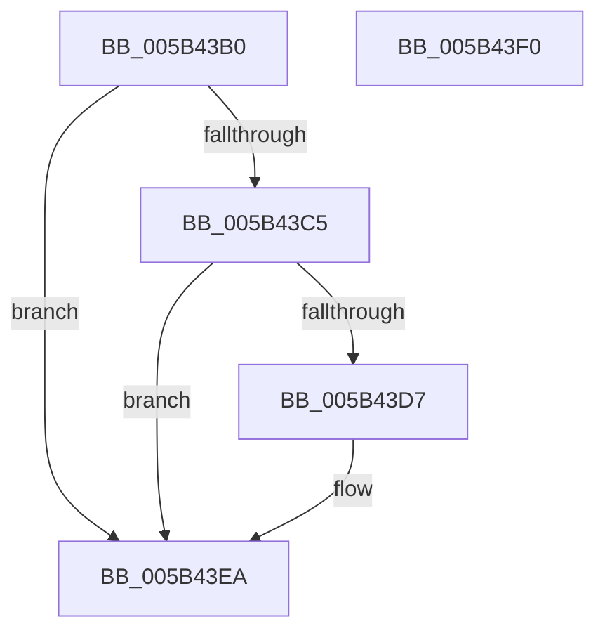

# KiCollectFullProcessName

- RVA: `0x005B43B0`–`0x005B43F1` (길이 `65` bytes)
- VA: `0x00000001405B43B0`
- 실행 섹션: `.text`
- PDB 이름 있음: `예`; PDB Function 태그: `아니요`
- unwind 정보 RVA: `0x0005CF00`
- 디코드: `18`개 명령, `65/65` bytes 표시
- 미해석 바이트: `0` (있으면 어셈블리에 `.byte`로 보존)

> 이 문서는 커널 이미지의 기계어와 PDB 기호를 분석해 생성했습니다. 4번과 5번은 함수 원형과 자료형을 바이너리 사용 방식에서 추정한 C 해석이며 원본 소스 복구 결과는 아닙니다.

## 1. Dependencies

- 직접 호출 지점: **2**; 고유 호출 대상: **2**
- 직접 호출자로 확인된 함수: **1**
- RIP 상대 이미지 참조: **0**

### Outgoing calls
- `0x005B43CE` → [MmIsAddressValidEx](../27/MmIsAddressValidEx_function_0027FDD0.md) (function, `0x0027FDD0`)
- `0x005B43E5` → [IoAddTriageDumpDataBlock](../42/IoAddTriageDumpDataBlock_function_00428374.md) (function, `0x00428374`)

### Direct callers
- [KiCollectTriageDumpDataBlocks](KiCollectTriageDumpDataBlocks_function_005B43F8.md) at `0x005B4421`
- [KiCollectTriageDumpDataBlocks](KiCollectTriageDumpDataBlocks_function_005B43F8.md) at `0x005B463B`

### Static image references
- 디코드된 RIP-relative 메모리 참조가 없습니다.

## 2. Other-region calls and transfers

- 다른 실행 섹션으로 향하는 call: **0**
- 별도 외부 분기/꼬리 이동을 확인하지 못했습니다.

## 3. Assembly (complete function range)

```asm
005B43B0  40 53                           push rbx
005B43B2  48 83 EC 20                     sub rsp, 0x20
005B43B6  F7 81 FC 05 00 00 00 10 00 00   test dword ptr [rcx + 0x5fc], 0x1000
005B43C0  48 8B D9                        mov rbx, rcx
005B43C3  75 25                           jne 0x1405b43ea
005B43C5  48 8B 89 50 03 00 00            mov rcx, qword ptr [rcx + 0x350]
005B43CC  33 D2                           xor edx, edx
005B43CE  E8 FD B9 CC FF                  call 0x14027fdd0
005B43D3  84 C0                           test al, al
005B43D5  74 13                           je 0x1405b43ea
005B43D7  48 8B 8B 50 03 00 00            mov rcx, qword ptr [rbx + 0x350]
005B43DE  0F B7 11                        movzx edx, word ptr [rcx]
005B43E1  48 8B 49 08                     mov rcx, qword ptr [rcx + 8]
005B43E5  E8 8A 3F E7 FF                  call 0x140428374
005B43EA  48 83 C4 20                     add rsp, 0x20
005B43EE  5B                              pop rbx
005B43EF  C3                              ret
005B43F0  CC                              int3
```

## 4. C-style interpretation (structured pseudocode)

```c
__int64 __fastcall KiCollectFullProcessName(__int64 a1, int a2)
{
    __int64 result;
    __int64 v_rsp;

    v_rsp = (v_rsp) - (32);
    if (((*(unsigned int *)(a1 + 1532)) & (0x1000ULL)) != 0) goto loc_005B43EA;
    a2 = 0;
    result = MmIsAddressValidEx(*(unsigned __int64 *)(a1 + 848), a2, a3, a4);
    if ((unsigned __int8)(result) != 0) {
        a1 = *(unsigned __int64 *)(a1 + 848);
        a2 = *(unsigned __int16 *)(a1);
        a1 = *(unsigned __int64 *)(a1 + 8);
        result = IoAddTriageDumpDataBlock(a1, a2, a3, a4);
    }
    v_rsp = (v_rsp) + (32);
    return result;
}
```

## 5. (Beta) C Style

```c
int64_t KiCollectFullProcessName(void *Arg1, int32_t Arg2)
{
    uint8_t *arg1 = (uint8_t *)Arg1;

    int64_t result;
    int64_t local_rsp;

    local_rsp = (local_rsp) - (32);
    if (((*(uint32_t *)(arg1 + 0x5FC)) & (0x1000ULL)) != 0) goto loc_005B43EA;
    Arg2 = 0;
    result = MmIsAddressValidEx(*(uint64_t *)(arg1 + 0x350), Arg2, a3, a4);
    if ((uint8_t)(result) != 0) {
        Arg1 = *(uint64_t *)(arg1 + 0x350);
        Arg2 = *(uint16_t *)(arg1);
        Arg1 = *(uint64_t *)(arg1 + 0x8);
        result = IoAddTriageDumpDataBlock(Arg1, Arg2, a3, a4);
    }
    local_rsp = (local_rsp) + (32);
    return result;
}
```

### 관측된 메모리 오프셋

구조체 형식이 확인되지 않은 접근은 인자 기준의 오프셋으로만 기록했습니다.

| 기준 인자 | 오프셋 표현 | 폭 (bit) | 접근 |
|---|---:|---:|---|
| `Arg1` | `+ 0x350` | `64` | `R` |
| `Arg1` | `+ 0x5FC` | `32` | `R` |

## 6. Execution-region graph

[열기: 2D/3D 그래프와 함수 탐색 컨트롤 패널](../../../control-panel.html?section=text&rva=0x005B43B0&view=graph)

- 2D 그래프는 위에서 아래로 흐르고, 3D 그래프는 빈 공간을 드래그해 회전합니다. Shift+드래그는 이동, 휠은 확대·축소, 함수 노드 선택은 대상 보고서 이동입니다.

### Static fallback


