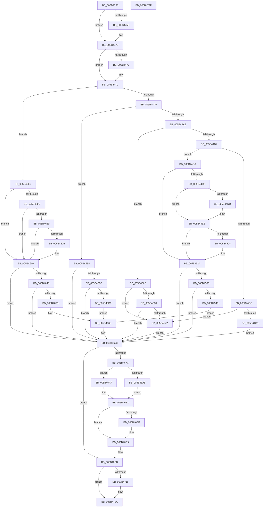

# KiCollectTriageDumpDataBlocks

- RVA: `0x005B43F8`–`0x005B4740` (길이 `840` bytes)
- VA: `0x00000001405B43F8`
- 실행 섹션: `.text`
- PDB 이름 있음: `예`; PDB Function 태그: `아니요`
- unwind 정보 RVA: `0x0005C954`
- 디코드: `178`개 명령, `840/840` bytes 표시
- 미해석 바이트: `0` (있으면 어셈블리에 `.byte`로 보존)

> 이 문서는 커널 이미지의 기계어와 PDB 기호를 분석해 생성했습니다. 4번과 5번은 함수 원형과 자료형을 바이너리 사용 방식에서 추정한 C 해석이며 원본 소스 복구 결과는 아닙니다.

## 1. Dependencies

- 직접 호출 지점: **30**; 고유 호출 대상: **10**
- 직접 호출자로 확인된 함수: **1**
- RIP 상대 이미지 참조: **16**

### Outgoing calls
- `0x005B4421` → [KiCollectFullProcessName](KiCollectFullProcessName_function_005B43B0.md) (function, `0x005B43B0`)
- `0x005B4432` → [IoAddTriageDumpDataBlock](../42/IoAddTriageDumpDataBlock_function_00428374.md) (function, `0x00428374`)
- `0x005B4443` → [IoAddTriageDumpDataBlock](../42/IoAddTriageDumpDataBlock_function_00428374.md) (function, `0x00428374`)
- `0x005B4459` → [IoAddTriageDumpDataBlock](../42/IoAddTriageDumpDataBlock_function_00428374.md) (function, `0x00428374`)
- `0x005B446D` → [IoAddTriageDumpDataBlock](../42/IoAddTriageDumpDataBlock_function_00428374.md) (function, `0x00428374`)
- `0x005B4477` → [KiSaveCurrentEtwTraceBuffer](KiSaveCurrentEtwTraceBuffer_function_005B5338.md) (function, `0x005B5338`)
- `0x005B4488` → [IoAddTriageDumpDataBlock](../42/IoAddTriageDumpDataBlock_function_00428374.md) (function, `0x00428374`)
- `0x005B44E9` → [IoAddTriageDumpDataBlock](../42/IoAddTriageDumpDataBlock_function_00428374.md) (function, `0x00428374`)
- `0x005B44FA` → [IoAddTriageDumpDataBlock](../42/IoAddTriageDumpDataBlock_function_00428374.md) (function, `0x00428374`)
- `0x005B4514` → [IoAddTriageDumpDataBlock](../42/IoAddTriageDumpDataBlock_function_00428374.md) (function, `0x00428374`)
- `0x005B4525` → [IoAddTriageDumpDataBlock](../42/IoAddTriageDumpDataBlock_function_00428374.md) (function, `0x00428374`)
- `0x005B454C` → [IoAddTriageDumpDataBlock](../42/IoAddTriageDumpDataBlock_function_00428374.md) (function, `0x00428374`)
- `0x005B457E` → [IoAddTriageDumpDataBlock](../42/IoAddTriageDumpDataBlock_function_00428374.md) (function, `0x00428374`)
- `0x005B458A` → [IopAddBugcheckTriageThread](../5A/IopAddBugcheckTriageThread_function_005A0CF8.md) (function, `0x005A0CF8`)
- `0x005B45A9` → [KiMarkBugCheckRegions](../50/KiMarkBugCheckRegions_function_0050A188.md) (function, `0x0050A188`)
- `0x005B45CC` → [MmIsAddressValidEx](../27/MmIsAddressValidEx_function_0027FDD0.md) (function, `0x0027FDD0`)
- `0x005B45EE` → [PopInternalAddToDumpFile](../5C/PopInternalAddToDumpFile_function_005CE634.md) (function, `0x005CE634`)
- `0x005B45F3` → [PsGetCurrentServerSiloGlobals](../2F/PsGetCurrentServerSiloGlobals_function_002FE1F0.md) (function, `0x002FE1F0`)
- `0x005B4633` → [IoAddTriageDumpDataBlock](../42/IoAddTriageDumpDataBlock_function_00428374.md) (function, `0x00428374`)
- `0x005B463B` → [KiCollectFullProcessName](KiCollectFullProcessName_function_005B43B0.md) (function, `0x005B43B0`)
- `0x005B4654` → [IoAddTriageDumpDataBlock](../42/IoAddTriageDumpDataBlock_function_00428374.md) (function, `0x00428374`)
- `0x005B466E` → [IoAddTriageDumpDataBlock](../42/IoAddTriageDumpDataBlock_function_00428374.md) (function, `0x00428374`)
- `0x005B46B6` → [KiIsAddressRangeValid](../4B/KiIsAddressRangeValid_function_004B0278.md) (function, `0x004B0278`)
- `0x005B46C4` → [IoAddTriageDumpDataBlock](../42/IoAddTriageDumpDataBlock_function_00428374.md) (function, `0x00428374`)
- `0x005B46D5` → [IoAddTriageDumpDataBlock](../42/IoAddTriageDumpDataBlock_function_00428374.md) (function, `0x00428374`)
- `0x005B46E6` → [IoAddTriageDumpDataBlock](../42/IoAddTriageDumpDataBlock_function_00428374.md) (function, `0x00428374`)
- `0x005B46F7` → [IoAddTriageDumpDataBlock](../42/IoAddTriageDumpDataBlock_function_00428374.md) (function, `0x00428374`)
- `0x005B4708` → [IoAddTriageDumpDataBlock](../42/IoAddTriageDumpDataBlock_function_00428374.md) (function, `0x00428374`)
- `0x005B470D` → [Feature_14FBugcheckMinidumpDiagnostics__private_IsEnabledDeviceUsageNoInline](../59/Feature_14FBugcheckMinidumpDiagnostics__private_IsEnabledDeviceUsageNoInline_function_005919CC.md) (function, `0x005919CC`)
- `0x005B4725` → [IoAddTriageDumpDataBlock](../42/IoAddTriageDumpDataBlock_function_00428374.md) (function, `0x00428374`)

### Direct callers
- [KeBugCheck2](KeBugCheck2_function_005B27D0.md) at `0x005B3121`

### Static image references
- `0x005B442B` → RVA `0x00E667E0` (`.data`; read)
- `0x005B443C` → RVA `0x00E667F0` (`.data`; read)
- `0x005B4481` → RVA `0x00E66C80` (`.data`; read)
- `0x005B448D` → RVA `0x00F47588` (`.data`; read)
- `0x005B44D3` → RVA `0x00F49620` (`.data`; read)
- `0x005B44F3` → RVA `0x00FCE260` (`ALMOSTRO`; read)
- `0x005B44FF` → RVA `0x00FC6E00` (`ALMOSTRO`; read)
- `0x005B4533` → RVA `0x00FC6D08` (`ALMOSTRO`; read)
- `0x005B4577` → RVA `0x00FC6ED0` (`ALMOSTRO`; read)
- `0x005B4594` → RVA `0x00F475A0` (`.data`; read)
- `0x005B459B` → RVA `0x00F47598` (`.data`; read)
- `0x005B45A2` → RVA `0x00F47590` (`.data`; read)
- `0x005B4673` → RVA `0x01201841` (`CFGRO`; read)
- `0x005B46CE` → RVA `0x01201842` (`CFGRO`; read)
- `0x005B46DF` → RVA `0x00FC80A0` (`ALMOSTRO`; read)
- `0x005B4701` → RVA `0x01201843` (`CFGRO`; read)

## 2. Other-region calls and transfers

- 다른 실행 섹션으로 향하는 call: **0**
- 별도 외부 분기/꼬리 이동을 확인하지 못했습니다.

## 3. Assembly (complete function range)

```asm
005B43F8  48 89 5C 24 08                  mov qword ptr [rsp + 8], rbx
005B43FD  48 89 6C 24 10                  mov qword ptr [rsp + 0x10], rbp
005B4402  48 89 74 24 18                  mov qword ptr [rsp + 0x18], rsi
005B4407  57                              push rdi
005B4408  48 83 EC 20                     sub rsp, 0x20
005B440C  8B D9                           mov ebx, ecx
005B440E  40 8A FA                        mov dil, dl
005B4411  65 48 8B 0C 25 88 01 00 00      mov rcx, qword ptr gs:[0x188]
005B441A  48 8B 89 B8 00 00 00            mov rcx, qword ptr [rcx + 0xb8]
005B4421  E8 8A FF FF FF                  call 0x1405b43b0
005B4426  BA 08 00 00 00                  mov edx, 8
005B442B  48 8D 0D AE 23 8B 00            lea rcx, [rip + 0x8b23ae]
005B4432  E8 3D 3F E7 FF                  call 0x140428374
005B4437  BA 04 00 00 00                  mov edx, 4
005B443C  48 8D 0D AD 23 8B 00            lea rcx, [rip + 0x8b23ad]
005B4443  E8 2C 3F E7 FF                  call 0x140428374
005B4448  48 8B 0D 91 23 8B 00            mov rcx, qword ptr [rip + 0x8b2391]
005B444F  33 F6                           xor esi, esi
005B4451  48 85 C9                        test rcx, rcx
005B4454  74 1C                           je 0x1405b4472
005B4456  8D 56 10                        lea edx, [rsi + 0x10]
005B4459  E8 16 3F E7 FF                  call 0x140428374
005B445E  48 8B 0D 7B 23 8B 00            mov rcx, qword ptr [rip + 0x8b237b]
005B4465  0F B7 51 02                     movzx edx, word ptr [rcx + 2]
005B4469  48 8B 49 08                     mov rcx, qword ptr [rcx + 8]
005B446D  E8 02 3F E7 FF                  call 0x140428374
005B4472  40 84 FF                        test dil, dil
005B4475  75 05                           jne 0x1405b447c
005B4477  E8 BC 0E 00 00                  call 0x1405b5338
005B447C  BA 60 00 00 00                  mov edx, 0x60
005B4481  48 8D 0D F8 27 8B 00            lea rcx, [rip + 0x8b27f8]
005B4488  E8 E7 3E E7 FF                  call 0x140428374
005B448D  48 8B 0D F4 30 99 00            mov rcx, qword ptr [rip + 0x9930f4]
005B4494  BD 00 10 00 00                  mov ebp, 0x1000
005B4499  81 EB EF 00 00 00               sub ebx, 0xef
005B449F  0F 84 42 01 00 00               je 0x1405b45e7
005B44A5  83 EB 1A                        sub ebx, 0x1a
005B44A8  0F 84 E6 00 00 00               je 0x1405b4594
005B44AE  83 EB 46                        sub ebx, 0x46
005B44B1  0F 84 AB 00 00 00               je 0x1405b4562
005B44B7  83 EB 3C                        sub ebx, 0x3c
005B44BA  74 0E                           je 0x1405b44ca
005B44BC  83 FB 60                        cmp ebx, 0x60
005B44BF  0F 84 AD 00 00 00               je 0x1405b4572
005B44C5  E9 A9 01 00 00                  jmp 0x1405b4673
005B44CA  48 81 F9 8C 01 00 00            cmp rcx, 0x18c
005B44D1  75 57                           jne 0x1405b452a
005B44D3  8B 05 47 51 99 00               mov eax, dword ptr [rip + 0x995147]
005B44D9  85 C0                           test eax, eax
005B44DB  74 11                           je 0x1405b44ee
005B44DD  BA 04 00 00 00                  mov edx, 4
005B44E2  48 8D 0D 37 51 99 00            lea rcx, [rip + 0x995137]
005B44E9  E8 86 3E E7 FF                  call 0x140428374
005B44EE  BA 08 0A 00 00                  mov edx, 0xa08
005B44F3  48 8D 0D 66 9D A1 00            lea rcx, [rip + 0xa19d66]
005B44FA  E8 75 3E E7 FF                  call 0x140428374
005B44FF  48 39 35 FA 28 A1 00            cmp qword ptr [rip + 0xa128fa], rsi
005B4506  74 22                           je 0x1405b452a
005B4508  BA 08 00 00 00                  mov edx, 8
005B450D  48 8D 0D EC 28 A1 00            lea rcx, [rip + 0xa128ec]
005B4514  E8 5B 3E E7 FF                  call 0x140428374
005B4519  48 8B 0D E0 28 A1 00            mov rcx, qword ptr [rip + 0xa128e0]
005B4520  BA 08 00 05 00                  mov edx, 0x50008
005B4525  E8 4A 3E E7 FF                  call 0x140428374
005B452A  40 84 FF                        test dil, dil
005B452D  0F 84 40 01 00 00               je 0x1405b4673
005B4533  48 39 35 CE 27 A1 00            cmp qword ptr [rip + 0xa127ce], rsi
005B453A  0F 84 33 01 00 00               je 0x1405b4673
005B4540  BA 08 00 00 00                  mov edx, 8
005B4545  48 8D 0D BC 27 A1 00            lea rcx, [rip + 0xa127bc]
005B454C  E8 23 3E E7 FF                  call 0x140428374
005B4551  48 8B 0D B0 27 A1 00            mov rcx, qword ptr [rip + 0xa127b0]
005B4558  BA 00 20 00 00                  mov edx, 0x2000
005B455D  E9 0C 01 00 00                  jmp 0x1405b466e
005B4562  48 83 F9 04                     cmp rcx, 4
005B4566  74 0A                           je 0x1405b4572
005B4568  48 83 F9 64                     cmp rcx, 0x64
005B456C  0F 85 01 01 00 00               jne 0x1405b4673
005B4572  BA 08 00 00 00                  mov edx, 8
005B4577  48 8D 0D 52 29 A1 00            lea rcx, [rip + 0xa12952]
005B457E  E8 F1 3D E7 FF                  call 0x140428374
005B4583  48 8B 0D 46 29 A1 00            mov rcx, qword ptr [rip + 0xa12946]
005B458A  E8 69 C7 FE FF                  call 0x1405a0cf8
005B458F  E9 DF 00 00 00                  jmp 0x1405b4673
005B4594  4C 8B 0D 05 30 99 00            mov r9, qword ptr [rip + 0x993005]
005B459B  4C 8B 05 F6 2F 99 00            mov r8, qword ptr [rip + 0x992ff6]
005B45A2  48 8B 15 E7 2F 99 00            mov rdx, qword ptr [rip + 0x992fe7]
005B45A9  E8 DA 5B F5 FF                  call 0x14050a188
005B45AE  48 83 3D EA 2F 99 00 2F         cmp qword ptr [rip + 0x992fea], 0x2f
005B45B6  0F 85 B7 00 00 00               jne 0x1405b4673
005B45BC  48 8B 1D D5 2F 99 00            mov rbx, qword ptr [rip + 0x992fd5]
005B45C3  33 D2                           xor edx, edx
005B45C5  48 8D 8B 08 05 00 00            lea rcx, [rbx + 0x508]
005B45CC  E8 FF B7 CC FF                  call 0x14027fdd0
005B45D1  84 C0                           test al, al
005B45D3  0F 84 9A 00 00 00               je 0x1405b4673
005B45D9  48 8B 8B 08 05 00 00            mov rcx, qword ptr [rbx + 0x508]
005B45E0  8B D5                           mov edx, ebp
005B45E2  E9 87 00 00 00                  jmp 0x1405b466e
005B45E7  45 33 C0                        xor r8d, r8d
005B45EA  33 D2                           xor edx, edx
005B45EC  33 C9                           xor ecx, ecx
005B45EE  E8 41 A0 01 00                  call 0x1405ce634
005B45F3  E8 F8 9B D4 FF                  call 0x1402fe1f0
005B45F8  65 48 8B 3C 25 88 01 00 00      mov rdi, qword ptr gs:[0x188]
005B4601  48 8B D8                        mov rbx, rax
005B4604  80 BF 4A 02 00 00 01            cmp byte ptr [rdi + 0x24a], 1
005B460B  75 33                           jne 0x1405b4640
005B460D  48 8B BF 78 02 00 00            mov rdi, qword ptr [rdi + 0x278]
005B4614  48 85 FF                        test rdi, rdi
005B4617  74 27                           je 0x1405b4640
005B4619  65 48 8B 04 25 88 01 00 00      mov rax, qword ptr gs:[0x188]
005B4622  48 3B B8 B8 00 00 00            cmp rdi, qword ptr [rax + 0xb8]
005B4629  74 15                           je 0x1405b4640
005B462B  BA 40 08 00 00                  mov edx, 0x840
005B4630  48 8B CF                        mov rcx, rdi
005B4633  E8 3C 3D E7 FF                  call 0x140428374
005B4638  48 8B CF                        mov rcx, rdi
005B463B  E8 70 FD FF FF                  call 0x1405b43b0
005B4640  39 B3 58 05 00 00               cmp dword ptr [rbx + 0x558], esi
005B4646  74 2B                           je 0x1405b4673
005B4648  BA 30 00 00 00                  mov edx, 0x30
005B464D  48 8D 8B 58 05 00 00            lea rcx, [rbx + 0x558]
005B4654  E8 1B 3D E7 FF                  call 0x140428374
005B4659  0F B7 83 68 05 00 00            movzx eax, word ptr [rbx + 0x568]
005B4660  66 85 C0                        test ax, ax
005B4663  74 0E                           je 0x1405b4673
005B4665  48 8B 8B 70 05 00 00            mov rcx, qword ptr [rbx + 0x570]
005B466C  8B D0                           mov edx, eax
005B466E  E8 01 3D E7 FF                  call 0x140428374
005B4673  40 38 35 C7 D1 C4 00            cmp byte ptr [rip + 0xc4d1c7], sil
005B467A  74 6F                           je 0x1405b46eb
005B467C  65 48 8B 04 25 88 01 00 00      mov rax, qword ptr gs:[0x188]
005B4685  48 8B B8 20 04 00 00            mov rdi, qword ptr [rax + 0x420]
005B468C  48 8B 98 18 04 00 00            mov rbx, qword ptr [rax + 0x418]
005B4693  48 81 E7 00 F0 FF FF            and rdi, 0xfffffffffffff000
005B469A  48 2B DD                        sub rbx, rbp
005B469D  48 03 FD                        add rdi, rbp
005B46A0  48 8B C3                        mov rax, rbx
005B46A3  48 2B C7                        sub rax, rdi
005B46A6  48 3B C5                        cmp rax, rbp
005B46A9  73 04                           jae 0x1405b46af
005B46AB  2B DF                           sub ebx, edi
005B46AD  EB 02                           jmp 0x1405b46b1
005B46AF  8B DD                           mov ebx, ebp
005B46B1  8B D3                           mov edx, ebx
005B46B3  48 8B CF                        mov rcx, rdi
005B46B6  E8 BD BB EF FF                  call 0x1404b0278
005B46BB  84 C0                           test al, al
005B46BD  74 0A                           je 0x1405b46c9
005B46BF  8B D3                           mov edx, ebx
005B46C1  48 8B CF                        mov rcx, rdi
005B46C4  E8 AB 3C E7 FF                  call 0x140428374
005B46C9  BA 01 00 00 00                  mov edx, 1
005B46CE  48 8D 0D 6D D1 C4 00            lea rcx, [rip + 0xc4d16d]
005B46D5  E8 9A 3C E7 FF                  call 0x140428374
005B46DA  BA 20 01 00 00                  mov edx, 0x120
005B46DF  48 8D 0D BA 39 A1 00            lea rcx, [rip + 0xa139ba]
005B46E6  E8 89 3C E7 FF                  call 0x140428374
005B46EB  BA 01 00 00 00                  mov edx, 1
005B46F0  48 8D 0D 4A D1 C4 00            lea rcx, [rip + 0xc4d14a]
005B46F7  E8 78 3C E7 FF                  call 0x140428374
005B46FC  BA 01 00 00 00                  mov edx, 1
005B4701  48 8D 0D 3B D1 C4 00            lea rcx, [rip + 0xc4d13b]
005B4708  E8 67 3C E7 FF                  call 0x140428374
005B470D  E8 BA D2 FD FF                  call 0x1405919cc
005B4712  85 C0                           test eax, eax
005B4714  74 14                           je 0x1405b472a
005B4716  BA D8 03 00 00                  mov edx, 0x3d8
005B471B  48 B9 00 00 00 00 80 F7 FF FF   movabs rcx, 0xfffff78000000000
005B4725  E8 4A 3C E7 FF                  call 0x140428374
005B472A  48 8B 5C 24 30                  mov rbx, qword ptr [rsp + 0x30]
005B472F  48 8B 6C 24 38                  mov rbp, qword ptr [rsp + 0x38]
005B4734  48 8B 74 24 40                  mov rsi, qword ptr [rsp + 0x40]
005B4739  48 83 C4 20                     add rsp, 0x20
005B473D  5F                              pop rdi
005B473E  C3                              ret
005B473F  CC                              int3
```

## 4. C-style interpretation (structured pseudocode)

```c
__int64 __fastcall KiCollectTriageDumpDataBlocks(int a1, unsigned __int8 a2)
{
    __int64 result;
    __int64 v_rbx;
    __int64 v_rdi;
    __int64 v_rsi;
    __int64 v_rsp;
    unsigned __int64 v_stack_p10;
    unsigned __int64 v_stack_p18;
    unsigned __int64 v_stack_p8;

    v_stack_p8 = v_rbx;
    v_stack_p10 = v_rbp;
    v_stack_p18 = v_rsi;
    v_rsp = (v_rsp) - (32);
    result = KiCollectFullProcessName(*(unsigned __int64 *)(*(unsigned __int64 *)(gs_base + (0 + 392)) + 184), a2, a3, a4);
    result = IoAddTriageDumpDataBlock(v_rip + 9118638, 8, a3, a4);
    result = IoAddTriageDumpDataBlock(v_rip + 9118637, 4, a3, a4);
    v_rsi = 0;
    if (*(unsigned __int64 *)(v_rip + 9118609) != 0) {
        a2 = v_rsi + 16;
        result = IoAddTriageDumpDataBlock(*(unsigned __int64 *)(v_rip + 9118609), a2, a3, a4);
        a1 = *(unsigned __int64 *)(v_rip + 9118587);
        a2 = *(unsigned __int16 *)(a1 + 2);
        a1 = *(unsigned __int64 *)(a1 + 8);
        result = IoAddTriageDumpDataBlock(a1, a2, a3, a4);
    }
    if (a2 == 0) {
        result = KiSaveCurrentEtwTraceBuffer(a1, a2, a3, a4);
    }
    result = IoAddTriageDumpDataBlock(v_rip + 9119736, 96, a3, a4);
    v_rbx = (unsigned int)(((unsigned int)(a1)) - (239));
    if (condition_is_equal) goto loc_005B45E7;
    v_rbx = (unsigned int)((v_rbx) - (26));
    if (condition_is_equal) goto loc_005B4594;
    v_rbx = (unsigned int)((v_rbx) - (70));
    if (condition_is_equal) goto loc_005B4562;
    v_rbx = (unsigned int)((v_rbx) - (60));
    if (condition_is_equal) goto loc_005B44CA;
    if (((unsigned int)(v_rbx)) == 96) goto loc_005B4572;
    goto loc_005B4673;
loc_005B44CA:
    if ((*(unsigned __int64 *)(v_rip + 10039540)) != 396) goto loc_005B452A;
    result = (unsigned int)(*(unsigned int *)(v_rip + 10047815));
    if ((unsigned int)((unsigned int)(*(unsigned int *)(v_rip + 10047815))) != 0) {
        a2 = 4;
        a1 = v_rip + 10047799;
        result = IoAddTriageDumpDataBlock(a1, a2, a3, a4);
    }
    result = IoAddTriageDumpDataBlock(v_rip + 10591590, (unsigned int)(0xA08ULL), a3, a4);
    if ((*(unsigned __int64 *)(v_rip + 10561786)) != 0) {
        a2 = 8;
        a1 = v_rip + 10561772;
        result = IoAddTriageDumpDataBlock(a1, a2, a3, a4);
        a1 = *(unsigned __int64 *)(v_rip + 10561760);
        a2 = 0x50008ULL;
        result = IoAddTriageDumpDataBlock(a1, a2, a3, a4);
    }
    if (a2 == 0) goto loc_005B4673;
    if ((*(unsigned __int64 *)(v_rip + 10561486)) == 0) goto loc_005B4673;
    result = IoAddTriageDumpDataBlock(v_rip + 10561468, 8, a3, a4);
    goto loc_005B466E;
loc_005B4562:
    if ((*(unsigned __int64 *)(v_rip + 10561456)) == 4) goto loc_005B4572;
    if ((*(unsigned __int64 *)(v_rip + 10561456)) != 100) goto loc_005B4673;
loc_005B4572:
    result = IoAddTriageDumpDataBlock(v_rip + 10561874, 8, a3, a4);
    result = IopAddBugcheckTriageThread(*(unsigned __int64 *)(v_rip + 10561862), 8, a3, a4);
    goto loc_005B4673;
loc_005B4594:
    result = KiMarkBugCheckRegions(*(unsigned __int64 *)(v_rip + 10561862), *(unsigned __int64 *)(v_rip + 10039271), *(unsigned __int64 *)(v_rip + 10039286), *(unsigned __int64 *)(v_rip + 10039301));
    if ((*(unsigned __int64 *)(v_rip + 10039274)) != 47) goto loc_005B4673;
    a2 = 0;
    result = MmIsAddressValidEx(*(unsigned __int64 *)(v_rip + 10039253) + 1288, a2, *(unsigned __int64 *)(v_rip + 10039286), *(unsigned __int64 *)(v_rip + 10039301));
    if ((unsigned __int8)(result) == 0) goto loc_005B4673;
    goto loc_005B466E;
loc_005B45E7:
    a3 = 0;
    a2 = 0;
    a1 = 0;
    result = PopInternalAddToDumpFile(a1, a2, a3, *(unsigned __int64 *)(v_rip + 10039301));
    result = PsGetCurrentServerSiloGlobals(a1, a2, a3, *(unsigned __int64 *)(v_rip + 10039301));
    if ((*(unsigned __int8 *)(*(unsigned __int64 *)(gs_base + (0 + 392)) + 586)) != 1) goto loc_005B4640;
    if (*(unsigned __int64 *)(*(unsigned __int64 *)(gs_base + (0 + 392)) + 632) == 0) goto loc_005B4640;
    result = *(unsigned __int64 *)(gs_base + (0 + 392));
    if ((*(unsigned __int64 *)(*(unsigned __int64 *)(gs_base + (0 + 392)) + 632)) != (*(unsigned __int64 *)(*(unsigned __int64 *)(gs_base + (0 + 392)) + 184))) {
        a2 = 0x840ULL;
        a1 = *(unsigned __int64 *)(*(unsigned __int64 *)(gs_base + (0 + 392)) + 632);
        result = IoAddTriageDumpDataBlock(a1, a2, a3, *(unsigned __int64 *)(v_rip + 10039301));
        a1 = *(unsigned __int64 *)(*(unsigned __int64 *)(gs_base + (0 + 392)) + 632);
        result = KiCollectFullProcessName(a1, a2, a3, *(unsigned __int64 *)(v_rip + 10039301));
    }
    if ((*(unsigned int *)(result + 1368)) == 0) goto loc_005B4673;
    result = IoAddTriageDumpDataBlock(result + 1368, 48, a3, *(unsigned __int64 *)(v_rip + 10039301));
    if ((unsigned __int16)(*(unsigned __int16 *)(result + 1384)) == 0) goto loc_005B4673;
loc_005B466E:
    result = IoAddTriageDumpDataBlock(*(unsigned __int64 *)(result + 1392), (unsigned int)((unsigned int)(*(unsigned __int16 *)(result + 1384))), a3, *(unsigned __int64 *)(v_rip + 10039301));
loc_005B4673:
    if ((*(unsigned __int8 *)(v_rip + 12898759)) == 0) goto loc_005B46EB;
    v_rdi = (*(unsigned __int64 *)(*(unsigned __int64 *)(gs_base + (0 + 392)) + 1056)) & (0xFFFFFFFFFFFFF000ULL);
    v_rbx = (*(unsigned __int64 *)(*(unsigned __int64 *)(gs_base + (0 + 392)) + 1048)) - ((unsigned int)(0x1000ULL));
    v_rdi = (v_rdi) + ((unsigned int)(0x1000ULL));
    result = (v_rbx) - (v_rdi);
    if (result >= ((unsigned int)(0x1000ULL))) goto loc_005B46AF;
    v_rbx = (unsigned int)((v_rbx) - ((unsigned int)(v_rdi)));
    goto loc_005B46B1;
loc_005B46AF:
loc_005B46B1:
    result = KiIsAddressRangeValid(v_rdi, (unsigned int)((unsigned int)((unsigned int)((unsigned int)((unsigned int)(0x1000ULL))))), a3, *(unsigned __int64 *)(v_rip + 10039301));
    if ((unsigned __int8)(result) != 0) {
        a2 = (unsigned int)((unsigned int)((unsigned int)((unsigned int)(0x1000ULL))));
        a1 = v_rdi;
        result = IoAddTriageDumpDataBlock(a1, a2, a3, *(unsigned __int64 *)(v_rip + 10039301));
    }
    result = IoAddTriageDumpDataBlock(v_rip + 12898669, 1, a3, *(unsigned __int64 *)(v_rip + 10039301));
    result = IoAddTriageDumpDataBlock(v_rip + 10566074, 288, a3, *(unsigned __int64 *)(v_rip + 10039301));
loc_005B46EB:
    result = IoAddTriageDumpDataBlock(v_rip + 12898634, 1, a3, *(unsigned __int64 *)(v_rip + 10039301));
    result = IoAddTriageDumpDataBlock(v_rip + 12898619, 1, a3, *(unsigned __int64 *)(v_rip + 10039301));
    result = Feature_14FBugcheckMinidumpDiagnostics__private_IsEnabledDeviceUsageNoInline(v_rip + 12898619, 1, a3, *(unsigned __int64 *)(v_rip + 10039301));
    if ((unsigned int)(result) != 0) {
        a2 = 984;
        result = IoAddTriageDumpDataBlock(v_rip + 12898619, a2, a3, *(unsigned __int64 *)(v_rip + 10039301));
    }
    v_rsp = (v_rsp) + (32);
    return result;
}
```

## 5. (Beta) C Style

```c
int64_t KiCollectTriageDumpDataBlocks(int32_t Arg1, uint8_t Arg2)
{
    int64_t result;
    int64_t local_rbx;
    int64_t local_rdi;
    int64_t local_rsi;
    int64_t local_rsp;
    uint64_t v_stack_p10;
    uint64_t v_stack_p18;
    uint64_t v_stack_p8;

    v_stack_p8 = local_rbx;
    v_stack_p10 = local_rbp;
    v_stack_p18 = local_rsi;
    local_rsp = (local_rsp) - (32);
    result = KiCollectFullProcessName(*(uint64_t *)(*(uint64_t *)(gs_base + (0 + 0x188)) + 0xB8), Arg2, a3, a4);
    result = IoAddTriageDumpDataBlock(v_rip + 9118638, 8, a3, a4);
    result = IoAddTriageDumpDataBlock(v_rip + 9118637, 4, a3, a4);
    local_rsi = 0;
    if (*(uint64_t *)(v_rip + 0x8B2391) != 0) {
        Arg2 = local_rsi + 16;
        result = IoAddTriageDumpDataBlock(*(uint64_t *)(v_rip + 0x8B2391), Arg2, a3, a4);
        Arg1 = *(uint64_t *)(v_rip + 0x8B237B);
        Arg2 = *(uint16_t *)(Arg1 + 0x2);
        Arg1 = *(uint64_t *)(Arg1 + 0x8);
        result = IoAddTriageDumpDataBlock(Arg1, Arg2, a3, a4);
    }
    if (Arg2 == 0) {
        result = KiSaveCurrentEtwTraceBuffer(Arg1, Arg2, a3, a4);
    }
    result = IoAddTriageDumpDataBlock(v_rip + 9119736, 96, a3, a4);
    local_rbx = (uint32_t)(((uint32_t)(Arg1)) - (239));
    if (condition_is_equal) goto loc_005B45E7;
    local_rbx = (uint32_t)((local_rbx) - (26));
    if (condition_is_equal) goto loc_005B4594;
    local_rbx = (uint32_t)((local_rbx) - (70));
    if (condition_is_equal) goto loc_005B4562;
    local_rbx = (uint32_t)((local_rbx) - (60));
    if (condition_is_equal) goto loc_005B44CA;
    if (((uint32_t)(local_rbx)) == 96) goto loc_005B4572;
    goto loc_005B4673;
loc_005B44CA:
    if ((*(uint64_t *)(v_rip + 0x9930F4)) != 396) goto loc_005B452A;
    result = (uint32_t)(*(uint32_t *)(v_rip + 0x995147));
    if ((uint32_t)((uint32_t)(*(uint32_t *)(v_rip + 0x995147))) != 0) {
        Arg2 = 4;
        Arg1 = v_rip + 10047799;
        result = IoAddTriageDumpDataBlock(Arg1, Arg2, a3, a4);
    }
    result = IoAddTriageDumpDataBlock(v_rip + 10591590, (uint32_t)(0xA08ULL), a3, a4);
    if ((*(uint64_t *)(v_rip + 0xA128FA)) != 0) {
        Arg2 = 8;
        Arg1 = v_rip + 10561772;
        result = IoAddTriageDumpDataBlock(Arg1, Arg2, a3, a4);
        Arg1 = *(uint64_t *)(v_rip + 0xA128E0);
        Arg2 = 0x50008ULL;
        result = IoAddTriageDumpDataBlock(Arg1, Arg2, a3, a4);
    }
    if (Arg2 == 0) goto loc_005B4673;
    if ((*(uint64_t *)(v_rip + 0xA127CE)) == 0) goto loc_005B4673;
    result = IoAddTriageDumpDataBlock(v_rip + 10561468, 8, a3, a4);
    goto loc_005B466E;
loc_005B4562:
    if ((*(uint64_t *)(v_rip + 0xA127B0)) == 4) goto loc_005B4572;
    if ((*(uint64_t *)(v_rip + 0xA127B0)) != 100) goto loc_005B4673;
loc_005B4572:
    result = IoAddTriageDumpDataBlock(v_rip + 10561874, 8, a3, a4);
    result = IopAddBugcheckTriageThread(*(uint64_t *)(v_rip + 0xA12946), 8, a3, a4);
    goto loc_005B4673;
loc_005B4594:
    result = KiMarkBugCheckRegions(*(uint64_t *)(v_rip + 0xA12946), *(uint64_t *)(v_rip + 0x992FE7), *(uint64_t *)(v_rip + 0x992FF6), *(uint64_t *)(v_rip + 0x993005));
    if ((*(uint64_t *)(v_rip + 0x992FEA)) != 47) goto loc_005B4673;
    Arg2 = 0;
    result = MmIsAddressValidEx(*(uint64_t *)(v_rip + 0x992FD5) + 1288, Arg2, *(uint64_t *)(v_rip + 0x992FF6), *(uint64_t *)(v_rip + 0x993005));
    if ((uint8_t)(result) == 0) goto loc_005B4673;
    goto loc_005B466E;
loc_005B45E7:
    a3 = 0;
    Arg2 = 0;
    Arg1 = 0;
    result = PopInternalAddToDumpFile(Arg1, Arg2, a3, *(uint64_t *)(v_rip + 0x993005));
    result = PsGetCurrentServerSiloGlobals(Arg1, Arg2, a3, *(uint64_t *)(v_rip + 0x993005));
    if ((*(uint8_t *)(*(uint64_t *)(gs_base + (0 + 0x188)) + 0x24A)) != 1) goto loc_005B4640;
    if (*(uint64_t *)(*(uint64_t *)(gs_base + (0 + 0x188)) + 0x278) == 0) goto loc_005B4640;
    result = *(uint64_t *)(gs_base + (0 + 0x188));
    if ((*(uint64_t *)(*(uint64_t *)(gs_base + (0 + 0x188)) + 0x278)) != (*(uint64_t *)(*(uint64_t *)(gs_base + (0 + 0x188)) + 0xB8))) {
        Arg2 = 0x840ULL;
        Arg1 = *(uint64_t *)(*(uint64_t *)(gs_base + (0 + 0x188)) + 0x278);
        result = IoAddTriageDumpDataBlock(Arg1, Arg2, a3, *(uint64_t *)(v_rip + 0x993005));
        Arg1 = *(uint64_t *)(*(uint64_t *)(gs_base + (0 + 0x188)) + 0x278);
        result = KiCollectFullProcessName(Arg1, Arg2, a3, *(uint64_t *)(v_rip + 0x993005));
    }
    if ((*(uint32_t *)(result + 0x558)) == 0) goto loc_005B4673;
    result = IoAddTriageDumpDataBlock(result + 1368, 48, a3, *(uint64_t *)(v_rip + 0x993005));
    if ((uint16_t)(*(uint16_t *)(result + 0x568)) == 0) goto loc_005B4673;
loc_005B466E:
    result = IoAddTriageDumpDataBlock(*(uint64_t *)(result + 0x570), (uint32_t)((uint32_t)(*(uint16_t *)(result + 0x568))), a3, *(uint64_t *)(v_rip + 0x993005));
loc_005B4673:
    if ((*(uint8_t *)(v_rip + 0xC4D1C7)) == 0) goto loc_005B46EB;
    local_rdi = (*(uint64_t *)(*(uint64_t *)(gs_base + (0 + 0x188)) + 0x420)) & (0xFFFFFFFFFFFFF000ULL);
    local_rbx = (*(uint64_t *)(*(uint64_t *)(gs_base + (0 + 0x188)) + 0x418)) - ((uint32_t)(0x1000ULL));
    local_rdi = (local_rdi) + ((uint32_t)(0x1000ULL));
    result = (local_rbx) - (local_rdi);
    if (result >= ((uint32_t)(0x1000ULL))) goto loc_005B46AF;
    local_rbx = (uint32_t)((local_rbx) - ((uint32_t)(local_rdi)));
    goto loc_005B46B1;
loc_005B46AF:
loc_005B46B1:
    result = KiIsAddressRangeValid(local_rdi, (uint32_t)((uint32_t)((uint32_t)((uint32_t)((uint32_t)(0x1000ULL))))), a3, *(uint64_t *)(v_rip + 0x993005));
    if ((uint8_t)(result) != 0) {
        Arg2 = (uint32_t)((uint32_t)((uint32_t)((uint32_t)(0x1000ULL))));
        Arg1 = local_rdi;
        result = IoAddTriageDumpDataBlock(Arg1, Arg2, a3, *(uint64_t *)(v_rip + 0x993005));
    }
    result = IoAddTriageDumpDataBlock(v_rip + 12898669, 1, a3, *(uint64_t *)(v_rip + 0x993005));
    result = IoAddTriageDumpDataBlock(v_rip + 10566074, 288, a3, *(uint64_t *)(v_rip + 0x993005));
loc_005B46EB:
    result = IoAddTriageDumpDataBlock(v_rip + 12898634, 1, a3, *(uint64_t *)(v_rip + 0x993005));
    result = IoAddTriageDumpDataBlock(v_rip + 12898619, 1, a3, *(uint64_t *)(v_rip + 0x993005));
    result = Feature_14FBugcheckMinidumpDiagnostics__private_IsEnabledDeviceUsageNoInline(v_rip + 12898619, 1, a3, *(uint64_t *)(v_rip + 0x993005));
    if ((uint32_t)(result) != 0) {
        Arg2 = 984;
        result = IoAddTriageDumpDataBlock(v_rip + 12898619, Arg2, a3, *(uint64_t *)(v_rip + 0x993005));
    }
    local_rsp = (local_rsp) + (32);
    return result;
}
```

## 6. Execution-region graph

[열기: 2D/3D 그래프와 함수 탐색 컨트롤 패널](../../../control-panel.html?section=text&rva=0x005B43F8&view=graph)

- 2D 그래프는 위에서 아래로 흐르고, 3D 그래프는 빈 공간을 드래그해 회전합니다. Shift+드래그는 이동, 휠은 확대·축소, 함수 노드 선택은 대상 보고서 이동입니다.

### Static fallback


