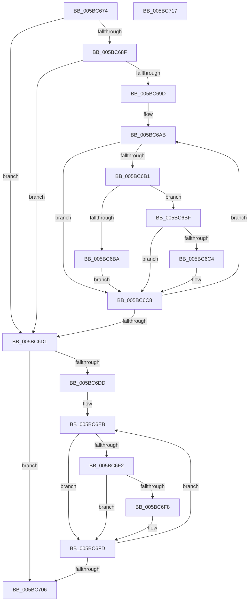

# KiCommitGroupSubNodeAssignments

- RVA: `0x005BC674`–`0x005BC718` (길이 `164` bytes)
- VA: `0x00000001405BC674`
- 실행 섹션: `.text`
- PDB 이름 있음: `예`; PDB Function 태그: `아니요`
- unwind 정보 RVA: `0x00071750`
- 디코드: `47`개 명령, `164/164` bytes 표시
- 미해석 바이트: `0` (있으면 어셈블리에 `.byte`로 보존)

> 이 문서는 커널 이미지의 기계어와 PDB 기호를 분석해 생성했습니다. 4번과 5번은 함수 원형과 자료형을 바이너리 사용 방식에서 추정한 C 해석이며 원본 소스 복구 결과는 아닙니다.

## 1. Dependencies

- 직접 호출 지점: **0**; 고유 호출 대상: **0**
- 직접 호출자로 확인된 함수: **2**
- RIP 상대 이미지 참조: **4**

### Outgoing calls
- 직접 디코드된 call 명령이 없습니다.

### Direct callers
- [KiAllocateProcessorNumber](KiAllocateProcessorNumber_function_005BC2FC.md) at `0x005BC393`
- [Phase1InitializationDiscard](../../init/C1/Phase1InitializationDiscard_function_00C1C728.md) at `0x00C1CA7B`

### Static image references
- `0x005BC679` → RVA `0x00E668F8` (`.data`; read)
- `0x005BC68F` → RVA `0x00F21AC8` (`.data`; read)
- `0x005BC69D` → RVA `0x00F21AF0` (`.data`; read)
- `0x005BC70F` → RVA `0x00E668F8` (`.data`; write)

## 2. Other-region calls and transfers

- 다른 실행 섹션으로 향하는 call: **0**
- 별도 외부 분기/꼬리 이동을 확인하지 못했습니다.

## 3. Assembly (complete function range)

```asm
005BC674  48 89 5C 24 08                  mov qword ptr [rsp + 8], rbx
005BC679  0F B7 15 78 A2 8A 00            movzx edx, word ptr [rip + 0x8aa278]
005BC680  33 DB                           xor ebx, ebx
005BC682  44 0F B7 C1                     movzx r8d, cx
005BC686  44 8D 5B 01                     lea r11d, [rbx + 1]
005BC68A  66 3B CA                        cmp cx, dx
005BC68D  74 42                           je 0x1405bc6d1
005BC68F  44 0F B7 0D 31 54 96 00         movzx r9d, word ptr [rip + 0x965431]
005BC697  66 41 3B D9                     cmp bx, r9w
005BC69B  73 34                           jae 0x1405bc6d1
005BC69D  48 8B 0D 4C 54 96 00            mov rcx, qword ptr [rip + 0x96544c]
005BC6A4  45 8B D1                        mov r10d, r9d
005BC6A7  48 83 C1 06                     add rcx, 6
005BC6AB  44 84 59 FF                     test byte ptr [rcx - 1], r11b
005BC6AF  74 17                           je 0x1405bc6c8
005BC6B1  0F B7 01                        movzx eax, word ptr [rcx]
005BC6B4  66 41 3B C0                     cmp ax, r8w
005BC6B8  75 05                           jne 0x1405bc6bf
005BC6BA  66 89 11                        mov word ptr [rcx], dx
005BC6BD  EB 09                           jmp 0x1405bc6c8
005BC6BF  66 3B C2                        cmp ax, dx
005BC6C2  75 04                           jne 0x1405bc6c8
005BC6C4  66 44 89 01                     mov word ptr [rcx], r8w
005BC6C8  48 83 C1 18                     add rcx, 0x18
005BC6CC  4D 2B D3                        sub r10, r11
005BC6CF  75 DA                           jne 0x1405bc6ab
005BC6D1  0F B7 0D F0 53 96 00            movzx ecx, word ptr [rip + 0x9653f0]
005BC6D8  66 3B D9                        cmp bx, cx
005BC6DB  73 29                           jae 0x1405bc706
005BC6DD  48 8B 05 0C 54 96 00            mov rax, qword ptr [rip + 0x96540c]
005BC6E4  44 8B C1                        mov r8d, ecx
005BC6E7  48 83 C0 05                     add rax, 5
005BC6EB  8A 08                           mov cl, byte ptr [rax]
005BC6ED  41 84 CB                        test r11b, cl
005BC6F0  74 0B                           je 0x1405bc6fd
005BC6F2  66 39 50 01                     cmp word ptr [rax + 1], dx
005BC6F6  75 05                           jne 0x1405bc6fd
005BC6F8  80 C9 02                        or cl, 2
005BC6FB  88 08                           mov byte ptr [rax], cl
005BC6FD  48 83 C0 18                     add rax, 0x18
005BC701  4D 2B C3                        sub r8, r11
005BC704  75 E5                           jne 0x1405bc6eb
005BC706  48 8B 5C 24 08                  mov rbx, qword ptr [rsp + 8]
005BC70B  66 41 03 D3                     add dx, r11w
005BC70F  66 89 15 E2 A1 8A 00            mov word ptr [rip + 0x8aa1e2], dx
005BC716  C3                              ret
005BC717  CC                              int3
```

## 4. C-style interpretation (structured pseudocode)

```c
__int64 __fastcall KiCommitGroupSubNodeAssignments(unsigned __int16 a1)
{
    __int64 result;
    __int64 v_r10;
    __int64 v_rbx;
    unsigned __int64 v_stack_p8;

    v_stack_p8 = v_rbx;
    v_rbx = 0;
    if (a1 == ((unsigned __int16)(*(unsigned __int16 *)(v_rip + 9085560)))) goto loc_005BC6D1;
    if (0 >= ((unsigned __int16)(*(unsigned __int16 *)(v_rip + 9851953)))) goto loc_005BC6D1;
    a1 = (*(unsigned __int64 *)(v_rip + 9851980)) + (6);
loc_005BC6AB:
    if (((*(unsigned __int8 *)(a1 - 1)) & ((unsigned __int8)(v_rbx + 1))) == 0) goto loc_005BC6C8;
    if (((unsigned __int16)(*(unsigned __int16 *)(a1))) != a1) goto loc_005BC6BF;
    *(unsigned __int16 *)(a1) = (unsigned __int16)(*(unsigned __int16 *)(v_rip + 9085560));
    goto loc_005BC6C8;
loc_005BC6BF:
    if (((unsigned __int16)(*(unsigned __int16 *)(a1))) == ((unsigned __int16)(*(unsigned __int16 *)(v_rip + 9085560)))) {
        *(unsigned __int16 *)(a1) = a1;
    }
    a1 = (a1) + (24);
    v_r10 = ((unsigned int)((unsigned int)(*(unsigned __int16 *)(v_rip + 9851953)))) - (v_rbx + 1);
    if (condition_is_not_equal) goto loc_005BC6AB;
loc_005BC6D1:
    if (0 >= ((unsigned __int16)(*(unsigned __int16 *)(v_rip + 9851888)))) goto loc_005BC706;
    result = (*(unsigned __int64 *)(v_rip + 9851916)) + (5);
loc_005BC6EB:
    if ((((unsigned __int8)(v_rbx + 1)) & ((unsigned __int8)(*(unsigned __int8 *)(result)))) == 0) goto loc_005BC6FD;
    if ((*(unsigned __int16 *)(result + 1)) == ((unsigned __int16)(*(unsigned __int16 *)(v_rip + 9085560)))) {
        a1 = (unsigned __int8)((*(unsigned __int8 *)(result)) | (2));
        *(unsigned __int8 *)(result) = (unsigned __int8)(a1);
    }
    result = (result) + (24);
    a3 = ((unsigned int)((unsigned int)(*(unsigned __int16 *)(v_rip + 9851888)))) - (v_rbx + 1);
    if (condition_is_not_equal) goto loc_005BC6EB;
loc_005BC706:
    a2 = (unsigned __int16)((*(unsigned __int16 *)(v_rip + 9085560)) + ((unsigned __int16)(v_rbx + 1)));
    *(unsigned __int16 *)(v_rip + 9085410) = (unsigned __int16)(a2);
    return result;
}
```

## 5. (Beta) C Style

```c
int64_t KiCommitGroupSubNodeAssignments(uint16_t Arg1)
{
    int64_t result;
    int64_t local_r10;
    int64_t local_rbx;
    uint64_t v_stack_p8;

    v_stack_p8 = local_rbx;
    local_rbx = 0;
    if (Arg1 == ((uint16_t)(*(uint16_t *)(v_rip + 0x8AA278)))) goto loc_005BC6D1;
    if (0 >= ((uint16_t)(*(uint16_t *)(v_rip + 0x965431)))) goto loc_005BC6D1;
    Arg1 = (*(uint64_t *)(v_rip + 0x96544C)) + (6);
loc_005BC6AB:
    if (((*(uint8_t *)(Arg1 - 0x1)) & ((uint8_t)(local_rbx + 1))) == 0) goto loc_005BC6C8;
    if (((uint16_t)(*(uint16_t *)(Arg1))) != Arg1) goto loc_005BC6BF;
    *(uint16_t *)(Arg1) = (uint16_t)(*(uint16_t *)(v_rip + 0x8AA278));
    goto loc_005BC6C8;
loc_005BC6BF:
    if (((uint16_t)(*(uint16_t *)(Arg1))) == ((uint16_t)(*(uint16_t *)(v_rip + 0x8AA278)))) {
        *(uint16_t *)(Arg1) = Arg1;
    }
    Arg1 = (Arg1) + (24);
    local_r10 = ((uint32_t)((uint32_t)(*(uint16_t *)(v_rip + 0x965431)))) - (local_rbx + 1);
    if (condition_is_not_equal) goto loc_005BC6AB;
loc_005BC6D1:
    if (0 >= ((uint16_t)(*(uint16_t *)(v_rip + 0x9653F0)))) goto loc_005BC706;
    result = (*(uint64_t *)(v_rip + 0x96540C)) + (5);
loc_005BC6EB:
    if ((((uint8_t)(local_rbx + 1)) & ((uint8_t)(*(uint8_t *)(result)))) == 0) goto loc_005BC6FD;
    if ((*(uint16_t *)(result + 0x1)) == ((uint16_t)(*(uint16_t *)(v_rip + 0x8AA278)))) {
        Arg1 = (uint8_t)((*(uint8_t *)(result)) | (2));
        *(uint8_t *)(result) = (uint8_t)(Arg1);
    }
    result = (result) + (24);
    a3 = ((uint32_t)((uint32_t)(*(uint16_t *)(v_rip + 0x9653F0)))) - (local_rbx + 1);
    if (condition_is_not_equal) goto loc_005BC6EB;
loc_005BC706:
    a2 = (uint16_t)((*(uint16_t *)(v_rip + 0x8AA278)) + ((uint16_t)(local_rbx + 1)));
    *(uint16_t *)(v_rip + 0x8AA1E2) = (uint16_t)(a2);
    return result;
}
```

## 6. Execution-region graph

[열기: 2D/3D 그래프와 함수 탐색 컨트롤 패널](../../../control-panel.html?section=text&rva=0x005BC674&view=graph)

- 2D 그래프는 위에서 아래로 흐르고, 3D 그래프는 빈 공간을 드래그해 회전합니다. Shift+드래그는 이동, 휠은 확대·축소, 함수 노드 선택은 대상 보고서 이동입니다.

### Static fallback


