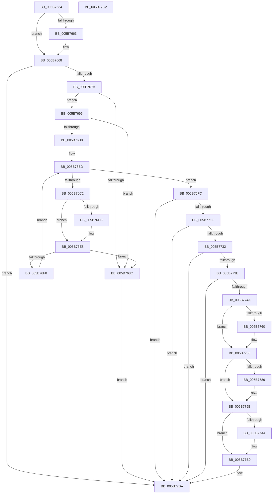

# KiCompleteBootProcessorContextInitialization

- RVA: `0x005B7634`–`0x005B77C3` (길이 `399` bytes)
- VA: `0x00000001405B7634`
- 실행 섹션: `.text`
- PDB 이름 있음: `예`; PDB Function 태그: `아니요`
- unwind 정보 RVA: `0x000C3DE4`
- 디코드: `103`개 명령, `399/399` bytes 표시
- 미해석 바이트: `0` (있으면 어셈블리에 `.byte`로 보존)

> 이 문서는 커널 이미지의 기계어와 PDB 기호를 분석해 생성했습니다. 4번과 5번은 함수 원형과 자료형을 바이너리 사용 방식에서 추정한 C 해석이며 원본 소스 복구 결과는 아닙니다.

## 1. Dependencies

- 직접 호출 지점: **13**; 고유 호출 대상: **10**
- 직접 호출자로 확인된 함수: **1**
- RIP 상대 이미지 참조: **3**

### Outgoing calls
- `0x005B7663` → [KiResetBootProcessorApicMask](../../page/74/KiResetBootProcessorApicMask_function_00745604.md) (function, `0x00745604`)
- `0x005B766D` → [KiInitializePrcbContext](../../pagelk/B6/KiInitializePrcbContext_function_00B66D70.md) (function, `0x00B66D70`)
- `0x005B7683` → [MmAllocateIsrStack](../../page/80/MmAllocateIsrStack_function_00807ECC.md) (function, `0x00807ECC`)
- `0x005B76AF` → [MmAllocateIsrStack](../../page/80/MmAllocateIsrStack_function_00807ECC.md) (function, `0x00807ECC`)
- `0x005B76EF` → [MmAllocateIsrStack](../../page/80/MmAllocateIsrStack_function_00807ECC.md) (function, `0x00807ECC`)
- `0x005B7711` → [KiAllocateDpcDelegateThread](KiAllocateDpcDelegateThread_function_005B697C.md) (function, `0x005B697C`)
- `0x005B7725` → [KiAllocateSmtIsolationThread](../5C/KiAllocateSmtIsolationThread_function_005C3F88.md) (function, `0x005C3F88`)
- `0x005B7735` → [KiAllocateIdleSearchStructures](KiAllocateIdleSearchStructures_function_005B6A04.md) (function, `0x005B6A04`)
- `0x005B7741` → [KiAllocateForceParkingData](../5C/KiAllocateForceParkingData_function_005C96C8.md) (function, `0x005C96C8`)
- `0x005B7763` → [KiRaiseIrqlProcessIrqlFlags](../4F/KiRaiseIrqlProcessIrqlFlags_function_004F56FC.md) (function, `0x004F56FC`)
- `0x005B7773` → [KiStartPrcbThread](KiStartPrcbThread_function_005B941C.md) (function, `0x005B941C`)
- `0x005B778F` → [KiStartPrcbThread](KiStartPrcbThread_function_005B941C.md) (function, `0x005B941C`)
- `0x005B77AB` → [KiLowerIrqlProcessIrqlFlags](../4F/KiLowerIrqlProcessIrqlFlags_function_004F5698.md) (function, `0x004F5698`)

### Direct callers
- [KeStartAllProcessors](../../init/C3/KeStartAllProcessors_function_00C36F78.md) at `0x00C36FEA`

### Static image references
- `0x005B765A` → RVA `0x00F906F8` (`.data`; read)
- `0x005B76C2` → RVA `0x01201840` (`CFGRO`; read)
- `0x005B7757` → RVA `0x00FC6D20` (`ALMOSTRO`; read)

## 2. Other-region calls and transfers

- 다른 실행 섹션으로 향하는 call: **5**
  - `0x005B7663` → [KiResetBootProcessorApicMask](../../page/74/KiResetBootProcessorApicMask_function_00745604.md) (`.text` → `PAGE`)
  - `0x005B766D` → [KiInitializePrcbContext](../../pagelk/B6/KiInitializePrcbContext_function_00B66D70.md) (`.text` → `PAGELK`)
  - `0x005B7683` → [MmAllocateIsrStack](../../page/80/MmAllocateIsrStack_function_00807ECC.md) (`.text` → `PAGE`)
  - `0x005B76AF` → [MmAllocateIsrStack](../../page/80/MmAllocateIsrStack_function_00807ECC.md) (`.text` → `PAGE`)
  - `0x005B76EF` → [MmAllocateIsrStack](../../page/80/MmAllocateIsrStack_function_00807ECC.md) (`.text` → `PAGE`)
- 별도 외부 분기/꼬리 이동을 확인하지 못했습니다.

## 3. Assembly (complete function range)

```asm
005B7634  40 53                           push rbx
005B7636  56                              push rsi
005B7637  57                              push rdi
005B7638  48 83 EC 20                     sub rsp, 0x20
005B763C  65 48 8B 34 25 18 00 00 00      mov rsi, qword ptr gs:[0x18]
005B7645  48 83 64 24 48 00               and qword ptr [rsp + 0x48], 0
005B764B  48 83 64 24 50 00               and qword ptr [rsp + 0x50], 0
005B7651  65 48 8B 3C 25 20 00 00 00      mov rdi, qword ptr gs:[0x20]
005B765A  80 3D 97 90 9D 00 00            cmp byte ptr [rip + 0x9d9097], 0
005B7661  75 05                           jne 0x1405b7668
005B7663  E8 9C DF 18 00                  call 0x140745604
005B7668  33 D2                           xor edx, edx
005B766A  48 8B CF                        mov rcx, rdi
005B766D  E8 FE F6 5A 00                  call 0x140b66d70
005B7672  85 C0                           test eax, eax
005B7674  0F 88 40 01 00 00               js 0x1405b77ba
005B767A  48 8D 8F D8 8F 00 00            lea rcx, [rdi + 0x8fd8]
005B7681  33 D2                           xor edx, edx
005B7683  E8 44 08 25 00                  call 0x140807ecc
005B7688  84 C0                           test al, al
005B768A  75 0A                           jne 0x1405b7696
005B768C  B8 17 00 00 C0                  mov eax, 0xc0000017
005B7691  E9 24 01 00 00                  jmp 0x1405b77ba
005B7696  65 48 8B 04 25 E8 88 00 00      mov rax, qword ptr gs:[0x88e8]
005B769F  48 8D 4C 24 40                  lea rcx, [rsp + 0x40]
005B76A4  48 83 C0 50                     add rax, 0x50
005B76A8  33 D2                           xor edx, edx
005B76AA  48 89 44 24 40                  mov qword ptr [rsp + 0x40], rax
005B76AF  E8 18 08 25 00                  call 0x140807ecc
005B76B4  84 C0                           test al, al
005B76B6  74 D4                           je 0x1405b768c
005B76B8  BB 01 00 00 00                  mov ebx, 1
005B76BD  83 FB 04                        cmp ebx, 4
005B76C0  77 3A                           ja 0x1405b76fc
005B76C2  80 3D 77 A1 C4 00 00            cmp byte ptr [rip + 0xc4a177], 0
005B76C9  48 8B 46 08                     mov rax, qword ptr [rsi + 8]
005B76CD  8B CB                           mov ecx, ebx
005B76CF  48 8B 44 C8 1C                  mov rax, qword ptr [rax + rcx*8 + 0x1c]
005B76D4  48 89 44 24 40                  mov qword ptr [rsp + 0x40], rax
005B76D9  74 0D                           je 0x1405b76e8
005B76DB  48 8B 40 08                     mov rax, qword ptr [rax + 8]
005B76DF  48 83 C0 20                     add rax, 0x20
005B76E3  48 89 44 24 40                  mov qword ptr [rsp + 0x40], rax
005B76E8  33 D2                           xor edx, edx
005B76EA  48 8D 4C 24 40                  lea rcx, [rsp + 0x40]
005B76EF  E8 D8 07 25 00                  call 0x140807ecc
005B76F4  84 C0                           test al, al
005B76F6  74 94                           je 0x1405b768c
005B76F8  FF C3                           inc ebx
005B76FA  EB C1                           jmp 0x1405b76bd
005B76FC  48 8B 87 C0 00 00 00            mov rax, qword ptr [rdi + 0xc0]
005B7703  48 8D 4C 24 48                  lea rcx, [rsp + 0x48]
005B7708  0F B7 98 8A 00 00 00            movzx ebx, word ptr [rax + 0x8a]
005B770F  8B D3                           mov edx, ebx
005B7711  E8 66 F2 FF FF                  call 0x1405b697c
005B7716  85 C0                           test eax, eax
005B7718  0F 88 9C 00 00 00               js 0x1405b77ba
005B771E  8B D3                           mov edx, ebx
005B7720  48 8D 4C 24 50                  lea rcx, [rsp + 0x50]
005B7725  E8 5E C8 00 00                  call 0x1405c3f88
005B772A  85 C0                           test eax, eax
005B772C  0F 88 88 00 00 00               js 0x1405b77ba
005B7732  48 8B CF                        mov rcx, rdi
005B7735  E8 CA F2 FF FF                  call 0x1405b6a04
005B773A  85 C0                           test eax, eax
005B773C  78 7C                           js 0x1405b77ba
005B773E  48 8B CF                        mov rcx, rdi
005B7741  E8 82 1F 01 00                  call 0x1405c96c8
005B7746  85 C0                           test eax, eax
005B7748  78 70                           js 0x1405b77ba
005B774A  44 0F 20 C6                     mov rsi, cr8
005B774E  BA 02 00 00 00                  mov edx, 2
005B7753  44 0F 22 C2                     mov cr8, rdx
005B7757  83 3D C2 F5 A0 00 00            cmp dword ptr [rip + 0xa0f5c2], 0
005B775E  74 08                           je 0x1405b7768
005B7760  40 8A CE                        mov cl, sil
005B7763  E8 94 DF F3 FF                  call 0x1404f56fc
005B7768  48 8B 5C 24 48                  mov rbx, qword ptr [rsp + 0x48]
005B776D  48 8B D7                        mov rdx, rdi
005B7770  48 8B CB                        mov rcx, rbx
005B7773  E8 A4 1C 00 00                  call 0x1405b941c
005B7778  48 89 9F 38 38 00 00            mov qword ptr [rdi + 0x3838], rbx
005B777F  48 8B 5C 24 50                  mov rbx, qword ptr [rsp + 0x50]
005B7784  48 85 DB                        test rbx, rbx
005B7787  74 12                           je 0x1405b779b
005B7789  48 8B D7                        mov rdx, rdi
005B778C  48 8B CB                        mov rcx, rbx
005B778F  E8 88 1C 00 00                  call 0x1405b941c
005B7794  48 89 9F 80 8E 00 00            mov qword ptr [rdi + 0x8e80], rbx
005B779B  83 3D 7E F5 A0 00 00            cmp dword ptr [rip + 0xa0f57e], 0
005B77A2  74 0C                           je 0x1405b77b0
005B77A4  44 0F 20 C1                     mov rcx, cr8
005B77A8  40 8A D6                        mov dl, sil
005B77AB  E8 E8 DE F3 FF                  call 0x1404f5698
005B77B0  40 0F B6 C6                     movzx eax, sil
005B77B4  44 0F 22 C0                     mov cr8, rax
005B77B8  33 C0                           xor eax, eax
005B77BA  48 83 C4 20                     add rsp, 0x20
005B77BE  5F                              pop rdi
005B77BF  5E                              pop rsi
005B77C0  5B                              pop rbx
005B77C1  C3                              ret
005B77C2  CC                              int3
```

## 4. C-style interpretation (structured pseudocode)

```c
__int64 __fastcall KiCompleteBootProcessorContextInitialization(__int64 a1, int a2)
{
    __int64 result;
    __int64 v_rbx;
    __int64 v_rsp;
    unsigned __int64 v_stack_p10;
    unsigned __int64 v_stack_p18;
    unsigned __int64 v_stack_p8;

    v_rsp = (v_rsp) - (32);
    if ((*(unsigned __int8 *)(v_rip + 10326167)) == 0) {
        result = KiResetBootProcessorApicMask(a1, a2, a3, a4);
    }
    a2 = 0;
    result = KiInitializePrcbContext(*(unsigned __int64 *)(gs_base + (0 + 32)), a2, a3, a4);
    if (sign_flag) goto loc_005B77BA;
    a2 = 0;
    result = MmAllocateIsrStack(*(unsigned __int64 *)(gs_base + (0 + 32)) + 36824, a2, a3, a4);
    if ((unsigned __int8)(result) != 0) goto loc_005B7696;
loc_005B768C:
    goto loc_005B77BA;
loc_005B7696:
    result = (*(unsigned __int64 *)(gs_base + (0 + 35048))) + (80);
    a2 = 0;
    v_stack_p8 = result;
    result = MmAllocateIsrStack(v_stack_p8, a2, a3, a4);
    if ((unsigned __int8)(result) == 0) goto loc_005B768C;
loc_005B76BD:
    if (1 > 4) goto loc_005B76FC;
    v_stack_p8 = *(unsigned __int64 *)(*(unsigned __int64 *)(*(unsigned __int64 *)(gs_base + (0 + 24)) + 8) + 1 * 8 + 28);
    result = *(unsigned __int64 *)(*(unsigned __int64 *)(*(unsigned __int64 *)(gs_base + (0 + 24)) + 8) + 1 * 8 + 28);
    if ((*(unsigned __int8 *)(v_rip + 12886391)) != 0) {
        result = *(unsigned __int64 *)(*(unsigned __int64 *)(*(unsigned __int64 *)(*(unsigned __int64 *)(gs_base + (0 + 24)) + 8) + 1 * 8 + 28) + 8);
        result = (result) + (32);
        v_stack_p8 = result;
    }
    a2 = 0;
    result = MmAllocateIsrStack(v_stack_p8, a2, a3, a4);
    if ((unsigned __int8)(result) == 0) goto loc_005B768C;
    v_rbx = (unsigned int)((1) + 1);
    goto loc_005B76BD;
loc_005B76FC:
    result = KiAllocateDpcDelegateThread(v_stack_p10, (unsigned int)((unsigned int)(*(unsigned __int16 *)(*(unsigned __int64 *)(*(unsigned __int64 *)(gs_base + (0 + 32)) + 192) + 138))), a3, a4);
    if (sign_flag) goto loc_005B77BA;
    result = KiAllocateSmtIsolationThread(v_stack_p18, (unsigned int)((unsigned int)(*(unsigned __int16 *)(*(unsigned __int64 *)(*(unsigned __int64 *)(gs_base + (0 + 32)) + 192) + 138))), a3, a4);
    if (sign_flag) goto loc_005B77BA;
    result = KiAllocateIdleSearchStructures(*(unsigned __int64 *)(gs_base + (0 + 32)), (unsigned int)((unsigned int)(*(unsigned __int16 *)(*(unsigned __int64 *)(*(unsigned __int64 *)(gs_base + (0 + 32)) + 192) + 138))), a3, a4);
    if (sign_flag) goto loc_005B77BA;
    result = KiAllocateForceParkingData(*(unsigned __int64 *)(gs_base + (0 + 32)), (unsigned int)((unsigned int)(*(unsigned __int16 *)(*(unsigned __int64 *)(*(unsigned __int64 *)(gs_base + (0 + 32)) + 192) + 138))), a3, a4);
    if (sign_flag) goto loc_005B77BA;
    if ((*(unsigned int *)(v_rip + 10548674)) != 0) {
        a1 = (unsigned __int8)(v_cr8);
        result = KiRaiseIrqlProcessIrqlFlags(a1, 2, a3, a4);
    }
    result = KiStartPrcbThread(v_stack_p10, *(unsigned __int64 *)(gs_base + (0 + 32)), a3, a4);
    *(unsigned __int64 *)(*(unsigned __int64 *)(gs_base + (0 + 32)) + 14392) = v_stack_p10;
    if (v_stack_p18 != 0) {
        a2 = *(unsigned __int64 *)(gs_base + (0 + 32));
        a1 = v_stack_p18;
        result = KiStartPrcbThread(a1, a2, a3, a4);
        *(unsigned __int64 *)(*(unsigned __int64 *)(gs_base + (0 + 32)) + 36480) = v_stack_p18;
    }
    if ((*(unsigned int *)(v_rip + 10548606)) != 0) {
        a1 = 2;
        a2 = (unsigned __int8)(v_cr8);
        result = KiLowerIrqlProcessIrqlFlags(a1, a2, a3, a4);
    }
    result = 0;
loc_005B77BA:
    v_rsp = (v_rsp) + (32);
    return result;
}
```

## 5. (Beta) C Style

```c
int64_t KiCompleteBootProcessorContextInitialization(int64_t Arg1, int32_t Arg2)
{
    int64_t result;
    int64_t local_rbx;
    int64_t local_rsp;
    uint64_t v_stack_p10;
    uint64_t v_stack_p18;
    uint64_t v_stack_p8;

    local_rsp = (local_rsp) - (32);
    if ((*(uint8_t *)(v_rip + 0x9D9097)) == 0) {
        result = KiResetBootProcessorApicMask(Arg1, Arg2, a3, a4);
    }
    Arg2 = 0;
    result = KiInitializePrcbContext(*(uint64_t *)(gs_base + (0 + 0x20)), Arg2, a3, a4);
    if (sign_flag) goto loc_005B77BA;
    Arg2 = 0;
    result = MmAllocateIsrStack(*(uint64_t *)(gs_base + (0 + 0x20)) + 36824, Arg2, a3, a4);
    if ((uint8_t)(result) != 0) goto loc_005B7696;
loc_005B768C:
    goto loc_005B77BA;
loc_005B7696:
    result = (*(uint64_t *)(gs_base + (0 + 0x88E8))) + (80);
    Arg2 = 0;
    v_stack_p8 = result;
    result = MmAllocateIsrStack(v_stack_p8, Arg2, a3, a4);
    if ((uint8_t)(result) == 0) goto loc_005B768C;
loc_005B76BD:
    if (1 > 4) goto loc_005B76FC;
    v_stack_p8 = *(uint64_t *)(*(uint64_t *)(*(uint64_t *)(gs_base + (0 + 0x18)) + 0x8) + 0x1 * 8 + 0x1C);
    result = *(uint64_t *)(*(uint64_t *)(*(uint64_t *)(gs_base + (0 + 0x18)) + 0x8) + 0x1 * 8 + 0x1C);
    if ((*(uint8_t *)(v_rip + 0xC4A177)) != 0) {
        result = *(uint64_t *)(*(uint64_t *)(*(uint64_t *)(*(uint64_t *)(gs_base + (0 + 0x18)) + 0x8) + 0x1 * 8 + 0x1C) + 0x8);
        result = (result) + (32);
        v_stack_p8 = result;
    }
    Arg2 = 0;
    result = MmAllocateIsrStack(v_stack_p8, Arg2, a3, a4);
    if ((uint8_t)(result) == 0) goto loc_005B768C;
    local_rbx = (uint32_t)((1) + 1);
    goto loc_005B76BD;
loc_005B76FC:
    result = KiAllocateDpcDelegateThread(v_stack_p10, (uint32_t)((uint32_t)(*(uint16_t *)(*(uint64_t *)(*(uint64_t *)(gs_base + (0 + 0x20)) + 0xC0) + 0x8A))), a3, a4);
    if (sign_flag) goto loc_005B77BA;
    result = KiAllocateSmtIsolationThread(v_stack_p18, (uint32_t)((uint32_t)(*(uint16_t *)(*(uint64_t *)(*(uint64_t *)(gs_base + (0 + 0x20)) + 0xC0) + 0x8A))), a3, a4);
    if (sign_flag) goto loc_005B77BA;
    result = KiAllocateIdleSearchStructures(*(uint64_t *)(gs_base + (0 + 0x20)), (uint32_t)((uint32_t)(*(uint16_t *)(*(uint64_t *)(*(uint64_t *)(gs_base + (0 + 0x20)) + 0xC0) + 0x8A))), a3, a4);
    if (sign_flag) goto loc_005B77BA;
    result = KiAllocateForceParkingData(*(uint64_t *)(gs_base + (0 + 0x20)), (uint32_t)((uint32_t)(*(uint16_t *)(*(uint64_t *)(*(uint64_t *)(gs_base + (0 + 0x20)) + 0xC0) + 0x8A))), a3, a4);
    if (sign_flag) goto loc_005B77BA;
    if ((*(uint32_t *)(v_rip + 0xA0F5C2)) != 0) {
        Arg1 = (uint8_t)(v_cr8);
        result = KiRaiseIrqlProcessIrqlFlags(Arg1, 2, a3, a4);
    }
    result = KiStartPrcbThread(v_stack_p10, *(uint64_t *)(gs_base + (0 + 0x20)), a3, a4);
    *(uint64_t *)(*(uint64_t *)(gs_base + (0 + 0x20)) + 0x3838) = v_stack_p10;
    if (v_stack_p18 != 0) {
        Arg2 = *(uint64_t *)(gs_base + (0 + 0x20));
        Arg1 = v_stack_p18;
        result = KiStartPrcbThread(Arg1, Arg2, a3, a4);
        *(uint64_t *)(*(uint64_t *)(gs_base + (0 + 0x20)) + 0x8E80) = v_stack_p18;
    }
    if ((*(uint32_t *)(v_rip + 0xA0F57E)) != 0) {
        Arg1 = 2;
        Arg2 = (uint8_t)(v_cr8);
        result = KiLowerIrqlProcessIrqlFlags(Arg1, Arg2, a3, a4);
    }
    result = 0;
loc_005B77BA:
    local_rsp = (local_rsp) + (32);
    return result;
}
```

## 6. Execution-region graph

[열기: 2D/3D 그래프와 함수 탐색 컨트롤 패널](../../../control-panel.html?section=text&rva=0x005B7634&view=graph)

- 2D 그래프는 위에서 아래로 흐르고, 3D 그래프는 빈 공간을 드래그해 회전합니다. Shift+드래그는 이동, 휠은 확대·축소, 함수 노드 선택은 대상 보고서 이동입니다.

### Static fallback


