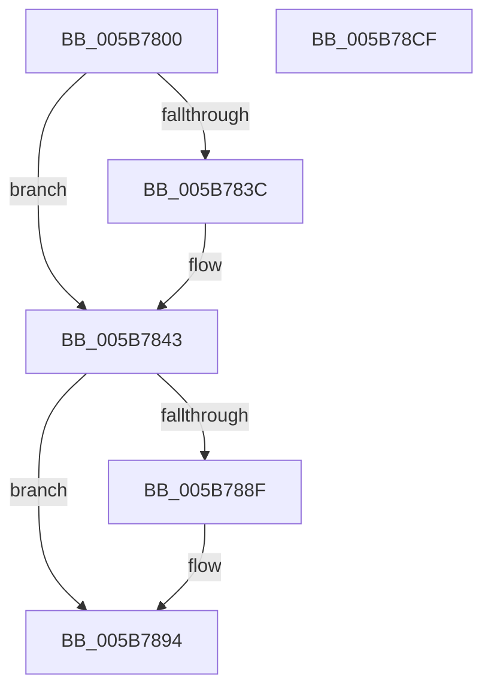

# KiComputeEstimatedMaximumProcessors

- RVA: `0x005B7800`–`0x005B78D0` (길이 `208` bytes)
- VA: `0x00000001405B7800`
- 실행 섹션: `.text`
- PDB 이름 있음: `예`; PDB Function 태그: `아니요`
- unwind 정보 RVA: `0x0006F978`
- 디코드: `53`개 명령, `208/208` bytes 표시
- 미해석 바이트: `0` (있으면 어셈블리에 `.byte`로 보존)

> 이 문서는 커널 이미지의 기계어와 PDB 기호를 분석해 생성했습니다. 4번과 5번은 함수 원형과 자료형을 바이너리 사용 방식에서 추정한 C 해석이며 원본 소스 복구 결과는 아닙니다.

## 1. Dependencies

- 직접 호출 지점: **2**; 고유 호출 대상: **2**
- 직접 호출자로 확인된 함수: **1**
- RIP 상대 이미지 참조: **7**

### Outgoing calls
- `0x005B7824` → [HalEnumerateProcessors](../54/HalEnumerateProcessors_function_00543240.md) (function, `0x00543240`)
- `0x005B782B` → [HalQueryMaximumProcessorCount](../4A/HalQueryMaximumProcessorCount_function_004AC9A0.md) (function, `0x004AC9A0`)

### Direct callers
- [KeStartAllProcessors](../../init/C3/KeStartAllProcessors_function_00C36F78.md) at `0x00C3708F`

### Static image references
- `0x005B781B` → RVA `0x00FC6C68` (`ALMOSTRO`; read)
- `0x005B7830` → RVA `0x00FC6CF4` (`ALMOSTRO`; read)
- `0x005B7843` → RVA `0x00FC5014` (`ALMOSTRO`; read)
- `0x005B7857` → RVA `0x00FC5044` (`ALMOSTRO`; read)
- `0x005B7879` → RVA `0x00FC6C94` (`ALMOSTRO`; read)
- `0x005B789B` → RVA `0x00FC6AA4` (`ALMOSTRO`; read)
- `0x005B78AD` → RVA `0x00FC6E5C` (`ALMOSTRO`; read)

## 2. Other-region calls and transfers

- 다른 실행 섹션으로 향하는 call: **0**
- 별도 외부 분기/꼬리 이동을 확인하지 못했습니다.

## 3. Assembly (complete function range)

```asm
005B7800  48 89 5C 24 08                  mov qword ptr [rsp + 8], rbx
005B7805  48 89 74 24 10                  mov qword ptr [rsp + 0x10], rsi
005B780A  48 89 7C 24 18                  mov qword ptr [rsp + 0x18], rdi
005B780F  41 56                           push r14
005B7811  48 83 EC 20                     sub rsp, 0x20
005B7815  4C 8B F1                        mov r14, rcx
005B7818  49 8B F8                        mov rdi, r8
005B781B  8B 0D 47 F4 A0 00               mov ecx, dword ptr [rip + 0xa0f447]
005B7821  48 8B F2                        mov rsi, rdx
005B7824  E8 17 BA F8 FF                  call 0x140543240
005B7829  8B D8                           mov ebx, eax
005B782B  E8 70 51 EF FF                  call 0x1404ac9a0
005B7830  44 8B 0D BD F4 A0 00            mov r9d, dword ptr [rip + 0xa0f4bd]
005B7837  45 85 C9                        test r9d, r9d
005B783A  74 07                           je 0x1405b7843
005B783C  44 3B CB                        cmp r9d, ebx
005B783F  41 0F 42 D9                     cmovb ebx, r9d
005B7843  0F B7 0D CA D7 A0 00            movzx ecx, word ptr [rip + 0xa0d7ca]
005B784A  41 B8 00 08 00 00               mov r8d, 0x800
005B7850  41 3B C0                        cmp eax, r8d
005B7853  41 0F 47 C0                     cmova eax, r8d
005B7857  0F AF 0D E6 D7 A0 00            imul ecx, dword ptr [rip + 0xa0d7e6]
005B785E  3B C1                           cmp eax, ecx
005B7860  0F 46 C8                        cmovbe ecx, eax
005B7863  65 48 8B 04 25 20 00 00 00      mov rax, qword ptr gs:[0x20]
005B786C  8B 90 A4 00 00 00               mov edx, dword ptr [rax + 0xa4]
005B7872  0F AF 90 A0 00 00 00            imul edx, dword ptr [rax + 0xa0]
005B7879  8B 05 15 F4 A0 00               mov eax, dword ptr [rip + 0xa0f415]
005B787F  0F AF 15 E2 F3 A0 00            imul edx, dword ptr [rip + 0xa0f3e2]
005B7886  3B CA                           cmp ecx, edx
005B7888  0F 46 D1                        cmovbe edx, ecx
005B788B  85 C0                           test eax, eax
005B788D  74 05                           je 0x1405b7894
005B788F  3B C2                           cmp eax, edx
005B7891  0F 42 D0                        cmovb edx, eax
005B7894  3B DA                           cmp ebx, edx
005B7896  8B CA                           mov ecx, edx
005B7898  0F 46 CB                        cmovbe ecx, ebx
005B789B  80 3D 02 F2 A0 00 00            cmp byte ptr [rip + 0xa0f202], 0
005B78A2  48 8B 5C 24 30                  mov rbx, qword ptr [rsp + 0x30]
005B78A7  0F 44 D1                        cmove edx, ecx
005B78AA  41 89 0E                        mov dword ptr [r14], ecx
005B78AD  83 3D A8 F5 A0 00 00            cmp dword ptr [rip + 0xa0f5a8], 0
005B78B4  8B C2                           mov eax, edx
005B78B6  89 16                           mov dword ptr [rsi], edx
005B78B8  48 8B 74 24 38                  mov rsi, qword ptr [rsp + 0x38]
005B78BD  41 0F 45 C0                     cmovne eax, r8d
005B78C1  89 07                           mov dword ptr [rdi], eax
005B78C3  48 8B 7C 24 40                  mov rdi, qword ptr [rsp + 0x40]
005B78C8  48 83 C4 20                     add rsp, 0x20
005B78CC  41 5E                           pop r14
005B78CE  C3                              ret
005B78CF  CC                              int3
```

## 4. C-style interpretation (structured pseudocode)

```c
__int64 __fastcall KiComputeEstimatedMaximumProcessors(__int64 a1, __int64 a2, __int64 a3)
{
    __int64 result;
    __int64 v_rbx;
    __int64 v_rsp;
    unsigned __int64 v_stack_p10;
    unsigned __int64 v_stack_p18;
    unsigned __int64 v_stack_p8;

    v_stack_p8 = v_rbx;
    v_stack_p10 = v_rsi;
    v_stack_p18 = v_rdi;
    v_rsp = (v_rsp) - (32);
    result = HalEnumerateProcessors((unsigned int)(*(unsigned int *)(v_rip + 10548295)), a2, a3, a4);
    result = HalQueryMaximumProcessorCount((unsigned int)(*(unsigned int *)(v_rip + 10548295)), a2, a3, a4);
    v_rbx = (unsigned int)((unsigned int)(result));
    if ((unsigned int)((unsigned int)(*(unsigned int *)(v_rip + 10548413))) != 0) {
        v_rbx = (unsigned int)((unsigned int)(result));
        if (((unsigned int)((unsigned int)(*(unsigned int *)(v_rip + 10548413)))) < ((unsigned int)((unsigned int)((unsigned int)(result))))) { v_rbx = (unsigned int)((unsigned int)(*(unsigned int *)(v_rip + 10548413))); }
    }
    if (((unsigned int)(result)) > ((unsigned int)((unsigned int)(0x800ULL)))) { result = (unsigned int)((unsigned int)(0x800ULL)); }
    a1 = (unsigned int)((*(unsigned __int16 *)(v_rip + 10541002)) * (*(unsigned int *)(v_rip + 10541030)));
    if (((unsigned int)(result)) <= ((unsigned int)(a1))) { a1 = (unsigned int)(result); }
    a2 = (unsigned int)(((unsigned int)(*(unsigned int *)(*(unsigned __int64 *)(gs_base + (0 + 32)) + 164))) * (*(unsigned int *)(*(unsigned __int64 *)(gs_base + (0 + 32)) + 160)));
    a2 = (unsigned int)((a2) * (*(unsigned int *)(v_rip + 10548194)));
    if (((unsigned int)(a1)) <= ((unsigned int)(a2))) { a2 = (unsigned int)(a1); }
    if ((unsigned int)((unsigned int)(*(unsigned int *)(v_rip + 10548245))) != 0) {
        if (((unsigned int)((unsigned int)(*(unsigned int *)(v_rip + 10548245)))) < ((unsigned int)(a2))) { a2 = (unsigned int)((unsigned int)(*(unsigned int *)(v_rip + 10548245))); }
    }
    a1 = (unsigned int)((unsigned int)(a2));
    if (((unsigned int)(v_rbx)) <= ((unsigned int)(a2))) { a1 = (unsigned int)(v_rbx); }
    if ((*(unsigned __int8 *)(v_rip + 10547714)) == 0) { a2 = (unsigned int)(a1); }
    *(unsigned int *)(a1) = (unsigned int)(a1);
    *(unsigned int *)(a2) = (unsigned int)(a2);
    result = (unsigned int)((unsigned int)(a2));
    if ((*(unsigned int *)(v_rip + 10548648)) != 0) { result = (unsigned int)((unsigned int)(0x800ULL)); }
    *(unsigned int *)(a3) = (unsigned int)(result);
    v_rsp = (v_rsp) + (32);
    return result;
}
```

## 5. (Beta) C Style

```c
int64_t KiComputeEstimatedMaximumProcessors(void *Arg1, void *Arg2, void *Arg3)
{
    uint8_t *arg1 = (uint8_t *)Arg1;
    uint8_t *arg2 = (uint8_t *)Arg2;
    uint8_t *arg3 = (uint8_t *)Arg3;

    int64_t result;
    int64_t local_rbx;
    int64_t local_rsp;
    uint64_t v_stack_p10;
    uint64_t v_stack_p18;
    uint64_t v_stack_p8;

    v_stack_p8 = local_rbx;
    v_stack_p10 = local_rsi;
    v_stack_p18 = local_rdi;
    local_rsp = (local_rsp) - (32);
    result = HalEnumerateProcessors((uint32_t)(*(uint32_t *)(v_rip + 0xA0F447)), Arg2, Arg3, a4);
    result = HalQueryMaximumProcessorCount((uint32_t)(*(uint32_t *)(v_rip + 0xA0F447)), Arg2, Arg3, a4);
    local_rbx = (uint32_t)((uint32_t)(result));
    if ((uint32_t)((uint32_t)(*(uint32_t *)(v_rip + 0xA0F4BD))) != 0) {
        local_rbx = (uint32_t)((uint32_t)(result));
        if (((uint32_t)((uint32_t)(*(uint32_t *)(v_rip + 0xA0F4BD)))) < ((uint32_t)((uint32_t)((uint32_t)(result))))) { local_rbx = (uint32_t)((uint32_t)(*(uint32_t *)(v_rip + 0xA0F4BD))); }
    }
    if (((uint32_t)(result)) > ((uint32_t)((uint32_t)(0x800ULL)))) { result = (uint32_t)((uint32_t)(0x800ULL)); }
    Arg1 = (uint32_t)((*(uint16_t *)(v_rip + 0xA0D7CA)) * (*(uint32_t *)(v_rip + 0xA0D7E6)));
    if (((uint32_t)(result)) <= ((uint32_t)(Arg1))) { Arg1 = (uint32_t)(result); }
    Arg2 = (uint32_t)(((uint32_t)(*(uint32_t *)(*(uint64_t *)(gs_base + (0 + 0x20)) + 0xA4))) * (*(uint32_t *)(*(uint64_t *)(gs_base + (0 + 0x20)) + 0xA0)));
    Arg2 = (uint32_t)((Arg2) * (*(uint32_t *)(v_rip + 0xA0F3E2)));
    if (((uint32_t)(Arg1)) <= ((uint32_t)(Arg2))) { Arg2 = (uint32_t)(Arg1); }
    if ((uint32_t)((uint32_t)(*(uint32_t *)(v_rip + 0xA0F415))) != 0) {
        if (((uint32_t)((uint32_t)(*(uint32_t *)(v_rip + 0xA0F415)))) < ((uint32_t)(Arg2))) { Arg2 = (uint32_t)((uint32_t)(*(uint32_t *)(v_rip + 0xA0F415))); }
    }
    Arg1 = (uint32_t)((uint32_t)(Arg2));
    if (((uint32_t)(local_rbx)) <= ((uint32_t)(Arg2))) { Arg1 = (uint32_t)(local_rbx); }
    if ((*(uint8_t *)(v_rip + 0xA0F202)) == 0) { Arg2 = (uint32_t)(Arg1); }
    *(uint32_t *)(arg1) = (uint32_t)(Arg1);
    *(uint32_t *)(arg2) = (uint32_t)(Arg2);
    result = (uint32_t)((uint32_t)(Arg2));
    if ((*(uint32_t *)(v_rip + 0xA0F5A8)) != 0) { result = (uint32_t)((uint32_t)(0x800ULL)); }
    *(uint32_t *)(arg3) = (uint32_t)(result);
    local_rsp = (local_rsp) + (32);
    return result;
}
```

### 관측된 메모리 오프셋

구조체 형식이 확인되지 않은 접근은 인자 기준의 오프셋으로만 기록했습니다.

| 기준 인자 | 오프셋 표현 | 폭 (bit) | 접근 |
|---|---:|---:|---|
| `Arg1` | `+ 0x0` | `32` | `W` |
| `Arg2` | `+ 0x0` | `32` | `W` |
| `Arg3` | `+ 0x0` | `32` | `W` |

## 6. Execution-region graph

[열기: 2D/3D 그래프와 함수 탐색 컨트롤 패널](../../../control-panel.html?section=text&rva=0x005B7800&view=graph)

- 2D 그래프는 위에서 아래로 흐르고, 3D 그래프는 빈 공간을 드래그해 회전합니다. Shift+드래그는 이동, 휠은 확대·축소, 함수 노드 선택은 대상 보고서 이동입니다.

### Static fallback


