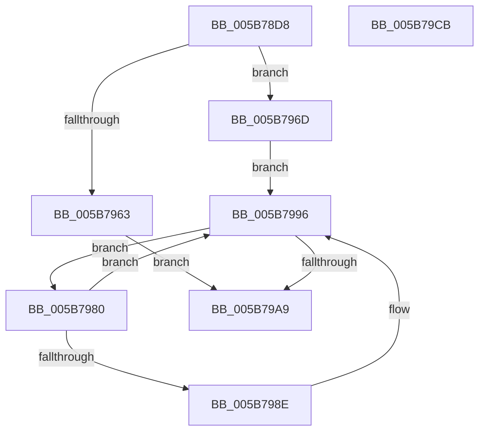

# KiConfigureCooperativeIdleSearchContextTargets

- RVA: `0x005B78D8`–`0x005B79CC` (길이 `244` bytes)
- VA: `0x00000001405B78D8`
- 실행 섹션: `.text`
- PDB 이름 있음: `예`; PDB Function 태그: `아니요`
- unwind 정보 RVA: `0x000C9E60`
- 디코드: `61`개 명령, `244/244` bytes 표시
- 미해석 바이트: `0` (있으면 어셈블리에 `.byte`로 보존)

> 이 문서는 커널 이미지의 기계어와 PDB 기호를 분석해 생성했습니다. 4번과 5번은 함수 원형과 자료형을 바이너리 사용 방식에서 추정한 C 해석이며 원본 소스 복구 결과는 아닙니다.

## 1. Dependencies

- 직접 호출 지점: **7**; 고유 호출 대상: **5**
- 직접 호출자로 확인된 함수: **1**
- RIP 상대 이미지 참조: **1**

### Outgoing calls
- `0x005B7937` → [memset](../6C/memset_function_006C6C40.md) (function, `0x006C6C40`)
- `0x005B7953` → [memset](../6C/memset_function_006C6C40.md) (function, `0x006C6C40`)
- `0x005B7966` → [KiAddSubNodeToIdleSearchContextTargets](KiAddSubNodeToIdleSearchContextTargets_function_005B691C.md) (function, `0x005B691C`)
- `0x005B7979` → [KiInitializeSystemSubNodeEnumerationContext](../42/KiInitializeSystemSubNodeEnumerationContext_function_0042798C.md) (function, `0x0042798C`)
- `0x005B7991` → [KiAddSubNodeToIdleSearchContextTargets](KiAddSubNodeToIdleSearchContextTargets_function_005B691C.md) (function, `0x005B691C`)
- `0x005B79A0` → [KiEnumerateNextSchedulerSubNodeInSystem](../25/KiEnumerateNextSchedulerSubNodeInSystem_function_002569C0.md) (function, `0x002569C0`)
- `0x005B79B1` → [_security_check_cookie](../6A/_security_check_cookie_function_006AC640.md) (function, `0x006AC640`)

### Direct callers
- [KiConfigureCooperativeIdleSearchTargets](KiConfigureCooperativeIdleSearchTargets_function_005B79D4.md) at `0x005B7A41`

### Static image references
- `0x005B78EA` → RVA `0x00E0A740` (`.data`; read)

## 2. Other-region calls and transfers

- 다른 실행 섹션으로 향하는 call: **0**
- 별도 외부 분기/꼬리 이동을 확인하지 못했습니다.

## 3. Assembly (complete function range)

```asm
005B78D8  48 89 5C 24 10                  mov qword ptr [rsp + 0x10], rbx
005B78DD  48 89 6C 24 20                  mov qword ptr [rsp + 0x20], rbp
005B78E2  56                              push rsi
005B78E3  57                              push rdi
005B78E4  41 56                           push r14
005B78E6  48 83 EC 50                     sub rsp, 0x50
005B78EA  48 8B 05 4F 2E 85 00            mov rax, qword ptr [rip + 0x852e4f]
005B78F1  48 33 C4                        xor rax, rsp
005B78F4  48 89 44 24 48                  mov qword ptr [rsp + 0x48], rax
005B78F9  49 8B F0                        mov rsi, r8
005B78FC  0F 57 C0                        xorps xmm0, xmm0
005B78FF  45 0F B7 80 20 04 00 00         movzx r8d, word ptr [r8 + 0x420]
005B7907  8B FA                           mov edi, edx
005B7909  49 C1 E0 04                     shl r8, 4
005B790D  48 8B E9                        mov rbp, rcx
005B7910  45 33 F6                        xor r14d, r14d
005B7913  33 D2                           xor edx, edx
005B7915  4C 89 74 24 20                  mov qword ptr [rsp + 0x20], r14
005B791A  0F 11 44 24 28                  movups xmmword ptr [rsp + 0x28], xmm0
005B791F  49 8D 1C 30                     lea rbx, [r8 + rsi]
005B7923  66 44 89 B6 22 04 00 00         mov word ptr [rsi + 0x422], r14w
005B792B  48 8D 8B 28 04 00 00            lea rcx, [rbx + 0x428]
005B7932  0F 11 44 24 38                  movups xmmword ptr [rsp + 0x38], xmm0
005B7937  E8 04 F3 10 00                  call 0x1406c6c40
005B793C  44 0F B7 86 20 04 00 00         movzx r8d, word ptr [rsi + 0x420]
005B7944  48 8D 8B 28 04 00 00            lea rcx, [rbx + 0x428]
005B794B  4D 03 C0                        add r8, r8
005B794E  BA FF 00 00 00                  mov edx, 0xff
005B7953  E8 E8 F2 10 00                  call 0x1406c6c40
005B7958  48 8B 95 C0 00 00 00            mov rdx, qword ptr [rbp + 0xc0]
005B795F  85 FF                           test edi, edi
005B7961  75 0A                           jne 0x1405b796d
005B7963  48 8B CE                        mov rcx, rsi
005B7966  E8 B1 EF FF FF                  call 0x1405b691c
005B796B  EB 3C                           jmp 0x1405b79a9
005B796D  0F B7 92 8A 00 00 00            movzx edx, word ptr [rdx + 0x8a]
005B7974  48 8D 4C 24 28                  lea rcx, [rsp + 0x28]
005B7979  E8 0E 00 E7 FF                  call 0x14042798c
005B797E  EB 16                           jmp 0x1405b7996
005B7980  48 8B 54 24 20                  mov rdx, qword ptr [rsp + 0x20]
005B7985  48 3B 95 C0 00 00 00            cmp rdx, qword ptr [rbp + 0xc0]
005B798C  74 08                           je 0x1405b7996
005B798E  48 8B CE                        mov rcx, rsi
005B7991  E8 86 EF FF FF                  call 0x1405b691c
005B7996  48 8D 54 24 20                  lea rdx, [rsp + 0x20]
005B799B  48 8D 4C 24 28                  lea rcx, [rsp + 0x28]
005B79A0  E8 1B F0 C9 FF                  call 0x1402569c0
005B79A5  85 C0                           test eax, eax
005B79A7  74 D7                           je 0x1405b7980
005B79A9  48 8B 4C 24 48                  mov rcx, qword ptr [rsp + 0x48]
005B79AE  48 33 CC                        xor rcx, rsp
005B79B1  E8 8A 4C 0F 00                  call 0x1406ac640
005B79B6  4C 8D 5C 24 50                  lea r11, [rsp + 0x50]
005B79BB  49 8B 5B 28                     mov rbx, qword ptr [r11 + 0x28]
005B79BF  49 8B 6B 38                     mov rbp, qword ptr [r11 + 0x38]
005B79C3  49 8B E3                        mov rsp, r11
005B79C6  41 5E                           pop r14
005B79C8  5F                              pop rdi
005B79C9  5E                              pop rsi
005B79CA  C3                              ret
005B79CB  CC                              int3
```

## 4. C-style interpretation (structured pseudocode)

```c
__int64 __fastcall KiConfigureCooperativeIdleSearchContextTargets(__int64 a1, int a2, __int64 a3)
{
    __int64 result;
    __int64 v_r14;
    __int64 v_rsp;
    unsigned __int64 v_stack_m18;
    unsigned __int64 v_stack_m20;
    unsigned __int64 v_stack_m30;
    unsigned __int64 v_stack_m40;
    unsigned __int64 v_stack_m48;
    unsigned __int64 v_stack_p10;
    unsigned __int64 v_stack_p20;

    v_stack_p10 = v_rbx;
    v_stack_p20 = v_rbp;
    v_rsp = (v_rsp) - (80);
    result = (*(unsigned __int64 *)(v_rip + 8728143)) ^ (v_rsp);
    v_stack_m20 = result;
    a3 = (*(unsigned __int16 *)(a3 + 1056)) << (4);
    v_r14 = 0;
    a2 = 0;
    v_stack_m48 = 0;
    v_stack_m40 = v_xmm0;
    *(unsigned __int16 *)(a3 + 1058) = 0;
    v_stack_m30 = v_xmm0;
    result = memset(a3 + a3 * 1 + 1064, a2, a3, a4);
    a3 = (*(unsigned __int16 *)(a3 + 1056)) + (*(unsigned __int16 *)(a3 + 1056));
    result = memset(a3 + a3 * 1 + 1064, 255, a3, a4);
    if ((unsigned int)((unsigned int)(a2)) != 0) goto loc_005B796D;
    result = KiAddSubNodeToIdleSearchContextTargets(a3, *(unsigned __int64 *)(a1 + 192), a3, a4);
    goto loc_005B79A9;
loc_005B796D:
    result = KiInitializeSystemSubNodeEnumerationContext(v_stack_m40, *(unsigned __int16 *)(*(unsigned __int64 *)(a1 + 192) + 138), a3, a4);
    goto loc_005B7996;
loc_005B7980:
    if (v_stack_m48 != (*(unsigned __int64 *)(a1 + 192))) {
        a1 = a3;
        result = KiAddSubNodeToIdleSearchContextTargets(a1, v_stack_m48, a3, a4);
    }
    result = KiEnumerateNextSchedulerSubNodeInSystem(v_stack_m40, v_stack_m48, a3, a4);
    if ((unsigned int)(result) == 0) goto loc_005B7980;
loc_005B79A9:
    a1 = (v_stack_m20) ^ (v_rsp);
    result = _security_check_cookie(a1, v_stack_m48, a3, a4);
    return result;
}
```

## 5. (Beta) C Style

```c
int64_t KiConfigureCooperativeIdleSearchContextTargets(void *Arg1, int32_t Arg2, void *Arg3)
{
    uint8_t *arg1 = (uint8_t *)Arg1;
    uint8_t *arg3 = (uint8_t *)Arg3;

    int64_t result;
    int64_t local_r14;
    int64_t local_rsp;
    uint64_t v_stack_m18;
    uint64_t v_stack_m20;
    uint64_t v_stack_m30;
    uint64_t v_stack_m40;
    uint64_t v_stack_m48;
    uint64_t v_stack_p10;
    uint64_t v_stack_p20;

    v_stack_p10 = local_rbx;
    v_stack_p20 = local_rbp;
    local_rsp = (local_rsp) - (80);
    result = (*(uint64_t *)(v_rip + 0x852E4F)) ^ (local_rsp);
    v_stack_m20 = result;
    Arg3 = (*(uint16_t *)(arg3 + 0x420)) << (4);
    local_r14 = 0;
    Arg2 = 0;
    v_stack_m48 = 0;
    v_stack_m40 = v_xmm0;
    *(uint16_t *)(arg3 + 0x422) = 0;
    v_stack_m30 = v_xmm0;
    result = memset(Arg3 + Arg3 * 1 + 1064, Arg2, Arg3, a4);
    Arg3 = (*(uint16_t *)(arg3 + 0x420)) + (*(uint16_t *)(arg3 + 0x420));
    result = memset(Arg3 + Arg3 * 1 + 1064, 255, Arg3, a4);
    if ((uint32_t)((uint32_t)(Arg2)) != 0) goto loc_005B796D;
    result = KiAddSubNodeToIdleSearchContextTargets(Arg3, *(uint64_t *)(arg1 + 0xC0), Arg3, a4);
    goto loc_005B79A9;
loc_005B796D:
    result = KiInitializeSystemSubNodeEnumerationContext(v_stack_m40, *(uint16_t *)(*(uint64_t *)(arg1 + 0xC0) + 0x8A), Arg3, a4);
    goto loc_005B7996;
loc_005B7980:
    if (v_stack_m48 != (*(uint64_t *)(arg1 + 0xC0))) {
        Arg1 = Arg3;
        result = KiAddSubNodeToIdleSearchContextTargets(Arg1, v_stack_m48, Arg3, a4);
    }
    result = KiEnumerateNextSchedulerSubNodeInSystem(v_stack_m40, v_stack_m48, Arg3, a4);
    if ((uint32_t)(result) == 0) goto loc_005B7980;
loc_005B79A9:
    Arg1 = (v_stack_m20) ^ (local_rsp);
    result = _security_check_cookie(Arg1, v_stack_m48, Arg3, a4);
    return result;
}
```

### 관측된 메모리 오프셋

구조체 형식이 확인되지 않은 접근은 인자 기준의 오프셋으로만 기록했습니다.

| 기준 인자 | 오프셋 표현 | 폭 (bit) | 접근 |
|---|---:|---:|---|
| `Arg1` | `+ 0xC0` | `64` | `R` |
| `Arg3` | `+ 0x420` | `16` | `R` |
| `Arg3` | `+ 0x422` | `16` | `W` |

## 6. Execution-region graph

[열기: 2D/3D 그래프와 함수 탐색 컨트롤 패널](../../../control-panel.html?section=text&rva=0x005B78D8&view=graph)

- 2D 그래프는 위에서 아래로 흐르고, 3D 그래프는 빈 공간을 드래그해 회전합니다. Shift+드래그는 이동, 휠은 확대·축소, 함수 노드 선택은 대상 보고서 이동입니다.

### Static fallback


