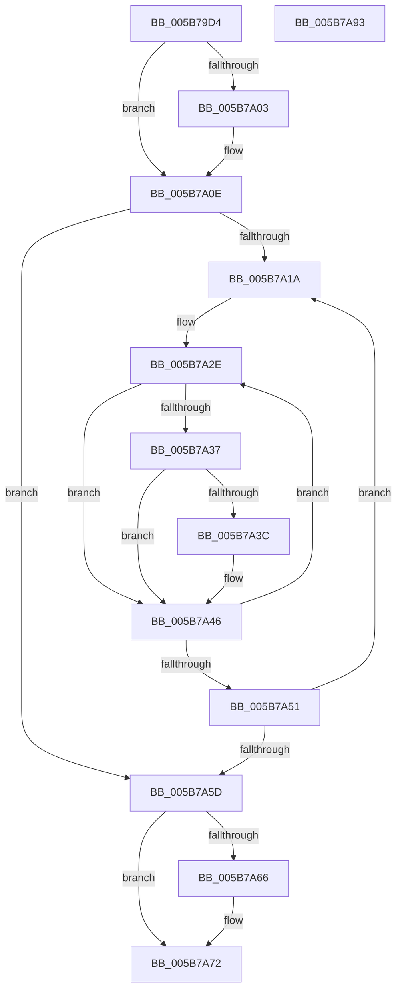

# KiConfigureCooperativeIdleSearchTargets

- RVA: `0x005B79D4`–`0x005B7A94` (길이 `192` bytes)
- VA: `0x00000001405B79D4`
- 실행 섹션: `.text`
- PDB 이름 있음: `예`; PDB Function 태그: `아니요`
- unwind 정보 RVA: `0x00060300`
- 디코드: `55`개 명령, `192/192` bytes 표시
- 미해석 바이트: `0` (있으면 어셈블리에 `.byte`로 보존)

> 이 문서는 커널 이미지의 기계어와 PDB 기호를 분석해 생성했습니다. 4번과 5번은 함수 원형과 자료형을 바이너리 사용 방식에서 추정한 C 해석이며 원본 소스 복구 결과는 아닙니다.

## 1. Dependencies

- 직접 호출 지점: **3**; 고유 호출 대상: **3**
- 직접 호출자로 확인된 함수: **2**
- RIP 상대 이미지 참조: **3**

### Outgoing calls
- `0x005B7A09` → [KiRaiseIrqlProcessIrqlFlags](../4F/KiRaiseIrqlProcessIrqlFlags_function_004F56FC.md) (function, `0x004F56FC`)
- `0x005B7A41` → [KiConfigureCooperativeIdleSearchContextTargets](KiConfigureCooperativeIdleSearchContextTargets_function_005B78D8.md) (function, `0x005B78D8`)
- `0x005B7A6D` → [KiLowerIrqlProcessIrqlFlags](../4F/KiLowerIrqlProcessIrqlFlags_function_004F5698.md) (function, `0x004F5698`)

### Direct callers
- [KiInitializeDynamicProcessorDpc](../../pagelk/B6/KiInitializeDynamicProcessorDpc_function_00B67A30.md) at `0x00B67BC0`
- [KiConfigureAllSchedulingInformation](../../init/C3/KiConfigureAllSchedulingInformation_function_00C380D0.md) at `0x00C381AC`

### Static image references
- `0x005B79FA` → RVA `0x00FC6D20` (`ALMOSTRO`; read)
- `0x005B7A0E` → RVA `0x00FC6A80` (`ALMOSTRO`; read)
- `0x005B7A1A` → RVA `0x00FC8C40` (`ALMOSTRO`; read)

## 2. Other-region calls and transfers

- 다른 실행 섹션으로 향하는 call: **0**
- 별도 외부 분기/꼬리 이동을 확인하지 못했습니다.

## 3. Assembly (complete function range)

```asm
005B79D4  48 89 5C 24 08                  mov qword ptr [rsp + 8], rbx
005B79D9  48 89 6C 24 10                  mov qword ptr [rsp + 0x10], rbp
005B79DE  48 89 74 24 18                  mov qword ptr [rsp + 0x18], rsi
005B79E3  57                              push rdi
005B79E4  41 56                           push r14
005B79E6  41 57                           push r15
005B79E8  48 83 EC 20                     sub rsp, 0x20
005B79EC  44 0F 20 C7                     mov rdi, cr8
005B79F0  41 BF 02 00 00 00               mov r15d, 2
005B79F6  45 0F 22 C7                     mov cr8, r15
005B79FA  83 3D 1F F3 A0 00 00            cmp dword ptr [rip + 0xa0f31f], 0
005B7A01  74 0B                           je 0x1405b7a0e
005B7A03  41 8A D7                        mov dl, r15b
005B7A06  40 8A CF                        mov cl, dil
005B7A09  E8 EE DC F3 FF                  call 0x1404f56fc
005B7A0E  8B 05 6C F0 A0 00               mov eax, dword ptr [rip + 0xa0f06c]
005B7A14  33 DB                           xor ebx, ebx
005B7A16  85 C0                           test eax, eax
005B7A18  74 43                           je 0x1405b7a5d
005B7A1A  4C 8D 35 1F 12 A1 00            lea r14, [rip + 0xa1121f]
005B7A21  33 ED                           xor ebp, ebp
005B7A23  4D 8B 34 DE                     mov r14, qword ptr [r14 + rbx*8]
005B7A27  49 8D B6 08 94 00 00            lea rsi, [r14 + 0x9408]
005B7A2E  4C 8B 46 10                     mov r8, qword ptr [rsi + 0x10]
005B7A32  4D 85 C0                        test r8, r8
005B7A35  74 0F                           je 0x1405b7a46
005B7A37  4C 3B 06                        cmp r8, qword ptr [rsi]
005B7A3A  75 0A                           jne 0x1405b7a46
005B7A3C  8B D5                           mov edx, ebp
005B7A3E  49 8B CE                        mov rcx, r14
005B7A41  E8 92 FE FF FF                  call 0x1405b78d8
005B7A46  FF C5                           inc ebp
005B7A48  48 83 C6 08                     add rsi, 8
005B7A4C  41 3B EF                        cmp ebp, r15d
005B7A4F  72 DD                           jb 0x1405b7a2e
005B7A51  8B 05 29 F0 A0 00               mov eax, dword ptr [rip + 0xa0f029]
005B7A57  FF C3                           inc ebx
005B7A59  3B D8                           cmp ebx, eax
005B7A5B  72 BD                           jb 0x1405b7a1a
005B7A5D  83 3D BC F2 A0 00 00            cmp dword ptr [rip + 0xa0f2bc], 0
005B7A64  74 0C                           je 0x1405b7a72
005B7A66  44 0F 20 C1                     mov rcx, cr8
005B7A6A  40 8A D7                        mov dl, dil
005B7A6D  E8 26 DC F3 FF                  call 0x1404f5698
005B7A72  40 0F B6 C7                     movzx eax, dil
005B7A76  44 0F 22 C0                     mov cr8, rax
005B7A7A  48 8B 5C 24 40                  mov rbx, qword ptr [rsp + 0x40]
005B7A7F  48 8B 6C 24 48                  mov rbp, qword ptr [rsp + 0x48]
005B7A84  48 8B 74 24 50                  mov rsi, qword ptr [rsp + 0x50]
005B7A89  48 83 C4 20                     add rsp, 0x20
005B7A8D  41 5F                           pop r15
005B7A8F  41 5E                           pop r14
005B7A91  5F                              pop rdi
005B7A92  C3                              ret
005B7A93  CC                              int3
```

## 4. C-style interpretation (structured pseudocode)

```c
__int64 __fastcall KiConfigureCooperativeIdleSearchTargets(void)
{
    __int64 result;
    __int64 v_rbp;
    __int64 v_rbx;
    __int64 v_rsi;
    __int64 v_rsp;
    unsigned __int64 v_stack_p10;
    unsigned __int64 v_stack_p18;
    unsigned __int64 v_stack_p8;

    v_stack_p8 = v_rbx;
    v_stack_p10 = v_rbp;
    v_stack_p18 = v_rsi;
    v_rsp = (v_rsp) - (32);
    if ((*(unsigned int *)(v_rip + 10547999)) != 0) {
        a2 = 2;
        a1 = (unsigned __int8)(v_cr8);
        result = KiRaiseIrqlProcessIrqlFlags(a1, a2, a3, a4);
    }
    v_rbx = 0;
    if ((unsigned int)((unsigned int)(*(unsigned int *)(v_rip + 10547308))) == 0) goto loc_005B7A5D;
loc_005B7A1A:
    v_rbp = 0;
loc_005B7A2E:
    if (*(unsigned __int64 *)(*(unsigned __int64 *)(v_rip + 10555935 + v_rbx * 8) + 37896 + 16) == 0) goto loc_005B7A46;
    result = (unsigned int)(*(unsigned int *)(v_rip + 10547308));
    if ((*(unsigned __int64 *)(*(unsigned __int64 *)(v_rip + 10555935 + v_rbx * 8) + 37896 + 16)) == (*(unsigned __int64 *)(*(unsigned __int64 *)(v_rip + 10555935 + v_rbx * 8) + 37896))) {
        a2 = 0;
        a1 = *(unsigned __int64 *)(v_rip + 10555935 + v_rbx * 8);
        result = KiConfigureCooperativeIdleSearchContextTargets(a1, a2, *(unsigned __int64 *)(*(unsigned __int64 *)(v_rip + 10555935 + v_rbx * 8) + 37896 + 16), a4);
    }
    v_rbp = (unsigned int)((v_rbp) + 1);
    v_rsi = (*(unsigned __int64 *)(v_rip + 10555935 + v_rbx * 8) + 37896) + (8);
    if (((unsigned int)(v_rbp)) < 2) goto loc_005B7A2E;
    v_rbx = (unsigned int)((v_rbx) + 1);
    if (((unsigned int)(v_rbx)) < ((unsigned int)((unsigned int)(*(unsigned int *)(v_rip + 10547241))))) goto loc_005B7A1A;
loc_005B7A5D:
    result = (unsigned int)(*(unsigned int *)(v_rip + 10547241));
    if ((*(unsigned int *)(v_rip + 10547900)) != 0) {
        a1 = 2;
        a2 = (unsigned __int8)(v_cr8);
        result = KiLowerIrqlProcessIrqlFlags(a1, a2, *(unsigned __int64 *)(*(unsigned __int64 *)(v_rip + 10555935 + v_rbx * 8) + 37896 + 16), a4);
    }
    v_rsp = (v_rsp) + (32);
    return (unsigned __int8)(v_cr8);
}
```

## 5. (Beta) C Style

```c
void KiConfigureCooperativeIdleSearchTargets(void)
{
    int64_t result;
    int64_t local_rbp;
    int64_t local_rbx;
    int64_t local_rsi;
    int64_t local_rsp;
    uint64_t v_stack_p10;
    uint64_t v_stack_p18;
    uint64_t v_stack_p8;

    v_stack_p8 = local_rbx;
    v_stack_p10 = local_rbp;
    v_stack_p18 = local_rsi;
    local_rsp = (local_rsp) - (32);
    if ((*(uint32_t *)(v_rip + 0xA0F31F)) != 0) {
        a2 = 2;
        a1 = (uint8_t)(v_cr8);
        result = KiRaiseIrqlProcessIrqlFlags(a1, a2, a3, a4);
    }
    local_rbx = 0;
    if ((uint32_t)((uint32_t)(*(uint32_t *)(v_rip + 0xA0F06C))) == 0) goto loc_005B7A5D;
loc_005B7A1A:
    local_rbp = 0;
loc_005B7A2E:
    if (*(uint64_t *)(*(uint64_t *)(v_rip + 0xA1121F + local_rbx * 8) + 0x9408 + 0x10) == 0) goto loc_005B7A46;
    result = (uint32_t)(*(uint32_t *)(v_rip + 0xA0F06C));
    if ((*(uint64_t *)(*(uint64_t *)(v_rip + 0xA1121F + local_rbx * 8) + 0x9408 + 0x10)) == (*(uint64_t *)(*(uint64_t *)(v_rip + 0xA1121F + local_rbx * 8) + 0x9408))) {
        a2 = 0;
        a1 = *(uint64_t *)(v_rip + 0xA1121F + local_rbx * 8);
        result = KiConfigureCooperativeIdleSearchContextTargets(a1, a2, *(uint64_t *)(*(uint64_t *)(v_rip + 0xA1121F + local_rbx * 8) + 0x9408 + 0x10), a4);
    }
    local_rbp = (uint32_t)((local_rbp) + 1);
    local_rsi = (*(uint64_t *)(v_rip + 0xA1121F + local_rbx * 8) + 37896) + (8);
    if (((uint32_t)(local_rbp)) < 2) goto loc_005B7A2E;
    local_rbx = (uint32_t)((local_rbx) + 1);
    if (((uint32_t)(local_rbx)) < ((uint32_t)((uint32_t)(*(uint32_t *)(v_rip + 0xA0F029))))) goto loc_005B7A1A;
loc_005B7A5D:
    result = (uint32_t)(*(uint32_t *)(v_rip + 0xA0F029));
    if ((*(uint32_t *)(v_rip + 0xA0F2BC)) != 0) {
        a1 = 2;
        a2 = (uint8_t)(v_cr8);
        result = KiLowerIrqlProcessIrqlFlags(a1, a2, *(uint64_t *)(*(uint64_t *)(v_rip + 0xA1121F + local_rbx * 8) + 0x9408 + 0x10), a4);
    }
    local_rsp = (local_rsp) + (32);
    return (uint8_t)(v_cr8);
}
```

## 6. Execution-region graph

[열기: 2D/3D 그래프와 함수 탐색 컨트롤 패널](../../../control-panel.html?section=text&rva=0x005B79D4&view=graph)

- 2D 그래프는 위에서 아래로 흐르고, 3D 그래프는 빈 공간을 드래그해 회전합니다. Shift+드래그는 이동, 휠은 확대·축소, 함수 노드 선택은 대상 보고서 이동입니다.

### Static fallback


