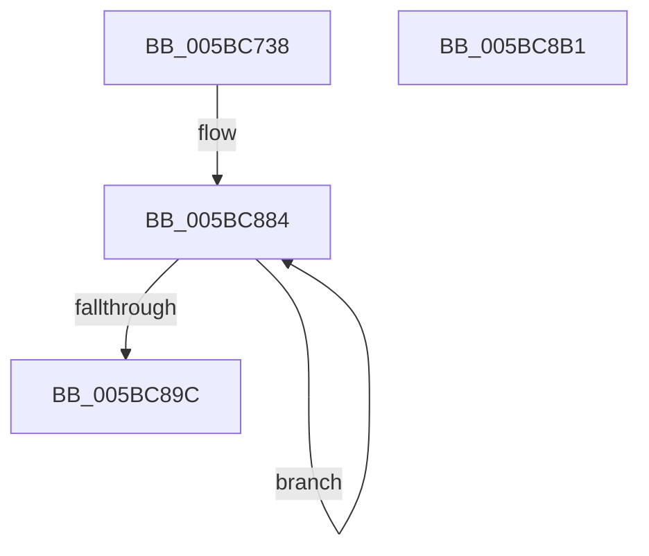

# KiConfigureInitialNodes

- RVA: `0x005BC738`–`0x005BC8B2` (길이 `378` bytes)
- VA: `0x00000001405BC738`
- 실행 섹션: `.text`
- PDB 이름 있음: `예`; PDB Function 태그: `아니요`
- unwind 정보 RVA: `0x0006C8E8`
- 디코드: `77`개 명령, `378/378` bytes 표시
- 미해석 바이트: `0` (있으면 어셈블리에 `.byte`로 보존)

> 이 문서는 커널 이미지의 기계어와 PDB 기호를 분석해 생성했습니다. 4번과 5번은 함수 원형과 자료형을 바이너리 사용 방식에서 추정한 C 해석이며 원본 소스 복구 결과는 아닙니다.

## 1. Dependencies

- 직접 호출 지점: **4**; 고유 호출 대상: **4**
- 직접 호출자로 확인된 함수: **1**
- RIP 상대 이미지 참조: **33**

### Outgoing calls
- `0x005BC784` → [Feature_PpmParkEx__private_IsEnabledNoReportingNoInline](../4F/Feature_PpmParkEx__private_IsEnabledNoReportingNoInline_function_004F40E0.md) (function, `0x004F40E0`)
- `0x005BC7FB` → [KiInitializeSchedulerSubNode](KiInitializeSchedulerSubNode_function_005BCB74.md) (function, `0x005BCB74`)
- `0x005BC846` → [KiAllocateProcessorNumber](KiAllocateProcessorNumber_function_005BC2FC.md) (function, `0x005BC2FC`)
- `0x005BC856` → [KiAssignProcessorNumberToPrcb](KiAssignProcessorNumberToPrcb_function_005BC510.md) (function, `0x005BC510`)

### Direct callers
- [KiInitializeBootStructures](../../pagelk/B6/KiInitializeBootStructures_function_00B68530.md) at `0x00B686E1`

### Static image references
- `0x005BC74C` → RVA `0x00FD0B44` (`CACHEALI`; read/write)
- `0x005BC755` → RVA `0x00FD0B4A` (`CACHEALI`; read/write)
- `0x005BC762` → RVA `0x00FD0B40` (`CACHEALI`; read)
- `0x005BC769` → RVA `0x00FCF6C0` (`CACHEALI`; write)
- `0x005BC770` → RVA `0x00FC5044` (`ALMOSTRO`; read)
- `0x005BC777` → RVA `0x00FD0B48` (`CACHEALI`; write)
- `0x005BC77E` → RVA `0x00FD0B40` (`CACHEALI`; write)
- `0x005BC78B` → RVA `0x00E15A00` (`.data`; write)
- `0x005BC794` → RVA `0x00E15A10` (`.data`; write)
- `0x005BC79E` → RVA `0x00F21AC8` (`.data`; write)
- `0x005BC7A5` → RVA `0x00E15A05` (`.data`; read/write)
- `0x005BC7AC` → RVA `0x00E15A00` (`.data`; read)
- `0x005BC7B6` → RVA `0x00F21AF0` (`.data`; write)
- `0x005BC7C1` → RVA `0x00E15A06` (`.data`; write)
- `0x005BC7CC` → RVA `0x00FD0C60` (`CACHEALI`; read)
- `0x005BC7D7` → RVA `0x00E167C0` (`.data`; read)
- `0x005BC7DE` → RVA `0x00F21AD0` (`.data`; write)
- `0x005BC7E5` → RVA `0x00E15A40` (`.data`; read)
- `0x005BC7F5` → RVA `0x00E15A04` (`.data`; write)
- `0x005BC800` → RVA `0x00E15D40` (`.data`; read)
- `0x005BC807` → RVA `0x00E15AF9` (`.data`; write)
- `0x005BC80E` → RVA `0x00E15B00` (`.data`; write)
- `0x005BC81A` → RVA `0x00E16BF8` (`.data`; read)
- `0x005BC821` → RVA `0x00E167C0` (`.data`; write)
- `0x005BC828` → RVA `0x00E15B08` (`.data`; write)
- `0x005BC831` → RVA `0x00E16DF8` (`.data`; read)
- `0x005BC838` → RVA `0x00FD0B60` (`CACHEALI`; write)
- `0x005BC83F` → RVA `0x00E15B10` (`.data`; write)
- `0x005BC85B` → RVA `0x00E15AE0` (`.data`; read/write)
- `0x005BC862` → RVA `0x00FCF6C8` (`CACHEALI`; read)
- `0x005BC869` → RVA `0x00E15A90` (`.data`; read/write)
- `0x005BC870` → RVA `0x00FDB1F8` (`PAGEDATA`; read)
- `0x005BC87D` → RVA `0x00FC8830` (`ALMOSTRO`; read/write)

## 2. Other-region calls and transfers

- 다른 실행 섹션으로 향하는 call: **0**
- 별도 외부 분기/꼬리 이동을 확인하지 못했습니다.

## 3. Assembly (complete function range)

```asm
005BC738  48 8B C4                        mov rax, rsp
005BC73B  48 89 58 10                     mov qword ptr [rax + 0x10], rbx
005BC73F  48 89 68 18                     mov qword ptr [rax + 0x18], rbp
005BC743  48 89 70 20                     mov qword ptr [rax + 0x20], rsi
005BC747  57                              push rdi
005BC748  48 83 EC 20                     sub rsp, 0x20
005BC74C  83 0D F1 43 A1 00 FF            or dword ptr [rip + 0xa143f1], 0xffffffff
005BC753  33 F6                           xor esi, esi
005BC755  80 0D EE 43 A1 00 02            or byte ptr [rip + 0xa143ee], 2
005BC75C  48 8B D9                        mov rbx, rcx
005BC75F  89 70 08                        mov dword ptr [rax + 8], esi
005BC762  48 8D 05 D7 43 A1 00            lea rax, [rip + 0xa143d7]
005BC769  48 89 05 50 2F A1 00            mov qword ptr [rip + 0xa12f50], rax
005BC770  0F B7 05 CD 88 A0 00            movzx eax, word ptr [rip + 0xa088cd]
005BC777  66 89 05 CA 43 A1 00            mov word ptr [rip + 0xa143ca], ax
005BC77E  89 35 BC 43 A1 00               mov dword ptr [rip + 0xa143bc], esi
005BC784  E8 57 79 F3 FF                  call 0x1404f40e0
005BC789  F7 D8                           neg eax
005BC78B  89 35 6F 92 85 00               mov dword ptr [rip + 0x85926f], esi
005BC791  8D 6E 01                        lea ebp, [rsi + 1]
005BC794  48 89 35 75 92 85 00            mov qword ptr [rip + 0x859275], rsi
005BC79B  48 1B C9                        sbb rcx, rcx
005BC79E  66 89 2D 23 53 96 00            mov word ptr [rip + 0x965323], bp
005BC7A5  80 0D 59 92 85 00 05            or byte ptr [rip + 0x859259], 5
005BC7AC  48 8D 15 4D 92 85 00            lea rdx, [rip + 0x85924d]
005BC7B3  83 E1 04                        and ecx, 4
005BC7B6  48 89 15 33 53 96 00            mov qword ptr [rip + 0x965333], rdx
005BC7BD  48 83 C1 14                     add rcx, 0x14
005BC7C1  66 89 35 3E 92 85 00            mov word ptr [rip + 0x85923e], si
005BC7C8  48 C1 E9 02                     shr rcx, 2
005BC7CC  48 8D 3D 8D 44 A1 00            lea rdi, [rip + 0xa1448d]
005BC7D3  8B C5                           mov eax, ebp
005BC7D5  F3 AB                           rep stosd dword ptr [rdi], eax
005BC7D7  48 8D 05 E2 9F 85 00            lea rax, [rip + 0x859fe2]
005BC7DE  48 89 05 EB 52 96 00            mov qword ptr [rip + 0x9652eb], rax
005BC7E5  48 8D 3D 54 92 85 00            lea rdi, [rip + 0x859254]
005BC7EC  8A 05 52 88 A0 00               mov al, byte ptr [rip + 0xa08852]
005BC7F2  48 8B CF                        mov rcx, rdi
005BC7F5  88 05 09 92 85 00               mov byte ptr [rip + 0x859209], al
005BC7FB  E8 74 03 00 00                  call 0x1405bcb74
005BC800  48 8D 05 39 95 85 00            lea rax, [rip + 0x859539]
005BC807  C6 05 EB 92 85 00 08            mov byte ptr [rip + 0x8592eb], 8
005BC80E  48 89 05 EB 92 85 00            mov qword ptr [rip + 0x8592eb], rax
005BC815  48 8D 54 24 30                  lea rdx, [rsp + 0x30]
005BC81A  48 8D 05 D7 A3 85 00            lea rax, [rip + 0x85a3d7]
005BC821  48 89 3D 98 9F 85 00            mov qword ptr [rip + 0x859f98], rdi
005BC828  48 89 05 D9 92 85 00            mov qword ptr [rip + 0x8592d9], rax
005BC82F  33 C9                           xor ecx, ecx
005BC831  48 8D 05 C0 A5 85 00            lea rax, [rip + 0x85a5c0]
005BC838  48 89 3D 21 43 A1 00            mov qword ptr [rip + 0xa14321], rdi
005BC83F  48 89 05 CA 92 85 00            mov qword ptr [rip + 0x8592ca], rax
005BC846  E8 B1 FA FF FF                  call 0x1405bc2fc
005BC84B  45 33 C0                        xor r8d, r8d
005BC84E  48 8D 54 24 30                  lea rdx, [rsp + 0x30]
005BC853  48 8B CB                        mov rcx, rbx
005BC856  E8 B5 FC FF FF                  call 0x1405bc510
005BC85B  48 09 2D 7E 92 85 00            or qword ptr [rip + 0x85927e], rbp
005BC862  48 8D 15 5F 2E A1 00            lea rdx, [rip + 0xa12e5f]
005BC869  48 09 2D 20 92 85 00            or qword ptr [rip + 0x859220], rbp
005BC870  48 8D 0D 81 E9 A1 00            lea rcx, [rip + 0xa1e981]
005BC877  40 88 6B 23                     mov byte ptr [rbx + 0x23], bpl
005BC87B  8B C5                           mov eax, ebp
005BC87D  48 09 2D AC BF A0 00            or qword ptr [rip + 0xa0bfac], rbp
005BC884  48 89 0A                        mov qword ptr [rdx], rcx
005BC887  48 8D 52 08                     lea rdx, [rdx + 8]
005BC88B  66 89 01                        mov word ptr [rcx], ax
005BC88E  03 C5                           add eax, ebp
005BC890  48 81 C1 38 03 00 00            add rcx, 0x338
005BC897  83 F8 40                        cmp eax, 0x40
005BC89A  72 E8                           jb 0x1405bc884
005BC89C  48 8B 5C 24 38                  mov rbx, qword ptr [rsp + 0x38]
005BC8A1  48 8B 6C 24 40                  mov rbp, qword ptr [rsp + 0x40]
005BC8A6  48 8B 74 24 48                  mov rsi, qword ptr [rsp + 0x48]
005BC8AB  48 83 C4 20                     add rsp, 0x20
005BC8AF  5F                              pop rdi
005BC8B0  C3                              ret
005BC8B1  CC                              int3
```

## 4. C-style interpretation (structured pseudocode)

```c
__int64 __fastcall KiConfigureInitialNodes(__int64 a1, __int64 a2, int a3)
{
    __int64 result;
    __int64 v_rsi;
    __int64 v_rsp;
    unsigned __int64 v_stack_p10;
    unsigned __int64 v_stack_p18;
    unsigned __int64 v_stack_p20;
    unsigned __int64 v_stack_p8;

    *(unsigned __int64 *)(v_rsp + 16) = v_rbx;
    *(unsigned __int64 *)(v_rsp + 24) = v_rbp;
    *(unsigned __int64 *)(v_rsp + 32) = v_rsi;
    v_rsp = (v_rsp) - (32);
    v_rsi = 0;
    *(unsigned int *)(v_rsp + 8) = 0;
    *(unsigned __int64 *)(v_rip + 10563408) = v_rip + 10568663;
    *(unsigned __int16 *)(v_rip + 10568650) = (unsigned __int16)(*(unsigned __int16 *)(v_rip + 10520781));
    *(unsigned int *)(v_rip + 10568636) = 0;
    result = Feature_PpmParkEx__private_IsEnabledNoReportingNoInline(a1, a2, a3, a4);
    result = (unsigned int)(-(result));
    *(unsigned int *)(v_rip + 8753775) = 0;
    *(unsigned __int64 *)(v_rip + 8753781) = 0;
    *(unsigned __int16 *)(v_rip + 9851683) = (unsigned __int16)(v_rsi + 1);
    a1 = (unsigned int)((a1) & (4));
    *(unsigned __int64 *)(v_rip + 9851699) = v_rip + 8753741;
    a1 = (a1) + (20);
    *(unsigned __int16 *)(v_rip + 8753726) = 0;
    a1 = (a1) >> (2);
    *(unsigned __int64 *)(v_rip + 9851627) = v_rip + 8757218;
    *(unsigned __int8 *)(v_rip + 8753673) = (unsigned __int8)(*(unsigned __int8 *)(v_rip + 10520658));
    result = KiInitializeSchedulerSubNode(v_rip + 8753748, v_rip + 8753741, a3, a4);
    *(unsigned __int8 *)(v_rip + 8753899) = 8;
    *(unsigned __int64 *)(v_rip + 8753899) = v_rip + 8754489;
    *(unsigned __int64 *)(v_rip + 8757144) = v_rip + 8753748;
    *(unsigned __int64 *)(v_rip + 8753881) = v_rip + 8758231;
    a1 = 0;
    *(unsigned __int64 *)(v_rip + 10568481) = v_rip + 8753748;
    *(unsigned __int64 *)(v_rip + 8753866) = v_rip + 8758720;
    result = KiAllocateProcessorNumber(a1, v_stack_p8, a3, a4);
    a3 = 0;
    result = KiAssignProcessorNumberToPrcb(0, v_stack_p8, a3, a4);
    *(unsigned __int8 *)(a1 + 35) = (unsigned __int8)(v_rsi + 1);
loc_005BC884:
    *(unsigned __int64 *)(v_rip + 10563167) = v_rip + 10611073;
    *(unsigned __int16 *)(v_rip + 10611073) = (unsigned __int16)((unsigned int)((unsigned int)(v_rsi + 1)));
    result = (unsigned int)(((unsigned int)((unsigned int)(v_rsi + 1))) + ((unsigned int)(v_rsi + 1)));
    a1 = (v_rip + 10611073) + (824);
    if (((unsigned int)(result)) < 64) goto loc_005BC884;
    v_rsp = (v_rsp) + (32);
    return result;
}
```

## 5. (Beta) C Style

```c
int64_t KiConfigureInitialNodes(void *Arg1, int64_t Arg2, int32_t Arg3)
{
    uint8_t *arg1 = (uint8_t *)Arg1;

    int64_t result;
    int64_t local_rsi;
    int64_t local_rsp;
    uint64_t v_stack_p10;
    uint64_t v_stack_p18;
    uint64_t v_stack_p20;
    uint64_t v_stack_p8;

    *(uint64_t *)(local_rsp + 0x10) = local_rbx;
    *(uint64_t *)(local_rsp + 0x18) = local_rbp;
    *(uint64_t *)(local_rsp + 0x20) = local_rsi;
    local_rsp = (local_rsp) - (32);
    local_rsi = 0;
    *(uint32_t *)(local_rsp + 0x8) = 0;
    *(uint64_t *)(v_rip + 0xA12F50) = v_rip + 10568663;
    *(uint16_t *)(v_rip + 0xA143CA) = (uint16_t)(*(uint16_t *)(v_rip + 0xA088CD));
    *(uint32_t *)(v_rip + 0xA143BC) = 0;
    result = Feature_PpmParkEx__private_IsEnabledNoReportingNoInline(Arg1, Arg2, Arg3, a4);
    result = (uint32_t)(-(result));
    *(uint32_t *)(v_rip + 0x85926F) = 0;
    *(uint64_t *)(v_rip + 0x859275) = 0;
    *(uint16_t *)(v_rip + 0x965323) = (uint16_t)(local_rsi + 1);
    Arg1 = (uint32_t)((Arg1) & (4));
    *(uint64_t *)(v_rip + 0x965333) = v_rip + 8753741;
    Arg1 = (Arg1) + (20);
    *(uint16_t *)(v_rip + 0x85923E) = 0;
    Arg1 = (Arg1) >> (2);
    *(uint64_t *)(v_rip + 0x9652EB) = v_rip + 8757218;
    *(uint8_t *)(v_rip + 0x859209) = (uint8_t)(*(uint8_t *)(v_rip + 0xA08852));
    result = KiInitializeSchedulerSubNode(v_rip + 8753748, v_rip + 8753741, Arg3, a4);
    *(uint8_t *)(v_rip + 0x8592EB) = 8;
    *(uint64_t *)(v_rip + 0x8592EB) = v_rip + 8754489;
    *(uint64_t *)(v_rip + 0x859F98) = v_rip + 8753748;
    *(uint64_t *)(v_rip + 0x8592D9) = v_rip + 8758231;
    Arg1 = 0;
    *(uint64_t *)(v_rip + 0xA14321) = v_rip + 8753748;
    *(uint64_t *)(v_rip + 0x8592CA) = v_rip + 8758720;
    result = KiAllocateProcessorNumber(Arg1, v_stack_p8, Arg3, a4);
    Arg3 = 0;
    result = KiAssignProcessorNumberToPrcb(0, v_stack_p8, Arg3, a4);
    *(uint8_t *)(arg1 + 0x23) = (uint8_t)(local_rsi + 1);
loc_005BC884:
    *(uint64_t *)(v_rip + 0xA12E5F) = v_rip + 10611073;
    *(uint16_t *)(v_rip + 0xA1E981) = (uint16_t)((uint32_t)((uint32_t)(local_rsi + 1)));
    result = (uint32_t)(((uint32_t)((uint32_t)(local_rsi + 1))) + ((uint32_t)(local_rsi + 1)));
    Arg1 = (v_rip + 10611073) + (824);
    if (((uint32_t)(result)) < 64) goto loc_005BC884;
    local_rsp = (local_rsp) + (32);
    return result;
}
```

### 관측된 메모리 오프셋

구조체 형식이 확인되지 않은 접근은 인자 기준의 오프셋으로만 기록했습니다.

| 기준 인자 | 오프셋 표현 | 폭 (bit) | 접근 |
|---|---:|---:|---|
| `Arg1` | `+ 0x23` | `8` | `W` |

## 6. Execution-region graph

[열기: 2D/3D 그래프와 함수 탐색 컨트롤 패널](../../../control-panel.html?section=text&rva=0x005BC738&view=graph)

- 2D 그래프는 위에서 아래로 흐르고, 3D 그래프는 빈 공간을 드래그해 회전합니다. Shift+드래그는 이동, 휠은 확대·축소, 함수 노드 선택은 대상 보고서 이동입니다.

### Static fallback


