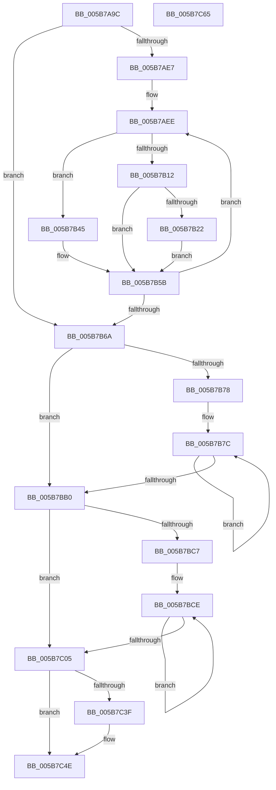

# KiConfigureNodeSchedulingInformation

- RVA: `0x005B7A9C`–`0x005B7C66` (길이 `458` bytes)
- VA: `0x00000001405B7A9C`
- 실행 섹션: `.text`
- PDB 이름 있음: `예`; PDB Function 태그: `아니요`
- unwind 정보 RVA: `0x000BB528`
- 디코드: `106`개 명령, `458/458` bytes 표시
- 미해석 바이트: `0` (있으면 어셈블리에 `.byte`로 보존)

> 이 문서는 커널 이미지의 기계어와 PDB 기호를 분석해 생성했습니다. 4번과 5번은 함수 원형과 자료형을 바이너리 사용 방식에서 추정한 C 해석이며 원본 소스 복구 결과는 아닙니다.

## 1. Dependencies

- 직접 호출 지점: **2**; 고유 호출 대상: **2**
- 직접 호출자로 확인된 함수: **1**
- RIP 상대 이미지 참조: **3**

### Outgoing calls
- `0x005B7BB3` → [KiAssignSubNodeSharedReadyQueues](KiAssignSubNodeSharedReadyQueues_function_005B737C.md) (function, `0x005B737C`)
- `0x005B7C08` → [KiAssignCooperativeIdleSearchContexts](KiAssignCooperativeIdleSearchContexts_function_005B7088.md) (function, `0x005B7088`)

### Direct callers
- [KiConfigureAllSchedulingInformation](../../init/C3/KiConfigureAllSchedulingInformation_function_00C380D0.md) at `0x00C38188`

### Static image references
- `0x005B7ABA` → RVA `0x00000000` (`image boundary/outside`; read)
- `0x005B7ACB` → RVA `0x00F906F8` (`.data`; read)
- `0x005B7AEE` → RVA `0x00F231B8` (`.data`; read)

## 2. Other-region calls and transfers

- 다른 실행 섹션으로 향하는 call: **0**
- 별도 외부 분기/꼬리 이동을 확인하지 못했습니다.

## 3. Assembly (complete function range)

```asm
005B7A9C  48 89 5C 24 10                  mov qword ptr [rsp + 0x10], rbx
005B7AA1  48 89 6C 24 18                  mov qword ptr [rsp + 0x18], rbp
005B7AA6  56                              push rsi
005B7AA7  57                              push rdi
005B7AA8  41 55                           push r13
005B7AAA  41 56                           push r14
005B7AAC  41 57                           push r15
005B7AAE  48 83 EC 20                     sub rsp, 0x20
005B7AB2  44 0F B7 B1 88 00 00 00         movzx r14d, word ptr [rcx + 0x88]
005B7ABA  4C 8D 2D 3F 85 A4 FF            lea r13, [rip - 0x5b7ac1]
005B7AC1  4C 8B 89 80 00 00 00            mov r9, qword ptr [rcx + 0x80]
005B7AC8  41 8B FE                        mov edi, r14d
005B7ACB  40 8A 2D 26 8C 9D 00            mov bpl, byte ptr [rip + 0x9d8c26]
005B7AD2  33 F6                           xor esi, esi
005B7AD4  48 C1 E7 05                     shl rdi, 5
005B7AD8  48 8B D9                        mov rbx, rcx
005B7ADB  45 8B C6                        mov r8d, r14d
005B7ADE  4D 85 C9                        test r9, r9
005B7AE1  0F 84 83 00 00 00               je 0x1405b7b6a
005B7AE7  45 8B D6                        mov r10d, r14d
005B7AEA  41 C1 E2 06                     shl r10d, 6
005B7AEE  48 8B 05 C3 B6 96 00            mov rax, qword ptr [rip + 0x96b6c3]
005B7AF5  83 64 24 50 00                  and dword ptr [rsp + 0x50], 0
005B7AFA  4D 0F BC D9                     bsf r11, r9
005B7AFE  43 8D 0C 1A                     lea ecx, [r10 + r11]
005B7B02  8B 0C 88                        mov ecx, dword ptr [rax + rcx*4]
005B7B05  49 8B 8C CD 40 8C FC 00         mov rcx, qword ptr [r13 + rcx*8 + 0xfc8c40]
005B7B0D  40 84 ED                        test bpl, bpl
005B7B10  74 33                           je 0x1405b7b45
005B7B12  48 8B 91 60 8E 00 00            mov rdx, qword ptr [rcx + 0x8e60]
005B7B19  48 3B 91 C8 00 00 00            cmp rdx, qword ptr [rcx + 0xc8]
005B7B20  74 39                           je 0x1405b7b5b
005B7B22  80 8B B8 00 00 00 01            or byte ptr [rbx + 0xb8], 1
005B7B29  48 8B 81 C0 00 00 00            mov rax, qword ptr [rcx + 0xc0]
005B7B30  0F B7 88 8A 00 00 00            movzx ecx, word ptr [rax + 0x8a]
005B7B37  49 8B 84 CD C0 F6 FC 00         mov rax, qword ptr [r13 + rcx*8 + 0xfcf6c0]
005B7B3F  80 48 0A 08                     or byte ptr [rax + 0xa], 8
005B7B43  EB 16                           jmp 0x1405b7b5b
005B7B45  0F B6 81 D0 00 00 00            movzx eax, byte ptr [rcx + 0xd0]
005B7B4C  48 8B 94 C1 18 8C 00 00         mov rdx, qword ptr [rcx + rax*8 + 0x8c18]
005B7B54  48 23 93 80 00 00 00            and rdx, qword ptr [rbx + 0x80]
005B7B5B  41 8B C3                        mov eax, r11d
005B7B5E  48 F7 D2                        not rdx
005B7B61  48 0F AB C6                     bts rsi, rax
005B7B65  4C 23 CA                        and r9, rdx
005B7B68  75 84                           jne 0x1405b7aee
005B7B6A  4C 8B 8B 80 00 00 00            mov r9, qword ptr [rbx + 0x80]
005B7B71  33 ED                           xor ebp, ebp
005B7B73  4D 85 C9                        test r9, r9
005B7B76  74 38                           je 0x1405b7bb0
005B7B78  41 C1 E0 06                     shl r8d, 6
005B7B7C  48 8B 05 35 B6 96 00            mov rax, qword ptr [rip + 0x96b635]
005B7B83  83 64 24 50 00                  and dword ptr [rsp + 0x50], 0
005B7B88  49 0F BC D1                     bsf rdx, r9
005B7B8C  41 8D 0C 10                     lea ecx, [r8 + rdx]
005B7B90  8B 0C 88                        mov ecx, dword ptr [rax + rcx*4]
005B7B93  8B C2                           mov eax, edx
005B7B95  48 0F AB C5                     bts rbp, rax
005B7B99  49 8B 8C CD 40 8C FC 00         mov rcx, qword ptr [r13 + rcx*8 + 0xfc8c40]
005B7BA1  48 8B 81 70 8E 00 00            mov rax, qword ptr [rcx + 0x8e70]
005B7BA8  48 F7 D0                        not rax
005B7BAB  4C 23 C8                        and r9, rax
005B7BAE  75 CC                           jne 0x1405b7b7c
005B7BB0  48 8B CB                        mov rcx, rbx
005B7BB3  E8 C4 F7 FF FF                  call 0x1405b737c
005B7BB8  4C 8B 83 80 00 00 00            mov r8, qword ptr [rbx + 0x80]
005B7BBF  45 33 FF                        xor r15d, r15d
005B7BC2  4D 85 C0                        test r8, r8
005B7BC5  74 3E                           je 0x1405b7c05
005B7BC7  45 8B CE                        mov r9d, r14d
005B7BCA  41 C1 E1 06                     shl r9d, 6
005B7BCE  48 8B 05 E3 B5 96 00            mov rax, qword ptr [rip + 0x96b5e3]
005B7BD5  83 64 24 50 00                  and dword ptr [rsp + 0x50], 0
005B7BDA  49 0F BC D0                     bsf rdx, r8
005B7BDE  41 8D 0C 11                     lea ecx, [r9 + rdx]
005B7BE2  8B 0C 88                        mov ecx, dword ptr [rax + rcx*4]
005B7BE5  49 8B 84 CD 40 8C FC 00         mov rax, qword ptr [r13 + rcx*8 + 0xfc8c40]
005B7BED  48 8B 88 40 8E 00 00            mov rcx, qword ptr [rax + 0x8e40]
005B7BF4  4C 0B F9                        or r15, rcx
005B7BF7  8B C2                           mov eax, edx
005B7BF9  49 0F B3 C0                     btr r8, rax
005B7BFD  48 F7 D1                        not rcx
005B7C00  4C 23 C1                        and r8, rcx
005B7C03  75 C9                           jne 0x1405b7bce
005B7C05  48 8B CB                        mov rcx, rbx
005B7C08  E8 7B F4 FF FF                  call 0x1405b7088
005B7C0D  48 89 B3 A0 00 00 00            mov qword ptr [rbx + 0xa0], rsi
005B7C14  48 89 AB A8 00 00 00            mov qword ptr [rbx + 0xa8], rbp
005B7C1B  4C 89 BB 98 00 00 00            mov qword ptr [rbx + 0x98], r15
005B7C22  4A 09 B4 2F 30 88 FC 00         or qword ptr [rdi + r13 + 0xfc8830], rsi
005B7C2A  0F B7 83 8A 00 00 00            movzx eax, word ptr [rbx + 0x8a]
005B7C31  49 8B 84 C5 C0 F6 FC 00         mov rax, qword ptr [r13 + rax*8 + 0xfcf6c0]
005B7C39  F6 40 0A 01                     test byte ptr [rax + 0xa], 1
005B7C3D  74 0F                           je 0x1405b7c4e
005B7C3F  48 8B 83 80 00 00 00            mov rax, qword ptr [rbx + 0x80]
005B7C46  4A 09 84 2F 38 88 FC 00         or qword ptr [rdi + r13 + 0xfc8838], rax
005B7C4E  48 8B 5C 24 58                  mov rbx, qword ptr [rsp + 0x58]
005B7C53  48 8B 6C 24 60                  mov rbp, qword ptr [rsp + 0x60]
005B7C58  48 83 C4 20                     add rsp, 0x20
005B7C5C  41 5F                           pop r15
005B7C5E  41 5E                           pop r14
005B7C60  41 5D                           pop r13
005B7C62  5F                              pop rdi
005B7C63  5E                              pop rsi
005B7C64  C3                              ret
005B7C65  CC                              int3
```

## 4. C-style interpretation (structured pseudocode)

```c
__int64 __fastcall KiConfigureNodeSchedulingInformation(__int64 a1)
{
    __int64 result;
    __int64 v_r10;
    __int64 v_r15;
    __int64 v_rbp;
    __int64 v_rdi;
    __int64 v_rsi;
    __int64 v_rsp;
    unsigned __int64 v_stack_p10;
    unsigned __int64 v_stack_p18;
    unsigned int v_stack_p8;

    v_stack_p10 = v_rbx;
    v_stack_p18 = v_rbp;
    v_rsp = (v_rsp) - (32);
    v_rsi = 0;
    v_rdi = ((unsigned int)((unsigned int)(*(unsigned __int16 *)(a1 + 136)))) << (5);
    if (*(unsigned __int64 *)(a1 + 128) == 0) goto loc_005B7B6A;
    v_r10 = (unsigned int)(((unsigned int)((unsigned int)(*(unsigned __int16 *)(a1 + 136)))) << (6));
loc_005B7AEE:
    if ((unsigned __int8)(*(unsigned __int8 *)(v_rip + 10325030)) == 0) goto loc_005B7B45;
    if ((*(unsigned __int64 *)(*(unsigned __int64 *)(v_rip - 5995201 + (unsigned int)(*(unsigned int *)(*(unsigned __int64 *)(v_rip + 9877187) + v_r10 + v_r11 * 1 * 4)) * 8 + 16550976) + 36448)) == (*(unsigned __int64 *)(*(unsigned __int64 *)(v_rip - 5995201 + (unsigned int)(*(unsigned int *)(*(unsigned __int64 *)(v_rip + 9877187) + v_r10 + v_r11 * 1 * 4)) * 8 + 16550976) + 200))) goto loc_005B7B5B;
    goto loc_005B7B5B;
loc_005B7B45:
    a2 = (*(unsigned __int64 *)(*(unsigned __int16 *)(*(unsigned __int64 *)(*(unsigned __int64 *)(v_rip - 5995201 + (unsigned int)(*(unsigned int *)(*(unsigned __int64 *)(v_rip + 9877187) + v_r10 + v_r11 * 1 * 4)) * 8 + 16550976) + 192) + 138) + *(unsigned __int8 *)(*(unsigned __int16 *)(*(unsigned __int64 *)(*(unsigned __int64 *)(v_rip - 5995201 + (unsigned int)(*(unsigned int *)(*(unsigned __int64 *)(v_rip + 9877187) + v_r10 + v_r11 * 1 * 4)) * 8 + 16550976) + 192) + 138) + 208) * 8 + 35864)) & (*(unsigned __int64 *)(a1 + 128));
loc_005B7B5B:
    a2 = ~(a2);
    a4 = (*(unsigned __int64 *)(a1 + 128)) & (a2);
    if (condition_is_not_equal) goto loc_005B7AEE;
loc_005B7B6A:
    v_rbp = 0;
    if (*(unsigned __int64 *)(a1 + 128) == 0) goto loc_005B7BB0;
    a3 = (unsigned int)(((unsigned int)((unsigned int)(*(unsigned __int16 *)(a1 + 136)))) << (6));
loc_005B7B7C:
    result = ~(*(unsigned __int64 *)(*(unsigned __int64 *)(v_rip - 5995201 + (unsigned int)(*(unsigned int *)(*(unsigned __int64 *)(v_rip + 9877045) + a3 + a2 * 1 * 4)) * 8 + 16550976) + 36464));
    a4 = (*(unsigned __int64 *)(a1 + 128)) & (result);
    if (condition_is_not_equal) goto loc_005B7B7C;
loc_005B7BB0:
    result = KiAssignSubNodeSharedReadyQueues(a1, a2, a3, a4);
    v_r15 = 0;
    if (*(unsigned __int64 *)(a1 + 128) == 0) goto loc_005B7C05;
    a4 = (unsigned int)(((unsigned int)((unsigned int)(*(unsigned __int16 *)(a1 + 136)))) << (6));
loc_005B7BCE:
    v_r15 = (v_r15) | (*(unsigned __int64 *)(*(unsigned __int64 *)(v_rip - 5995201 + (unsigned int)(*(unsigned int *)(*(unsigned __int64 *)(v_rip + 9876963) + a4 + a2 * 1 * 4)) * 8 + 16550976) + 36416));
    a1 = ~(*(unsigned __int64 *)(*(unsigned __int64 *)(v_rip - 5995201 + (unsigned int)(*(unsigned int *)(*(unsigned __int64 *)(v_rip + 9876963) + a4 + a2 * 1 * 4)) * 8 + 16550976) + 36416));
    a3 = (*(unsigned __int64 *)(a1 + 128)) & (a1);
    if (condition_is_not_equal) goto loc_005B7BCE;
loc_005B7C05:
    result = KiAssignCooperativeIdleSearchContexts(a1, a2, a3, a4);
    *(unsigned __int64 *)(a1 + 160) = 0;
    *(unsigned __int64 *)(a1 + 168) = 0;
    *(unsigned __int64 *)(a1 + 152) = v_r15;
    result = *(unsigned __int64 *)(v_rip - 5995201 + *(unsigned __int16 *)(a1 + 138) * 8 + 16578240);
    if (((*(unsigned __int8 *)(*(unsigned __int64 *)(v_rip - 5995201 + *(unsigned __int16 *)(a1 + 138) * 8 + 16578240) + 10)) & (1)) != 0) {
        result = *(unsigned __int64 *)(a1 + 128);
    }
    v_rsp = (v_rsp) + (32);
    return result;
}
```

## 5. (Beta) C Style

```c
int64_t KiConfigureNodeSchedulingInformation(void *Arg1)
{
    uint8_t *arg1 = (uint8_t *)Arg1;

    int64_t result;
    int64_t local_r10;
    int64_t local_r15;
    int64_t local_rbp;
    int64_t local_rdi;
    int64_t local_rsi;
    int64_t local_rsp;
    uint64_t v_stack_p10;
    uint64_t v_stack_p18;
    uint32_t v_stack_p8;

    v_stack_p10 = local_rbx;
    v_stack_p18 = local_rbp;
    local_rsp = (local_rsp) - (32);
    local_rsi = 0;
    local_rdi = ((uint32_t)((uint32_t)(*(uint16_t *)(arg1 + 0x88)))) << (5);
    if (*(uint64_t *)(arg1 + 0x80) == 0) goto loc_005B7B6A;
    local_r10 = (uint32_t)(((uint32_t)((uint32_t)(*(uint16_t *)(arg1 + 0x88)))) << (6));
loc_005B7AEE:
    if ((uint8_t)(*(uint8_t *)(v_rip + 0x9D8C26)) == 0) goto loc_005B7B45;
    if ((*(uint64_t *)(*(uint64_t *)(v_rip - 0x5B7AC1 + (uint32_t)(*(uint32_t *)(*(uint64_t *)(v_rip + 0x96B6C3) + local_r10 + local_r11 * 1 * 4)) * 8 + 0xFC8C40) + 0x8E60)) == (*(uint64_t *)(*(uint64_t *)(v_rip - 0x5B7AC1 + (uint32_t)(*(uint32_t *)(*(uint64_t *)(v_rip + 0x96B6C3) + local_r10 + local_r11 * 1 * 4)) * 8 + 0xFC8C40) + 0xC8))) goto loc_005B7B5B;
    goto loc_005B7B5B;
loc_005B7B45:
    a2 = (*(uint64_t *)(*(uint16_t *)(*(uint64_t *)(*(uint64_t *)(v_rip - 0x5B7AC1 + (uint32_t)(*(uint32_t *)(*(uint64_t *)(v_rip + 0x96B6C3) + local_r10 + local_r11 * 1 * 4)) * 8 + 0xFC8C40) + 0xC0) + 0x8A) + *(uint8_t *)(*(uint16_t *)(*(uint64_t *)(*(uint64_t *)(v_rip - 0x5B7AC1 + (uint32_t)(*(uint32_t *)(*(uint64_t *)(v_rip + 0x96B6C3) + local_r10 + local_r11 * 1 * 4)) * 8 + 0xFC8C40) + 0xC0) + 0x8A) + 0xD0) * 8 + 0x8C18)) & (*(uint64_t *)(arg1 + 0x80));
loc_005B7B5B:
    a2 = ~(a2);
    a4 = (*(uint64_t *)(arg1 + 0x80)) & (a2);
    if (condition_is_not_equal) goto loc_005B7AEE;
loc_005B7B6A:
    local_rbp = 0;
    if (*(uint64_t *)(arg1 + 0x80) == 0) goto loc_005B7BB0;
    a3 = (uint32_t)(((uint32_t)((uint32_t)(*(uint16_t *)(arg1 + 0x88)))) << (6));
loc_005B7B7C:
    result = ~(*(uint64_t *)(*(uint64_t *)(v_rip - 0x5B7AC1 + (uint32_t)(*(uint32_t *)(*(uint64_t *)(v_rip + 0x96B635) + a3 + a2 * 1 * 4)) * 8 + 0xFC8C40) + 0x8E70));
    a4 = (*(uint64_t *)(arg1 + 0x80)) & (result);
    if (condition_is_not_equal) goto loc_005B7B7C;
loc_005B7BB0:
    result = KiAssignSubNodeSharedReadyQueues(Arg1, a2, a3, a4);
    local_r15 = 0;
    if (*(uint64_t *)(arg1 + 0x80) == 0) goto loc_005B7C05;
    a4 = (uint32_t)(((uint32_t)((uint32_t)(*(uint16_t *)(arg1 + 0x88)))) << (6));
loc_005B7BCE:
    local_r15 = (local_r15) | (*(uint64_t *)(*(uint64_t *)(v_rip - 0x5B7AC1 + (uint32_t)(*(uint32_t *)(*(uint64_t *)(v_rip + 0x96B5E3) + a4 + a2 * 1 * 4)) * 8 + 0xFC8C40) + 0x8E40));
    Arg1 = ~(*(uint64_t *)(*(uint64_t *)(v_rip - 0x5B7AC1 + (uint32_t)(*(uint32_t *)(*(uint64_t *)(v_rip + 0x96B5E3) + a4 + a2 * 1 * 4)) * 8 + 0xFC8C40) + 0x8E40));
    a3 = (*(uint64_t *)(arg1 + 0x80)) & (Arg1);
    if (condition_is_not_equal) goto loc_005B7BCE;
loc_005B7C05:
    result = KiAssignCooperativeIdleSearchContexts(Arg1, a2, a3, a4);
    *(uint64_t *)(arg1 + 0xA0) = 0;
    *(uint64_t *)(arg1 + 0xA8) = 0;
    *(uint64_t *)(arg1 + 0x98) = local_r15;
    result = *(uint64_t *)(v_rip - 0x5B7AC1 + *(uint16_t *)(arg1 + 0x8A) * 8 + 0xFCF6C0);
    if (((*(uint8_t *)(*(uint64_t *)(v_rip - 0x5B7AC1 + *(uint16_t *)(arg1 + 0x8A) * 8 + 0xFCF6C0) + 0xA)) & (1)) != 0) {
        result = *(uint64_t *)(arg1 + 0x80);
    }
    local_rsp = (local_rsp) + (32);
    return result;
}
```

### 관측된 메모리 오프셋

구조체 형식이 확인되지 않은 접근은 인자 기준의 오프셋으로만 기록했습니다.

| 기준 인자 | 오프셋 표현 | 폭 (bit) | 접근 |
|---|---:|---:|---|
| `Arg1` | `+ 0x80` | `64` | `R` |
| `Arg1` | `+ 0x88` | `16` | `R` |
| `Arg1` | `+ 0x8A` | `16` | `R` |
| `Arg1` | `+ 0x98` | `64` | `W` |
| `Arg1` | `+ 0xA0` | `64` | `W` |
| `Arg1` | `+ 0xA8` | `64` | `W` |
| `Arg1` | `+ 0xB8` | `8` | `R/W` |

## 6. Execution-region graph

[열기: 2D/3D 그래프와 함수 탐색 컨트롤 패널](../../../control-panel.html?section=text&rva=0x005B7A9C&view=graph)

- 2D 그래프는 위에서 아래로 흐르고, 3D 그래프는 빈 공간을 드래그해 회전합니다. Shift+드래그는 이동, 휠은 확대·축소, 함수 노드 선택은 대상 보고서 이동입니다.

### Static fallback


