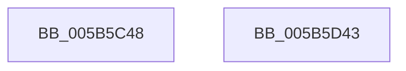

# KiCreateDpcLimitsProcessorConfiguration

- RVA: `0x005B5C48`–`0x005B5D44` (길이 `252` bytes)
- VA: `0x00000001405B5C48`
- 실행 섹션: `.text`
- PDB 이름 있음: `예`; PDB Function 태그: `아니요`
- unwind 정보 RVA: `0x000DB714`
- 디코드: `65`개 명령, `252/252` bytes 표시
- 미해석 바이트: `0` (있으면 어셈블리에 `.byte`로 보존)

> 이 문서는 커널 이미지의 기계어와 PDB 기호를 분석해 생성했습니다. 4번과 5번은 함수 원형과 자료형을 바이너리 사용 방식에서 추정한 C 해석이며 원본 소스 복구 결과는 아닙니다.

## 1. Dependencies

- 직접 호출 지점: **0**; 고유 호출 대상: **0**
- 직접 호출자로 확인된 함수: **2**
- RIP 상대 이미지 참조: **7**

### Outgoing calls
- 직접 디코드된 call 명령이 없습니다.

### Direct callers
- [KeUpdateDpcWatchdogConfiguration](KeUpdateDpcWatchdogConfiguration_function_005B5A34.md) at `0x005B5BC9`
- [KiInitializeProcessor](../../pagelk/B6/KiInitializeProcessor_function_00B66A0C.md) at `0x00B66AE0`

### Static image references
- `0x005B5C65` → RVA `0x00FC6AA0` (`ALMOSTRO`; read)
- `0x005B5C6C` → RVA `0x00FC502C` (`ALMOSTRO`; read)
- `0x005B5C91` → RVA `0x00FC5034` (`ALMOSTRO`; read)
- `0x005B5CB4` → RVA `0x00FC5024` (`ALMOSTRO`; read)
- `0x005B5CD8` → RVA `0x00FC5028` (`ALMOSTRO`; read)
- `0x005B5CFC` → RVA `0x00FC5040` (`ALMOSTRO`; read)
- `0x005B5D20` → RVA `0x00FC503C` (`ALMOSTRO`; read)

## 2. Other-region calls and transfers

- 다른 실행 섹션으로 향하는 call: **0**
- 별도 외부 분기/꼬리 이동을 확인하지 못했습니다.

## 3. Assembly (complete function range)

```asm
005B5C48  33 C0                           xor eax, eax
005B5C4A  41 BA FF FF FF FF               mov r10d, 0xffffffff
005B5C50  48 89 01                        mov qword ptr [rcx], rax
005B5C53  4C 8B C9                        mov r9, rcx
005B5C56  48 89 41 08                     mov qword ptr [rcx + 8], rax
005B5C5A  48 89 41 10                     mov qword ptr [rcx + 0x10], rax
005B5C5E  89 51 1C                        mov dword ptr [rcx + 0x1c], edx
005B5C61  44 89 41 18                     mov dword ptr [rcx + 0x18], r8d
005B5C65  44 8B 05 34 0E A1 00            mov r8d, dword ptr [rip + 0xa10e34]
005B5C6C  8B 05 BA F3 A0 00               mov eax, dword ptr [rip + 0xa0f3ba]
005B5C72  48 69 D0 10 27 00 00            imul rdx, rax, 0x2710
005B5C79  49 8D 40 FF                     lea rax, [r8 - 1]
005B5C7D  48 03 C2                        add rax, rdx
005B5C80  33 D2                           xor edx, edx
005B5C82  49 F7 F0                        div r8
005B5C85  49 3B C2                        cmp rax, r10
005B5C88  49 0F 47 C2                     cmova rax, r10
005B5C8C  33 D2                           xor edx, edx
005B5C8E  89 41 04                        mov dword ptr [rcx + 4], eax
005B5C91  8B 05 9D F3 A0 00               mov eax, dword ptr [rip + 0xa0f39d]
005B5C97  48 69 C8 10 27 00 00            imul rcx, rax, 0x2710
005B5C9E  49 8D 40 FF                     lea rax, [r8 - 1]
005B5CA2  48 03 C1                        add rax, rcx
005B5CA5  49 F7 F0                        div r8
005B5CA8  49 3B C2                        cmp rax, r10
005B5CAB  49 0F 47 C2                     cmova rax, r10
005B5CAF  33 D2                           xor edx, edx
005B5CB1  41 89 01                        mov dword ptr [r9], eax
005B5CB4  8B 05 6A F3 A0 00               mov eax, dword ptr [rip + 0xa0f36a]
005B5CBA  48 69 C8 10 27 00 00            imul rcx, rax, 0x2710
005B5CC1  49 8D 40 FF                     lea rax, [r8 - 1]
005B5CC5  48 03 C1                        add rax, rcx
005B5CC8  49 F7 F0                        div r8
005B5CCB  49 3B C2                        cmp rax, r10
005B5CCE  49 0F 47 C2                     cmova rax, r10
005B5CD2  33 D2                           xor edx, edx
005B5CD4  41 89 41 14                     mov dword ptr [r9 + 0x14], eax
005B5CD8  8B 05 4A F3 A0 00               mov eax, dword ptr [rip + 0xa0f34a]
005B5CDE  48 69 C8 10 27 00 00            imul rcx, rax, 0x2710
005B5CE5  49 8D 40 FF                     lea rax, [r8 - 1]
005B5CE9  48 03 C1                        add rax, rcx
005B5CEC  49 F7 F0                        div r8
005B5CEF  49 3B C2                        cmp rax, r10
005B5CF2  49 0F 47 C2                     cmova rax, r10
005B5CF6  33 D2                           xor edx, edx
005B5CF8  41 89 41 10                     mov dword ptr [r9 + 0x10], eax
005B5CFC  8B 05 3E F3 A0 00               mov eax, dword ptr [rip + 0xa0f33e]
005B5D02  48 69 C8 10 27 00 00            imul rcx, rax, 0x2710
005B5D09  49 8D 40 FF                     lea rax, [r8 - 1]
005B5D0D  48 03 C1                        add rax, rcx
005B5D10  49 F7 F0                        div r8
005B5D13  49 3B C2                        cmp rax, r10
005B5D16  49 0F 47 C2                     cmova rax, r10
005B5D1A  33 D2                           xor edx, edx
005B5D1C  41 89 41 08                     mov dword ptr [r9 + 8], eax
005B5D20  8B 05 16 F3 A0 00               mov eax, dword ptr [rip + 0xa0f316]
005B5D26  48 69 C8 10 27 00 00            imul rcx, rax, 0x2710
005B5D2D  49 8D 40 FF                     lea rax, [r8 - 1]
005B5D31  48 03 C1                        add rax, rcx
005B5D34  49 F7 F0                        div r8
005B5D37  49 3B C2                        cmp rax, r10
005B5D3A  49 0F 47 C2                     cmova rax, r10
005B5D3E  41 89 41 0C                     mov dword ptr [r9 + 0xc], eax
005B5D42  C3                              ret
005B5D43  CC                              int3
```

## 4. C-style interpretation (structured pseudocode)

```c
__int64 __fastcall KiCreateDpcLimitsProcessorConfiguration(__int64 a1, int a2, int a3)
{
    __int64 result;

    result = 0;
    *(unsigned __int64 *)(a1) = 0;
    *(unsigned __int64 *)(a1 + 8) = 0;
    *(unsigned __int64 *)(a1 + 16) = 0;
    *(unsigned int *)(a1 + 28) = a2;
    *(unsigned int *)(a1 + 24) = a3;
    a2 = (a2) * ((unsigned int)(*(unsigned int *)(v_rip + 10548154)));
    result = ((unsigned int)(*(unsigned int *)(v_rip + 10554932)) - 1) + (a2);
    a2 = 0;
    if (result > ((unsigned int)(0xFFFFFFFFULL))) { result = (unsigned int)(0xFFFFFFFFULL); }
    a2 = 0;
    *(unsigned int *)(a1 + 4) = (unsigned int)(result);
    a1 = (a1) * ((unsigned int)(*(unsigned int *)(v_rip + 10548125)));
    result = ((unsigned int)(*(unsigned int *)(v_rip + 10554932)) - 1) + (a1);
    if (result > ((unsigned int)(0xFFFFFFFFULL))) { result = (unsigned int)(0xFFFFFFFFULL); }
    a2 = 0;
    *(unsigned int *)(a1) = (unsigned int)(result);
    a1 = (a1) * ((unsigned int)(*(unsigned int *)(v_rip + 10548074)));
    result = ((unsigned int)(*(unsigned int *)(v_rip + 10554932)) - 1) + (a1);
    if (result > ((unsigned int)(0xFFFFFFFFULL))) { result = (unsigned int)(0xFFFFFFFFULL); }
    a2 = 0;
    *(unsigned int *)(a1 + 20) = (unsigned int)(result);
    a1 = (a1) * ((unsigned int)(*(unsigned int *)(v_rip + 10548042)));
    result = ((unsigned int)(*(unsigned int *)(v_rip + 10554932)) - 1) + (a1);
    if (result > ((unsigned int)(0xFFFFFFFFULL))) { result = (unsigned int)(0xFFFFFFFFULL); }
    a2 = 0;
    *(unsigned int *)(a1 + 16) = (unsigned int)(result);
    a1 = (a1) * ((unsigned int)(*(unsigned int *)(v_rip + 10548030)));
    result = ((unsigned int)(*(unsigned int *)(v_rip + 10554932)) - 1) + (a1);
    if (result > ((unsigned int)(0xFFFFFFFFULL))) { result = (unsigned int)(0xFFFFFFFFULL); }
    a2 = 0;
    *(unsigned int *)(a1 + 8) = (unsigned int)(result);
    a1 = (a1) * ((unsigned int)(*(unsigned int *)(v_rip + 10547990)));
    result = ((unsigned int)(*(unsigned int *)(v_rip + 10554932)) - 1) + (a1);
    if (result > ((unsigned int)(0xFFFFFFFFULL))) { result = (unsigned int)(0xFFFFFFFFULL); }
    *(unsigned int *)(a1 + 12) = (unsigned int)(result);
    return result;
}
```

## 5. (Beta) C Style

```c
int64_t KiCreateDpcLimitsProcessorConfiguration(void *Arg1, int32_t Arg2, int32_t Arg3)
{
    uint8_t *arg1 = (uint8_t *)Arg1;

    int64_t result;

    result = 0;
    *(uint64_t *)(arg1) = 0;
    *(uint64_t *)(arg1 + 0x8) = 0;
    *(uint64_t *)(arg1 + 0x10) = 0;
    *(uint32_t *)(arg1 + 0x1C) = Arg2;
    *(uint32_t *)(arg1 + 0x18) = Arg3;
    Arg2 = (Arg2) * ((uint32_t)(*(uint32_t *)(v_rip + 0xA0F3BA)));
    result = ((uint32_t)(*(uint32_t *)(v_rip + 0xA10E34)) - 1) + (Arg2);
    Arg2 = 0;
    if (result > ((uint32_t)(0xFFFFFFFFULL))) { result = (uint32_t)(0xFFFFFFFFULL); }
    Arg2 = 0;
    *(uint32_t *)(arg1 + 0x4) = (uint32_t)(result);
    Arg1 = (Arg1) * ((uint32_t)(*(uint32_t *)(v_rip + 0xA0F39D)));
    result = ((uint32_t)(*(uint32_t *)(v_rip + 0xA10E34)) - 1) + (Arg1);
    if (result > ((uint32_t)(0xFFFFFFFFULL))) { result = (uint32_t)(0xFFFFFFFFULL); }
    Arg2 = 0;
    *(uint32_t *)(arg1) = (uint32_t)(result);
    Arg1 = (Arg1) * ((uint32_t)(*(uint32_t *)(v_rip + 0xA0F36A)));
    result = ((uint32_t)(*(uint32_t *)(v_rip + 0xA10E34)) - 1) + (Arg1);
    if (result > ((uint32_t)(0xFFFFFFFFULL))) { result = (uint32_t)(0xFFFFFFFFULL); }
    Arg2 = 0;
    *(uint32_t *)(arg1 + 0x14) = (uint32_t)(result);
    Arg1 = (Arg1) * ((uint32_t)(*(uint32_t *)(v_rip + 0xA0F34A)));
    result = ((uint32_t)(*(uint32_t *)(v_rip + 0xA10E34)) - 1) + (Arg1);
    if (result > ((uint32_t)(0xFFFFFFFFULL))) { result = (uint32_t)(0xFFFFFFFFULL); }
    Arg2 = 0;
    *(uint32_t *)(arg1 + 0x10) = (uint32_t)(result);
    Arg1 = (Arg1) * ((uint32_t)(*(uint32_t *)(v_rip + 0xA0F33E)));
    result = ((uint32_t)(*(uint32_t *)(v_rip + 0xA10E34)) - 1) + (Arg1);
    if (result > ((uint32_t)(0xFFFFFFFFULL))) { result = (uint32_t)(0xFFFFFFFFULL); }
    Arg2 = 0;
    *(uint32_t *)(arg1 + 0x8) = (uint32_t)(result);
    Arg1 = (Arg1) * ((uint32_t)(*(uint32_t *)(v_rip + 0xA0F316)));
    result = ((uint32_t)(*(uint32_t *)(v_rip + 0xA10E34)) - 1) + (Arg1);
    if (result > ((uint32_t)(0xFFFFFFFFULL))) { result = (uint32_t)(0xFFFFFFFFULL); }
    *(uint32_t *)(arg1 + 0xC) = (uint32_t)(result);
    return result;
}
```

### 관측된 메모리 오프셋

구조체 형식이 확인되지 않은 접근은 인자 기준의 오프셋으로만 기록했습니다.

| 기준 인자 | 오프셋 표현 | 폭 (bit) | 접근 |
|---|---:|---:|---|
| `Arg1` | `+ 0x0` | `32` | `W` |
| `Arg1` | `+ 0x0` | `64` | `W` |
| `Arg1` | `+ 0x4` | `32` | `W` |
| `Arg1` | `+ 0x8` | `32` | `W` |
| `Arg1` | `+ 0x8` | `64` | `W` |
| `Arg1` | `+ 0xC` | `32` | `W` |
| `Arg1` | `+ 0x10` | `32` | `W` |
| `Arg1` | `+ 0x10` | `64` | `W` |
| `Arg1` | `+ 0x14` | `32` | `W` |
| `Arg1` | `+ 0x18` | `32` | `W` |
| `Arg1` | `+ 0x1C` | `32` | `W` |

## 6. Execution-region graph

[열기: 2D/3D 그래프와 함수 탐색 컨트롤 패널](../../../control-panel.html?section=text&rva=0x005B5C48&view=graph)

- 2D 그래프는 위에서 아래로 흐르고, 3D 그래프는 빈 공간을 드래그해 회전합니다. Shift+드래그는 이동, 휠은 확대·축소, 함수 노드 선택은 대상 보고서 이동입니다.

### Static fallback


