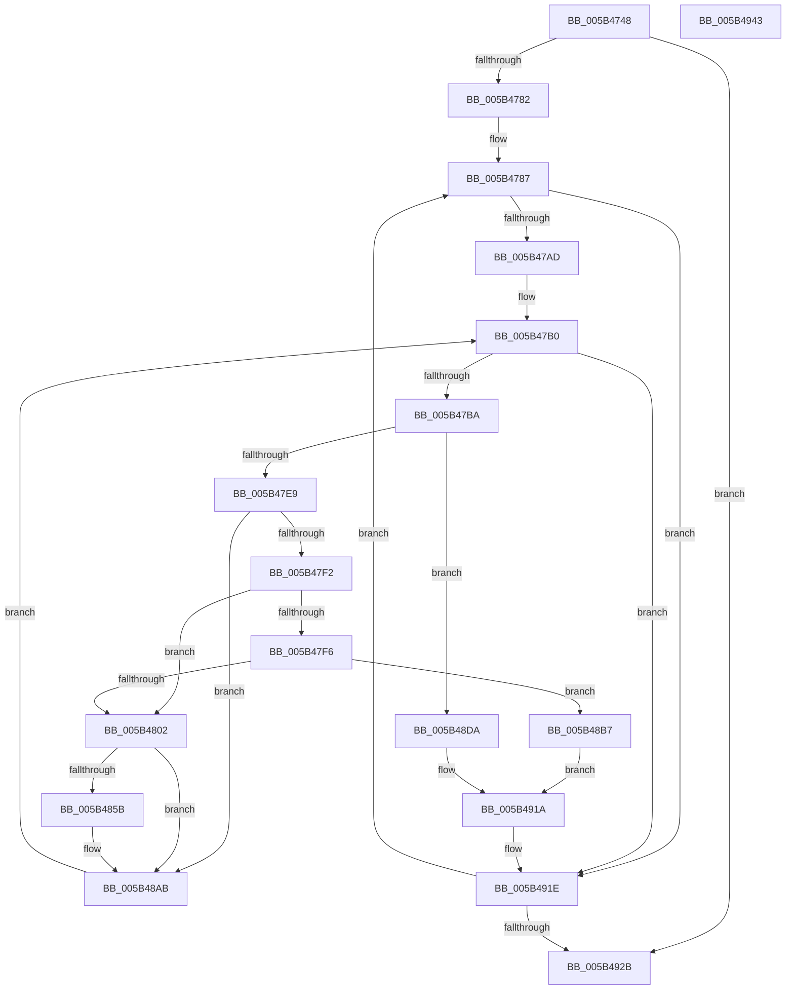

# KiDeduplicateTriageDumpDataArrays

- RVA: `0x005B4748`–`0x005B4944` (길이 `508` bytes)
- VA: `0x00000001405B4748`
- 실행 섹션: `.text`
- PDB 이름 있음: `예`; PDB Function 태그: `아니요`
- unwind 정보 RVA: `0x000C9C20`
- 디코드: `138`개 명령, `508/508` bytes 표시
- 미해석 바이트: `0` (있으면 어셈블리에 `.byte`로 보존)

> 이 문서는 커널 이미지의 기계어와 PDB 기호를 분석해 생성했습니다. 4번과 5번은 함수 원형과 자료형을 바이너리 사용 방식에서 추정한 C 해석이며 원본 소스 복구 결과는 아닙니다.

## 1. Dependencies

- 직접 호출 지점: **8**; 고유 호출 대상: **3**
- 직접 호출자로 확인된 함수: **1**
- RIP 상대 이미지 참조: **4**

### Outgoing calls
- `0x005B47D0` → [KiCheckRangeOverlap](KiCheckRangeOverlap_function_005B42F8.md) (function, `0x005B42F8`)
- `0x005B4827` → [DbgPrintEx](../35/DbgPrintEx_function_00359290.md) (function, `0x00359290`)
- `0x005B4836` → [RtlULongSub](../4A/RtlULongSub_function_004A1DA8.md) (function, `0x004A1DA8`)
- `0x005B4845` → [RtlULongSub](../4A/RtlULongSub_function_004A1DA8.md) (function, `0x004A1DA8`)
- `0x005B48A6` → [DbgPrintEx](../35/DbgPrintEx_function_00359290.md) (function, `0x00359290`)
- `0x005B48D3` → [DbgPrintEx](../35/DbgPrintEx_function_00359290.md) (function, `0x00359290`)
- `0x005B48F1` → [DbgPrintEx](../35/DbgPrintEx_function_00359290.md) (function, `0x00359290`)
- `0x005B490C` → [RtlULongSub](../4A/RtlULongSub_function_004A1DA8.md) (function, `0x004A1DA8`)

### Direct callers
- [KiInvokeBugCheckAddTriageDumpDataCallbacks](KiInvokeBugCheckAddTriageDumpDataCallbacks_function_005B4F88.md) at `0x005B50F7`

### Static image references
- `0x005B4806` → RVA `0x006CB8F0` (` ?? ::FNODOBFM::`string'`; read)
- `0x005B4890` → RVA `0x006CB7E0` (` ?? ::FNODOBFM::`string'`; read)
- `0x005B48BB` → RVA `0x006CB940` (` ?? ::FNODOBFM::`string'`; read)
- `0x005B48DD` → RVA `0x006CB880` (` ?? ::FNODOBFM::`string'`; read)

## 2. Other-region calls and transfers

- 다른 실행 섹션으로 향하는 call: **0**
- 별도 외부 분기/꼬리 이동을 확인하지 못했습니다.

## 3. Assembly (complete function range)

```asm
005B4748  48 89 5C 24 18                  mov qword ptr [rsp + 0x18], rbx
005B474D  48 89 54 24 10                  mov qword ptr [rsp + 0x10], rdx
005B4752  55                              push rbp
005B4753  56                              push rsi
005B4754  57                              push rdi
005B4755  41 54                           push r12
005B4757  41 55                           push r13
005B4759  41 56                           push r14
005B475B  41 57                           push r15
005B475D  48 8B EC                        mov rbp, rsp
005B4760  48 83 EC 60                     sub rsp, 0x60
005B4764  83 65 40 00                     and dword ptr [rbp + 0x40], 0
005B4768  45 33 F6                        xor r14d, r14d
005B476B  0F 57 C0                        xorps xmm0, xmm0
005B476E  4C 8B C2                        mov r8, rdx
005B4771  48 8B F1                        mov rsi, rcx
005B4774  0F 11 45 E0                     movups xmmword ptr [rbp - 0x20], xmm0
005B4778  44 39 71 10                     cmp dword ptr [rcx + 0x10], r14d
005B477C  0F 86 A9 01 00 00               jbe 0x1405b492b
005B4782  BB FF FF FF FF                  mov ebx, 0xffffffff
005B4787  41 8B FE                        mov edi, r14d
005B478A  48 83 C7 03                     add rdi, 3
005B478E  48 C1 E7 04                     shl rdi, 4
005B4792  48 03 FE                        add rdi, rsi
005B4795  48 8B 07                        mov rax, qword ptr [rdi]
005B4798  48 89 45 F0                     mov qword ptr [rbp - 0x10], rax
005B479C  48 8B 47 08                     mov rax, qword ptr [rdi + 8]
005B47A0  48 89 45 F8                     mov qword ptr [rbp - 8], rax
005B47A4  48 85 C0                        test rax, rax
005B47A7  0F 84 71 01 00 00               je 0x1405b491e
005B47AD  45 33 FF                        xor r15d, r15d
005B47B0  45 3B 78 10                     cmp r15d, dword ptr [r8 + 0x10]
005B47B4  0F 83 64 01 00 00               jae 0x1405b491e
005B47BA  41 8B D7                        mov edx, r15d
005B47BD  48 8D 4D F0                     lea rcx, [rbp - 0x10]
005B47C1  48 83 C2 03                     add rdx, 3
005B47C5  48 C1 E2 04                     shl rdx, 4
005B47C9  49 03 D0                        add rdx, r8
005B47CC  4C 8D 45 E0                     lea r8, [rbp - 0x20]
005B47D0  E8 23 FB FF FF                  call 0x1405b42f8
005B47D5  4C 8B 65 F8                     mov r12, qword ptr [rbp - 8]
005B47D9  44 8A E8                        mov r13b, al
005B47DC  48 8B 57 08                     mov rdx, qword ptr [rdi + 8]
005B47E0  4D 85 E4                        test r12, r12
005B47E3  0F 84 F1 00 00 00               je 0x1405b48da
005B47E9  4C 3B E2                        cmp r12, rdx
005B47EC  0F 84 B9 00 00 00               je 0x1405b48ab
005B47F2  84 C0                           test al, al
005B47F4  74 0C                           je 0x1405b4802
005B47F6  8B 4E 14                        mov ecx, dword ptr [rsi + 0x14]
005B47F9  39 4E 10                        cmp dword ptr [rsi + 0x10], ecx
005B47FC  0F 84 B5 00 00 00               je 0x1405b48b7
005B4802  48 8B 5D F0                     mov rbx, qword ptr [rbp - 0x10]
005B4806  4C 8D 05 E3 70 11 00            lea r8, [rip + 0x1170e3]
005B480D  4C 8B 0F                        mov r9, qword ptr [rdi]
005B4810  4C 89 64 24 30                  mov qword ptr [rsp + 0x30], r12
005B4815  48 89 5C 24 28                  mov qword ptr [rsp + 0x28], rbx
005B481A  48 89 54 24 20                  mov qword ptr [rsp + 0x20], rdx
005B481F  BA 03 00 00 00                  mov edx, 3
005B4824  8D 4A 02                        lea ecx, [rdx + 2]
005B4827  E8 64 4A DA FF                  call 0x140359290
005B482C  8B 4F 08                        mov ecx, dword ptr [rdi + 8]
005B482F  4C 8D 45 40                     lea r8, [rbp + 0x40]
005B4833  41 8B D4                        mov edx, r12d
005B4836  E8 6D D5 EE FF                  call 0x1404a1da8
005B483B  8B 55 40                        mov edx, dword ptr [rbp + 0x40]
005B483E  4C 8D 46 18                     lea r8, [rsi + 0x18]
005B4842  41 8B 08                        mov ecx, dword ptr [r8]
005B4845  E8 5E D5 EE FF                  call 0x1404a1da8
005B484A  48 89 1F                        mov qword ptr [rdi], rbx
005B484D  BB FF FF FF FF                  mov ebx, 0xffffffff
005B4852  4C 89 67 08                     mov qword ptr [rdi + 8], r12
005B4856  45 84 ED                        test r13b, r13b
005B4859  74 50                           je 0x1405b48ab
005B485B  48 8B 55 E8                     mov rdx, qword ptr [rbp - 0x18]
005B485F  44 8B 4E 10                     mov r9d, dword ptr [rsi + 0x10]
005B4863  48 8B 45 E0                     mov rax, qword ptr [rbp - 0x20]
005B4867  49 83 C1 03                     add r9, 3
005B486B  49 C1 E1 04                     shl r9, 4
005B486F  4C 03 CE                        add r9, rsi
005B4872  49 89 01                        mov qword ptr [r9], rax
005B4875  8B C3                           mov eax, ebx
005B4877  49 89 51 08                     mov qword ptr [r9 + 8], rdx
005B487B  41 8B 08                        mov ecx, dword ptr [r8]
005B487E  FF 46 10                        inc dword ptr [rsi + 0x10]
005B4881  03 CA                           add ecx, edx
005B4883  3B CA                           cmp ecx, edx
005B4885  BA 03 00 00 00                  mov edx, 3
005B488A  0F 43 C1                        cmovae eax, ecx
005B488D  41 89 00                        mov dword ptr [r8], eax
005B4890  4C 8D 05 49 6F 11 00            lea r8, [rip + 0x116f49]
005B4897  49 8B 41 08                     mov rax, qword ptr [r9 + 8]
005B489B  8D 4A 02                        lea ecx, [rdx + 2]
005B489E  4D 8B 09                        mov r9, qword ptr [r9]
005B48A1  48 89 44 24 20                  mov qword ptr [rsp + 0x20], rax
005B48A6  E8 E5 49 DA FF                  call 0x140359290
005B48AB  4C 8B 45 48                     mov r8, qword ptr [rbp + 0x48]
005B48AF  41 FF C7                        inc r15d
005B48B2  E9 F9 FE FF FF                  jmp 0x1405b47b0
005B48B7  48 8B 45 E8                     mov rax, qword ptr [rbp - 0x18]
005B48BB  4C 8D 05 7E 70 11 00            lea r8, [rip + 0x11707e]
005B48C2  4C 8B 4D E0                     mov r9, qword ptr [rbp - 0x20]
005B48C6  BA 03 00 00 00                  mov edx, 3
005B48CB  48 89 44 24 20                  mov qword ptr [rsp + 0x20], rax
005B48D0  8D 4A 02                        lea ecx, [rdx + 2]
005B48D3  E8 B8 49 DA FF                  call 0x140359290
005B48D8  EB 40                           jmp 0x1405b491a
005B48DA  4C 8B 0F                        mov r9, qword ptr [rdi]
005B48DD  4C 8D 05 9C 6F 11 00            lea r8, [rip + 0x116f9c]
005B48E4  48 89 54 24 20                  mov qword ptr [rsp + 0x20], rdx
005B48E9  BA 03 00 00 00                  mov edx, 3
005B48EE  8D 4A 02                        lea ecx, [rdx + 2]
005B48F1  E8 9A 49 DA FF                  call 0x140359290
005B48F6  48 8B 47 08                     mov rax, qword ptr [rdi + 8]
005B48FA  4C 8D 46 18                     lea r8, [rsi + 0x18]
005B48FE  41 8B 08                        mov ecx, dword ptr [r8]
005B4901  48 3B C3                        cmp rax, rbx
005B4904  8B D3                           mov edx, ebx
005B4906  0F 46 D0                        cmovbe edx, eax
005B4909  89 55 40                        mov dword ptr [rbp + 0x40], edx
005B490C  E8 97 D4 EE FF                  call 0x1404a1da8
005B4911  48 83 27 00                     and qword ptr [rdi], 0
005B4915  48 83 67 08 00                  and qword ptr [rdi + 8], 0
005B491A  4C 8B 45 48                     mov r8, qword ptr [rbp + 0x48]
005B491E  41 FF C6                        inc r14d
005B4921  44 3B 76 10                     cmp r14d, dword ptr [rsi + 0x10]
005B4925  0F 82 5C FE FF FF               jb 0x1405b4787
005B492B  48 8B 9C 24 B0 00 00 00         mov rbx, qword ptr [rsp + 0xb0]
005B4933  48 83 C4 60                     add rsp, 0x60
005B4937  41 5F                           pop r15
005B4939  41 5E                           pop r14
005B493B  41 5D                           pop r13
005B493D  41 5C                           pop r12
005B493F  5F                              pop rdi
005B4940  5E                              pop rsi
005B4941  5D                              pop rbp
005B4942  C3                              ret
005B4943  CC                              int3
```

## 4. C-style interpretation (structured pseudocode)

```c
__int64 __fastcall KiDeduplicateTriageDumpDataArrays(__int64 a1, __int64 a2)
{
    __int64 result;
    __int64 v_r14;
    __int64 v_r15;
    __int64 v_rdi;
    __int64 v_rsp;
    unsigned __int64 v_stack_m40;
    unsigned __int64 v_stack_m48;
    unsigned __int64 v_stack_m50;
    unsigned __int64 v_stack_m58;
    unsigned __int64 v_stack_m68;
    unsigned __int64 v_stack_m70;
    unsigned __int64 v_stack_m78;
    unsigned __int64 v_stack_p10;
    unsigned __int64 v_stack_p18;
    unsigned int v_stack_p8;

    v_stack_p18 = v_rbx;
    v_stack_p10 = a2;
    v_rsp = (v_rsp) - (96);
    v_r14 = 0;
    v_stack_m58 = v_xmm0;
    if ((*(unsigned int *)(a1 + 16)) <= 0) goto loc_005B492B;
loc_005B4787:
    v_rdi = (0) + (3);
    v_rdi = (v_rdi) << (4);
    v_rdi = (v_rdi) + (a1);
    v_stack_m48 = *(unsigned __int64 *)(v_rdi);
    v_stack_m40 = *(unsigned __int64 *)(v_rdi + 8);
    if (*(unsigned __int64 *)(v_rdi + 8) == 0) goto loc_005B491E;
    v_r15 = 0;
loc_005B47B0:
    if (0 >= (*(unsigned int *)(a2 + 16))) goto loc_005B491E;
    a2 = (0) + (3);
    a2 = (a2) << (4);
    a2 = (a2) + (a2);
    result = KiCheckRangeOverlap(v_stack_m48, a2, v_stack_m58, a4);
    if (v_stack_m40 == 0) goto loc_005B48DA;
    if (v_stack_m40 == (*(unsigned __int64 *)(v_rdi + 8))) goto loc_005B48AB;
    if ((unsigned __int8)(result) == 0) goto loc_005B4802;
    if ((*(unsigned int *)(a1 + 16)) == ((unsigned int)((unsigned int)(*(unsigned int *)(a1 + 20))))) goto loc_005B48B7;
loc_005B4802:
    v_stack_m68 = v_stack_m40;
    v_stack_m70 = v_stack_m48;
    v_stack_m78 = *(unsigned __int64 *)(v_rdi + 8);
    result = DbgPrintEx(3 + 2, 3, v_rip + 1143011, *(unsigned __int64 *)(v_rdi));
    result = RtlULongSub((unsigned int)(*(unsigned int *)(v_rdi + 8)), (unsigned int)((unsigned int)(v_stack_m40)), v_stack_p8, *(unsigned __int64 *)(v_rdi));
    result = RtlULongSub((unsigned int)(*(unsigned int *)(a1 + 24)), (unsigned int)(v_stack_p8), a1 + 24, *(unsigned __int64 *)(v_rdi));
    *(unsigned __int64 *)(v_rdi) = v_stack_m48;
    *(unsigned __int64 *)(v_rdi + 8) = v_stack_m40;
    if ((unsigned __int8)((unsigned __int8)(result)) != 0) {
        a2 = v_stack_m50;
        a4 = *(unsigned int *)(a1 + 16);
        result = v_stack_m58;
        a4 = (a4) + (3);
        a4 = (a4) << (4);
        a4 = (a4) + (a1);
        *(unsigned __int64 *)(a4) = result;
        result = (unsigned int)((unsigned int)(0xFFFFFFFFULL));
        *(unsigned __int64 *)(a4 + 8) = a2;
        a1 = *(unsigned int *)(a1 + 24);
        a1 = (unsigned int)((a1) + ((unsigned int)(a2)));
        a2 = 3;
        if (((unsigned int)(a1)) >= ((unsigned int)(a2))) { result = (unsigned int)(a1); }
        *(unsigned int *)(a1 + 24) = (unsigned int)(result);
        a3 = v_rip + 1142601;
        result = *(unsigned __int64 *)(a4 + 8);
        a1 = a2 + 2;
        a4 = *(unsigned __int64 *)(a4);
        v_stack_m78 = result;
        result = DbgPrintEx(a1, a2, a3, a4);
    }
    v_r15 = (unsigned int)((v_r15) + 1);
    goto loc_005B47B0;
loc_005B48B7:
    v_stack_m78 = v_stack_m50;
    result = DbgPrintEx(3 + 2, 3, v_rip + 1142910, v_stack_m58);
    goto loc_005B491A;
loc_005B48DA:
    v_stack_m78 = 3;
    result = DbgPrintEx(3 + 2, 3, v_rip + 1142684, *(unsigned __int64 *)(v_rdi));
    a2 = (unsigned int)((unsigned int)((unsigned int)(0xFFFFFFFFULL)));
    if ((*(unsigned __int64 *)(v_rdi + 8)) <= ((unsigned int)(0xFFFFFFFFULL))) { a2 = (unsigned int)(*(unsigned __int64 *)(v_rdi + 8)); }
    v_stack_p8 = (unsigned int)(a2);
    result = RtlULongSub((unsigned int)(*(unsigned int *)(a1 + 24)), a2, a1 + 24, *(unsigned __int64 *)(v_rdi));
loc_005B491A:
loc_005B491E:
    v_r14 = (unsigned int)((v_r14) + 1);
    if (((unsigned int)(v_r14)) < (*(unsigned int *)(a1 + 16))) goto loc_005B4787;
loc_005B492B:
    v_rsp = (v_rsp) + (96);
    return result;
}
```

## 5. (Beta) C Style

```c
int64_t KiDeduplicateTriageDumpDataArrays(void *Arg1, int64_t Arg2)
{
    uint8_t *arg1 = (uint8_t *)Arg1;

    int64_t result;
    int64_t local_r14;
    int64_t local_r15;
    int64_t local_rdi;
    int64_t local_rsp;
    uint64_t v_stack_m40;
    uint64_t v_stack_m48;
    uint64_t v_stack_m50;
    uint64_t v_stack_m58;
    uint64_t v_stack_m68;
    uint64_t v_stack_m70;
    uint64_t v_stack_m78;
    uint64_t v_stack_p10;
    uint64_t v_stack_p18;
    uint32_t v_stack_p8;

    v_stack_p18 = local_rbx;
    v_stack_p10 = Arg2;
    local_rsp = (local_rsp) - (96);
    local_r14 = 0;
    v_stack_m58 = v_xmm0;
    if ((*(uint32_t *)(arg1 + 0x10)) <= 0) goto loc_005B492B;
loc_005B4787:
    local_rdi = (0) + (3);
    local_rdi = (local_rdi) << (4);
    local_rdi = (local_rdi) + (Arg1);
    v_stack_m48 = *(uint64_t *)(local_rdi);
    v_stack_m40 = *(uint64_t *)(local_rdi + 0x8);
    if (*(uint64_t *)(local_rdi + 0x8) == 0) goto loc_005B491E;
    local_r15 = 0;
loc_005B47B0:
    if (0 >= (*(uint32_t *)(Arg2 + 0x10))) goto loc_005B491E;
    Arg2 = (0) + (3);
    Arg2 = (Arg2) << (4);
    Arg2 = (Arg2) + (Arg2);
    result = KiCheckRangeOverlap(v_stack_m48, Arg2, v_stack_m58, a4);
    if (v_stack_m40 == 0) goto loc_005B48DA;
    if (v_stack_m40 == (*(uint64_t *)(local_rdi + 0x8))) goto loc_005B48AB;
    if ((uint8_t)(result) == 0) goto loc_005B4802;
    if ((*(uint32_t *)(arg1 + 0x10)) == ((uint32_t)((uint32_t)(*(uint32_t *)(arg1 + 0x14))))) goto loc_005B48B7;
loc_005B4802:
    v_stack_m68 = v_stack_m40;
    v_stack_m70 = v_stack_m48;
    v_stack_m78 = *(uint64_t *)(local_rdi + 0x8);
    result = DbgPrintEx(3 + 2, 3, v_rip + 1143011, *(uint64_t *)(local_rdi));
    result = RtlULongSub((uint32_t)(*(uint32_t *)(local_rdi + 0x8)), (uint32_t)((uint32_t)(v_stack_m40)), v_stack_p8, *(uint64_t *)(local_rdi));
    result = RtlULongSub((uint32_t)(*(uint32_t *)(arg1 + 0x18)), (uint32_t)(v_stack_p8), Arg1 + 24, *(uint64_t *)(local_rdi));
    *(uint64_t *)(local_rdi) = v_stack_m48;
    *(uint64_t *)(local_rdi + 0x8) = v_stack_m40;
    if ((uint8_t)((uint8_t)(result)) != 0) {
        Arg2 = v_stack_m50;
        a4 = *(uint32_t *)(arg1 + 0x10);
        result = v_stack_m58;
        a4 = (a4) + (3);
        a4 = (a4) << (4);
        a4 = (a4) + (Arg1);
        *(uint64_t *)(a4) = result;
        result = (uint32_t)((uint32_t)(0xFFFFFFFFULL));
        *(uint64_t *)(a4 + 0x8) = Arg2;
        Arg1 = *(uint32_t *)(arg1 + 0x18);
        Arg1 = (uint32_t)((Arg1) + ((uint32_t)(Arg2)));
        Arg2 = 3;
        if (((uint32_t)(Arg1)) >= ((uint32_t)(Arg2))) { result = (uint32_t)(Arg1); }
        *(uint32_t *)(arg1 + 0x18) = (uint32_t)(result);
        a3 = v_rip + 1142601;
        result = *(uint64_t *)(a4 + 0x8);
        Arg1 = Arg2 + 2;
        a4 = *(uint64_t *)(a4);
        v_stack_m78 = result;
        result = DbgPrintEx(Arg1, Arg2, a3, a4);
    }
    local_r15 = (uint32_t)((local_r15) + 1);
    goto loc_005B47B0;
loc_005B48B7:
    v_stack_m78 = v_stack_m50;
    result = DbgPrintEx(3 + 2, 3, v_rip + 1142910, v_stack_m58);
    goto loc_005B491A;
loc_005B48DA:
    v_stack_m78 = 3;
    result = DbgPrintEx(3 + 2, 3, v_rip + 1142684, *(uint64_t *)(local_rdi));
    Arg2 = (uint32_t)((uint32_t)((uint32_t)(0xFFFFFFFFULL)));
    if ((*(uint64_t *)(local_rdi + 0x8)) <= ((uint32_t)(0xFFFFFFFFULL))) { Arg2 = (uint32_t)(*(uint64_t *)(local_rdi + 0x8)); }
    v_stack_p8 = (uint32_t)(Arg2);
    result = RtlULongSub((uint32_t)(*(uint32_t *)(arg1 + 0x18)), Arg2, Arg1 + 24, *(uint64_t *)(local_rdi));
loc_005B491A:
loc_005B491E:
    local_r14 = (uint32_t)((local_r14) + 1);
    if (((uint32_t)(local_r14)) < (*(uint32_t *)(arg1 + 0x10))) goto loc_005B4787;
loc_005B492B:
    local_rsp = (local_rsp) + (96);
    return result;
}
```

### 관측된 메모리 오프셋

구조체 형식이 확인되지 않은 접근은 인자 기준의 오프셋으로만 기록했습니다.

| 기준 인자 | 오프셋 표현 | 폭 (bit) | 접근 |
|---|---:|---:|---|
| `Arg1` | `+ 0x0` | `32` | `R` |
| `Arg1` | `+ 0x10` | `32` | `R` |
| `Arg1` | `+ 0x10` | `32` | `R/W` |
| `Arg1` | `+ 0x14` | `32` | `R` |
| `Arg1` | `+ 0x18` | `64` | `R` |

## 6. Execution-region graph

[열기: 2D/3D 그래프와 함수 탐색 컨트롤 패널](../../../control-panel.html?section=text&rva=0x005B4748&view=graph)

- 2D 그래프는 위에서 아래로 흐르고, 3D 그래프는 빈 공간을 드래그해 회전합니다. Shift+드래그는 이동, 휠은 확대·축소, 함수 노드 선택은 대상 보고서 이동입니다.

### Static fallback


