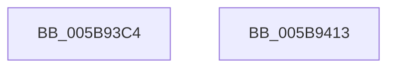

# KiDeleteXStateStack

- RVA: `0x005B93C4`–`0x005B9414` (길이 `80` bytes)
- VA: `0x00000001405B93C4`
- 실행 섹션: `.text`
- PDB 이름 있음: `예`; PDB Function 태그: `아니요`
- unwind 정보 RVA: `0x000AF0B0`
- 디코드: `20`개 명령, `80/80` bytes 표시
- 미해석 바이트: `0` (있으면 어셈블리에 `.byte`로 보존)

> 이 문서는 커널 이미지의 기계어와 PDB 기호를 분석해 생성했습니다. 4번과 5번은 함수 원형과 자료형을 바이너리 사용 방식에서 추정한 C 해석이며 원본 소스 복구 결과는 아닙니다.

## 1. Dependencies

- 직접 호출 지점: **1**; 고유 호출 대상: **1**
- 직접 호출자로 확인된 함수: **2**
- RIP 상대 이미지 참조: **1**

### Outgoing calls
- `0x005B9403` → [MmDeleteKernelStack](../33/MmDeleteKernelStack_function_0033A960.md) (function, `0x0033A960`)

### Direct callers
- [KeUninitThread](../../page/A2/KeUninitThread_function_00A25D2C.md) at `0x00A25DBA`
- [sub_00B80710](../../pagelk/B8/Unknown_function_00B80710.md) at `0x00B8071D`

### Static image references
- `0x005B93EA` → RVA `0x00FC6C54` (`ALMOSTRO`; read)

## 2. Other-region calls and transfers

- 다른 실행 섹션으로 향하는 call: **0**
- 별도 외부 분기/꼬리 이동을 확인하지 못했습니다.

## 3. Assembly (complete function range)

```asm
005B93C4  48 8B C4                        mov rax, rsp
005B93C7  53                              push rbx
005B93C8  48 83 EC 50                     sub rsp, 0x50
005B93CC  48 83 60 D0 00                  and qword ptr [rax - 0x30], 0
005B93D1  0F 57 C0                        xorps xmm0, xmm0
005B93D4  F3 0F 7F 40 E8                  movdqu xmmword ptr [rax - 0x18], xmm0
005B93D9  C7 40 C8 08 00 00 00            mov dword ptr [rax - 0x38], 8
005B93E0  48 8B D9                        mov rbx, rcx
005B93E3  C7 40 CC 05 00 00 00            mov dword ptr [rax - 0x34], 5
005B93EA  8B 05 64 D8 A0 00               mov eax, dword ptr [rip + 0xa0d864]
005B93F0  48 03 41 60                     add rax, qword ptr [rcx + 0x60]
005B93F4  48 89 4C 24 30                  mov qword ptr [rsp + 0x30], rcx
005B93F9  48 8D 4C 24 20                  lea rcx, [rsp + 0x20]
005B93FE  48 89 44 24 38                  mov qword ptr [rsp + 0x38], rax
005B9403  E8 58 15 D8 FF                  call 0x14033a960
005B9408  48 83 63 60 00                  and qword ptr [rbx + 0x60], 0
005B940D  48 83 C4 50                     add rsp, 0x50
005B9411  5B                              pop rbx
005B9412  C3                              ret
005B9413  CC                              int3
```

## 4. C-style interpretation (structured pseudocode)

```c
__int64 __fastcall KiDeleteXStateStack(__int64 a1)
{
    __int64 result;
    __int64 v_rsp;
    unsigned __int64 v_stack_m20;
    unsigned __int64 v_stack_m28;
    unsigned __int64 v_stack_m38;

    v_rsp = (v_rsp) - (80);
    *(unsigned __int64 *)(v_rsp - 24) = v_xmm0;
    *(unsigned int *)(v_rsp - 56) = 8;
    *(unsigned int *)(v_rsp - 52) = 5;
    result = ((unsigned int)(*(unsigned int *)(v_rip + 10541156))) + (*(unsigned __int64 *)(a1 + 96));
    v_stack_m28 = a1;
    v_stack_m20 = result;
    result = MmDeleteKernelStack(v_stack_m38, a2, a3, a4);
    v_rsp = (v_rsp) + (80);
    return result;
}
```

## 5. (Beta) C Style

```c
int64_t KiDeleteXStateStack(void *Arg1)
{
    uint8_t *arg1 = (uint8_t *)Arg1;

    int64_t result;
    int64_t local_rsp;
    uint64_t v_stack_m20;
    uint64_t v_stack_m28;
    uint64_t v_stack_m38;

    local_rsp = (local_rsp) - (80);
    *(uint64_t *)(local_rsp - 0x18) = v_xmm0;
    *(uint32_t *)(local_rsp - 0x38) = 8;
    *(uint32_t *)(local_rsp - 0x34) = 5;
    result = ((uint32_t)(*(uint32_t *)(v_rip + 0xA0D864))) + (*(uint64_t *)(arg1 + 0x60));
    v_stack_m28 = Arg1;
    v_stack_m20 = result;
    result = MmDeleteKernelStack(v_stack_m38, a2, a3, a4);
    local_rsp = (local_rsp) + (80);
    return result;
}
```

### 관측된 메모리 오프셋

구조체 형식이 확인되지 않은 접근은 인자 기준의 오프셋으로만 기록했습니다.

| 기준 인자 | 오프셋 표현 | 폭 (bit) | 접근 |
|---|---:|---:|---|
| `Arg1` | `+ 0x60` | `64` | `R` |
| `Arg1` | `+ 0x60` | `64` | `R/W` |

## 6. Execution-region graph

[열기: 2D/3D 그래프와 함수 탐색 컨트롤 패널](../../../control-panel.html?section=text&rva=0x005B93C4&view=graph)

- 2D 그래프는 위에서 아래로 흐르고, 3D 그래프는 빈 공간을 드래그해 회전합니다. Shift+드래그는 이동, 휠은 확대·축소, 함수 노드 선택은 대상 보고서 이동입니다.

### Static fallback


