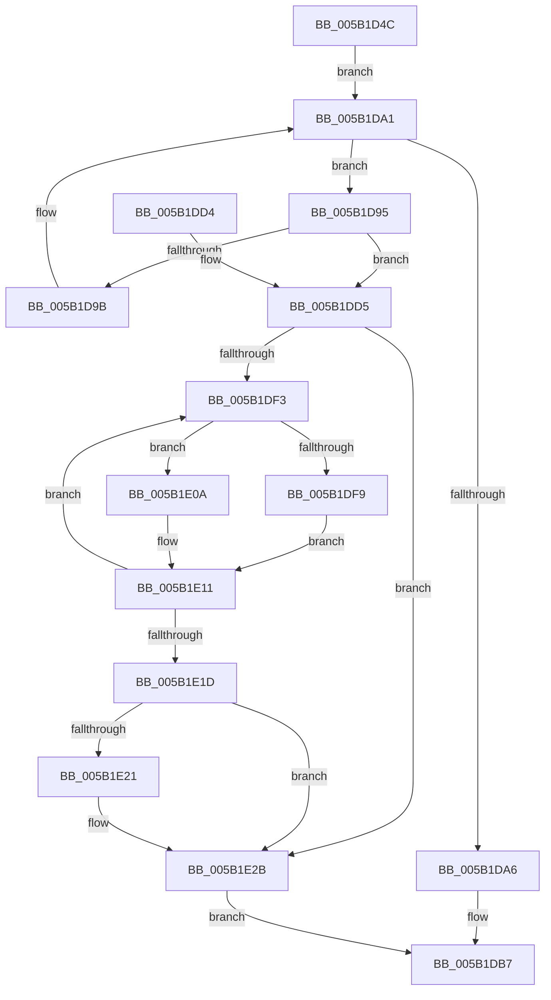

# KiDeregisterNmiSxCallback

- RVA: `0x005B1D4C`–`0x005B1E3F` (길이 `243` bytes)
- VA: `0x00000001405B1D4C`
- 실행 섹션: `.text`
- PDB 이름 있음: `예`; PDB Function 태그: `아니요`
- unwind 정보 RVA: `0x000C9BC8`
- 디코드: `65`개 명령, `243/243` bytes 표시
- 미해석 바이트: `0` (있으면 어셈블리에 `.byte`로 보존)

> 이 문서는 커널 이미지의 기계어와 PDB 기호를 분석해 생성했습니다. 4번과 5번은 함수 원형과 자료형을 바이너리 사용 방식에서 추정한 C 해석이며 원본 소스 복구 결과는 아닙니다.

## 1. Dependencies

- 직접 호출 지점: **8**; 고유 호출 대상: **6**
- 직접 호출자로 확인된 함수: **2**
- RIP 상대 이미지 참조: **4**

### Outgoing calls
- `0x005B1D7E` → [KeAcquireSpinLockRaiseToDpc](../20/KeAcquireSpinLockRaiseToDpc_function_00208470.md) (function, `0x00208470`)
- `0x005B1DAD` → [KeReleaseSpinLock](../39/KeReleaseSpinLock_function_00392BA0.md) (function, `0x00392BA0`)
- `0x005B1DBF` → [_security_check_cookie](../6A/_security_check_cookie_function_006AC640.md) (function, `0x006AC640`)
- `0x005B1DE2` → [KeReleaseSpinLock](../39/KeReleaseSpinLock_function_00392BA0.md) (function, `0x00392BA0`)
- `0x005B1DFE` → [KiSetSystemAffinityThreadToProcessor](../5C/KiSetSystemAffinityThreadToProcessor_function_005C4588.md) (function, `0x005C4588`)
- `0x005B1E0C` → [KiSetSystemAffinityThreadToProcessor](../5C/KiSetSystemAffinityThreadToProcessor_function_005C4588.md) (function, `0x005C4588`)
- `0x005B1E26` → [KeRevertToUserGroupAffinityThread](../39/KeRevertToUserGroupAffinityThread_function_00398EC0.md) (function, `0x00398EC0`)
- `0x005B1E33` → [ExFreePoolWithTag](../../poolcode/B8/ExFreePoolWithTag_function_00B82870.md) (function, `0x00B82870`)

### Direct callers
- [KeDeregisterNmiCallback](KeDeregisterNmiCallback_function_005B1820.md) at `0x005B1824`
- [DifKeDeregisterNmiCallbackWrapper](../62/DifKeDeregisterNmiCallbackWrapper_function_0062F280.md) at `0x0062F34D`

### Static image references
- `0x005B1D5B` → RVA `0x00E0A740` (`.data`; read)
- `0x005B1D70` → RVA `0x00F475B0` (`.data`; read)
- `0x005B1D83` → RVA `0x00F475A8` (`.data`; read)
- `0x005B1DE7` → RVA `0x00FC6A80` (`ALMOSTRO`; read)

## 2. Other-region calls and transfers

- 다른 실행 섹션으로 향하는 call: **1**
  - `0x005B1E33` → [ExFreePoolWithTag](../../poolcode/B8/ExFreePoolWithTag_function_00B82870.md) (`.text` → `POOLCODE`)
- 별도 외부 분기/꼬리 이동을 확인하지 못했습니다.

## 3. Assembly (complete function range)

```asm
005B1D4C  48 89 5C 24 08                  mov qword ptr [rsp + 8], rbx
005B1D51  48 89 74 24 10                  mov qword ptr [rsp + 0x10], rsi
005B1D56  57                              push rdi
005B1D57  48 83 EC 40                     sub rsp, 0x40
005B1D5B  48 8B 05 DE 89 85 00            mov rax, qword ptr [rip + 0x8589de]
005B1D62  48 33 C4                        xor rax, rsp
005B1D65  48 89 44 24 30                  mov qword ptr [rsp + 0x30], rax
005B1D6A  48 8B F9                        mov rdi, rcx
005B1D6D  0F 57 C0                        xorps xmm0, xmm0
005B1D70  48 8D 0D 39 58 99 00            lea rcx, [rip + 0x995839]
005B1D77  33 F6                           xor esi, esi
005B1D79  0F 11 44 24 20                  movups xmmword ptr [rsp + 0x20], xmm0
005B1D7E  E8 ED 66 C5 FF                  call 0x140208470
005B1D83  48 8B 1D 1E 58 99 00            mov rbx, qword ptr [rip + 0x99581e]
005B1D8A  4C 8D 05 17 58 99 00            lea r8, [rip + 0x995817]
005B1D91  8A D0                           mov dl, al
005B1D93  EB 0C                           jmp 0x1405b1da1
005B1D95  48 39 7B 18                     cmp qword ptr [rbx + 0x18], rdi
005B1D99  74 3A                           je 0x1405b1dd5
005B1D9B  4C 8B C3                        mov r8, rbx
005B1D9E  48 8B 1B                        mov rbx, qword ptr [rbx]
005B1DA1  48 85 DB                        test rbx, rbx
005B1DA4  75 EF                           jne 0x1405b1d95
005B1DA6  48 8D 0D 03 58 99 00            lea rcx, [rip + 0x995803]
005B1DAD  E8 EE 0D DE FF                  call 0x140392ba0
005B1DB2  B8 08 00 00 C0                  mov eax, 0xc0000008
005B1DB7  48 8B 4C 24 30                  mov rcx, qword ptr [rsp + 0x30]
005B1DBC  48 33 CC                        xor rcx, rsp
005B1DBF  E8 7C A8 0F 00                  call 0x1406ac640
005B1DC4  48 8B 5C 24 50                  mov rbx, qword ptr [rsp + 0x50]
005B1DC9  48 8B 74 24 58                  mov rsi, qword ptr [rsp + 0x58]
005B1DCE  48 83 C4 40                     add rsp, 0x40
005B1DD2  5F                              pop rdi
005B1DD3  C3                              ret
005B1DD4  CC                              int3
005B1DD5  48 8B 03                        mov rax, qword ptr [rbx]
005B1DD8  48 8D 0D D1 57 99 00            lea rcx, [rip + 0x9957d1]
005B1DDF  49 89 00                        mov qword ptr [r8], rax
005B1DE2  E8 B9 0D DE FF                  call 0x140392ba0
005B1DE7  8B 05 93 4C A1 00               mov eax, dword ptr [rip + 0xa14c93]
005B1DED  33 FF                           xor edi, edi
005B1DEF  85 C0                           test eax, eax
005B1DF1  74 38                           je 0x1405b1e2b
005B1DF3  8B CF                           mov ecx, edi
005B1DF5  85 F6                           test esi, esi
005B1DF7  75 11                           jne 0x1405b1e0a
005B1DF9  48 8D 54 24 20                  lea rdx, [rsp + 0x20]
005B1DFE  E8 85 27 01 00                  call 0x1405c4588
005B1E03  BE 01 00 00 00                  mov esi, 1
005B1E08  EB 07                           jmp 0x1405b1e11
005B1E0A  33 D2                           xor edx, edx
005B1E0C  E8 77 27 01 00                  call 0x1405c4588
005B1E11  8B 05 69 4C A1 00               mov eax, dword ptr [rip + 0xa14c69]
005B1E17  FF C7                           inc edi
005B1E19  3B F8                           cmp edi, eax
005B1E1B  72 D6                           jb 0x1405b1df3
005B1E1D  85 F6                           test esi, esi
005B1E1F  74 0A                           je 0x1405b1e2b
005B1E21  48 8D 4C 24 20                  lea rcx, [rsp + 0x20]
005B1E26  E8 95 70 DE FF                  call 0x140398ec0
005B1E2B  BA 4B 4E 4D 49                  mov edx, 0x494d4e4b
005B1E30  48 8B CB                        mov rcx, rbx
005B1E33  E8 38 0A 5D 00                  call 0x140b82870
005B1E38  33 C0                           xor eax, eax
005B1E3A  E9 78 FF FF FF                  jmp 0x1405b1db7
```

## 4. C-style interpretation (structured pseudocode)

```c
__int64 __fastcall KiDeregisterNmiSxCallback(__int64 a1)
{
    __int64 result;
    __int64 v_rdi;
    __int64 v_rsi;
    __int64 v_rsp;
    unsigned __int64 v_stack_m18;
    unsigned __int64 v_stack_m28;
    unsigned __int64 v_stack_p10;
    unsigned __int64 v_stack_p20;
    unsigned __int64 v_stack_p8;

    v_stack_p8 = v_rbx;
    v_stack_p10 = v_rsi;
    v_rsp = (v_rsp) - (64);
    result = (*(unsigned __int64 *)(v_rip + 8751582)) ^ (v_rsp);
    v_stack_m18 = result;
    v_rsi = 0;
    v_stack_m28 = v_xmm0;
    result = KeAcquireSpinLockRaiseToDpc(v_rip + 10049593, a2, a3, a4);
    goto loc_005B1DA1;
loc_005B1D95:
    if ((*(unsigned __int64 *)(*(unsigned __int64 *)(v_rip + 10049566) + 24)) == a1) goto loc_005B1DD5;
loc_005B1DA1:
    if (*(unsigned __int64 *)(*(unsigned __int64 *)(v_rip + 10049566)) != 0) goto loc_005B1D95;
    result = KeReleaseSpinLock(v_rip + 10049539, (unsigned __int8)(result), *(unsigned __int64 *)(v_rip + 10049566), a4);
loc_005B1DB7:
    a1 = (v_stack_m18) ^ (v_rsp);
    result = _security_check_cookie(a1, (unsigned __int8)(result), *(unsigned __int64 *)(v_rip + 10049566), a4);
    v_rsp = (v_rsp) + (64);
    return result;
loc_005B1DD5:
    *(unsigned __int64 *)(*(unsigned __int64 *)(v_rip + 10049566)) = *(unsigned __int64 *)(v_stack_p8);
    result = KeReleaseSpinLock(v_rip + 10049489, (unsigned __int8)(result), *(unsigned __int64 *)(v_rip + 10049566), a4);
    v_rdi = 0;
    if ((unsigned int)((unsigned int)(*(unsigned int *)(v_rip + 10570899))) == 0) goto loc_005B1E2B;
loc_005B1DF3:
    if ((unsigned int)(v_stack_p10) != 0) goto loc_005B1E0A;
    result = KiSetSystemAffinityThreadToProcessor(0, v_stack_p20, *(unsigned __int64 *)(v_rip + 10049566), a4);
    goto loc_005B1E11;
loc_005B1E0A:
    a2 = 0;
    result = KiSetSystemAffinityThreadToProcessor(0, a2, *(unsigned __int64 *)(v_rip + 10049566), a4);
loc_005B1E11:
    v_rdi = (unsigned int)((v_rdi) + 1);
    if (((unsigned int)(v_rdi)) < ((unsigned int)((unsigned int)(*(unsigned int *)(v_rip + 10570857))))) goto loc_005B1DF3;
    result = (unsigned int)(*(unsigned int *)(v_rip + 10570857));
    if (1 != 0) {
        a1 = v_stack_p20;
        result = KeRevertToUserGroupAffinityThread(a1, a2, *(unsigned __int64 *)(v_rip + 10049566), a4);
    }
    result = ExFreePoolWithTag(v_stack_p8, (unsigned int)(0x494D4E4BULL), *(unsigned __int64 *)(v_rip + 10049566), a4);
    result = 0;
    goto loc_005B1DB7;
}
```

## 5. (Beta) C Style

```c
int64_t KiDeregisterNmiSxCallback(int64_t Arg1)
{
    int64_t result;
    int64_t local_rdi;
    int64_t local_rsi;
    int64_t local_rsp;
    uint64_t v_stack_m18;
    uint64_t v_stack_m28;
    uint64_t v_stack_p10;
    uint64_t v_stack_p20;
    uint64_t v_stack_p8;

    v_stack_p8 = local_rbx;
    v_stack_p10 = local_rsi;
    local_rsp = (local_rsp) - (64);
    result = (*(uint64_t *)(v_rip + 0x8589DE)) ^ (local_rsp);
    v_stack_m18 = result;
    local_rsi = 0;
    v_stack_m28 = v_xmm0;
    result = KeAcquireSpinLockRaiseToDpc(v_rip + 10049593, a2, a3, a4);
    goto loc_005B1DA1;
loc_005B1D95:
    if ((*(uint64_t *)(*(uint64_t *)(v_rip + 0x99581E) + 0x18)) == Arg1) goto loc_005B1DD5;
loc_005B1DA1:
    if (*(uint64_t *)(*(uint64_t *)(v_rip + 0x99581E)) != 0) goto loc_005B1D95;
    result = KeReleaseSpinLock(v_rip + 10049539, (uint8_t)(result), *(uint64_t *)(v_rip + 0x99581E), a4);
loc_005B1DB7:
    Arg1 = (v_stack_m18) ^ (local_rsp);
    result = _security_check_cookie(Arg1, (uint8_t)(result), *(uint64_t *)(v_rip + 0x99581E), a4);
    local_rsp = (local_rsp) + (64);
    return result;
loc_005B1DD5:
    *(uint64_t *)(*(uint64_t *)(v_rip + 0x99581E)) = *(uint64_t *)(v_stack_p8);
    result = KeReleaseSpinLock(v_rip + 10049489, (uint8_t)(result), *(uint64_t *)(v_rip + 0x99581E), a4);
    local_rdi = 0;
    if ((uint32_t)((uint32_t)(*(uint32_t *)(v_rip + 0xA14C93))) == 0) goto loc_005B1E2B;
loc_005B1DF3:
    if ((uint32_t)(v_stack_p10) != 0) goto loc_005B1E0A;
    result = KiSetSystemAffinityThreadToProcessor(0, v_stack_p20, *(uint64_t *)(v_rip + 0x99581E), a4);
    goto loc_005B1E11;
loc_005B1E0A:
    a2 = 0;
    result = KiSetSystemAffinityThreadToProcessor(0, a2, *(uint64_t *)(v_rip + 0x99581E), a4);
loc_005B1E11:
    local_rdi = (uint32_t)((local_rdi) + 1);
    if (((uint32_t)(local_rdi)) < ((uint32_t)((uint32_t)(*(uint32_t *)(v_rip + 0xA14C69))))) goto loc_005B1DF3;
    result = (uint32_t)(*(uint32_t *)(v_rip + 0xA14C69));
    if (1 != 0) {
        Arg1 = v_stack_p20;
        result = KeRevertToUserGroupAffinityThread(Arg1, a2, *(uint64_t *)(v_rip + 0x99581E), a4);
    }
    result = ExFreePoolWithTag(v_stack_p8, (uint32_t)(0x494D4E4BULL), *(uint64_t *)(v_rip + 0x99581E), a4);
    result = 0;
    goto loc_005B1DB7;
}
```

## 6. Execution-region graph

[열기: 2D/3D 그래프와 함수 탐색 컨트롤 패널](../../../control-panel.html?section=text&rva=0x005B1D4C&view=graph)

- 2D 그래프는 위에서 아래로 흐르고, 3D 그래프는 빈 공간을 드래그해 회전합니다. Shift+드래그는 이동, 휠은 확대·축소, 함수 노드 선택은 대상 보고서 이동입니다.

### Static fallback


