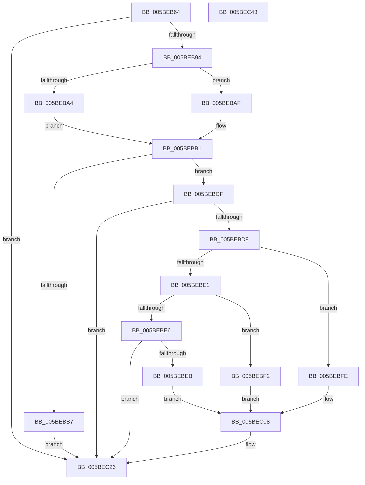

# KiDetectAmdNonArchSsbdSupport

- RVA: `0x005BEB64`–`0x005BEC44` (길이 `224` bytes)
- VA: `0x00000001405BEB64`
- 실행 섹션: `.text`
- PDB 이름 있음: `예`; PDB Function 태그: `아니요`
- unwind 정보 RVA: `0x000CA630`
- 디코드: `60`개 명령, `224/224` bytes 표시
- 미해석 바이트: `0` (있으면 어셈블리에 `.byte`로 보존)

> 이 문서는 커널 이미지의 기계어와 PDB 기호를 분석해 생성했습니다. 4번과 5번은 함수 원형과 자료형을 바이너리 사용 방식에서 추정한 C 해석이며 원본 소스 복구 결과는 아닙니다.

## 1. Dependencies

- 직접 호출 지점: **2**; 고유 호출 대상: **2**
- 직접 호출자로 확인된 함수: **1**
- RIP 상대 이미지 참조: **3**

### Outgoing calls
- `0x005BEBCF` → [HviIsAnyHypervisorPresent](../4A/HviIsAnyHypervisorPresent_function_004ADC50.md) (function, `0x004ADC50`)
- `0x005BEC2E` → [_security_check_cookie](../6A/_security_check_cookie_function_006AC640.md) (function, `0x006AC640`)

### Direct callers
- [KiOptimizeSpecCtrlSettingsWorker](KiOptimizeSpecCtrlSettingsWorker_function_005BF5A0.md) at `0x005BF638`

### Static image references
- `0x005BEB73` → RVA `0x00E0A740` (`.data`; read)
- `0x005BEBC4` → RVA `0x00E0B1F8` (`.data`; write)
- `0x005BEC1F` → RVA `0x00E0B1F0` (`.data`; write)

## 2. Other-region calls and transfers

- 다른 실행 섹션으로 향하는 call: **0**
- 별도 외부 분기/꼬리 이동을 확인하지 못했습니다.

## 3. Assembly (complete function range)

```asm
005BEB64  48 89 5C 24 08                  mov qword ptr [rsp + 8], rbx
005BEB69  48 89 74 24 18                  mov qword ptr [rsp + 0x18], rsi
005BEB6E  57                              push rdi
005BEB6F  48 83 EC 40                     sub rsp, 0x40
005BEB73  48 8B 05 C6 BB 84 00            mov rax, qword ptr [rip + 0x84bbc6]
005BEB7A  48 33 C4                        xor rax, rsp
005BEB7D  48 89 44 24 30                  mov qword ptr [rsp + 0x30], rax
005BEB82  4C 8B 02                        mov r8, qword ptr [rdx]
005BEB85  48 8B FA                        mov rdi, rdx
005BEB88  48 8B F1                        mov rsi, rcx
005BEB8B  45 84 C0                        test r8b, r8b
005BEB8E  0F 88 92 00 00 00               js 0x1405bec26
005BEB94  33 C9                           xor ecx, ecx
005BEB96  B8 00 00 00 80                  mov eax, 0x80000000
005BEB9B  0F A2                           cpuid
005BEB9D  3D 08 00 00 80                  cmp eax, 0x80000008
005BEBA2  72 0B                           jb 0x1405bebaf
005BEBA4  B8 08 00 00 80                  mov eax, 0x80000008
005BEBA9  33 C9                           xor ecx, ecx
005BEBAB  0F A2                           cpuid
005BEBAD  EB 02                           jmp 0x1405bebb1
005BEBAF  33 DB                           xor ebx, ebx
005BEBB1  0F BA E3 19                     bt ebx, 0x19
005BEBB5  73 18                           jae 0x1405bebcf
005BEBB7  B8 1F 01 01 C0                  mov eax, 0xc001011f
005BEBBC  49 0F BA E8 07                  bts r8, 7
005BEBC1  89 47 08                        mov dword ptr [rdi + 8], eax
005BEBC4  89 05 2E C6 84 00               mov dword ptr [rip + 0x84c62e], eax
005BEBCA  4C 89 07                        mov qword ptr [rdi], r8
005BEBCD  EB 57                           jmp 0x1405bec26
005BEBCF  E8 7C F0 EE FF                  call 0x1404adc50
005BEBD4  84 C0                           test al, al
005BEBD6  75 4E                           jne 0x1405bec26
005BEBD8  0F BE 4E 40                     movsx ecx, byte ptr [rsi + 0x40]
005BEBDC  83 E9 15                        sub ecx, 0x15
005BEBDF  74 1D                           je 0x1405bebfe
005BEBE1  83 E9 01                        sub ecx, 1
005BEBE4  74 0C                           je 0x1405bebf2
005BEBE6  83 F9 01                        cmp ecx, 1
005BEBE9  75 3B                           jne 0x1405bec26
005BEBEB  B8 00 04 00 00                  mov eax, 0x400
005BEBF0  EB 16                           jmp 0x1405bec08
005BEBF2  48 B8 00 00 00 00 02 00 00 00   movabs rax, 0x200000000
005BEBFC  EB 0A                           jmp 0x1405bec08
005BEBFE  48 B8 00 00 00 00 00 00 40 00   movabs rax, 0x40000000000000
005BEC08  48 0F BA 2F 07                  bts qword ptr [rdi], 7
005BEC0D  B9 20 10 01 C0                  mov ecx, 0xc0011020
005BEC12  89 4F 08                        mov dword ptr [rdi + 8], ecx
005BEC15  89 0D DD C5 84 00               mov dword ptr [rip + 0x84c5dd], ecx
005BEC1B  48 89 47 10                     mov qword ptr [rdi + 0x10], rax
005BEC1F  48 89 05 CA C5 84 00            mov qword ptr [rip + 0x84c5ca], rax
005BEC26  48 8B 4C 24 30                  mov rcx, qword ptr [rsp + 0x30]
005BEC2B  48 33 CC                        xor rcx, rsp
005BEC2E  E8 0D DA 0E 00                  call 0x1406ac640
005BEC33  48 8B 5C 24 50                  mov rbx, qword ptr [rsp + 0x50]
005BEC38  48 8B 74 24 60                  mov rsi, qword ptr [rsp + 0x60]
005BEC3D  48 83 C4 40                     add rsp, 0x40
005BEC41  5F                              pop rdi
005BEC42  C3                              ret
005BEC43  CC                              int3
```

## 4. C-style interpretation (structured pseudocode)

```c
__int64 __fastcall KiDetectAmdNonArchSsbdSupport(__int64 a1, __int64 a2)
{
    __int64 result;
    __int64 v_rbx;
    __int64 v_rsp;
    unsigned __int64 v_stack_m18;
    unsigned __int64 v_stack_p18;
    unsigned __int64 v_stack_p8;

    v_stack_p8 = v_rbx;
    v_stack_p18 = v_rsi;
    v_rsp = (v_rsp) - (64);
    result = (*(unsigned __int64 *)(v_rip + 8698822)) ^ (v_rsp);
    v_stack_m18 = result;
    if (sign_flag) goto loc_005BEC26;
    a1 = 0;
    if (((unsigned int)((unsigned int)(0x80000000ULL))) < 0x80000008ULL) goto loc_005BEBAF;
    a1 = 0;
    goto loc_005BEBB1;
loc_005BEBAF:
    v_rbx = 0;
loc_005BEBB1:
    if (condition_is_above_or_equal) goto loc_005BEBCF;
    *(unsigned int *)(a2 + 8) = (unsigned int)((unsigned int)(0xC001011FULL));
    *(unsigned int *)(v_rip + 8701486) = (unsigned int)((unsigned int)(0xC001011FULL));
    *(unsigned __int64 *)(a2) = *(unsigned __int64 *)(a2);
    goto loc_005BEC26;
loc_005BEBCF:
    result = HviIsAnyHypervisorPresent(a1, a2, *(unsigned __int64 *)(a2), a4);
    if ((unsigned __int8)(result) != 0) goto loc_005BEC26;
    a1 = (unsigned int)(((__int8)(*(unsigned __int8 *)(a1 + 64))) - (21));
    if (condition_is_equal) goto loc_005BEBFE;
    a1 = (unsigned int)((a1) - (1));
    if (condition_is_equal) goto loc_005BEBF2;
    if (((unsigned int)(a1)) != 1) goto loc_005BEC26;
    goto loc_005BEC08;
loc_005BEBF2:
    goto loc_005BEC08;
loc_005BEBFE:
loc_005BEC08:
    *(unsigned int *)(a2 + 8) = (unsigned int)((unsigned int)(0xC0011020ULL));
    *(unsigned int *)(v_rip + 8701405) = (unsigned int)((unsigned int)(0xC0011020ULL));
    *(unsigned __int64 *)(a2 + 16) = (unsigned int)(0x400ULL);
    *(unsigned __int64 *)(v_rip + 8701386) = (unsigned int)(0x400ULL);
loc_005BEC26:
    a1 = (v_stack_m18) ^ (v_rsp);
    result = _security_check_cookie(a1, a2, *(unsigned __int64 *)(a2), a4);
    v_rsp = (v_rsp) + (64);
    return result;
}
```

## 5. (Beta) C Style

```c
int64_t KiDetectAmdNonArchSsbdSupport(void *Arg1, void *Arg2)
{
    uint8_t *arg1 = (uint8_t *)Arg1;
    uint8_t *arg2 = (uint8_t *)Arg2;

    int64_t result;
    int64_t local_rbx;
    int64_t local_rsp;
    uint64_t v_stack_m18;
    uint64_t v_stack_p18;
    uint64_t v_stack_p8;

    v_stack_p8 = local_rbx;
    v_stack_p18 = local_rsi;
    local_rsp = (local_rsp) - (64);
    result = (*(uint64_t *)(v_rip + 0x84BBC6)) ^ (local_rsp);
    v_stack_m18 = result;
    if (sign_flag) goto loc_005BEC26;
    Arg1 = 0;
    if (((uint32_t)((uint32_t)(0x80000000ULL))) < 0x80000008ULL) goto loc_005BEBAF;
    Arg1 = 0;
    goto loc_005BEBB1;
loc_005BEBAF:
    local_rbx = 0;
loc_005BEBB1:
    if (condition_is_above_or_equal) goto loc_005BEBCF;
    *(uint32_t *)(arg2 + 0x8) = (uint32_t)((uint32_t)(0xC001011FULL));
    *(uint32_t *)(v_rip + 0x84C62E) = (uint32_t)((uint32_t)(0xC001011FULL));
    *(uint64_t *)(arg2) = *(uint64_t *)(arg2);
    goto loc_005BEC26;
loc_005BEBCF:
    result = HviIsAnyHypervisorPresent(Arg1, Arg2, *(uint64_t *)(arg2), a4);
    if ((uint8_t)(result) != 0) goto loc_005BEC26;
    Arg1 = (uint32_t)(((int8_t)(*(uint8_t *)(arg1 + 0x40))) - (21));
    if (condition_is_equal) goto loc_005BEBFE;
    Arg1 = (uint32_t)((Arg1) - (1));
    if (condition_is_equal) goto loc_005BEBF2;
    if (((uint32_t)(Arg1)) != 1) goto loc_005BEC26;
    goto loc_005BEC08;
loc_005BEBF2:
    goto loc_005BEC08;
loc_005BEBFE:
loc_005BEC08:
    *(uint32_t *)(arg2 + 0x8) = (uint32_t)((uint32_t)(0xC0011020ULL));
    *(uint32_t *)(v_rip + 0x84C5DD) = (uint32_t)((uint32_t)(0xC0011020ULL));
    *(uint64_t *)(arg2 + 0x10) = (uint32_t)(0x400ULL);
    *(uint64_t *)(v_rip + 0x84C5CA) = (uint32_t)(0x400ULL);
loc_005BEC26:
    Arg1 = (v_stack_m18) ^ (local_rsp);
    result = _security_check_cookie(Arg1, Arg2, *(uint64_t *)(arg2), a4);
    local_rsp = (local_rsp) + (64);
    return result;
}
```

### 관측된 메모리 오프셋

구조체 형식이 확인되지 않은 접근은 인자 기준의 오프셋으로만 기록했습니다.

| 기준 인자 | 오프셋 표현 | 폭 (bit) | 접근 |
|---|---:|---:|---|
| `Arg1` | `+ 0x40` | `8` | `R` |
| `Arg2` | `+ 0x0` | `64` | `R` |
| `Arg2` | `+ 0x0` | `64` | `R/W` |
| `Arg2` | `+ 0x0` | `64` | `W` |
| `Arg2` | `+ 0x8` | `32` | `W` |
| `Arg2` | `+ 0x10` | `64` | `W` |

## 6. Execution-region graph

[열기: 2D/3D 그래프와 함수 탐색 컨트롤 패널](../../../control-panel.html?section=text&rva=0x005BEB64&view=graph)

- 2D 그래프는 위에서 아래로 흐르고, 3D 그래프는 빈 공간을 드래그해 회전합니다. Shift+드래그는 이동, 휠은 확대·축소, 함수 노드 선택은 대상 보고서 이동입니다.

### Static fallback


