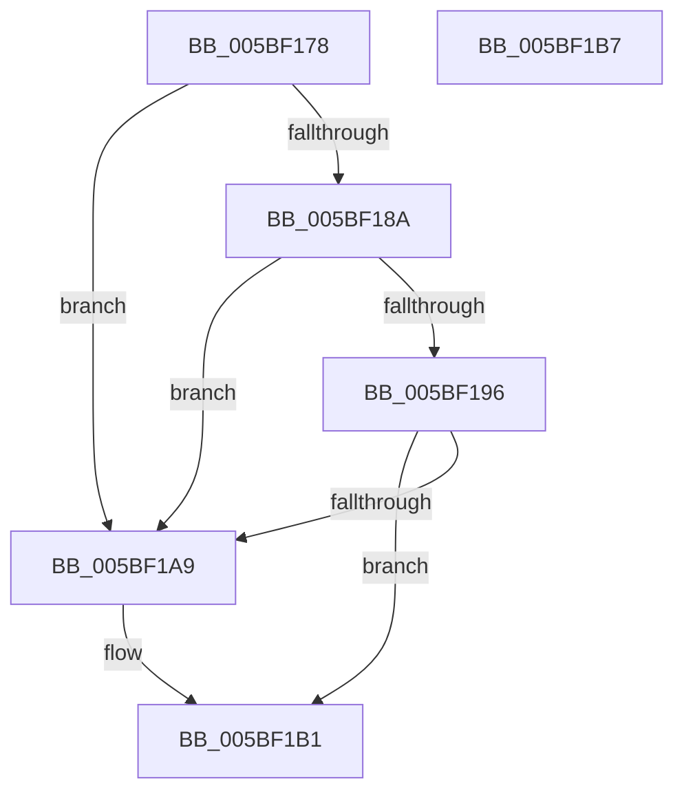

# KiDetermineImportOptimizationEnablement

- RVA: `0x005BF178`–`0x005BF1B8` (길이 `64` bytes)
- VA: `0x00000001405BF178`
- 실행 섹션: `.text`
- PDB 이름 있음: `예`; PDB Function 태그: `아니요`
- unwind 정보 RVA: `0x0005CF00`
- 디코드: `18`개 명령, `64/64` bytes 표시
- 미해석 바이트: `0` (있으면 어셈블리에 `.byte`로 보존)

> 이 문서는 커널 이미지의 기계어와 PDB 기호를 분석해 생성했습니다. 4번과 5번은 함수 원형과 자료형을 바이너리 사용 방식에서 추정한 C 해석이며 원본 소스 복구 결과는 아닙니다.

## 1. Dependencies

- 직접 호출 지점: **2**; 고유 호출 대상: **2**
- 직접 호출자로 확인된 함수: **1**
- RIP 상대 이미지 참조: **1**

### Outgoing calls
- `0x005BF181` → [KiIsSafeBoot](KiIsSafeBoot_function_005BF404.md) (function, `0x005BF404`)
- `0x005BF18D` → [KiIsWinPEBoot](KiIsWinPEBoot_function_005BF560.md) (function, `0x005BF560`)

### Direct callers
- [KiInitializeBootStructures](../../pagelk/B6/KiInitializeBootStructures_function_00B68530.md) at `0x00B687CA`

### Static image references
- `0x005BF1A9` → RVA `0x00F10EC0` (`.data`; read/write)

## 2. Other-region calls and transfers

- 다른 실행 섹션으로 향하는 call: **0**
- 별도 외부 분기/꼬리 이동을 확인하지 못했습니다.

## 3. Assembly (complete function range)

```asm
005BF178  40 53                           push rbx
005BF17A  48 83 EC 20                     sub rsp, 0x20
005BF17E  48 8B D9                        mov rbx, rcx
005BF181  E8 7E 02 00 00                  call 0x1405bf404
005BF186  84 C0                           test al, al
005BF188  75 1F                           jne 0x1405bf1a9
005BF18A  48 8B CB                        mov rcx, rbx
005BF18D  E8 CE 03 00 00                  call 0x1405bf560
005BF192  84 C0                           test al, al
005BF194  75 13                           jne 0x1405bf1a9
005BF196  48 8B 83 F0 00 00 00            mov rax, qword ptr [rbx + 0xf0]
005BF19D  F7 80 84 00 00 00 00 10 00 00   test dword ptr [rax + 0x84], 0x1000
005BF1A7  74 08                           je 0x1405bf1b1
005BF1A9  0F BA 2D 0F 1D 95 00 11         bts dword ptr [rip + 0x951d0f], 0x11
005BF1B1  48 83 C4 20                     add rsp, 0x20
005BF1B5  5B                              pop rbx
005BF1B6  C3                              ret
005BF1B7  CC                              int3
```

## 4. C-style interpretation (structured pseudocode)

```c
__int64 __fastcall KiDetermineImportOptimizationEnablement(__int64 a1)
{
    __int64 result;
    __int64 v_rsp;

    v_rsp = (v_rsp) - (32);
    result = KiIsSafeBoot(a1, a2, a3, a4);
    if ((unsigned __int8)(result) != 0) goto loc_005BF1A9;
    result = KiIsWinPEBoot(a1, a2, a3, a4);
    if ((unsigned __int8)(result) != 0) goto loc_005BF1A9;
    if (((*(unsigned int *)(*(unsigned __int64 *)(a1 + 240) + 132)) & (0x1000ULL)) != 0) {
    }
    v_rsp = (v_rsp) + (32);
    return *(unsigned __int64 *)(a1 + 240);
}
```

## 5. (Beta) C Style

```c
int64_t KiDetermineImportOptimizationEnablement(void *Arg1)
{
    uint8_t *arg1 = (uint8_t *)Arg1;

    int64_t result;
    int64_t local_rsp;

    local_rsp = (local_rsp) - (32);
    result = KiIsSafeBoot(Arg1, a2, a3, a4);
    if ((uint8_t)(result) != 0) goto loc_005BF1A9;
    result = KiIsWinPEBoot(Arg1, a2, a3, a4);
    if ((uint8_t)(result) != 0) goto loc_005BF1A9;
    if (((*(uint32_t *)(*(uint64_t *)(arg1 + 0xF0) + 0x84)) & (0x1000ULL)) != 0) {
    }
    local_rsp = (local_rsp) + (32);
    return *(uint64_t *)(arg1 + 0xF0);
}
```

### 관측된 메모리 오프셋

구조체 형식이 확인되지 않은 접근은 인자 기준의 오프셋으로만 기록했습니다.

| 기준 인자 | 오프셋 표현 | 폭 (bit) | 접근 |
|---|---:|---:|---|
| `Arg1` | `+ 0xF0` | `64` | `R` |

## 6. Execution-region graph

[열기: 2D/3D 그래프와 함수 탐색 컨트롤 패널](../../../control-panel.html?section=text&rva=0x005BF178&view=graph)

- 2D 그래프는 위에서 아래로 흐르고, 3D 그래프는 빈 공간을 드래그해 회전합니다. Shift+드래그는 이동, 휠은 확대·축소, 함수 노드 선택은 대상 보고서 이동입니다.

### Static fallback


