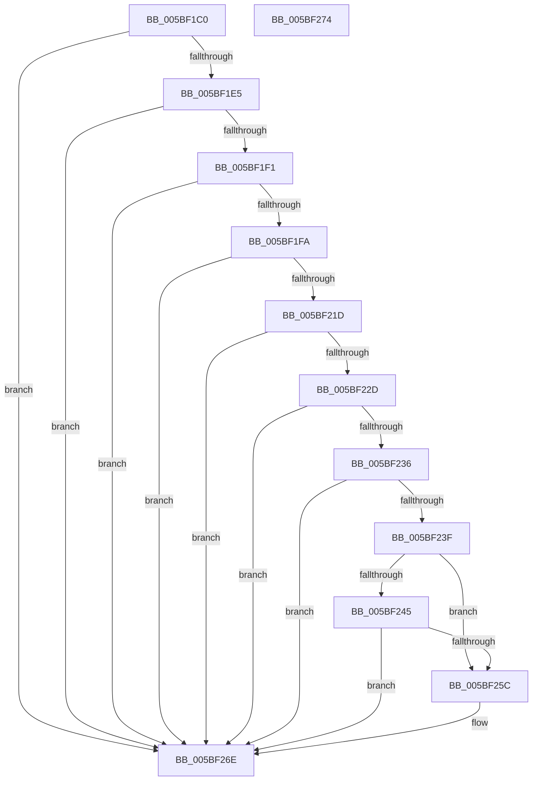

# KiDetermineRetpolineEnablement

- RVA: `0x005BF1C0`–`0x005BF275` (길이 `181` bytes)
- VA: `0x00000001405BF1C0`
- 실행 섹션: `.text`
- PDB 이름 있음: `예`; PDB Function 태그: `아니요`
- unwind 정보 RVA: `0x000697A4`
- 디코드: `48`개 명령, `181/181` bytes 표시
- 미해석 바이트: `0` (있으면 어셈블리에 `.byte`로 보존)

> 이 문서는 커널 이미지의 기계어와 PDB 기호를 분석해 생성했습니다. 4번과 5번은 함수 원형과 자료형을 바이너리 사용 방식에서 추정한 C 해석이며 원본 소스 복구 결과는 아닙니다.

## 1. Dependencies

- 직접 호출 지점: **4**; 고유 호출 대상: **4**
- 직접 호출자로 확인된 함수: **1**
- RIP 상대 이미지 참조: **3**

### Outgoing calls
- `0x005BF1D8` → [KiIsSafeBoot](KiIsSafeBoot_function_005BF404.md) (function, `0x005BF404`)
- `0x005BF1E8` → [KiIsWinPEBoot](KiIsWinPEBoot_function_005BF560.md) (function, `0x005BF560`)
- `0x005BF1F1` → [KiIsPgiKernel](KiIsPgiKernel_function_005BF348.md) (function, `0x005BF348`)
- `0x005BF20D` → [KiDetectHardwareSpecControlFeatures](KiDetectHardwareSpecControlFeatures_function_005BEC4C.md) (function, `0x005BEC4C`)

### Direct callers
- [KiInitializeBootStructures](../../pagelk/B6/KiInitializeBootStructures_function_00B68530.md) at `0x00B687D2`

### Static image references
- `0x005BF212` → RVA `0x00F10EC0` (`.data`; read)
- `0x005BF236` → RVA `0x01201841` (`CFGRO`; read)
- `0x005BF266` → RVA `0x00FC6B48` (`ALMOSTRO`; read/write)

## 2. Other-region calls and transfers

- 다른 실행 섹션으로 향하는 call: **0**
- 별도 외부 분기/꼬리 이동을 확인하지 못했습니다.

## 3. Assembly (complete function range)

```asm
005BF1C0  40 53                           push rbx
005BF1C2  48 83 EC 40                     sub rsp, 0x40
005BF1C6  0F 57 C0                        xorps xmm0, xmm0
005BF1C9  33 C0                           xor eax, eax
005BF1CB  0F 11 44 24 20                  movups xmmword ptr [rsp + 0x20], xmm0
005BF1D0  48 89 44 24 30                  mov qword ptr [rsp + 0x30], rax
005BF1D5  48 8B D9                        mov rbx, rcx
005BF1D8  E8 27 02 00 00                  call 0x1405bf404
005BF1DD  84 C0                           test al, al
005BF1DF  0F 85 89 00 00 00               jne 0x1405bf26e
005BF1E5  48 8B CB                        mov rcx, rbx
005BF1E8  E8 73 03 00 00                  call 0x1405bf560
005BF1ED  84 C0                           test al, al
005BF1EF  75 7D                           jne 0x1405bf26e
005BF1F1  E8 52 01 00 00                  call 0x1405bf348
005BF1F6  84 C0                           test al, al
005BF1F8  75 74                           jne 0x1405bf26e
005BF1FA  65 48 8B 0C 25 20 00 00 00      mov rcx, qword ptr gs:[0x20]
005BF203  4C 8D 44 24 20                  lea r8, [rsp + 0x20]
005BF208  45 33 C9                        xor r9d, r9d
005BF20B  33 D2                           xor edx, edx
005BF20D  E8 3A FA FF FF                  call 0x1405bec4c
005BF212  8B 15 A8 1C 95 00               mov edx, dword ptr [rip + 0x951ca8]
005BF218  F6 C2 05                        test dl, 5
005BF21B  75 51                           jne 0x1405bf26e
005BF21D  48 8B 83 F0 00 00 00            mov rax, qword ptr [rbx + 0xf0]
005BF224  83 B8 AC 0D 00 00 00            cmp dword ptr [rax + 0xdac], 0
005BF22B  74 41                           je 0x1405bf26e
005BF22D  48 8B 44 24 20                  mov rax, qword ptr [rsp + 0x20]
005BF232  A8 01                           test al, 1
005BF234  75 38                           jne 0x1405bf26e
005BF236  80 3D 04 26 C4 00 00            cmp byte ptr [rip + 0xc42604], 0
005BF23D  75 2F                           jne 0x1405bf26e
005BF23F  0F BA E2 09                     bt edx, 9
005BF243  72 17                           jb 0x1405bf25c
005BF245  25 04 02 00 00                  and eax, 0x204
005BF24A  48 83 F8 04                     cmp rax, 4
005BF24E  0F 94 C1                        sete cl
005BF251  0F BA E2 08                     bt edx, 8
005BF255  0F 93 C0                        setae al
005BF258  84 C8                           test al, cl
005BF25A  74 12                           je 0x1405bf26e
005BF25C  48 B8 00 00 00 00 00 02 00 00   movabs rax, 0x20000000000
005BF266  F0 48 09 05 DA 78 A0 00         lock or qword ptr [rip + 0xa078da], rax
005BF26E  48 83 C4 40                     add rsp, 0x40
005BF272  5B                              pop rbx
005BF273  C3                              ret
005BF274  CC                              int3
```

## 4. C-style interpretation (structured pseudocode)

```c
__int64 __fastcall KiDetermineRetpolineEnablement(__int64 a1, int a2, __int64 a3, int a4)
{
    __int64 result;
    __int64 v_rsp;
    unsigned __int64 v_stack_m18;
    unsigned __int64 v_stack_m28;

    v_rsp = (v_rsp) - (64);
    result = 0;
    v_stack_m28 = v_xmm0;
    v_stack_m18 = 0;
    result = KiIsSafeBoot(a1, a2, a3, a4);
    if ((unsigned __int8)(result) != 0) goto loc_005BF26E;
    result = KiIsWinPEBoot(a1, a2, a3, a4);
    if ((unsigned __int8)(result) != 0) goto loc_005BF26E;
    result = KiIsPgiKernel(a1, a2, a3, a4);
    if ((unsigned __int8)(result) != 0) goto loc_005BF26E;
    a4 = 0;
    a2 = 0;
    result = KiDetectHardwareSpecControlFeatures(*(unsigned __int64 *)(gs_base + (0 + 32)), a2, v_stack_m28, a4);
    if ((((unsigned __int8)((unsigned int)(*(unsigned int *)(v_rip + 9772200)))) & (5)) != 0) goto loc_005BF26E;
    if ((*(unsigned int *)(*(unsigned __int64 *)(a1 + 240) + 3500)) == 0) goto loc_005BF26E;
    if ((((unsigned __int8)(v_stack_m28)) & (1)) != 0) goto loc_005BF26E;
    if ((*(unsigned __int8 *)(v_rip + 12854788)) != 0) goto loc_005BF26E;
    if ((*(unsigned __int8 *)(v_rip + 12854788)) < 0) goto loc_005BF25C;
    result = (unsigned int)((v_stack_m28) & (516));
    a1 = (result == 4) ? 1 : 0;
    result = (result >= 4) ? 1 : 0;
    if ((((unsigned __int8)(result)) & ((unsigned __int8)(a1))) != 0) {
    }
    v_rsp = (v_rsp) + (64);
    return result;
}
```

## 5. (Beta) C Style

```c
int64_t KiDetermineRetpolineEnablement(void *Arg1, int32_t Arg2, int64_t Arg3, int32_t Arg4)
{
    uint8_t *arg1 = (uint8_t *)Arg1;

    int64_t result;
    int64_t local_rsp;
    uint64_t v_stack_m18;
    uint64_t v_stack_m28;

    local_rsp = (local_rsp) - (64);
    result = 0;
    v_stack_m28 = v_xmm0;
    v_stack_m18 = 0;
    result = KiIsSafeBoot(Arg1, Arg2, Arg3, Arg4);
    if ((uint8_t)(result) != 0) goto loc_005BF26E;
    result = KiIsWinPEBoot(Arg1, Arg2, Arg3, Arg4);
    if ((uint8_t)(result) != 0) goto loc_005BF26E;
    result = KiIsPgiKernel(Arg1, Arg2, Arg3, Arg4);
    if ((uint8_t)(result) != 0) goto loc_005BF26E;
    Arg4 = 0;
    Arg2 = 0;
    result = KiDetectHardwareSpecControlFeatures(*(uint64_t *)(gs_base + (0 + 0x20)), Arg2, v_stack_m28, Arg4);
    if ((((uint8_t)((uint32_t)(*(uint32_t *)(v_rip + 0x951CA8)))) & (5)) != 0) goto loc_005BF26E;
    if ((*(uint32_t *)(*(uint64_t *)(arg1 + 0xF0) + 0xDAC)) == 0) goto loc_005BF26E;
    if ((((uint8_t)(v_stack_m28)) & (1)) != 0) goto loc_005BF26E;
    if ((*(uint8_t *)(v_rip + 0xC42604)) != 0) goto loc_005BF26E;
    if ((*(uint8_t *)(v_rip + 0xC42604)) < 0) goto loc_005BF25C;
    result = (uint32_t)((v_stack_m28) & (516));
    Arg1 = (result == 4) ? 1 : 0;
    result = (result >= 4) ? 1 : 0;
    if ((((uint8_t)(result)) & ((uint8_t)(Arg1))) != 0) {
    }
    local_rsp = (local_rsp) + (64);
    return result;
}
```

### 관측된 메모리 오프셋

구조체 형식이 확인되지 않은 접근은 인자 기준의 오프셋으로만 기록했습니다.

| 기준 인자 | 오프셋 표현 | 폭 (bit) | 접근 |
|---|---:|---:|---|
| `Arg1` | `+ 0xF0` | `64` | `R` |

## 6. Execution-region graph

[열기: 2D/3D 그래프와 함수 탐색 컨트롤 패널](../../../control-panel.html?section=text&rva=0x005BF1C0&view=graph)

- 2D 그래프는 위에서 아래로 흐르고, 3D 그래프는 빈 공간을 드래그해 회전합니다. Shift+드래그는 이동, 휠은 확대·축소, 함수 노드 선택은 대상 보고서 이동입니다.

### Static fallback


