# KiDisplayBlueScreen

- RVA: `0x005B494C`–`0x005B4CD8` (길이 `908` bytes)
- VA: `0x00000001405B494C`
- 실행 섹션: `.text`
- PDB 이름 있음: `예`; PDB Function 태그: `아니요`
- unwind 정보 RVA: `0x000B146C`
- 디코드: `229`개 명령, `908/908` bytes 표시
- 미해석 바이트: `0` (있으면 어셈블리에 `.byte`로 보존)

> 이 문서는 커널 이미지의 기계어와 PDB 기호를 분석해 생성했습니다. 4번과 5번은 함수 원형과 자료형을 바이너리 사용 방식에서 추정한 C 해석이며 원본 소스 복구 결과는 아닙니다.

## 1. Dependencies

- 직접 호출 지점: **31**; 고유 호출 대상: **15**
- 직접 호출자로 확인된 함수: **1**
- RIP 상대 이미지 참조: **9**

### Outgoing calls
- `0x005B4991` → [memset](../6C/memset_function_006C6C40.md) (function, `0x006C6C40`)
- `0x005B49CA` → [HeadlessDispatch](../65/HeadlessDispatch_function_00655C40.md) (function, `0x00655C40`)
- `0x005B49E1` → [HeadlessDispatch](../65/HeadlessDispatch_function_00655C40.md) (function, `0x00655C40`)
- `0x005B49FE` → [HeadlessDispatch](../65/HeadlessDispatch_function_00655C40.md) (function, `0x00655C40`)
- `0x005B4A07` → [IoSaveBugCheckProgress](../59/IoSaveBugCheckProgress_function_00592E10.md) (function, `0x00592E10`)
- `0x005B4A2A` → [KiDumpParameterImages](KiDumpParameterImages_function_005B4CE0.md) (function, `0x005B4CE0`)
- `0x005B4A52` → [memcmp](../6C/memcmp_function_006C6B10.md) (function, `0x006C6B10`)
- `0x005B4AA3` → [KeGetBugMessageText](KeGetBugMessageText_function_005B38EC.md) (function, `0x005B38EC`)
- `0x005B4AD7` → [RtlStringCbPrintfExA](../53/RtlStringCbPrintfExA_function_0053BC58.md) (function, `0x0053BC58`)
- `0x005B4B4C` → [InbvAcquireDisplayOwnership](../59/InbvAcquireDisplayOwnership_function_00590100.md) (function, `0x00590100`)
- `0x005B4B56` → [IoSaveBugCheckProgress](../59/IoSaveBugCheckProgress_function_00592E10.md) (function, `0x00592E10`)
- `0x005B4B6A` → [BgpFwAcquireLock](../4B/BgpFwAcquireLock_function_004B3AA4.md) (function, `0x004B3AA4`)
- `0x005B4B94` → [BgpFwDisplayBugCheckScreenModernized](../6A/BgpFwDisplayBugCheckScreenModernized_function_006A1338.md) (function, `0x006A1338`)
- `0x005B4B9B` → [BgpFwDisplayBugCheckScreen](../6A/BgpFwDisplayBugCheckScreen_function_006A0FE8.md) (function, `0x006A0FE8`)
- `0x005B4BA0` → [BgpFwReleaseLock](../4B/BgpFwReleaseLock_function_004B357C.md) (function, `0x004B357C`)
- `0x005B4BAA` → [IoSaveBugCheckProgress](../59/IoSaveBugCheckProgress_function_00592E10.md) (function, `0x00592E10`)
- `0x005B4BD6` → [KiHeadlessDisplayString](KiHeadlessDisplayString_function_005B4F54.md) (function, `0x005B4F54`)
- `0x005B4BE2` → [KiHeadlessDisplayString](KiHeadlessDisplayString_function_005B4F54.md) (function, `0x005B4F54`)
- `0x005B4BED` → [KiHeadlessDisplayString](KiHeadlessDisplayString_function_005B4F54.md) (function, `0x005B4F54`)
- `0x005B4BF9` → [KiHeadlessDisplayString](KiHeadlessDisplayString_function_005B4F54.md) (function, `0x005B4F54`)
- `0x005B4C0D` → [KiBugCheckConvertParameterValueToUnicodeString](KiBugCheckConvertParameterValueToUnicodeString_function_005B3C38.md) (function, `0x005B3C38`)
- `0x005B4C26` → [KiHeadlessDisplayString](KiHeadlessDisplayString_function_005B4F54.md) (function, `0x005B4F54`)
- `0x005B4C35` → [KiHeadlessDisplayString](KiHeadlessDisplayString_function_005B4F54.md) (function, `0x005B4F54`)
- `0x005B4C49` → [KiHeadlessDisplayString](KiHeadlessDisplayString_function_005B4F54.md) (function, `0x005B4F54`)
- `0x005B4C5C` → [KiHeadlessDisplayString](KiHeadlessDisplayString_function_005B4F54.md) (function, `0x005B4F54`)
- `0x005B4C67` → [KiHeadlessDisplayString](KiHeadlessDisplayString_function_005B4F54.md) (function, `0x005B4F54`)
- `0x005B4C72` → [KiHeadlessDisplayString](KiHeadlessDisplayString_function_005B4F54.md) (function, `0x005B4F54`)
- `0x005B4C82` → [KiHeadlessDisplayString](KiHeadlessDisplayString_function_005B4F54.md) (function, `0x005B4F54`)
- `0x005B4C8D` → [KiHeadlessDisplayString](KiHeadlessDisplayString_function_005B4F54.md) (function, `0x005B4F54`)
- `0x005B4CA2` → [KiHeadlessDisplayString](KiHeadlessDisplayString_function_005B4F54.md) (function, `0x005B4F54`)
- `0x005B4CB1` → [_security_check_cookie](../6A/_security_check_cookie_function_006AC640.md) (function, `0x006AC640`)

### Direct callers
- [KeBugCheck2](KeBugCheck2_function_005B27D0.md) at `0x005B35C7`

### Static image references
- `0x005B4972` → RVA `0x00E0A740` (`.data`; read)
- `0x005B4996` → RVA `0x00F47580` (`.data`; read)
- `0x005B4A0C` → RVA `0x00E667E0` (`.data`; read)
- `0x005B4A13` → RVA `0x00F47588` (`.data`; read)
- `0x005B4A4B` → RVA `0x00028A30` (`.rdata`; read)
- `0x005B4AC2` → RVA `0x006CB700` (` ?? ::FNODOBFM::`string'`; read)
- `0x005B4B6F` → RVA `0x00EF0450` (`.data`; read)
- `0x005B4B79` → RVA `0x00EF03D0` (`.data`; read)
- `0x005B4BB4` → RVA `0x006CB500` (` ?? ::FNODOBFM::`string'`; read)

## 2. Other-region calls and transfers

- 다른 실행 섹션으로 향하는 call: **0**
- 별도 외부 분기/꼬리 이동을 확인하지 못했습니다.

## 3. Assembly (complete function range)

```asm
005B494C  48 8B C4                        mov rax, rsp
005B494F  48 89 58 08                     mov qword ptr [rax + 8], rbx
005B4953  48 89 70 10                     mov qword ptr [rax + 0x10], rsi
005B4957  48 89 78 18                     mov qword ptr [rax + 0x18], rdi
005B495B  55                              push rbp
005B495C  41 54                           push r12
005B495E  41 55                           push r13
005B4960  41 56                           push r14
005B4962  41 57                           push r15
005B4964  48 8D A8 58 FE FF FF            lea rbp, [rax - 0x1a8]
005B496B  48 81 EC 80 02 00 00            sub rsp, 0x280
005B4972  48 8B 05 C7 5D 85 00            mov rax, qword ptr [rip + 0x855dc7]
005B4979  48 33 C4                        xor rax, rsp
005B497C  48 89 85 70 01 00 00            mov qword ptr [rbp + 0x170], rax
005B4983  33 D2                           xor edx, edx
005B4985  44 8B F9                        mov r15d, ecx
005B4988  48 8D 4C 24 60                  lea rcx, [rsp + 0x60]
005B498D  44 8D 42 60                     lea r8d, [rdx + 0x60]
005B4991  E8 AA 22 11 00                  call 0x1406c6c40
005B4996  8B 05 E4 2B 99 00               mov eax, dword ptr [rip + 0x992be4]
005B499C  45 33 E4                        xor r12d, r12d
005B499F  0F 57 C0                        xorps xmm0, xmm0
005B49A2  4C 89 64 24 48                  mov qword ptr [rsp + 0x48], r12
005B49A7  45 33 C9                        xor r9d, r9d
005B49AA  89 44 24 44                     mov dword ptr [rsp + 0x44], eax
005B49AE  45 33 C0                        xor r8d, r8d
005B49B1  4C 89 64 24 20                  mov qword ptr [rsp + 0x20], r12
005B49B6  41 8D 74 24 01                  lea esi, [r12 + 1]
005B49BB  33 D2                           xor edx, edx
005B49BD  8D 4E 0D                        lea ecx, [rsi + 0xd]
005B49C0  40 88 74 24 40                  mov byte ptr [rsp + 0x40], sil
005B49C5  0F 11 44 24 50                  movups xmmword ptr [rsp + 0x50], xmm0
005B49CA  E8 71 12 0A 00                  call 0x140655c40
005B49CF  45 33 C9                        xor r9d, r9d
005B49D2  4C 89 64 24 20                  mov qword ptr [rsp + 0x20], r12
005B49D7  44 8B C6                        mov r8d, esi
005B49DA  48 8D 54 24 40                  lea rdx, [rsp + 0x40]
005B49DF  8B CE                           mov ecx, esi
005B49E1  E8 5A 12 0A 00                  call 0x140655c40
005B49E6  45 8D 74 24 04                  lea r14d, [r12 + 4]
005B49EB  4C 89 64 24 20                  mov qword ptr [rsp + 0x20], r12
005B49F0  45 8B C6                        mov r8d, r14d
005B49F3  48 8D 54 24 44                  lea rdx, [rsp + 0x44]
005B49F8  45 33 C9                        xor r9d, r9d
005B49FB  8D 4E 13                        lea ecx, [rsi + 0x13]
005B49FE  E8 3D 12 0A 00                  call 0x140655c40
005B4A03  41 8D 4E 7D                     lea ecx, [r14 + 0x7d]
005B4A07  E8 04 E4 FD FF                  call 0x140592e10
005B4A0C  48 8B 1D CD 1D 8B 00            mov rbx, qword ptr [rip + 0x8b1dcd]
005B4A13  48 8D 3D 6E 2B 99 00            lea rdi, [rip + 0x992b6e]
005B4A1A  48 85 DB                        test rbx, rbx
005B4A1D  75 1C                           jne 0x1405b4a3b
005B4A1F  45 33 C9                        xor r9d, r9d
005B4A22  45 8B C6                        mov r8d, r14d
005B4A25  48 8B D7                        mov rdx, rdi
005B4A28  33 C9                           xor ecx, ecx
005B4A2A  E8 B1 02 00 00                  call 0x1405b4ce0
005B4A2F  48 8B 1D AA 1D 8B 00            mov rbx, qword ptr [rip + 0x8b1daa]
005B4A36  48 85 DB                        test rbx, rbx
005B4A39  74 23                           je 0x1405b4a5e
005B4A3B  41 B8 1E 00 00 00               mov r8d, 0x1e
005B4A41  66 44 39 03                     cmp word ptr [rbx], r8w
005B4A45  75 17                           jne 0x1405b4a5e
005B4A47  48 8B 4B 08                     mov rcx, qword ptr [rbx + 8]
005B4A4B  48 8D 15 DE 3F A7 FF            lea rdx, [rip - 0x58c022]
005B4A52  E8 B9 20 11 00                  call 0x1406c6b10
005B4A57  85 C0                           test eax, eax
005B4A59  75 03                           jne 0x1405b4a5e
005B4A5B  49 8B DC                        mov rbx, r12
005B4A5E  48 8D 45 70                     lea rax, [rbp + 0x70]
005B4A62  49 8B D6                        mov rdx, r14
005B4A65  48 89 44 24 78                  mov qword ptr [rsp + 0x78], rax
005B4A6A  48 8D 4D D0                     lea rcx, [rbp - 0x30]
005B4A6E  B8 00 01 00 00                  mov eax, 0x100
005B4A73  41 B9 26 00 00 00               mov r9d, 0x26
005B4A79  66 89 44 24 72                  mov word ptr [rsp + 0x72], ax
005B4A7E  48 8D 45 80                     lea rax, [rbp - 0x80]
005B4A82  48 89 48 08                     mov qword ptr [rax + 8], rcx
005B4A86  49 03 C9                        add rcx, r9
005B4A89  C7 00 24 00 26 00               mov dword ptr [rax], 0x260024
005B4A8F  48 8D 40 10                     lea rax, [rax + 0x10]
005B4A93  48 2B D6                        sub rdx, rsi
005B4A96  75 EA                           jne 0x1405b4a82
005B4A98  8B 0D E2 2A 99 00               mov ecx, dword ptr [rip + 0x992ae2]
005B4A9E  48 8D 54 24 50                  lea rdx, [rsp + 0x50]
005B4AA3  E8 44 EE FF FF                  call 0x1405b38ec
005B4AA8  84 C0                           test al, al
005B4AAA  75 42                           jne 0x1405b4aee
005B4AAC  8B 05 CE 2A 99 00               mov eax, dword ptr [rip + 0x992ace]
005B4AB2  4C 8D 44 24 48                  lea r8, [rsp + 0x48]
005B4AB7  89 44 24 30                     mov dword ptr [rsp + 0x30], eax
005B4ABB  48 8D 4D C0                     lea rcx, [rbp - 0x40]
005B4ABF  45 33 C9                        xor r9d, r9d
005B4AC2  48 8D 05 37 6C 11 00            lea rax, [rip + 0x116c37]
005B4AC9  48 89 44 24 28                  mov qword ptr [rsp + 0x28], rax
005B4ACE  4C 89 64 24 20                  mov qword ptr [rsp + 0x20], r12
005B4AD3  41 8D 51 0B                     lea edx, [r9 + 0xb]
005B4AD7  E8 7C 71 F8 FF                  call 0x14053bc58
005B4ADC  0F B7 4C 24 48                  movzx ecx, word ptr [rsp + 0x48]
005B4AE1  48 8D 45 C0                     lea rax, [rbp - 0x40]
005B4AE5  66 2B C8                        sub cx, ax
005B4AE8  48 8D 55 C0                     lea rdx, [rbp - 0x40]
005B4AEC  EB 0A                           jmp 0x1405b4af8
005B4AEE  48 8B 54 24 58                  mov rdx, qword ptr [rsp + 0x58]
005B4AF3  0F B7 4C 24 50                  movzx ecx, word ptr [rsp + 0x50]
005B4AF8  0F B7 44 24 72                  movzx eax, word ptr [rsp + 0x72]
005B4AFD  45 0F B7 C4                     movzx r8d, r12w
005B4B01  66 D1 E8                        shr ax, 1
005B4B04  66 2B C6                        sub ax, si
005B4B07  66 3B C8                        cmp cx, ax
005B4B0A  66 0F 43 C8                     cmovae cx, ax
005B4B0E  66 44 3B E1                     cmp r12w, cx
005B4B12  73 20                           jae 0x1405b4b34
005B4B14  4C 8B 4C 24 78                  mov r9, qword ptr [rsp + 0x78]
005B4B19  44 0F B7 C1                     movzx r8d, cx
005B4B1D  44 0F B7 D1                     movzx r10d, cx
005B4B21  0F BE 02                        movsx eax, byte ptr [rdx]
005B4B24  48 03 D6                        add rdx, rsi
005B4B27  66 41 89 01                     mov word ptr [r9], ax
005B4B2B  4D 8D 49 02                     lea r9, [r9 + 2]
005B4B2F  4C 2B D6                        sub r10, rsi
005B4B32  75 ED                           jne 0x1405b4b21
005B4B34  48 8B 44 24 78                  mov rax, qword ptr [rsp + 0x78]
005B4B39  41 0F B7 C8                     movzx ecx, r8w
005B4B3D  66 45 03 C0                     add r8w, r8w
005B4B41  66 44 89 44 24 70               mov word ptr [rsp + 0x70], r8w
005B4B47  66 44 89 24 48                  mov word ptr [rax + rcx*2], r12w
005B4B4C  E8 AF B5 FD FF                  call 0x140590100
005B4B51  B9 82 00 00 00                  mov ecx, 0x82
005B4B56  E8 B5 E2 FD FF                  call 0x140592e10
005B4B5B  8B 35 1F 2A 99 00               mov esi, dword ptr [rip + 0x992a1f]
005B4B61  0F 57 C0                        xorps xmm0, xmm0
005B4B64  66 0F 7F 44 24 60               movdqa xmmword ptr [rsp + 0x60], xmm0
005B4B6A  E8 35 EF EF FF                  call 0x1404b3aa4
005B4B6F  8B 05 DB B8 93 00               mov eax, dword ptr [rip + 0x93b8db]
005B4B75  A8 02                           test al, 2
005B4B77  74 27                           je 0x1405b4ba0
005B4B79  44 38 25 50 B8 93 00            cmp byte ptr [rip + 0x93b850], r12b
005B4B80  4C 8D 4C 24 60                  lea r9, [rsp + 0x60]
005B4B85  44 89 7C 24 20                  mov dword ptr [rsp + 0x20], r15d
005B4B8A  4C 8B C3                        mov r8, rbx
005B4B8D  48 8B D7                        mov rdx, rdi
005B4B90  8B CE                           mov ecx, esi
005B4B92  74 07                           je 0x1405b4b9b
005B4B94  E8 9F C7 0E 00                  call 0x1406a1338
005B4B99  EB 05                           jmp 0x1405b4ba0
005B4B9B  E8 48 C4 0E 00                  call 0x1406a0fe8
005B4BA0  E8 D7 E9 EF FF                  call 0x1404b357c
005B4BA5  B9 80 00 00 00                  mov ecx, 0x80
005B4BAA  E8 61 E2 FD FF                  call 0x140592e10
005B4BAF  48 8B 74 24 60                  mov rsi, qword ptr [rsp + 0x60]
005B4BB4  4C 8D 2D 45 69 11 00            lea r13, [rip + 0x116945]
005B4BBB  41 BF 06 00 00 00               mov r15d, 6
005B4BC1  48 85 F6                        test rsi, rsi
005B4BC4  74 3A                           je 0x1405b4c00
005B4BC6  48 8B 5C 24 68                  mov rbx, qword ptr [rsp + 0x68]
005B4BCB  48 85 DB                        test rbx, rbx
005B4BCE  74 30                           je 0x1405b4c00
005B4BD0  41 8B D7                        mov edx, r15d
005B4BD3  49 8B CD                        mov rcx, r13
005B4BD6  E8 79 03 00 00                  call 0x1405b4f54
005B4BDB  0F B7 16                        movzx edx, word ptr [rsi]
005B4BDE  48 8B 4E 08                     mov rcx, qword ptr [rsi + 8]
005B4BE2  E8 6D 03 00 00                  call 0x1405b4f54
005B4BE7  41 8B D7                        mov edx, r15d
005B4BEA  49 8B CD                        mov rcx, r13
005B4BED  E8 62 03 00 00                  call 0x1405b4f54
005B4BF2  0F B7 13                        movzx edx, word ptr [rbx]
005B4BF5  48 8B 4B 08                     mov rcx, qword ptr [rbx + 8]
005B4BF9  E8 56 03 00 00                  call 0x1405b4f54
005B4BFE  EB 20                           jmp 0x1405b4c20
005B4C00  48 8D 5D 80                     lea rbx, [rbp - 0x80]
005B4C04  49 8B F6                        mov rsi, r14
005B4C07  48 8B 0F                        mov rcx, qword ptr [rdi]
005B4C0A  48 8B D3                        mov rdx, rbx
005B4C0D  E8 26 F0 FF FF                  call 0x1405b3c38
005B4C12  48 83 C3 10                     add rbx, 0x10
005B4C16  48 8D 7F 08                     lea rdi, [rdi + 8]
005B4C1A  48 83 EE 01                     sub rsi, 1
005B4C1E  75 E7                           jne 0x1405b4c07
005B4C20  49 8B D7                        mov rdx, r15
005B4C23  49 8B CD                        mov rcx, r13
005B4C26  E8 29 03 00 00                  call 0x1405b4f54
005B4C2B  0F B7 54 24 70                  movzx edx, word ptr [rsp + 0x70]
005B4C30  48 8B 4C 24 78                  mov rcx, qword ptr [rsp + 0x78]
005B4C35  E8 1A 03 00 00                  call 0x1405b4f54
005B4C3A  4C 39 25 9F 1B 8B 00            cmp qword ptr [rip + 0x8b1b9f], r12
005B4C41  74 1E                           je 0x1405b4c61
005B4C43  49 8B D7                        mov rdx, r15
005B4C46  49 8B CD                        mov rcx, r13
005B4C49  E8 06 03 00 00                  call 0x1405b4f54
005B4C4E  48 8B 0D 8B 1B 8B 00            mov rcx, qword ptr [rip + 0x8b1b8b]
005B4C55  0F B7 11                        movzx edx, word ptr [rcx]
005B4C58  48 8B 49 08                     mov rcx, qword ptr [rcx + 8]
005B4C5C  E8 F3 02 00 00                  call 0x1405b4f54
005B4C61  49 8B D7                        mov rdx, r15
005B4C64  49 8B CD                        mov rcx, r13
005B4C67  E8 E8 02 00 00                  call 0x1405b4f54
005B4C6C  49 8B D7                        mov rdx, r15
005B4C6F  49 8B CD                        mov rcx, r13
005B4C72  E8 DD 02 00 00                  call 0x1405b4f54
005B4C77  48 8D 5D 88                     lea rbx, [rbp - 0x78]
005B4C7B  0F B7 53 F8                     movzx edx, word ptr [rbx - 8]
005B4C7F  48 8B 0B                        mov rcx, qword ptr [rbx]
005B4C82  E8 CD 02 00 00                  call 0x1405b4f54
005B4C87  49 8B D7                        mov rdx, r15
005B4C8A  49 8B CD                        mov rcx, r13
005B4C8D  E8 C2 02 00 00                  call 0x1405b4f54
005B4C92  48 8D 5B 10                     lea rbx, [rbx + 0x10]
005B4C96  49 83 EE 01                     sub r14, 1
005B4C9A  75 DF                           jne 0x1405b4c7b
005B4C9C  49 8B D7                        mov rdx, r15
005B4C9F  49 8B CD                        mov rcx, r13
005B4CA2  E8 AD 02 00 00                  call 0x1405b4f54
005B4CA7  48 8B 8D 70 01 00 00            mov rcx, qword ptr [rbp + 0x170]
005B4CAE  48 33 CC                        xor rcx, rsp
005B4CB1  E8 8A 79 0F 00                  call 0x1406ac640
005B4CB6  4C 8D 9C 24 80 02 00 00         lea r11, [rsp + 0x280]
005B4CBE  49 8B 5B 30                     mov rbx, qword ptr [r11 + 0x30]
005B4CC2  49 8B 73 38                     mov rsi, qword ptr [r11 + 0x38]
005B4CC6  49 8B 7B 40                     mov rdi, qword ptr [r11 + 0x40]
005B4CCA  49 8B E3                        mov rsp, r11
005B4CCD  41 5F                           pop r15
005B4CCF  41 5E                           pop r14
005B4CD1  41 5D                           pop r13
005B4CD3  41 5C                           pop r12
005B4CD5  5D                              pop rbp
005B4CD6  C3                              ret
005B4CD7  CC                              int3
```

## 4. C-style interpretation (structured pseudocode)

```c
__int64 __fastcall KiDisplayBlueScreen(int a1, int a2, __int64 a3, int a4)
{
    __int64 result;
    __int64 v_r10;
    __int64 v_r12;
    __int64 v_r14;
    __int64 v_rbx;
    __int64 v_rsi;
    __int64 v_rsp;
    unsigned __int64 v_stack_m230;
    unsigned __int16 v_stack_m236;
    unsigned __int16 v_stack_m238;
    unsigned __int64 v_stack_m240;
    unsigned __int64 v_stack_m248;
    unsigned __int64 v_stack_m250;
    unsigned __int64 v_stack_m258;
    unsigned __int64 v_stack_m260;
    unsigned int v_stack_m264;
    unsigned __int8 v_stack_m268;
    unsigned int v_stack_m278;
    unsigned __int64 v_stack_m28;
    unsigned __int64 v_stack_m280;
    unsigned __int64 v_stack_m288;

    *(unsigned __int64 *)(v_rsp + 8) = v_rbx;
    *(unsigned __int64 *)(v_rsp + 16) = v_rsi;
    *(unsigned __int64 *)(v_rsp + 24) = v_rdi;
    v_rsp = (v_rsp) - (640);
    result = (*(unsigned __int64 *)(v_rip + 8740295)) ^ (v_rsp);
    *(unsigned __int64 *)(v_rsp - 424 + 368) = result;
    a2 = 0;
    result = memset(v_stack_m248, a2, a2 + 96, a4);
    v_r12 = 0;
    v_stack_m260 = 0;
    a4 = 0;
    v_stack_m264 = (unsigned int)((unsigned int)(*(unsigned int *)(v_rip + 10038244)));
    a3 = 0;
    v_stack_m288 = 0;
    a2 = 0;
    v_stack_m268 = (unsigned __int8)(v_r12 + 1);
    v_stack_m258 = v_xmm0;
    result = HeadlessDispatch(v_r12 + 1 + 13, a2, a3, a4);
    a4 = 0;
    v_stack_m288 = 0;
    result = HeadlessDispatch((unsigned int)((unsigned int)(v_r12 + 1)), v_stack_m268, (unsigned int)((unsigned int)(v_r12 + 1)), a4);
    v_stack_m288 = 0;
    a4 = 0;
    result = HeadlessDispatch(v_r12 + 1 + 19, v_stack_m264, (unsigned int)((unsigned int)(v_r12 + 4)), a4);
    result = IoSaveBugCheckProgress(v_r12 + 4 + 125, v_stack_m264, (unsigned int)((unsigned int)(v_r12 + 4)), a4);
    if (*(unsigned __int64 *)(v_rip + 9117133) != 0) goto loc_005B4A3B;
    a4 = 0;
    a1 = 0;
    result = KiDumpParameterImages(a1, v_rip + 10038126, (unsigned int)((unsigned int)(v_r12 + 4)), a4);
    if (*(unsigned __int64 *)(v_rip + 9117098) == 0) goto loc_005B4A5E;
loc_005B4A3B:
    if ((*(unsigned __int16 *)(*(unsigned __int64 *)(v_rip + 9117098))) != 30) goto loc_005B4A5E;
    result = memcmp(*(unsigned __int64 *)(*(unsigned __int64 *)(v_rip + 9117098) + 8), v_rip - 5816354, 30, a4);
    v_rbx = *(unsigned __int64 *)(v_rip + 9117098);
    if ((unsigned int)(result) == 0) {
        v_rbx = 0;
    }
    v_stack_m230 = v_rsp - 424 + 112;
    v_stack_m236 = 256;
loc_005B4A82:
    *(unsigned __int64 *)(v_rsp - 424 - 128 + 8) = v_rsp - 424 - 48;
    a1 = (v_rsp - 424 - 48) + (38);
    *(unsigned int *)(v_rsp - 424 - 128) = 0x260024ULL;
    a2 = (v_r12 + 4) - (v_r12 + 1);
    if (condition_is_not_equal) goto loc_005B4A82;
    result = KeGetBugMessageText((unsigned int)(*(unsigned int *)(v_rip + 10037986)), v_stack_m258, 30, 38);
    if ((unsigned __int8)(result) != 0) goto loc_005B4AEE;
    v_stack_m278 = (unsigned int)((unsigned int)(*(unsigned int *)(v_rip + 10037966)));
    a4 = 0;
    v_stack_m280 = v_rip + 1141815;
    v_stack_m288 = 0;
    result = RtlStringCbPrintfExA(v_rsp - 424 - 64, a4 + 11, v_stack_m260, a4);
    a1 = (unsigned __int16)((v_stack_m260) - ((unsigned __int16)(v_rsp - 424 - 64)));
    goto loc_005B4AF8;
loc_005B4AEE:
loc_005B4AF8:
    result = (unsigned __int16)((v_stack_m236) >> (1));
    result = (unsigned __int16)((result) - ((unsigned __int16)(v_r12 + 1)));
    a1 = v_stack_m258;
    if (((unsigned __int16)(v_stack_m258)) >= ((unsigned __int16)(result))) { a1 = (unsigned __int16)(result); }
    if (0 >= ((unsigned __int16)(a1))) goto loc_005B4B34;
loc_005B4B21:
    a2 = (v_stack_m250) + (v_r12 + 1);
    *(unsigned __int16 *)(v_stack_m230) = (unsigned __int16)((__int8)(*(unsigned __int8 *)(v_stack_m250)));
    v_r10 = ((unsigned __int16)(a1)) - (v_r12 + 1);
    if (condition_is_not_equal) goto loc_005B4B21;
loc_005B4B34:
    a3 = (unsigned __int16)(((unsigned __int16)(a1)) + ((unsigned __int16)((unsigned __int16)(a1))));
    v_stack_m238 = (unsigned __int16)(a3);
    *(unsigned __int16 *)(v_stack_m230 + (unsigned __int16)((unsigned __int16)(a1)) * 2) = 0;
    result = InbvAcquireDisplayOwnership((unsigned __int16)((unsigned __int16)(a1)), a2, a3, v_stack_m230 + 2);
    result = IoSaveBugCheckProgress(130, a2, a3, v_stack_m230 + 2);
    v_stack_m248 = v_xmm0;
    result = BgpFwAcquireLock(130, a2, a3, v_stack_m230 + 2);
    if ((((unsigned __int8)((unsigned int)(*(unsigned int *)(v_rip + 9681115)))) & (2)) == 0) goto loc_005B4BA0;
    v_stack_m288 = (unsigned int)((unsigned int)(a1));
    if ((*(unsigned __int8 *)(v_rip + 9680976)) == 0) goto loc_005B4B9B;
    result = BgpFwDisplayBugCheckScreenModernized((unsigned int)((unsigned int)((unsigned int)(*(unsigned int *)(v_rip + 10037791)))), v_rip + 10038126, v_rbx, v_stack_m248);
    goto loc_005B4BA0;
loc_005B4B9B:
    result = BgpFwDisplayBugCheckScreen((unsigned int)((unsigned int)((unsigned int)(*(unsigned int *)(v_rip + 10037791)))), v_rip + 10038126, v_rbx, v_stack_m248);
loc_005B4BA0:
    result = BgpFwReleaseLock((unsigned int)((unsigned int)((unsigned int)(*(unsigned int *)(v_rip + 10037791)))), v_rip + 10038126, v_rbx, v_stack_m248);
    result = IoSaveBugCheckProgress(128, v_rip + 10038126, v_rbx, v_stack_m248);
    if (v_stack_m248 == 0) goto loc_005B4C00;
    if (v_stack_m240 == 0) goto loc_005B4C00;
    result = KiHeadlessDisplayString(v_rip + 1141061, 6, v_rbx, v_stack_m248);
    result = KiHeadlessDisplayString(*(unsigned __int64 *)(v_stack_m248 + 8), *(unsigned __int16 *)(v_stack_m248), v_rbx, v_stack_m248);
    result = KiHeadlessDisplayString(v_rip + 1141061, 6, v_rbx, v_stack_m248);
    result = KiHeadlessDisplayString(*(unsigned __int64 *)(v_stack_m240 + 8), *(unsigned __int16 *)(v_stack_m240), v_rbx, v_stack_m248);
    goto loc_005B4C20;
loc_005B4C00:
loc_005B4C07:
    result = KiBugCheckConvertParameterValueToUnicodeString(*(unsigned __int64 *)(v_rip + 10038126), v_rsp - 424 - 128, v_rbx, v_stack_m248);
    v_rbx = (v_rsp - 424 - 128) + (16);
    v_rsi = (v_r12 + 4) - (1);
    if (condition_is_not_equal) goto loc_005B4C07;
loc_005B4C20:
    result = KiHeadlessDisplayString(v_rip + 1141061, 6, v_rbx, v_stack_m248);
    result = KiHeadlessDisplayString(v_stack_m230, v_stack_m238, v_rbx, v_stack_m248);
    if ((*(unsigned __int64 *)(v_rip + 9116575)) != 0) {
        a2 = 6;
        a1 = v_rip + 1141061;
        result = KiHeadlessDisplayString(a1, a2, v_rbx, v_stack_m248);
        a1 = *(unsigned __int64 *)(v_rip + 9116555);
        a2 = *(unsigned __int16 *)(a1);
        a1 = *(unsigned __int64 *)(a1 + 8);
        result = KiHeadlessDisplayString(a1, a2, v_rbx, v_stack_m248);
    }
    result = KiHeadlessDisplayString(v_rip + 1141061, 6, v_rbx, v_stack_m248);
    result = KiHeadlessDisplayString(v_rip + 1141061, 6, v_rbx, v_stack_m248);
loc_005B4C7B:
    result = KiHeadlessDisplayString(*(unsigned __int64 *)(v_rsp - 424 - 120), *(unsigned __int16 *)(v_rsp - 424 - 120 - 8), v_rbx, v_stack_m248);
    result = KiHeadlessDisplayString(v_rip + 1141061, 6, v_rbx, v_stack_m248);
    v_r14 = (v_r12 + 4) - (1);
    if (condition_is_not_equal) goto loc_005B4C7B;
    result = KiHeadlessDisplayString(v_rip + 1141061, 6, v_rbx, v_stack_m248);
    a1 = (*(unsigned __int64 *)(v_rsp - 424 + 368)) ^ (v_rsp);
    result = _security_check_cookie(a1, 6, v_rbx, v_stack_m248);
    return result;
}
```

## 5. (Beta) C Style

```c
int64_t KiDisplayBlueScreen(int32_t Arg1, int32_t Arg2, int64_t Arg3, int32_t Arg4)
{
    int64_t result;
    int64_t local_r10;
    int64_t local_r12;
    int64_t local_r14;
    int64_t local_rbx;
    int64_t local_rsi;
    int64_t local_rsp;
    uint64_t v_stack_m230;
    uint16_t v_stack_m236;
    uint16_t v_stack_m238;
    uint64_t v_stack_m240;
    uint64_t v_stack_m248;
    uint64_t v_stack_m250;
    uint64_t v_stack_m258;
    uint64_t v_stack_m260;
    uint32_t v_stack_m264;
    uint8_t v_stack_m268;
    uint32_t v_stack_m278;
    uint64_t v_stack_m28;
    uint64_t v_stack_m280;
    uint64_t v_stack_m288;

    *(uint64_t *)(local_rsp + 0x8) = local_rbx;
    *(uint64_t *)(local_rsp + 0x10) = local_rsi;
    *(uint64_t *)(local_rsp + 0x18) = local_rdi;
    local_rsp = (local_rsp) - (640);
    result = (*(uint64_t *)(v_rip + 0x855DC7)) ^ (local_rsp);
    *(uint64_t *)(local_rsp - 0x1A8 + 0x170) = result;
    Arg2 = 0;
    result = memset(v_stack_m248, Arg2, Arg2 + 96, Arg4);
    local_r12 = 0;
    v_stack_m260 = 0;
    Arg4 = 0;
    v_stack_m264 = (uint32_t)((uint32_t)(*(uint32_t *)(v_rip + 0x992BE4)));
    Arg3 = 0;
    v_stack_m288 = 0;
    Arg2 = 0;
    v_stack_m268 = (uint8_t)(local_r12 + 1);
    v_stack_m258 = v_xmm0;
    result = HeadlessDispatch(local_r12 + 1 + 13, Arg2, Arg3, Arg4);
    Arg4 = 0;
    v_stack_m288 = 0;
    result = HeadlessDispatch((uint32_t)((uint32_t)(local_r12 + 1)), v_stack_m268, (uint32_t)((uint32_t)(local_r12 + 1)), Arg4);
    v_stack_m288 = 0;
    Arg4 = 0;
    result = HeadlessDispatch(local_r12 + 1 + 19, v_stack_m264, (uint32_t)((uint32_t)(local_r12 + 4)), Arg4);
    result = IoSaveBugCheckProgress(local_r12 + 4 + 125, v_stack_m264, (uint32_t)((uint32_t)(local_r12 + 4)), Arg4);
    if (*(uint64_t *)(v_rip + 0x8B1DCD) != 0) goto loc_005B4A3B;
    Arg4 = 0;
    Arg1 = 0;
    result = KiDumpParameterImages(Arg1, v_rip + 10038126, (uint32_t)((uint32_t)(local_r12 + 4)), Arg4);
    if (*(uint64_t *)(v_rip + 0x8B1DAA) == 0) goto loc_005B4A5E;
loc_005B4A3B:
    if ((*(uint16_t *)(*(uint64_t *)(v_rip + 0x8B1DAA))) != 30) goto loc_005B4A5E;
    result = memcmp(*(uint64_t *)(*(uint64_t *)(v_rip + 0x8B1DAA) + 0x8), v_rip - 5816354, 30, Arg4);
    local_rbx = *(uint64_t *)(v_rip + 0x8B1DAA);
    if ((uint32_t)(result) == 0) {
        local_rbx = 0;
    }
    v_stack_m230 = local_rsp - 424 + 112;
    v_stack_m236 = 256;
loc_005B4A82:
    *(uint64_t *)(local_rsp - 0x1A8 - 0x80 + 0x8) = local_rsp - 424 - 48;
    Arg1 = (local_rsp - 424 - 48) + (38);
    *(uint32_t *)(local_rsp - 0x1A8 - 0x80) = 0x260024ULL;
    Arg2 = (local_r12 + 4) - (local_r12 + 1);
    if (condition_is_not_equal) goto loc_005B4A82;
    result = KeGetBugMessageText((uint32_t)(*(uint32_t *)(v_rip + 0x992AE2)), v_stack_m258, 30, 38);
    if ((uint8_t)(result) != 0) goto loc_005B4AEE;
    v_stack_m278 = (uint32_t)((uint32_t)(*(uint32_t *)(v_rip + 0x992ACE)));
    Arg4 = 0;
    v_stack_m280 = v_rip + 1141815;
    v_stack_m288 = 0;
    result = RtlStringCbPrintfExA(local_rsp - 424 - 64, Arg4 + 11, v_stack_m260, Arg4);
    Arg1 = (uint16_t)((v_stack_m260) - ((uint16_t)(local_rsp - 424 - 64)));
    goto loc_005B4AF8;
loc_005B4AEE:
loc_005B4AF8:
    result = (uint16_t)((v_stack_m236) >> (1));
    result = (uint16_t)((result) - ((uint16_t)(local_r12 + 1)));
    Arg1 = v_stack_m258;
    if (((uint16_t)(v_stack_m258)) >= ((uint16_t)(result))) { Arg1 = (uint16_t)(result); }
    if (0 >= ((uint16_t)(Arg1))) goto loc_005B4B34;
loc_005B4B21:
    Arg2 = (v_stack_m250) + (local_r12 + 1);
    *(uint16_t *)(v_stack_m230) = (uint16_t)((int8_t)(*(uint8_t *)(v_stack_m250)));
    local_r10 = ((uint16_t)(Arg1)) - (local_r12 + 1);
    if (condition_is_not_equal) goto loc_005B4B21;
loc_005B4B34:
    Arg3 = (uint16_t)(((uint16_t)(Arg1)) + ((uint16_t)((uint16_t)(Arg1))));
    v_stack_m238 = (uint16_t)(Arg3);
    *(uint16_t *)(v_stack_m230 + (uint16_t)((uint16_t)(Arg1)) * 2) = 0;
    result = InbvAcquireDisplayOwnership((uint16_t)((uint16_t)(Arg1)), Arg2, Arg3, v_stack_m230 + 2);
    result = IoSaveBugCheckProgress(130, Arg2, Arg3, v_stack_m230 + 2);
    v_stack_m248 = v_xmm0;
    result = BgpFwAcquireLock(130, Arg2, Arg3, v_stack_m230 + 2);
    if ((((uint8_t)((uint32_t)(*(uint32_t *)(v_rip + 0x93B8DB)))) & (2)) == 0) goto loc_005B4BA0;
    v_stack_m288 = (uint32_t)((uint32_t)(Arg1));
    if ((*(uint8_t *)(v_rip + 0x93B850)) == 0) goto loc_005B4B9B;
    result = BgpFwDisplayBugCheckScreenModernized((uint32_t)((uint32_t)((uint32_t)(*(uint32_t *)(v_rip + 0x992A1F)))), v_rip + 10038126, local_rbx, v_stack_m248);
    goto loc_005B4BA0;
loc_005B4B9B:
    result = BgpFwDisplayBugCheckScreen((uint32_t)((uint32_t)((uint32_t)(*(uint32_t *)(v_rip + 0x992A1F)))), v_rip + 10038126, local_rbx, v_stack_m248);
loc_005B4BA0:
    result = BgpFwReleaseLock((uint32_t)((uint32_t)((uint32_t)(*(uint32_t *)(v_rip + 0x992A1F)))), v_rip + 10038126, local_rbx, v_stack_m248);
    result = IoSaveBugCheckProgress(128, v_rip + 10038126, local_rbx, v_stack_m248);
    if (v_stack_m248 == 0) goto loc_005B4C00;
    if (v_stack_m240 == 0) goto loc_005B4C00;
    result = KiHeadlessDisplayString(v_rip + 1141061, 6, local_rbx, v_stack_m248);
    result = KiHeadlessDisplayString(*(uint64_t *)(v_stack_m248 + 0x8), *(uint16_t *)(v_stack_m248), local_rbx, v_stack_m248);
    result = KiHeadlessDisplayString(v_rip + 1141061, 6, local_rbx, v_stack_m248);
    result = KiHeadlessDisplayString(*(uint64_t *)(v_stack_m240 + 0x8), *(uint16_t *)(v_stack_m240), local_rbx, v_stack_m248);
    goto loc_005B4C20;
loc_005B4C00:
loc_005B4C07:
    result = KiBugCheckConvertParameterValueToUnicodeString(*(uint64_t *)(v_rip + 0x992B6E), local_rsp - 424 - 128, local_rbx, v_stack_m248);
    local_rbx = (local_rsp - 424 - 128) + (16);
    local_rsi = (local_r12 + 4) - (1);
    if (condition_is_not_equal) goto loc_005B4C07;
loc_005B4C20:
    result = KiHeadlessDisplayString(v_rip + 1141061, 6, local_rbx, v_stack_m248);
    result = KiHeadlessDisplayString(v_stack_m230, v_stack_m238, local_rbx, v_stack_m248);
    if ((*(uint64_t *)(v_rip + 0x8B1B9F)) != 0) {
        Arg2 = 6;
        Arg1 = v_rip + 1141061;
        result = KiHeadlessDisplayString(Arg1, Arg2, local_rbx, v_stack_m248);
        Arg1 = *(uint64_t *)(v_rip + 0x8B1B8B);
        Arg2 = *(uint16_t *)(Arg1);
        Arg1 = *(uint64_t *)(Arg1 + 0x8);
        result = KiHeadlessDisplayString(Arg1, Arg2, local_rbx, v_stack_m248);
    }
    result = KiHeadlessDisplayString(v_rip + 1141061, 6, local_rbx, v_stack_m248);
    result = KiHeadlessDisplayString(v_rip + 1141061, 6, local_rbx, v_stack_m248);
loc_005B4C7B:
    result = KiHeadlessDisplayString(*(uint64_t *)(local_rsp - 0x1A8 - 0x78), *(uint16_t *)(local_rsp - 0x1A8 - 0x78 - 0x8), local_rbx, v_stack_m248);
    result = KiHeadlessDisplayString(v_rip + 1141061, 6, local_rbx, v_stack_m248);
    local_r14 = (local_r12 + 4) - (1);
    if (condition_is_not_equal) goto loc_005B4C7B;
    result = KiHeadlessDisplayString(v_rip + 1141061, 6, local_rbx, v_stack_m248);
    Arg1 = (*(uint64_t *)(local_rsp - 0x1A8 + 0x170)) ^ (local_rsp);
    result = _security_check_cookie(Arg1, 6, local_rbx, v_stack_m248);
    return result;
}
```

## 6. Execution-region graph

[열기: 2D/3D 그래프와 함수 탐색 컨트롤 패널](../../../control-panel.html?section=text&rva=0x005B494C&view=graph)

- 2D 그래프는 위에서 아래로 흐르고, 3D 그래프는 빈 공간을 드래그해 회전합니다. Shift+드래그는 이동, 휠은 확대·축소, 함수 노드 선택은 대상 보고서 이동입니다.

### Static fallback

```mermaid
flowchart TD
  bb_005B494C[BB_005B494C]
  bb_005B4A1F[BB_005B4A1F]
  bb_005B4A3B[BB_005B4A3B]
  bb_005B4A47[BB_005B4A47]
  bb_005B4A5B[BB_005B4A5B]
  bb_005B4A5E[BB_005B4A5E]
  bb_005B4A82[BB_005B4A82]
  bb_005B4A98[BB_005B4A98]
  bb_005B4AAC[BB_005B4AAC]
  bb_005B4AEE[BB_005B4AEE]
  bb_005B4AF8[BB_005B4AF8]
  bb_005B4B14[BB_005B4B14]
  bb_005B4B21[BB_005B4B21]
  bb_005B4B34[BB_005B4B34]
  bb_005B4B79[BB_005B4B79]
  bb_005B4B94[BB_005B4B94]
  bb_005B4B9B[BB_005B4B9B]
  bb_005B4BA0[BB_005B4BA0]
  bb_005B4BC6[BB_005B4BC6]
  bb_005B4BD0[BB_005B4BD0]
  bb_005B4C00[BB_005B4C00]
  bb_005B4C07[BB_005B4C07]
  bb_005B4C20[BB_005B4C20]
  bb_005B4C43[BB_005B4C43]
  bb_005B4C61[BB_005B4C61]
  bb_005B4C7B[BB_005B4C7B]
  bb_005B4C9C[BB_005B4C9C]
  bb_005B4CD7[BB_005B4CD7]
  bb_005B494C -->|branch| bb_005B4A3B
  bb_005B494C -->|fallthrough| bb_005B4A1F
  bb_005B4A1F -->|branch| bb_005B4A5E
  bb_005B4A1F -->|fallthrough| bb_005B4A3B
  bb_005B4A3B -->|branch| bb_005B4A5E
  bb_005B4A3B -->|fallthrough| bb_005B4A47
  bb_005B4A47 -->|branch| bb_005B4A5E
  bb_005B4A47 -->|fallthrough| bb_005B4A5B
  bb_005B4A5B -->|flow| bb_005B4A5E
  bb_005B4A5E -->|flow| bb_005B4A82
  bb_005B4A82 -->|branch| bb_005B4A82
  bb_005B4A82 -->|fallthrough| bb_005B4A98
  bb_005B4A98 -->|branch| bb_005B4AEE
  bb_005B4A98 -->|fallthrough| bb_005B4AAC
  bb_005B4AAC -->|branch| bb_005B4AF8
  bb_005B4AEE -->|flow| bb_005B4AF8
  bb_005B4AF8 -->|branch| bb_005B4B34
  bb_005B4AF8 -->|fallthrough| bb_005B4B14
  bb_005B4B14 -->|flow| bb_005B4B21
  bb_005B4B21 -->|branch| bb_005B4B21
  bb_005B4B21 -->|fallthrough| bb_005B4B34
  bb_005B4B34 -->|branch| bb_005B4BA0
  bb_005B4B34 -->|fallthrough| bb_005B4B79
  bb_005B4B79 -->|branch| bb_005B4B9B
  bb_005B4B79 -->|fallthrough| bb_005B4B94
  bb_005B4B94 -->|branch| bb_005B4BA0
  bb_005B4B9B -->|flow| bb_005B4BA0
  bb_005B4BA0 -->|branch| bb_005B4C00
  bb_005B4BA0 -->|fallthrough| bb_005B4BC6
  bb_005B4BC6 -->|branch| bb_005B4C00
  bb_005B4BC6 -->|fallthrough| bb_005B4BD0
  bb_005B4BD0 -->|branch| bb_005B4C20
  bb_005B4C00 -->|flow| bb_005B4C07
  bb_005B4C07 -->|branch| bb_005B4C07
  bb_005B4C07 -->|fallthrough| bb_005B4C20
  bb_005B4C20 -->|branch| bb_005B4C61
  bb_005B4C20 -->|fallthrough| bb_005B4C43
  bb_005B4C43 -->|flow| bb_005B4C61
  bb_005B4C61 -->|flow| bb_005B4C7B
  bb_005B4C7B -->|branch| bb_005B4C7B
  bb_005B4C7B -->|fallthrough| bb_005B4C9C
```


