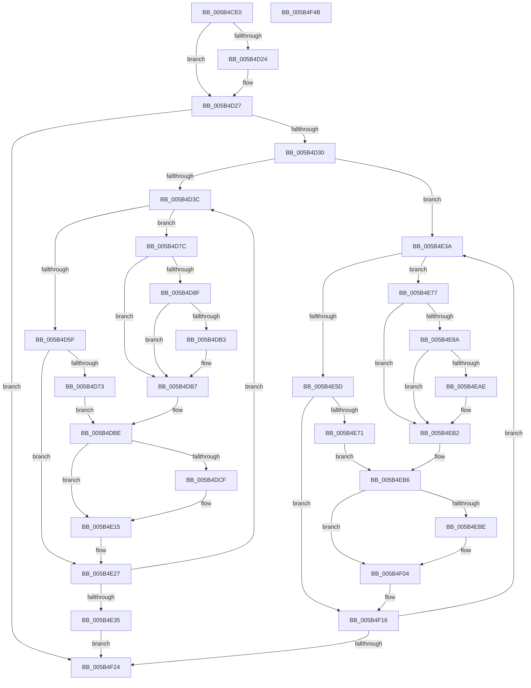

# KiDumpParameterImages

- RVA: `0x005B4CE0`–`0x005B4F4C` (길이 `620` bytes)
- VA: `0x00000001405B4CE0`
- 실행 섹션: `.text`
- PDB 이름 있음: `예`; PDB Function 태그: `아니요`
- unwind 정보 RVA: `0x000876E8`
- 디코드: `159`개 명령, `620/620` bytes 표시
- 미해석 바이트: `0` (있으면 어셈블리에 `.byte`로 보존)

> 이 문서는 커널 이미지의 기계어와 PDB 기호를 분석해 생성했습니다. 4번과 5번은 함수 원형과 자료형을 바이너리 사용 방식에서 추정한 C 해석이며 원본 소스 복구 결과는 아닙니다.

## 1. Dependencies

- 직접 호출 지점: **12**; 고유 호출 대상: **7**
- 직접 호출자로 확인된 함수: **2**
- RIP 상대 이미지 참조: **6**

### Outgoing calls
- `0x005B4D52` → [KiPcToFileHeader](KiPcToFileHeader_function_005B5268.md) (function, `0x005B5268`)
- `0x005B4D62` → [MmLocateUnloadedDriver](../67/MmLocateUnloadedDriver_function_0067170C.md) (function, `0x0067170C`)
- `0x005B4D86` → [MmIsAddressValidEx](../27/MmIsAddressValidEx_function_0027FDD0.md) (function, `0x0027FDD0`)
- `0x005B4DA4` → [RtlImageNtHeaderEx](../41/RtlImageNtHeaderEx_function_0041EAA0.md) (function, `0x0041EAA0`)
- `0x005B4DC5` → [KiBugCheckUnicodeToAnsi](KiBugCheckUnicodeToAnsi_function_005B4104.md) (function, `0x005B4104`)
- `0x005B4E10` → [RtlStringCbPrintfA](../53/RtlStringCbPrintfA_function_0053BC0C.md) (function, `0x0053BC0C`)
- `0x005B4E50` → [KiPcToFileHeader](KiPcToFileHeader_function_005B5268.md) (function, `0x005B5268`)
- `0x005B4E60` → [MmLocateUnloadedDriver](../67/MmLocateUnloadedDriver_function_0067170C.md) (function, `0x0067170C`)
- `0x005B4E81` → [MmIsAddressValidEx](../27/MmIsAddressValidEx_function_0027FDD0.md) (function, `0x0027FDD0`)
- `0x005B4E9F` → [RtlImageNtHeaderEx](../41/RtlImageNtHeaderEx_function_0041EAA0.md) (function, `0x0041EAA0`)
- `0x005B4EFF` → [RtlStringCbPrintfA](../53/RtlStringCbPrintfA_function_0053BC0C.md) (function, `0x0053BC0C`)
- `0x005B4F2B` → [_security_check_cookie](../6A/_security_check_cookie_function_006AC640.md) (function, `0x006AC640`)

### Direct callers
- [KeBugCheck2](KeBugCheck2_function_005B27D0.md) at `0x005B30D9`
- [KiDisplayBlueScreen](KiDisplayBlueScreen_function_005B494C.md) at `0x005B4A2A`

### Static image references
- `0x005B4CFC` → RVA `0x00E0A740` (`.data`; read)
- `0x005B4DD4` → RVA `0x006CB580` (` ?? ::FNODOBFM::`string'`; read)
- `0x005B4DE0` → RVA `0x006CB520` (` ?? ::FNODOBFM::`string'`; read)
- `0x005B4DF3` → RVA `0x006CB540` (` ?? ::FNODOBFM::`string'`; read)
- `0x005B4E15` → RVA `0x00E667E0` (`.data`; write)
- `0x005B4E1C` → RVA `0x00E667F0` (`.data`; write)

## 2. Other-region calls and transfers

- 다른 실행 섹션으로 향하는 call: **0**
- 별도 외부 분기/꼬리 이동을 확인하지 못했습니다.

## 3. Assembly (complete function range)

```asm
005B4CE0  48 89 5C 24 18                  mov qword ptr [rsp + 0x18], rbx
005B4CE5  55                              push rbp
005B4CE6  56                              push rsi
005B4CE7  57                              push rdi
005B4CE8  41 54                           push r12
005B4CEA  41 55                           push r13
005B4CEC  41 56                           push r14
005B4CEE  41 57                           push r15
005B4CF0  48 8D 6C 24 D9                  lea rbp, [rsp - 0x27]
005B4CF5  48 81 EC F0 00 00 00            sub rsp, 0xf0
005B4CFC  48 8B 05 3D 5A 85 00            mov rax, qword ptr [rip + 0x855a3d]
005B4D03  48 33 C4                        xor rax, rsp
005B4D06  48 89 45 17                     mov qword ptr [rbp + 0x17], rax
005B4D0A  48 83 65 87 00                  and qword ptr [rbp - 0x79], 0
005B4D0F  48 8B F2                        mov rsi, rdx
005B4D12  C6 44 24 40 01                  mov byte ptr [rsp + 0x40], 1
005B4D17  4C 8B E1                        mov r12, rcx
005B4D1A  C6 44 24 41 00                  mov byte ptr [rsp + 0x41], 0
005B4D1F  48 85 C9                        test rcx, rcx
005B4D22  74 03                           je 0x1405b4d27
005B4D24  C6 01 00                        mov byte ptr [rcx], 0
005B4D27  45 85 C0                        test r8d, r8d
005B4D2A  0F 84 F4 01 00 00               je 0x1405b4f24
005B4D30  45 8B F8                        mov r15d, r8d
005B4D33  45 84 C9                        test r9b, r9b
005B4D36  0F 84 FE 00 00 00               je 0x1405b4e3a
005B4D3C  48 8B 1E                        mov rbx, qword ptr [rsi]
005B4D3F  4C 8D 4C 24 41                  lea r9, [rsp + 0x41]
005B4D44  45 33 ED                        xor r13d, r13d
005B4D47  48 8D 55 87                     lea rdx, [rbp - 0x79]
005B4D4B  48 8B CB                        mov rcx, rbx
005B4D4E  45 8D 45 01                     lea r8d, [r13 + 1]
005B4D52  E8 11 05 00 00                  call 0x1405b5268
005B4D57  4C 8B F0                        mov r14, rax
005B4D5A  48 85 C0                        test rax, rax
005B4D5D  75 1D                           jne 0x1405b4d7c
005B4D5F  48 8B CB                        mov rcx, rbx
005B4D62  E8 A5 C9 0B 00                  call 0x14067170c
005B4D67  48 8B F8                        mov rdi, rax
005B4D6A  48 85 C0                        test rax, rax
005B4D6D  0F 84 B4 00 00 00               je 0x1405b4e27
005B4D73  4C 8B 70 10                     mov r14, qword ptr [rax + 0x10]
005B4D77  48 8B C8                        mov rcx, rax
005B4D7A  EB 42                           jmp 0x1405b4dbe
005B4D7C  48 8B 7D 87                     mov rdi, qword ptr [rbp - 0x79]
005B4D80  33 D2                           xor edx, edx
005B4D82  48 8B 4F 30                     mov rcx, qword ptr [rdi + 0x30]
005B4D86  E8 45 B0 CC FF                  call 0x14027fdd0
005B4D8B  3C 01                           cmp al, 1
005B4D8D  75 28                           jne 0x1405b4db7
005B4D8F  48 8B 57 30                     mov rdx, qword ptr [rdi + 0x30]
005B4D93  4C 8D 4C 24 48                  lea r9, [rsp + 0x48]
005B4D98  4C 21 6C 24 48                  and qword ptr [rsp + 0x48], r13
005B4D9D  45 33 C0                        xor r8d, r8d
005B4DA0  41 8D 48 01                     lea ecx, [r8 + 1]
005B4DA4  E8 F7 9C E6 FF                  call 0x14041eaa0
005B4DA9  48 8B 44 24 48                  mov rax, qword ptr [rsp + 0x48]
005B4DAE  48 85 C0                        test rax, rax
005B4DB1  74 04                           je 0x1405b4db7
005B4DB3  44 8B 68 08                     mov r13d, dword ptr [rax + 8]
005B4DB7  48 83 C7 58                     add rdi, 0x58
005B4DBB  48 8B CF                        mov rcx, rdi
005B4DBE  48 8D 55 97                     lea rdx, [rbp - 0x69]
005B4DC2  41 2B DE                        sub ebx, r14d
005B4DC5  E8 3A F3 FF FF                  call 0x1405b4104
005B4DCA  4D 85 E4                        test r12, r12
005B4DCD  74 46                           je 0x1405b4e15
005B4DCF  80 7C 24 40 00                  cmp byte ptr [rsp + 0x40], 0
005B4DD4  48 8D 05 A5 67 11 00            lea rax, [rip + 0x1167a5]
005B4DDB  44 89 6C 24 38                  mov dword ptr [rsp + 0x38], r13d
005B4DE0  4C 8D 0D 39 67 11 00            lea r9, [rip + 0x116739]
005B4DE7  4C 0F 44 C8                     cmove r9, rax
005B4DEB  4C 89 74 24 30                  mov qword ptr [rsp + 0x30], r14
005B4DF0  48 8B 06                        mov rax, qword ptr [rsi]
005B4DF3  4C 8D 05 46 67 11 00            lea r8, [rip + 0x116746]
005B4DFA  48 89 44 24 28                  mov qword ptr [rsp + 0x28], rax
005B4DFF  BA 80 00 00 00                  mov edx, 0x80
005B4E04  48 8D 45 97                     lea rax, [rbp - 0x69]
005B4E08  49 8B CC                        mov rcx, r12
005B4E0B  48 89 44 24 20                  mov qword ptr [rsp + 0x20], rax
005B4E10  E8 F7 6D F8 FF                  call 0x14053bc0c
005B4E15  48 89 3D C4 19 8B 00            mov qword ptr [rip + 0x8b19c4], rdi
005B4E1C  89 1D CE 19 8B 00               mov dword ptr [rip + 0x8b19ce], ebx
005B4E22  C6 44 24 40 00                  mov byte ptr [rsp + 0x40], 0
005B4E27  48 83 C6 08                     add rsi, 8
005B4E2B  49 83 EF 01                     sub r15, 1
005B4E2F  0F 85 07 FF FF FF               jne 0x1405b4d3c
005B4E35  E9 EA 00 00 00                  jmp 0x1405b4f24
005B4E3A  48 8B 1E                        mov rbx, qword ptr [rsi]
005B4E3D  4C 8D 4C 24 41                  lea r9, [rsp + 0x41]
005B4E42  45 33 ED                        xor r13d, r13d
005B4E45  48 8D 55 87                     lea rdx, [rbp - 0x79]
005B4E49  48 8B CB                        mov rcx, rbx
005B4E4C  45 8D 45 01                     lea r8d, [r13 + 1]
005B4E50  E8 13 04 00 00                  call 0x1405b5268
005B4E55  4C 8B F0                        mov r14, rax
005B4E58  48 85 C0                        test rax, rax
005B4E5B  75 1A                           jne 0x1405b4e77
005B4E5D  48 8B CB                        mov rcx, rbx
005B4E60  E8 A7 C8 0B 00                  call 0x14067170c
005B4E65  48 8B F8                        mov rdi, rax
005B4E68  48 85 C0                        test rax, rax
005B4E6B  0F 84 A5 00 00 00               je 0x1405b4f16
005B4E71  4C 8B 70 10                     mov r14, qword ptr [rax + 0x10]
005B4E75  EB 3F                           jmp 0x1405b4eb6
005B4E77  48 8B 7D 87                     mov rdi, qword ptr [rbp - 0x79]
005B4E7B  33 D2                           xor edx, edx
005B4E7D  48 8B 4F 30                     mov rcx, qword ptr [rdi + 0x30]
005B4E81  E8 4A AF CC FF                  call 0x14027fdd0
005B4E86  3C 01                           cmp al, 1
005B4E88  75 28                           jne 0x1405b4eb2
005B4E8A  48 8B 57 30                     mov rdx, qword ptr [rdi + 0x30]
005B4E8E  4C 8D 4C 24 48                  lea r9, [rsp + 0x48]
005B4E93  4C 21 6C 24 48                  and qword ptr [rsp + 0x48], r13
005B4E98  45 33 C0                        xor r8d, r8d
005B4E9B  41 8D 48 01                     lea ecx, [r8 + 1]
005B4E9F  E8 FC 9B E6 FF                  call 0x14041eaa0
005B4EA4  48 8B 44 24 48                  mov rax, qword ptr [rsp + 0x48]
005B4EA9  48 85 C0                        test rax, rax
005B4EAC  74 04                           je 0x1405b4eb2
005B4EAE  44 8B 68 08                     mov r13d, dword ptr [rax + 8]
005B4EB2  48 83 C7 58                     add rdi, 0x58
005B4EB6  41 2B DE                        sub ebx, r14d
005B4EB9  4D 85 E4                        test r12, r12
005B4EBC  74 46                           je 0x1405b4f04
005B4EBE  80 7C 24 40 00                  cmp byte ptr [rsp + 0x40], 0
005B4EC3  48 8D 05 B6 66 11 00            lea rax, [rip + 0x1166b6]
005B4ECA  44 89 6C 24 38                  mov dword ptr [rsp + 0x38], r13d
005B4ECF  4C 8D 0D 4A 66 11 00            lea r9, [rip + 0x11664a]
005B4ED6  4C 0F 44 C8                     cmove r9, rax
005B4EDA  4C 89 74 24 30                  mov qword ptr [rsp + 0x30], r14
005B4EDF  48 8B 06                        mov rax, qword ptr [rsi]
005B4EE2  4C 8D 05 57 66 11 00            lea r8, [rip + 0x116657]
005B4EE9  48 89 44 24 28                  mov qword ptr [rsp + 0x28], rax
005B4EEE  BA 80 00 00 00                  mov edx, 0x80
005B4EF3  48 8D 45 97                     lea rax, [rbp - 0x69]
005B4EF7  49 8B CC                        mov rcx, r12
005B4EFA  48 89 44 24 20                  mov qword ptr [rsp + 0x20], rax
005B4EFF  E8 08 6D F8 FF                  call 0x14053bc0c
005B4F04  48 89 3D D5 18 8B 00            mov qword ptr [rip + 0x8b18d5], rdi
005B4F0B  89 1D DF 18 8B 00               mov dword ptr [rip + 0x8b18df], ebx
005B4F11  C6 44 24 40 00                  mov byte ptr [rsp + 0x40], 0
005B4F16  48 83 C6 08                     add rsi, 8
005B4F1A  49 83 EF 01                     sub r15, 1
005B4F1E  0F 85 16 FF FF FF               jne 0x1405b4e3a
005B4F24  48 8B 4D 17                     mov rcx, qword ptr [rbp + 0x17]
005B4F28  48 33 CC                        xor rcx, rsp
005B4F2B  E8 10 77 0F 00                  call 0x1406ac640
005B4F30  48 8B 9C 24 40 01 00 00         mov rbx, qword ptr [rsp + 0x140]
005B4F38  48 81 C4 F0 00 00 00            add rsp, 0xf0
005B4F3F  41 5F                           pop r15
005B4F41  41 5E                           pop r14
005B4F43  41 5D                           pop r13
005B4F45  41 5C                           pop r12
005B4F47  5F                              pop rdi
005B4F48  5E                              pop rsi
005B4F49  5D                              pop rbp
005B4F4A  C3                              ret
005B4F4B  CC                              int3
```

## 4. C-style interpretation (structured pseudocode)

```c
__int64 __fastcall KiDumpParameterImages(__int64 a1, __int64 a2, int a3, unsigned __int8 a4)
{
    __int64 result;
    __int64 v_r13;
    __int64 v_r15;
    __int64 v_rbx;
    __int64 v_rdi;
    __int64 v_rsi;
    __int64 v_rsp;
    unsigned __int64 v_stack_m100;
    unsigned __int64 v_stack_m108;
    unsigned __int64 v_stack_m48;
    unsigned __int64 v_stack_m5F;
    unsigned __int64 v_stack_mC8;
    unsigned __int64 v_stack_mD8;
    unsigned __int64 v_stack_mE0;
    unsigned __int8 v_stack_mE7;
    unsigned __int8 v_stack_mE8;
    unsigned int v_stack_mF0;
    unsigned __int64 v_stack_mF8;
    unsigned __int64 v_stack_p18;

    v_stack_p18 = v_rbx;
    v_rsp = (v_rsp) - (240);
    result = (*(unsigned __int64 *)(v_rip + 8739389)) ^ (v_rsp);
    v_stack_m48 = result;
    v_stack_mE8 = 1;
    v_stack_mE7 = 0;
    if (a1 != 0) {
        *(unsigned __int8 *)(a1) = 0;
    }
    if (a3 == 0) goto loc_005B4F24;
    if (a4 == 0) goto loc_005B4E3A;
loc_005B4D3C:
    v_r13 = 0;
    result = KiPcToFileHeader(*(unsigned __int64 *)(a2), v_stack_mD8, v_r13 + 1, v_stack_mE7);
    if (result != 0) goto loc_005B4D7C;
    result = MmLocateUnloadedDriver(*(unsigned __int64 *)(a2), v_stack_mD8, v_r13 + 1, v_stack_mE7);
    if (result == 0) goto loc_005B4E27;
    goto loc_005B4DBE;
loc_005B4D7C:
    a2 = 0;
    result = MmIsAddressValidEx(*(unsigned __int64 *)(v_stack_mD8 + 48), a2, v_r13 + 1, v_stack_mE7);
    if (((unsigned __int8)(result)) != 1) goto loc_005B4DB7;
    a3 = 0;
    result = RtlImageNtHeaderEx(a3 + 1, *(unsigned __int64 *)(v_stack_mD8 + 48), a3, v_stack_mE0);
    if (v_stack_mE0 != 0) {
        v_r13 = *(unsigned int *)(v_stack_mE0 + 8);
    }
    v_rdi = (v_stack_mD8) + (88);
loc_005B4DBE:
    v_rbx = (unsigned int)((*(unsigned __int64 *)(a2)) - ((unsigned int)(*(unsigned __int64 *)(result + 16))));
    result = KiBugCheckUnicodeToAnsi(v_rdi, v_stack_mC8, a3, v_stack_mE0);
    if (a1 != 0) {
        result = v_rip + 1140645;
        v_stack_mF0 = (unsigned int)(v_r13);
        a4 = v_rip + 1140537;
        if (v_stack_mE8 == 0) { a4 = result; }
        v_stack_mF8 = *(unsigned __int64 *)(result + 16);
        result = *(unsigned __int64 *)(a2);
        a3 = v_rip + 1140550;
        v_stack_m100 = result;
        a2 = 128;
        result = v_stack_mC8;
        a1 = a1;
        v_stack_m108 = result;
        result = RtlStringCbPrintfA(a1, a2, a3, a4);
    }
    *(unsigned __int64 *)(v_rip + 9116100) = v_rdi;
    *(unsigned int *)(v_rip + 9116110) = (unsigned int)(v_rbx);
    v_stack_mE8 = 0;
loc_005B4E27:
    v_rsi = (a2) + (8);
    v_r15 = ((unsigned int)(a3)) - (1);
    if (condition_is_not_equal) goto loc_005B4D3C;
    goto loc_005B4F24;
loc_005B4E3A:
    v_r13 = 0;
    result = KiPcToFileHeader(*(unsigned __int64 *)(v_rsi), v_stack_mD8, v_r13 + 1, v_stack_mE7);
    if (result != 0) goto loc_005B4E77;
    result = MmLocateUnloadedDriver(*(unsigned __int64 *)(v_rsi), v_stack_mD8, v_r13 + 1, v_stack_mE7);
    if (result == 0) goto loc_005B4F16;
    goto loc_005B4EB6;
loc_005B4E77:
    a2 = 0;
    result = MmIsAddressValidEx(*(unsigned __int64 *)(v_stack_mD8 + 48), a2, v_r13 + 1, v_stack_mE7);
    if (((unsigned __int8)(result)) != 1) goto loc_005B4EB2;
    a3 = 0;
    result = RtlImageNtHeaderEx(a3 + 1, *(unsigned __int64 *)(v_stack_mD8 + 48), a3, v_stack_mE0);
    if (v_stack_mE0 != 0) {
        v_r13 = *(unsigned int *)(v_stack_mE0 + 8);
    }
    v_rdi = (v_stack_mD8) + (88);
loc_005B4EB6:
    v_rbx = (unsigned int)((*(unsigned __int64 *)(v_rsi)) - ((unsigned int)(*(unsigned __int64 *)(result + 16))));
    result = v_stack_mE0;
    if (a1 != 0) {
        result = v_rip + 1140406;
        v_stack_mF0 = (unsigned int)(v_r13);
        a4 = v_rip + 1140298;
        if (v_stack_mE8 == 0) { a4 = result; }
        v_stack_mF8 = *(unsigned __int64 *)(result + 16);
        result = *(unsigned __int64 *)(v_rsi);
        a3 = v_rip + 1140311;
        v_stack_m100 = result;
        a2 = 128;
        result = v_stack_mC8;
        a1 = a1;
        v_stack_m108 = result;
        result = RtlStringCbPrintfA(a1, a2, a3, a4);
    }
    *(unsigned __int64 *)(v_rip + 9115861) = v_rdi;
    *(unsigned int *)(v_rip + 9115871) = (unsigned int)(v_rbx);
    v_stack_mE8 = 0;
loc_005B4F16:
    v_rsi = (v_rsi) + (8);
    v_r15 = (v_r15) - (1);
    if (condition_is_not_equal) goto loc_005B4E3A;
loc_005B4F24:
    a1 = (v_stack_m48) ^ (v_rsp);
    result = _security_check_cookie(a1, a2, a3, a4);
    v_rsp = (v_rsp) + (240);
    return result;
}
```

## 5. (Beta) C Style

```c
int64_t KiDumpParameterImages(int64_t Arg1, void *Arg2, int32_t Arg3, uint8_t Arg4)
{
    uint8_t *arg2 = (uint8_t *)Arg2;

    int64_t result;
    int64_t local_r13;
    int64_t local_r15;
    int64_t local_rbx;
    int64_t local_rdi;
    int64_t local_rsi;
    int64_t local_rsp;
    uint64_t v_stack_m100;
    uint64_t v_stack_m108;
    uint64_t v_stack_m48;
    uint64_t v_stack_m5F;
    uint64_t v_stack_mC8;
    uint64_t v_stack_mD8;
    uint64_t v_stack_mE0;
    uint8_t v_stack_mE7;
    uint8_t v_stack_mE8;
    uint32_t v_stack_mF0;
    uint64_t v_stack_mF8;
    uint64_t v_stack_p18;

    v_stack_p18 = local_rbx;
    local_rsp = (local_rsp) - (240);
    result = (*(uint64_t *)(v_rip + 0x855A3D)) ^ (local_rsp);
    v_stack_m48 = result;
    v_stack_mE8 = 1;
    v_stack_mE7 = 0;
    if (Arg1 != 0) {
        *(uint8_t *)(Arg1) = 0;
    }
    if (Arg3 == 0) goto loc_005B4F24;
    if (Arg4 == 0) goto loc_005B4E3A;
loc_005B4D3C:
    local_r13 = 0;
    result = KiPcToFileHeader(*(uint64_t *)(arg2), v_stack_mD8, local_r13 + 1, v_stack_mE7);
    if (result != 0) goto loc_005B4D7C;
    result = MmLocateUnloadedDriver(*(uint64_t *)(arg2), v_stack_mD8, local_r13 + 1, v_stack_mE7);
    if (result == 0) goto loc_005B4E27;
    goto loc_005B4DBE;
loc_005B4D7C:
    Arg2 = 0;
    result = MmIsAddressValidEx(*(uint64_t *)(v_stack_mD8 + 0x30), Arg2, local_r13 + 1, v_stack_mE7);
    if (((uint8_t)(result)) != 1) goto loc_005B4DB7;
    Arg3 = 0;
    result = RtlImageNtHeaderEx(Arg3 + 1, *(uint64_t *)(v_stack_mD8 + 0x30), Arg3, v_stack_mE0);
    if (v_stack_mE0 != 0) {
        local_r13 = *(uint32_t *)(v_stack_mE0 + 0x8);
    }
    local_rdi = (v_stack_mD8) + (88);
loc_005B4DBE:
    local_rbx = (uint32_t)((*(uint64_t *)(arg2)) - ((uint32_t)(*(uint64_t *)(result + 0x10))));
    result = KiBugCheckUnicodeToAnsi(local_rdi, v_stack_mC8, Arg3, v_stack_mE0);
    if (Arg1 != 0) {
        result = v_rip + 1140645;
        v_stack_mF0 = (uint32_t)(local_r13);
        Arg4 = v_rip + 1140537;
        if (v_stack_mE8 == 0) { Arg4 = result; }
        v_stack_mF8 = *(uint64_t *)(result + 0x10);
        result = *(uint64_t *)(arg2);
        Arg3 = v_rip + 1140550;
        v_stack_m100 = result;
        Arg2 = 128;
        result = v_stack_mC8;
        Arg1 = Arg1;
        v_stack_m108 = result;
        result = RtlStringCbPrintfA(Arg1, Arg2, Arg3, Arg4);
    }
    *(uint64_t *)(v_rip + 0x8B19C4) = local_rdi;
    *(uint32_t *)(v_rip + 0x8B19CE) = (uint32_t)(local_rbx);
    v_stack_mE8 = 0;
loc_005B4E27:
    local_rsi = (Arg2) + (8);
    local_r15 = ((uint32_t)(Arg3)) - (1);
    if (condition_is_not_equal) goto loc_005B4D3C;
    goto loc_005B4F24;
loc_005B4E3A:
    local_r13 = 0;
    result = KiPcToFileHeader(*(uint64_t *)(local_rsi), v_stack_mD8, local_r13 + 1, v_stack_mE7);
    if (result != 0) goto loc_005B4E77;
    result = MmLocateUnloadedDriver(*(uint64_t *)(local_rsi), v_stack_mD8, local_r13 + 1, v_stack_mE7);
    if (result == 0) goto loc_005B4F16;
    goto loc_005B4EB6;
loc_005B4E77:
    Arg2 = 0;
    result = MmIsAddressValidEx(*(uint64_t *)(v_stack_mD8 + 0x30), Arg2, local_r13 + 1, v_stack_mE7);
    if (((uint8_t)(result)) != 1) goto loc_005B4EB2;
    Arg3 = 0;
    result = RtlImageNtHeaderEx(Arg3 + 1, *(uint64_t *)(v_stack_mD8 + 0x30), Arg3, v_stack_mE0);
    if (v_stack_mE0 != 0) {
        local_r13 = *(uint32_t *)(v_stack_mE0 + 0x8);
    }
    local_rdi = (v_stack_mD8) + (88);
loc_005B4EB6:
    local_rbx = (uint32_t)((*(uint64_t *)(local_rsi)) - ((uint32_t)(*(uint64_t *)(result + 0x10))));
    result = v_stack_mE0;
    if (Arg1 != 0) {
        result = v_rip + 1140406;
        v_stack_mF0 = (uint32_t)(local_r13);
        Arg4 = v_rip + 1140298;
        if (v_stack_mE8 == 0) { Arg4 = result; }
        v_stack_mF8 = *(uint64_t *)(result + 0x10);
        result = *(uint64_t *)(local_rsi);
        Arg3 = v_rip + 1140311;
        v_stack_m100 = result;
        Arg2 = 128;
        result = v_stack_mC8;
        Arg1 = Arg1;
        v_stack_m108 = result;
        result = RtlStringCbPrintfA(Arg1, Arg2, Arg3, Arg4);
    }
    *(uint64_t *)(v_rip + 0x8B18D5) = local_rdi;
    *(uint32_t *)(v_rip + 0x8B18DF) = (uint32_t)(local_rbx);
    v_stack_mE8 = 0;
loc_005B4F16:
    local_rsi = (local_rsi) + (8);
    local_r15 = (local_r15) - (1);
    if (condition_is_not_equal) goto loc_005B4E3A;
loc_005B4F24:
    Arg1 = (v_stack_m48) ^ (local_rsp);
    result = _security_check_cookie(Arg1, Arg2, Arg3, Arg4);
    local_rsp = (local_rsp) + (240);
    return result;
}
```

### 관측된 메모리 오프셋

구조체 형식이 확인되지 않은 접근은 인자 기준의 오프셋으로만 기록했습니다.

| 기준 인자 | 오프셋 표현 | 폭 (bit) | 접근 |
|---|---:|---:|---|
| `Arg2` | `+ 0x0` | `64` | `R` |

## 6. Execution-region graph

[열기: 2D/3D 그래프와 함수 탐색 컨트롤 패널](../../../control-panel.html?section=text&rva=0x005B4CE0&view=graph)

- 2D 그래프는 위에서 아래로 흐르고, 3D 그래프는 빈 공간을 드래그해 회전합니다. Shift+드래그는 이동, 휠은 확대·축소, 함수 노드 선택은 대상 보고서 이동입니다.

### Static fallback


