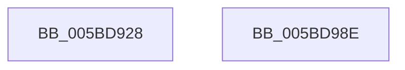

# KiDynamicProcessorAddNotification

- RVA: `0x005BD928`–`0x005BD98F` (길이 `103` bytes)
- VA: `0x00000001405BD928`
- 실행 섹션: `.text`
- PDB 이름 있음: `예`; PDB Function 태그: `아니요`
- unwind 정보 RVA: `0x000CA4B8`
- 디코드: `29`개 명령, `103/103` bytes 표시
- 미해석 바이트: `0` (있으면 어셈블리에 `.byte`로 보존)

> 이 문서는 커널 이미지의 기계어와 PDB 기호를 분석해 생성했습니다. 4번과 5번은 함수 원형과 자료형을 바이너리 사용 방식에서 추정한 C 해석이며 원본 소스 복구 결과는 아닙니다.

## 1. Dependencies

- 직접 호출 지점: **2**; 고유 호출 대상: **2**
- 직접 호출자로 확인된 함수: **1**
- RIP 상대 이미지 참조: **2**

### Outgoing calls
- `0x005BD974` → [ExNotifyWithProcessing](../45/ExNotifyWithProcessing_function_004523F4.md) (function, `0x004523F4`)
- `0x005BD983` → [_security_check_cookie](../6A/_security_check_cookie_function_006AC640.md) (function, `0x006AC640`)

### Direct callers
- [KiStartDynamicProcessor](../../page/74/KiStartDynamicProcessor_function_007456C8.md) at `0x00745AB5`
- [KiStartDynamicProcessor](../../page/74/KiStartDynamicProcessor_function_007456C8.md) at `0x00745B3E`

### Static image references
- `0x005BD931` → RVA `0x00E0A740` (`.data`; read)
- `0x005BD94F` → RVA `0x00EFEDA0` (`.data`; read)

## 2. Other-region calls and transfers

- 다른 실행 섹션으로 향하는 call: **0**
- 별도 외부 분기/꼬리 이동을 확인하지 못했습니다.

## 3. Assembly (complete function range)

```asm
005BD928  40 55                           push rbp
005BD92A  48 8B EC                        mov rbp, rsp
005BD92D  48 83 EC 50                     sub rsp, 0x50
005BD931  48 8B 05 08 CE 84 00            mov rax, qword ptr [rip + 0x84ce08]
005BD938  48 33 C4                        xor rax, rsp
005BD93B  48 89 45 F0                     mov qword ptr [rbp - 0x10], rax
005BD93F  8B 45 30                        mov eax, dword ptr [rbp + 0x30]
005BD942  83 65 D0 00                     and dword ptr [rbp - 0x30], 0
005BD946  89 45 E8                        mov dword ptr [rbp - 0x18], eax
005BD949  8B 45 38                        mov eax, dword ptr [rbp + 0x38]
005BD94C  89 4D D8                        mov dword ptr [rbp - 0x28], ecx
005BD94F  48 8B 0D 4A 14 94 00            mov rcx, qword ptr [rip + 0x94144a]
005BD956  89 55 DC                        mov dword ptr [rbp - 0x24], edx
005BD959  48 8D 55 D8                     lea rdx, [rbp - 0x28]
005BD95D  66 44 89 45 E4                  mov word ptr [rbp - 0x1c], r8w
005BD962  4C 8D 45 D0                     lea r8, [rbp - 0x30]
005BD966  44 88 4D E6                     mov byte ptr [rbp - 0x1a], r9b
005BD96A  45 33 C9                        xor r9d, r9d
005BD96D  89 45 E0                        mov dword ptr [rbp - 0x20], eax
005BD970  C6 45 E7 00                     mov byte ptr [rbp - 0x19], 0
005BD974  E8 7B 4A E9 FF                  call 0x1404523f4
005BD979  8B 45 D0                        mov eax, dword ptr [rbp - 0x30]
005BD97C  48 8B 4D F0                     mov rcx, qword ptr [rbp - 0x10]
005BD980  48 33 CC                        xor rcx, rsp
005BD983  E8 B8 EC 0E 00                  call 0x1406ac640
005BD988  48 83 C4 50                     add rsp, 0x50
005BD98C  5D                              pop rbp
005BD98D  C3                              ret
005BD98E  CC                              int3
```

## 4. C-style interpretation (structured pseudocode)

```c
__int64 __fastcall KiDynamicProcessorAddNotification(int a1, int a2, unsigned __int16 a3, int a4, unsigned int a5, unsigned int a6)
{
    __int64 result;
    __int64 v_rsp;
    unsigned __int64 v_stack_m18;
    unsigned int v_stack_m20;
    unsigned __int8 v_stack_m21;
    unsigned __int8 v_stack_m22;
    unsigned __int16 v_stack_m24;
    unsigned int v_stack_m28;
    unsigned int v_stack_m2C;
    unsigned int v_stack_m30;
    unsigned int v_stack_m38;

    v_rsp = (v_rsp) - (80);
    result = (*(unsigned __int64 *)(v_rip + 8703496)) ^ (v_rsp);
    v_stack_m18 = result;
    v_stack_m20 = (unsigned int)((unsigned int)(a5));
    v_stack_m30 = a1;
    v_stack_m2C = a2;
    v_stack_m24 = a3;
    v_stack_m22 = (unsigned __int8)(a4);
    a4 = 0;
    v_stack_m28 = (unsigned int)((unsigned int)(a6));
    v_stack_m21 = 0;
    result = ExNotifyWithProcessing(*(unsigned __int64 *)(v_rip + 9704522), v_stack_m30, v_stack_m38, a4);
    a1 = (v_stack_m18) ^ (v_rsp);
    result = _security_check_cookie(a1, v_stack_m30, v_stack_m38, a4);
    v_rsp = (v_rsp) + (80);
    return result;
}
```

## 5. (Beta) C Style

```c
int64_t KiDynamicProcessorAddNotification(int32_t Arg1, int32_t Arg2, uint16_t Arg3, int32_t Arg4, uint32_t Arg5, uint32_t Arg6)
{
    int64_t result;
    int64_t local_rsp;
    uint64_t v_stack_m18;
    uint32_t v_stack_m20;
    uint8_t v_stack_m21;
    uint8_t v_stack_m22;
    uint16_t v_stack_m24;
    uint32_t v_stack_m28;
    uint32_t v_stack_m2C;
    uint32_t v_stack_m30;
    uint32_t v_stack_m38;

    local_rsp = (local_rsp) - (80);
    result = (*(uint64_t *)(v_rip + 0x84CE08)) ^ (local_rsp);
    v_stack_m18 = result;
    v_stack_m20 = (uint32_t)((uint32_t)(Arg5));
    v_stack_m30 = Arg1;
    v_stack_m2C = Arg2;
    v_stack_m24 = Arg3;
    v_stack_m22 = (uint8_t)(Arg4);
    Arg4 = 0;
    v_stack_m28 = (uint32_t)((uint32_t)(Arg6));
    v_stack_m21 = 0;
    result = ExNotifyWithProcessing(*(uint64_t *)(v_rip + 0x94144A), v_stack_m30, v_stack_m38, Arg4);
    Arg1 = (v_stack_m18) ^ (local_rsp);
    result = _security_check_cookie(Arg1, v_stack_m30, v_stack_m38, Arg4);
    local_rsp = (local_rsp) + (80);
    return result;
}
```

## 6. Execution-region graph

[열기: 2D/3D 그래프와 함수 탐색 컨트롤 패널](../../../control-panel.html?section=text&rva=0x005BD928&view=graph)

- 2D 그래프는 위에서 아래로 흐르고, 3D 그래프는 빈 공간을 드래그해 회전합니다. Shift+드래그는 이동, 휠은 확대·축소, 함수 노드 선택은 대상 보고서 이동입니다.

### Static fallback


