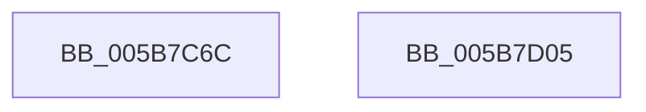

# KiDynamicProcessorInitialization

- RVA: `0x005B7C6C`–`0x005B7D06` (길이 `154` bytes)
- VA: `0x00000001405B7C6C`
- 실행 섹션: `.text`
- PDB 이름 있음: `예`; PDB Function 태그: `아니요`
- unwind 정보 RVA: `0x000606C0`
- 디코드: `39`개 명령, `154/154` bytes 표시
- 미해석 바이트: `0` (있으면 어셈블리에 `.byte`로 보존)

> 이 문서는 커널 이미지의 기계어와 PDB 기호를 분석해 생성했습니다. 4번과 5번은 함수 원형과 자료형을 바이너리 사용 방식에서 추정한 C 해석이며 원본 소스 복구 결과는 아닙니다.

## 1. Dependencies

- 직접 호출 지점: **5**; 고유 호출 대상: **5**
- 직접 호출자로 확인된 함수: **1**
- RIP 상대 이미지 참조: **2**

### Outgoing calls
- `0x005B7CD0` → [KeSetSystemGroupAffinityThread](../39/KeSetSystemGroupAffinityThread_function_00399140.md) (function, `0x00399140`)
- `0x005B7CDC` → [KeWriteProtectProcessorState](../../pagelk/B6/KeWriteProtectProcessorState_function_00B66BB0.md) (function, `0x00B66BB0`)
- `0x005B7CE3` → [KeOptimizeSpecCtrlSettings](KeOptimizeSpecCtrlSettings_function_005BE95C.md) (function, `0x005BE95C`)
- `0x005B7CED` → [KeRevertToUserGroupAffinityThread](../39/KeRevertToUserGroupAffinityThread_function_00398EC0.md) (function, `0x00398EC0`)
- `0x005B7CFA` → [_security_check_cookie](../6A/_security_check_cookie_function_006AC640.md) (function, `0x006AC640`)

### Direct callers
- [KiStartDynamicProcessor](../../page/74/KiStartDynamicProcessor_function_007456C8.md) at `0x00745B61`

### Static image references
- `0x005B7C72` → RVA `0x00E0A740` (`.data`; read)
- `0x005B7C87` → RVA `0x00F231B0` (`.data`; read)

## 2. Other-region calls and transfers

- 다른 실행 섹션으로 향하는 call: **1**
  - `0x005B7CDC` → [KeWriteProtectProcessorState](../../pagelk/B6/KeWriteProtectProcessorState_function_00B66BB0.md) (`.text` → `PAGELK`)
- 별도 외부 분기/꼬리 이동을 확인하지 못했습니다.

## 3. Assembly (complete function range)

```asm
005B7C6C  40 53                           push rbx
005B7C6E  48 83 EC 50                     sub rsp, 0x50
005B7C72  48 8B 05 C7 2A 85 00            mov rax, qword ptr [rip + 0x852ac7]
005B7C79  48 33 C4                        xor rax, rsp
005B7C7C  48 89 44 24 40                  mov qword ptr [rsp + 0x40], rax
005B7C81  8B 51 24                        mov edx, dword ptr [rcx + 0x24]
005B7C84  48 8B D9                        mov rbx, rcx
005B7C87  48 8B 05 22 B5 96 00            mov rax, qword ptr [rip + 0x96b522]
005B7C8E  0F 57 C0                        xorps xmm0, xmm0
005B7C91  0F 11 44 24 20                  movups xmmword ptr [rsp + 0x20], xmm0
005B7C96  0F 57 C9                        xorps xmm1, xmm1
005B7C99  8B 0C 90                        mov ecx, dword ptr [rax + rdx*4]
005B7C9C  33 C0                           xor eax, eax
005B7C9E  89 44 24 2A                     mov dword ptr [rsp + 0x2a], eax
005B7CA2  48 8D 54 24 30                  lea rdx, [rsp + 0x30]
005B7CA7  66 89 44 24 2E                  mov word ptr [rsp + 0x2e], ax
005B7CAC  8B C1                           mov eax, ecx
005B7CAE  C1 E8 06                        shr eax, 6
005B7CB1  83 E1 3F                        and ecx, 0x3f
005B7CB4  66 89 44 24 28                  mov word ptr [rsp + 0x28], ax
005B7CB9  B8 01 00 00 00                  mov eax, 1
005B7CBE  48 D3 E0                        shl rax, cl
005B7CC1  48 8D 4C 24 20                  lea rcx, [rsp + 0x20]
005B7CC6  48 89 44 24 20                  mov qword ptr [rsp + 0x20], rax
005B7CCB  0F 11 4C 24 30                  movups xmmword ptr [rsp + 0x30], xmm1
005B7CD0  E8 6B 14 DE FF                  call 0x140399140
005B7CD5  48 8D 8B 80 FE FF FF            lea rcx, [rbx - 0x180]
005B7CDC  E8 CF EE 5A 00                  call 0x140b66bb0
005B7CE1  B1 01                           mov cl, 1
005B7CE3  E8 74 6C 00 00                  call 0x1405be95c
005B7CE8  48 8D 4C 24 30                  lea rcx, [rsp + 0x30]
005B7CED  E8 CE 11 DE FF                  call 0x140398ec0
005B7CF2  48 8B 4C 24 40                  mov rcx, qword ptr [rsp + 0x40]
005B7CF7  48 33 CC                        xor rcx, rsp
005B7CFA  E8 41 49 0F 00                  call 0x1406ac640
005B7CFF  48 83 C4 50                     add rsp, 0x50
005B7D03  5B                              pop rbx
005B7D04  C3                              ret
005B7D05  CC                              int3
```

## 4. C-style interpretation (structured pseudocode)

```c
__int64 __fastcall KiDynamicProcessorInitialization(__int64 a1)
{
    __int64 result;
    __int64 v_rsp;
    unsigned __int64 v_stack_m18;
    unsigned __int64 v_stack_m28;
    unsigned __int16 v_stack_m2A;
    unsigned int v_stack_m2E;
    unsigned __int16 v_stack_m30;
    unsigned __int64 v_stack_m38;

    v_rsp = (v_rsp) - (80);
    result = (*(unsigned __int64 *)(v_rip + 8727239)) ^ (v_rsp);
    v_stack_m18 = result;
    v_stack_m38 = v_xmm0;
    result = 0;
    v_stack_m2E = 0;
    v_stack_m2A = 0;
    result = (unsigned int)(((unsigned int)((unsigned int)((unsigned int)(*(unsigned int *)(*(unsigned __int64 *)(v_rip + 9876770) + (unsigned int)(*(unsigned int *)(a1 + 36)) * 4))))) >> (6));
    a1 = (unsigned int)(((unsigned int)(*(unsigned int *)(*(unsigned __int64 *)(v_rip + 9876770) + (unsigned int)(*(unsigned int *)(a1 + 36)) * 4))) & (63));
    v_stack_m30 = (unsigned __int16)(result);
    result = (1) << ((unsigned __int8)(a1));
    v_stack_m38 = result;
    v_stack_m28 = v_xmm1;
    result = KeSetSystemGroupAffinityThread(v_stack_m38, v_stack_m28, a3, a4);
    result = KeWriteProtectProcessorState(a1 - 384, v_stack_m28, a3, a4);
    result = KeOptimizeSpecCtrlSettings(1, v_stack_m28, a3, a4);
    result = KeRevertToUserGroupAffinityThread(v_stack_m28, v_stack_m28, a3, a4);
    a1 = (v_stack_m18) ^ (v_rsp);
    result = _security_check_cookie(a1, v_stack_m28, a3, a4);
    v_rsp = (v_rsp) + (80);
    return result;
}
```

## 5. (Beta) C Style

```c
int64_t KiDynamicProcessorInitialization(void *Arg1)
{
    uint8_t *arg1 = (uint8_t *)Arg1;

    int64_t result;
    int64_t local_rsp;
    uint64_t v_stack_m18;
    uint64_t v_stack_m28;
    uint16_t v_stack_m2A;
    uint32_t v_stack_m2E;
    uint16_t v_stack_m30;
    uint64_t v_stack_m38;

    local_rsp = (local_rsp) - (80);
    result = (*(uint64_t *)(v_rip + 0x852AC7)) ^ (local_rsp);
    v_stack_m18 = result;
    v_stack_m38 = v_xmm0;
    result = 0;
    v_stack_m2E = 0;
    v_stack_m2A = 0;
    result = (uint32_t)(((uint32_t)((uint32_t)((uint32_t)(*(uint32_t *)(*(uint64_t *)(v_rip + 0x96B522) + (uint32_t)(*(uint32_t *)(arg1 + 0x24)) * 4))))) >> (6));
    Arg1 = (uint32_t)(((uint32_t)(*(uint32_t *)(*(uint64_t *)(v_rip + 0x96B522) + (uint32_t)(*(uint32_t *)(arg1 + 0x24)) * 4))) & (63));
    v_stack_m30 = (uint16_t)(result);
    result = (1) << ((uint8_t)(Arg1));
    v_stack_m38 = result;
    v_stack_m28 = v_xmm1;
    result = KeSetSystemGroupAffinityThread(v_stack_m38, v_stack_m28, a3, a4);
    result = KeWriteProtectProcessorState(Arg1 - 384, v_stack_m28, a3, a4);
    result = KeOptimizeSpecCtrlSettings(1, v_stack_m28, a3, a4);
    result = KeRevertToUserGroupAffinityThread(v_stack_m28, v_stack_m28, a3, a4);
    Arg1 = (v_stack_m18) ^ (local_rsp);
    result = _security_check_cookie(Arg1, v_stack_m28, a3, a4);
    local_rsp = (local_rsp) + (80);
    return result;
}
```

### 관측된 메모리 오프셋

구조체 형식이 확인되지 않은 접근은 인자 기준의 오프셋으로만 기록했습니다.

| 기준 인자 | 오프셋 표현 | 폭 (bit) | 접근 |
|---|---:|---:|---|
| `Arg1` | `- 0x180` | `64` | `R` |
| `Arg1` | `+ 0x24` | `32` | `R` |

## 6. Execution-region graph

[열기: 2D/3D 그래프와 함수 탐색 컨트롤 패널](../../../control-panel.html?section=text&rva=0x005B7C6C&view=graph)

- 2D 그래프는 위에서 아래로 흐르고, 3D 그래프는 빈 공간을 드래그해 회전합니다. Shift+드래그는 이동, 휠은 확대·축소, 함수 노드 선택은 대상 보고서 이동입니다.

### Static fallback


