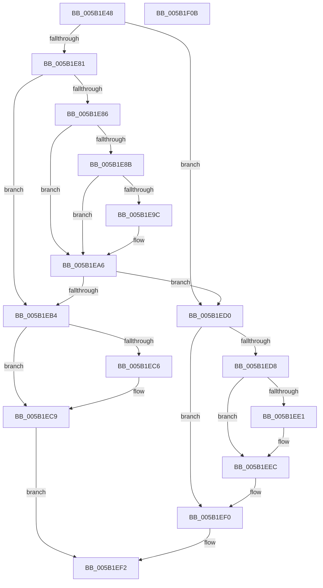

# KiEnumerateNmiSxCallback

- RVA: `0x005B1E48`–`0x005B1F0C` (길이 `196` bytes)
- VA: `0x00000001405B1E48`
- 실행 섹션: `.text`
- PDB 이름 있음: `예`; PDB Function 태그: `아니요`
- unwind 정보 RVA: `0x00060300`
- 디코드: `59`개 명령, `196/196` bytes 표시
- 미해석 바이트: `0` (있으면 어셈블리에 `.byte`로 보존)

> 이 문서는 커널 이미지의 기계어와 PDB 기호를 분석해 생성했습니다. 4번과 5번은 함수 원형과 자료형을 바이너리 사용 방식에서 추정한 C 해석이며 원본 소스 복구 결과는 아닙니다.

## 1. Dependencies

- 직접 호출 지점: **2**; 고유 호출 대상: **2**
- 직접 호출자로 확인된 함수: **2**
- RIP 상대 이미지 참조: **2**

### Outgoing calls
- `0x005B1EA1` → [KiRaiseIrqlProcessIrqlFlags](../4F/KiRaiseIrqlProcessIrqlFlags_function_004F56FC.md) (function, `0x004F56FC`)
- `0x005B1EE7` → [KiLowerIrqlProcessIrqlFlags](../4F/KiLowerIrqlProcessIrqlFlags_function_004F5698.md) (function, `0x004F5698`)

### Direct callers
- [KiEnumerateCallback](../4D/KiEnumerateCallback_function_004DFE00.md) at `0x004DFE5C`
- [MmIsVerifierApplicableToImage](../67/MmIsVerifierApplicableToImage_function_0067B5AC.md) at `0x0067B5FC`

### Static image references
- `0x005B1E70` → RVA `0x00F475A8` (`.data`; read)
- `0x005B1E93` → RVA `0x00FC6D20` (`ALMOSTRO`; read)

## 2. Other-region calls and transfers

- 다른 실행 섹션으로 향하는 call: **0**
- 별도 외부 분기/꼬리 이동을 확인하지 못했습니다.

## 3. Assembly (complete function range)

```asm
005B1E48  48 89 5C 24 08                  mov qword ptr [rsp + 8], rbx
005B1E4D  48 89 6C 24 10                  mov qword ptr [rsp + 0x10], rbp
005B1E52  48 89 74 24 18                  mov qword ptr [rsp + 0x18], rsi
005B1E57  57                              push rdi
005B1E58  41 56                           push r14
005B1E5A  41 57                           push r15
005B1E5C  48 83 EC 20                     sub rsp, 0x20
005B1E60  4D 8B F0                        mov r14, r8
005B1E63  48 8B F2                        mov rsi, rdx
005B1E66  48 8B F9                        mov rdi, rcx
005B1E69  44 0F 20 C3                     mov rbx, cr8
005B1E6D  4C 8B 09                        mov r9, qword ptr [rcx]
005B1E70  4C 8D 3D 31 57 99 00            lea r15, [rip + 0x995731]
005B1E77  BD 02 00 00 00                  mov ebp, 2
005B1E7C  4D 3B CF                        cmp r9, r15
005B1E7F  74 4F                           je 0x1405b1ed0
005B1E81  4D 85 C9                        test r9, r9
005B1E84  75 2E                           jne 0x1405b1eb4
005B1E86  40 3A DD                        cmp bl, bpl
005B1E89  73 1B                           jae 0x1405b1ea6
005B1E8B  44 0F 20 C3                     mov rbx, cr8
005B1E8F  44 0F 22 C5                     mov cr8, rbp
005B1E93  44 39 0D 86 4E A1 00            cmp dword ptr [rip + 0xa14e86], r9d
005B1E9A  74 0A                           je 0x1405b1ea6
005B1E9C  40 8A D5                        mov dl, bpl
005B1E9F  8A CB                           mov cl, bl
005B1EA1  E8 56 38 F4 FF                  call 0x1404f56fc
005B1EA6  88 1E                           mov byte ptr [rsi], bl
005B1EA8  4C 8B 0D F9 56 99 00            mov r9, qword ptr [rip + 0x9956f9]
005B1EAF  4D 85 C9                        test r9, r9
005B1EB2  74 1C                           je 0x1405b1ed0
005B1EB4  49 8B 41 08                     mov rax, qword ptr [r9 + 8]
005B1EB8  49 89 06                        mov qword ptr [r14], rax
005B1EBB  49 8B 01                        mov rax, qword ptr [r9]
005B1EBE  48 89 07                        mov qword ptr [rdi], rax
005B1EC1  48 85 C0                        test rax, rax
005B1EC4  75 03                           jne 0x1405b1ec9
005B1EC6  4C 89 3F                        mov qword ptr [rdi], r15
005B1EC9  B8 01 00 00 00                  mov eax, 1
005B1ECE  EB 22                           jmp 0x1405b1ef2
005B1ED0  0F B6 1E                        movzx ebx, byte ptr [rsi]
005B1ED3  40 3A DD                        cmp bl, bpl
005B1ED6  73 18                           jae 0x1405b1ef0
005B1ED8  83 3D 41 4E A1 00 00            cmp dword ptr [rip + 0xa14e41], 0
005B1EDF  74 0B                           je 0x1405b1eec
005B1EE1  44 0F 20 C1                     mov rcx, cr8
005B1EE5  8A D3                           mov dl, bl
005B1EE7  E8 AC 37 F4 FF                  call 0x1404f5698
005B1EEC  44 0F 22 C3                     mov cr8, rbx
005B1EF0  33 C0                           xor eax, eax
005B1EF2  48 8B 5C 24 40                  mov rbx, qword ptr [rsp + 0x40]
005B1EF7  48 8B 6C 24 48                  mov rbp, qword ptr [rsp + 0x48]
005B1EFC  48 8B 74 24 50                  mov rsi, qword ptr [rsp + 0x50]
005B1F01  48 83 C4 20                     add rsp, 0x20
005B1F05  41 5F                           pop r15
005B1F07  41 5E                           pop r14
005B1F09  5F                              pop rdi
005B1F0A  C3                              ret
005B1F0B  CC                              int3
```

## 4. C-style interpretation (structured pseudocode)

```c
__int64 __fastcall KiEnumerateNmiSxCallback(__int64 a1, __int64 a2, __int64 a3)
{
    __int64 result;
    __int64 v_rsp;
    unsigned __int64 v_stack_p10;
    unsigned __int64 v_stack_p18;
    unsigned __int64 v_stack_p8;

    v_stack_p8 = v_rbx;
    v_stack_p10 = v_rbp;
    v_stack_p18 = v_rsi;
    v_rsp = (v_rsp) - (32);
    if ((*(unsigned __int64 *)(a1)) == (v_rip + 10049329)) goto loc_005B1ED0;
    if (*(unsigned __int64 *)(a1) != 0) goto loc_005B1EB4;
    if (((unsigned __int8)(v_cr8)) >= 2) goto loc_005B1EA6;
    if ((*(unsigned int *)(v_rip + 10571398)) != ((unsigned int)(*(unsigned __int64 *)(a1)))) {
        a2 = 2;
        a1 = (unsigned __int8)(v_cr8);
        result = KiRaiseIrqlProcessIrqlFlags(a1, a2, a3, *(unsigned __int64 *)(a1));
    }
    *(unsigned __int8 *)(a2) = (unsigned __int8)(v_cr8);
    if (*(unsigned __int64 *)(v_rip + 10049273) == 0) goto loc_005B1ED0;
loc_005B1EB4:
    *(unsigned __int64 *)(a3) = *(unsigned __int64 *)(*(unsigned __int64 *)(v_rip + 10049273) + 8);
    *(unsigned __int64 *)(a1) = *(unsigned __int64 *)(*(unsigned __int64 *)(v_rip + 10049273));
    if (*(unsigned __int64 *)(*(unsigned __int64 *)(v_rip + 10049273)) == 0) {
        *(unsigned __int64 *)(a1) = v_rip + 10049329;
    }
    goto loc_005B1EF2;
loc_005B1ED0:
    if (((unsigned __int8)(*(unsigned __int8 *)(a2))) >= 2) goto loc_005B1EF0;
    result = 1;
    if ((*(unsigned int *)(v_rip + 10571329)) != 0) {
        a1 = 2;
        a2 = (unsigned __int8)(*(unsigned __int8 *)(a2));
        result = KiLowerIrqlProcessIrqlFlags(a1, a2, a3, *(unsigned __int64 *)(v_rip + 10049273));
    }
loc_005B1EF0:
    result = 0;
loc_005B1EF2:
    v_rsp = (v_rsp) + (32);
    return result;
}
```

## 5. (Beta) C Style

```c
int64_t KiEnumerateNmiSxCallback(void *Arg1, void *Arg2, void *Arg3)
{
    uint8_t *arg1 = (uint8_t *)Arg1;
    uint8_t *arg2 = (uint8_t *)Arg2;
    uint8_t *arg3 = (uint8_t *)Arg3;

    int64_t result;
    int64_t local_rsp;
    uint64_t v_stack_p10;
    uint64_t v_stack_p18;
    uint64_t v_stack_p8;

    v_stack_p8 = local_rbx;
    v_stack_p10 = local_rbp;
    v_stack_p18 = local_rsi;
    local_rsp = (local_rsp) - (32);
    if ((*(uint64_t *)(arg1)) == (v_rip + 10049329)) goto loc_005B1ED0;
    if (*(uint64_t *)(arg1) != 0) goto loc_005B1EB4;
    if (((uint8_t)(v_cr8)) >= 2) goto loc_005B1EA6;
    if ((*(uint32_t *)(v_rip + 0xA14E86)) != ((uint32_t)(*(uint64_t *)(arg1)))) {
        Arg2 = 2;
        Arg1 = (uint8_t)(v_cr8);
        result = KiRaiseIrqlProcessIrqlFlags(Arg1, Arg2, Arg3, *(uint64_t *)(arg1));
    }
    *(uint8_t *)(arg2) = (uint8_t)(v_cr8);
    if (*(uint64_t *)(v_rip + 0x9956F9) == 0) goto loc_005B1ED0;
loc_005B1EB4:
    *(uint64_t *)(arg3) = *(uint64_t *)(*(uint64_t *)(v_rip + 0x9956F9) + 0x8);
    *(uint64_t *)(arg1) = *(uint64_t *)(*(uint64_t *)(v_rip + 0x9956F9));
    if (*(uint64_t *)(*(uint64_t *)(v_rip + 0x9956F9)) == 0) {
        *(uint64_t *)(arg1) = v_rip + 10049329;
    }
    goto loc_005B1EF2;
loc_005B1ED0:
    if (((uint8_t)(*(uint8_t *)(arg2))) >= 2) goto loc_005B1EF0;
    result = 1;
    if ((*(uint32_t *)(v_rip + 0xA14E41)) != 0) {
        Arg1 = 2;
        Arg2 = (uint8_t)(*(uint8_t *)(arg2));
        result = KiLowerIrqlProcessIrqlFlags(Arg1, Arg2, Arg3, *(uint64_t *)(v_rip + 0x9956F9));
    }
loc_005B1EF0:
    result = 0;
loc_005B1EF2:
    local_rsp = (local_rsp) + (32);
    return result;
}
```

### 관측된 메모리 오프셋

구조체 형식이 확인되지 않은 접근은 인자 기준의 오프셋으로만 기록했습니다.

| 기준 인자 | 오프셋 표현 | 폭 (bit) | 접근 |
|---|---:|---:|---|
| `Arg1` | `+ 0x0` | `64` | `R` |
| `Arg1` | `+ 0x0` | `64` | `W` |
| `Arg2` | `+ 0x0` | `8` | `R` |
| `Arg2` | `+ 0x0` | `8` | `W` |
| `Arg3` | `+ 0x0` | `64` | `W` |

## 6. Execution-region graph

[열기: 2D/3D 그래프와 함수 탐색 컨트롤 패널](../../../control-panel.html?section=text&rva=0x005B1E48&view=graph)

- 2D 그래프는 위에서 아래로 흐르고, 3D 그래프는 빈 공간을 드래그해 회전합니다. Shift+드래그는 이동, 휠은 확대·축소, 함수 노드 선택은 대상 보고서 이동입니다.

### Static fallback


