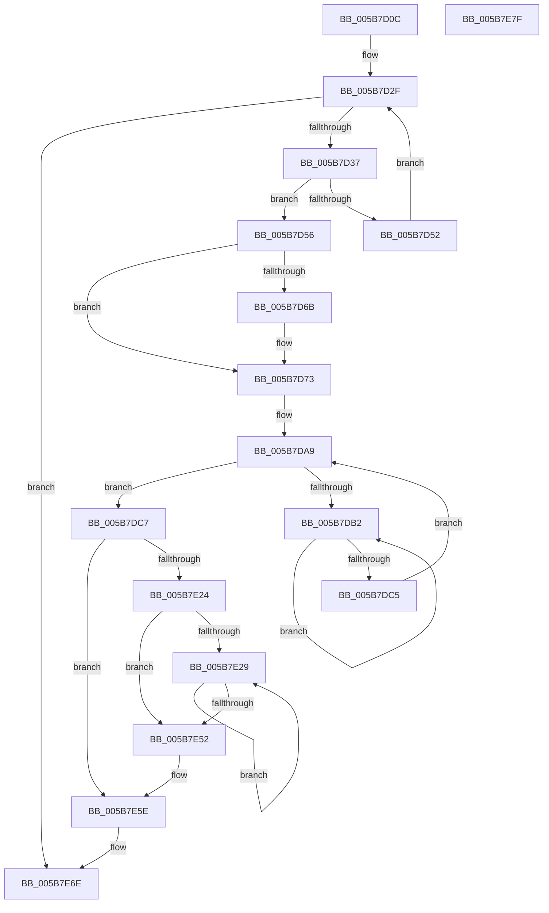

# KiFinalizeCoreControlBlockAssignment

- RVA: `0x005B7D0C`–`0x005B7E80` (길이 `372` bytes)
- VA: `0x00000001405B7D0C`
- 실행 섹션: `.text`
- PDB 이름 있음: `예`; PDB Function 태그: `아니요`
- unwind 정보 RVA: `0x000C9EF4`
- 디코드: `102`개 명령, `372/372` bytes 표시
- 미해석 바이트: `0` (있으면 어셈블리에 `.byte`로 보존)

> 이 문서는 커널 이미지의 기계어와 PDB 기호를 분석해 생성했습니다. 4번과 5번은 함수 원형과 자료형을 바이너리 사용 방식에서 추정한 C 해석이며 원본 소스 복구 결과는 아닙니다.

## 1. Dependencies

- 직접 호출 지점: **13**; 고유 호출 대상: **13**
- 직접 호출자로 확인된 함수: **2**
- RIP 상대 이미지 참조: **2**

### Outgoing calls
- `0x005B7D6E` → [KiRaiseIrqlProcessIrqlFlags](../4F/KiRaiseIrqlProcessIrqlFlags_function_004F56FC.md) (function, `0x004F56FC`)
- `0x005B7D8E` → [memset](../6C/memset_function_006C6C40.md) (function, `0x006C6C40`)
- `0x005B7DA0` → [KiAcquirePrcbLocksForIsolationUnit](../30/KiAcquirePrcbLocksForIsolationUnit_function_0030ED60.md) (function, `0x0030ED60`)
- `0x005B7DB7` → [KeYieldProcessorEx](../3F/KeYieldProcessorEx_function_003FBD00.md) (function, `0x003FBD00`)
- `0x005B7DD2` → [KiStartRescheduleContext](../30/KiStartRescheduleContext_function_0030C6B0.md) (function, `0x0030C6B0`)
- `0x005B7DE1` → [KiRemoveProcessorFromCoreControlBlock](KiRemoveProcessorFromCoreControlBlock_function_005BCDFC.md) (function, `0x005BCDFC`)
- `0x005B7DEC` → [KiAddProcessorToCoreControlBlock](KiAddProcessorToCoreControlBlock_function_005BBECC.md) (function, `0x005BBECC`)
- `0x005B7DF7` → [KiAdjustRescheduleContextForProcessorAddition](../5C/KiAdjustRescheduleContextForProcessorAddition_function_005C9284.md) (function, `0x005C9284`)
- `0x005B7E0F` → [KiCommitRescheduleContext](../30/KiCommitRescheduleContext_function_0030CF20.md) (function, `0x0030CF20`)
- `0x005B7E1B` → [KiReleasePrcbLocksForIsolationUnit](../39/KiReleasePrcbLocksForIsolationUnit_function_00399C50.md) (function, `0x00399C50`)
- `0x005B7E43` → [KiCompleteRescheduleContextEntry](../35/KiCompleteRescheduleContextEntry_function_00356330.md) (function, `0x00356330`)
- `0x005B7E59` → [KiFlushSoftwareInterruptBatch](../25/KiFlushSoftwareInterruptBatch_function_00252200.md) (function, `0x00252200`)
- `0x005B7E69` → [KiProcessDeferredReadyList](../25/KiProcessDeferredReadyList_function_00250800.md) (function, `0x00250800`)

### Direct callers
- [KiInitializeDynamicProcessorDpc](../../pagelk/B6/KiInitializeDynamicProcessorDpc_function_00B67A30.md) at `0x00B67BA9`
- [KiConfigureAllSchedulingInformation](../../init/C3/KiConfigureAllSchedulingInformation_function_00C380D0.md) at `0x00C3814F`

### Static image references
- `0x005B7D39` → RVA `0x00FC8C40` (`ALMOSTRO`; read)
- `0x005B7D63` → RVA `0x00FC6D20` (`ALMOSTRO`; read)

## 2. Other-region calls and transfers

- 다른 실행 섹션으로 향하는 call: **0**
- 별도 외부 분기/꼬리 이동을 확인하지 못했습니다.

## 3. Assembly (complete function range)

```asm
005B7D0C  48 89 5C 24 20                  mov qword ptr [rsp + 0x20], rbx
005B7D11  88 54 24 10                     mov byte ptr [rsp + 0x10], dl
005B7D15  55                              push rbp
005B7D16  56                              push rsi
005B7D17  57                              push rdi
005B7D18  41 56                           push r14
005B7D1A  41 57                           push r15
005B7D1C  48 83 EC 20                     sub rsp, 0x20
005B7D20  48 8B F1                        mov rsi, rcx
005B7D23  33 FF                           xor edi, edi
005B7D25  48 89 7C 24 50                  mov qword ptr [rsp + 0x50], rdi
005B7D2A  8B CF                           mov ecx, edi
005B7D2C  8B 56 24                        mov edx, dword ptr [rsi + 0x24]
005B7D2F  3B CA                           cmp ecx, edx
005B7D31  0F 83 37 01 00 00               jae 0x1405b7e6e
005B7D37  8B C1                           mov eax, ecx
005B7D39  48 8D 1D 00 0F A1 00            lea rbx, [rip + 0xa10f00]
005B7D40  48 8B 1C C3                     mov rbx, qword ptr [rbx + rax*8]
005B7D44  8B 86 1C 8E 00 00               mov eax, dword ptr [rsi + 0x8e1c]
005B7D4A  39 83 1C 8E 00 00               cmp dword ptr [rbx + 0x8e1c], eax
005B7D50  74 04                           je 0x1405b7d56
005B7D52  FF C1                           inc ecx
005B7D54  EB D9                           jmp 0x1405b7d2f
005B7D56  45 0F 20 C7                     mov r15, cr8
005B7D5A  BA 02 00 00 00                  mov edx, 2
005B7D5F  44 0F 22 C2                     mov cr8, rdx
005B7D63  39 3D B7 EF A0 00               cmp dword ptr [rip + 0xa0efb7], edi
005B7D69  74 08                           je 0x1405b7d73
005B7D6B  41 8A CF                        mov cl, r15b
005B7D6E  E8 89 D9 F3 FF                  call 0x1404f56fc
005B7D73  65 48 8B 2C 25 20 00 00 00      mov rbp, qword ptr gs:[0x20]
005B7D7C  33 D2                           xor edx, edx
005B7D7E  41 B8 F0 00 00 00               mov r8d, 0xf0
005B7D84  4C 8B B5 E8 37 00 00            mov r14, qword ptr [rbp + 0x37e8]
005B7D8B  49 8B CE                        mov rcx, r14
005B7D8E  E8 AD EE 10 00                  call 0x1406c6c40
005B7D93  4C 8D 44 24 50                  lea r8, [rsp + 0x50]
005B7D98  BA 01 00 00 00                  mov edx, 1
005B7D9D  48 8B CB                        mov rcx, rbx
005B7DA0  E8 BB 6F D5 FF                  call 0x14030ed60
005B7DA5  89 7C 24 58                     mov dword ptr [rsp + 0x58], edi
005B7DA9  F0 48 0F BA 6E 30 00            lock bts qword ptr [rsi + 0x30], 0
005B7DB0  73 15                           jae 0x1405b7dc7
005B7DB2  48 8D 4C 24 58                  lea rcx, [rsp + 0x58]
005B7DB7  E8 44 3F E4 FF                  call 0x1403fbd00
005B7DBC  48 8B 46 30                     mov rax, qword ptr [rsi + 0x30]
005B7DC0  48 85 C0                        test rax, rax
005B7DC3  75 ED                           jne 0x1405b7db2
005B7DC5  EB E2                           jmp 0x1405b7da9
005B7DC7  45 33 C0                        xor r8d, r8d
005B7DCA  48 8D 54 24 50                  lea rdx, [rsp + 0x50]
005B7DCF  49 8B CE                        mov rcx, r14
005B7DD2  E8 D9 48 D5 FF                  call 0x14030c6b0
005B7DD7  48 8B 9B 58 8E 00 00            mov rbx, qword ptr [rbx + 0x8e58]
005B7DDE  48 8B CE                        mov rcx, rsi
005B7DE1  E8 16 50 00 00                  call 0x1405bcdfc
005B7DE6  48 8B D6                        mov rdx, rsi
005B7DE9  48 8B CB                        mov rcx, rbx
005B7DEC  E8 DB 40 00 00                  call 0x1405bbecc
005B7DF1  48 8B D6                        mov rdx, rsi
005B7DF4  49 8B CE                        mov rcx, r14
005B7DF7  E8 88 14 01 00                  call 0x1405c9284
005B7DFC  4C 8D 4C 24 60                  lea r9, [rsp + 0x60]
005B7E01  48 89 7C 24 60                  mov qword ptr [rsp + 0x60], rdi
005B7E06  45 33 C0                        xor r8d, r8d
005B7E09  48 8B D5                        mov rdx, rbp
005B7E0C  49 8B CE                        mov rcx, r14
005B7E0F  E8 0C 51 D5 FF                  call 0x14030cf20
005B7E14  48 8D 4C 24 50                  lea rcx, [rsp + 0x50]
005B7E19  8A D8                           mov bl, al
005B7E1B  E8 30 1E DE FF                  call 0x140399c50
005B7E20  84 DB                           test bl, bl
005B7E22  74 3A                           je 0x1405b7e5e
005B7E24  41 38 3E                        cmp byte ptr [r14], dil
005B7E27  76 29                           jbe 0x1405b7e52
005B7E29  8B C7                           mov eax, edi
005B7E2B  45 33 C9                        xor r9d, r9d
005B7E2E  45 33 C0                        xor r8d, r8d
005B7E31  48 8B D5                        mov rdx, rbp
005B7E34  48 8D 0C 85 02 00 00 00         lea rcx, [rax*4 + 2]
005B7E3C  48 03 C8                        add rcx, rax
005B7E3F  49 8D 0C CE                     lea rcx, [r14 + rcx*8]
005B7E43  E8 E8 E4 D9 FF                  call 0x140356330
005B7E48  41 0F B6 06                     movzx eax, byte ptr [r14]
005B7E4C  FF C7                           inc edi
005B7E4E  3B F8                           cmp edi, eax
005B7E50  72 D7                           jb 0x1405b7e29
005B7E52  48 8D 8D D8 35 00 00            lea rcx, [rbp + 0x35d8]
005B7E59  E8 A2 A3 C9 FF                  call 0x140252200
005B7E5E  45 8A C7                        mov r8b, r15b
005B7E61  48 8D 54 24 60                  lea rdx, [rsp + 0x60]
005B7E66  48 8B CD                        mov rcx, rbp
005B7E69  E8 92 89 C9 FF                  call 0x140250800
005B7E6E  48 8B 5C 24 68                  mov rbx, qword ptr [rsp + 0x68]
005B7E73  48 83 C4 20                     add rsp, 0x20
005B7E77  41 5F                           pop r15
005B7E79  41 5E                           pop r14
005B7E7B  5F                              pop rdi
005B7E7C  5E                              pop rsi
005B7E7D  5D                              pop rbp
005B7E7E  C3                              ret
005B7E7F  CC                              int3
```

## 4. C-style interpretation (structured pseudocode)

```c
__int64 __fastcall KiFinalizeCoreControlBlockAssignment(__int64 a1, unsigned __int8 a2)
{
    __int64 result;
    __int64 v_rdi;
    __int64 v_rsp;
    unsigned __int8 v_stack_p10;
    unsigned __int64 v_stack_p18;
    unsigned __int64 v_stack_p20;
    unsigned __int64 v_stack_p8;

    v_stack_p20 = v_rbx;
    v_stack_p10 = a2;
    v_rsp = (v_rsp) - (32);
    v_rdi = 0;
    v_stack_p8 = 0;
loc_005B7D2F:
    if (0 >= ((unsigned int)((unsigned int)(*(unsigned int *)(a1 + 36))))) goto loc_005B7E6E;
    if ((*(unsigned int *)(*(unsigned __int64 *)(v_rip + 10555136 + 0 * 8) + 36380)) == ((unsigned int)((unsigned int)(*(unsigned int *)(a1 + 36380))))) goto loc_005B7D56;
    a1 = (unsigned int)((0) + 1);
    goto loc_005B7D2F;
loc_005B7D56:
    result = (unsigned int)(*(unsigned int *)(a1 + 36380));
    if ((*(unsigned int *)(v_rip + 10547127)) != 0) {
        a1 = (unsigned __int8)(v_cr8);
        result = KiRaiseIrqlProcessIrqlFlags(a1, 2, a3, a4);
    }
    a2 = 0;
    result = memset(*(unsigned __int64 *)(*(unsigned __int64 *)(gs_base + (0 + 32)) + 14312), a2, 240, a4);
    result = KiAcquirePrcbLocksForIsolationUnit(*(unsigned __int64 *)(v_rip + 10555136 + 0 * 8), 1, v_stack_p8, a4);
    v_stack_p10 = 0;
loc_005B7DA9:
    if (condition_is_above_or_equal) goto loc_005B7DC7;
loc_005B7DB2:
    result = KeYieldProcessorEx(v_stack_p10, 1, v_stack_p8, a4);
    if (*(unsigned __int64 *)(a1 + 48) != 0) goto loc_005B7DB2;
    goto loc_005B7DA9;
loc_005B7DC7:
    a3 = 0;
    result = KiStartRescheduleContext(*(unsigned __int64 *)(*(unsigned __int64 *)(gs_base + (0 + 32)) + 14312), v_stack_p8, a3, a4);
    result = KiRemoveProcessorFromCoreControlBlock(a1, v_stack_p8, a3, a4);
    result = KiAddProcessorToCoreControlBlock(*(unsigned __int64 *)(*(unsigned __int64 *)(v_rip + 10555136 + 0 * 8) + 36440), a1, a3, a4);
    result = KiAdjustRescheduleContextForProcessorAddition(*(unsigned __int64 *)(*(unsigned __int64 *)(gs_base + (0 + 32)) + 14312), a1, a3, a4);
    v_stack_p18 = 0;
    a3 = 0;
    result = KiCommitRescheduleContext(*(unsigned __int64 *)(*(unsigned __int64 *)(gs_base + (0 + 32)) + 14312), *(unsigned __int64 *)(gs_base + (0 + 32)), a3, v_stack_p18);
    result = KiReleasePrcbLocksForIsolationUnit(v_stack_p8, *(unsigned __int64 *)(gs_base + (0 + 32)), a3, v_stack_p18);
    if ((unsigned __int8)((unsigned __int8)(result)) == 0) goto loc_005B7E5E;
    if ((*(unsigned __int8 *)(*(unsigned __int64 *)(*(unsigned __int64 *)(gs_base + (0 + 32)) + 14312))) <= 0) goto loc_005B7E52;
loc_005B7E29:
    a4 = 0;
    a3 = 0;
    a1 = (0 * 4 + 2) + (0);
    result = KiCompleteRescheduleContextEntry(*(unsigned __int64 *)(*(unsigned __int64 *)(gs_base + (0 + 32)) + 14312) + a1 * 8, *(unsigned __int64 *)(gs_base + (0 + 32)), a3, a4);
    v_rdi = (unsigned int)((v_rdi) + 1);
    if (((unsigned int)(v_rdi)) < ((unsigned int)(*(unsigned __int8 *)(*(unsigned __int64 *)(*(unsigned __int64 *)(gs_base + (0 + 32)) + 14312))))) goto loc_005B7E29;
loc_005B7E52:
    result = KiFlushSoftwareInterruptBatch(*(unsigned __int64 *)(gs_base + (0 + 32)) + 13784, *(unsigned __int64 *)(gs_base + (0 + 32)), a3, a4);
loc_005B7E5E:
    result = KiProcessDeferredReadyList(*(unsigned __int64 *)(gs_base + (0 + 32)), v_stack_p18, (unsigned __int8)(v_cr8), a4);
loc_005B7E6E:
    v_rsp = (v_rsp) + (32);
    return result;
}
```

## 5. (Beta) C Style

```c
int64_t KiFinalizeCoreControlBlockAssignment(void *Arg1, uint8_t Arg2)
{
    uint8_t *arg1 = (uint8_t *)Arg1;

    int64_t result;
    int64_t local_rdi;
    int64_t local_rsp;
    uint8_t v_stack_p10;
    uint64_t v_stack_p18;
    uint64_t v_stack_p20;
    uint64_t v_stack_p8;

    v_stack_p20 = local_rbx;
    v_stack_p10 = Arg2;
    local_rsp = (local_rsp) - (32);
    local_rdi = 0;
    v_stack_p8 = 0;
loc_005B7D2F:
    if (0 >= ((uint32_t)((uint32_t)(*(uint32_t *)(arg1 + 0x24))))) goto loc_005B7E6E;
    if ((*(uint32_t *)(*(uint64_t *)(v_rip + 0xA10F00 + 0x0 * 8) + 0x8E1C)) == ((uint32_t)((uint32_t)(*(uint32_t *)(arg1 + 0x8E1C))))) goto loc_005B7D56;
    Arg1 = (uint32_t)((0) + 1);
    goto loc_005B7D2F;
loc_005B7D56:
    result = (uint32_t)(*(uint32_t *)(arg1 + 0x8E1C));
    if ((*(uint32_t *)(v_rip + 0xA0EFB7)) != 0) {
        Arg1 = (uint8_t)(v_cr8);
        result = KiRaiseIrqlProcessIrqlFlags(Arg1, 2, a3, a4);
    }
    Arg2 = 0;
    result = memset(*(uint64_t *)(*(uint64_t *)(gs_base + (0 + 0x20)) + 0x37E8), Arg2, 240, a4);
    result = KiAcquirePrcbLocksForIsolationUnit(*(uint64_t *)(v_rip + 0xA10F00 + 0x0 * 8), 1, v_stack_p8, a4);
    v_stack_p10 = 0;
loc_005B7DA9:
    if (condition_is_above_or_equal) goto loc_005B7DC7;
loc_005B7DB2:
    result = KeYieldProcessorEx(v_stack_p10, 1, v_stack_p8, a4);
    if (*(uint64_t *)(arg1 + 0x30) != 0) goto loc_005B7DB2;
    goto loc_005B7DA9;
loc_005B7DC7:
    a3 = 0;
    result = KiStartRescheduleContext(*(uint64_t *)(*(uint64_t *)(gs_base + (0 + 0x20)) + 0x37E8), v_stack_p8, a3, a4);
    result = KiRemoveProcessorFromCoreControlBlock(Arg1, v_stack_p8, a3, a4);
    result = KiAddProcessorToCoreControlBlock(*(uint64_t *)(*(uint64_t *)(v_rip + 0xA10F00 + 0x0 * 8) + 0x8E58), Arg1, a3, a4);
    result = KiAdjustRescheduleContextForProcessorAddition(*(uint64_t *)(*(uint64_t *)(gs_base + (0 + 0x20)) + 0x37E8), Arg1, a3, a4);
    v_stack_p18 = 0;
    a3 = 0;
    result = KiCommitRescheduleContext(*(uint64_t *)(*(uint64_t *)(gs_base + (0 + 0x20)) + 0x37E8), *(uint64_t *)(gs_base + (0 + 0x20)), a3, v_stack_p18);
    result = KiReleasePrcbLocksForIsolationUnit(v_stack_p8, *(uint64_t *)(gs_base + (0 + 0x20)), a3, v_stack_p18);
    if ((uint8_t)((uint8_t)(result)) == 0) goto loc_005B7E5E;
    if ((*(uint8_t *)(*(uint64_t *)(*(uint64_t *)(gs_base + (0 + 0x20)) + 0x37E8))) <= 0) goto loc_005B7E52;
loc_005B7E29:
    a4 = 0;
    a3 = 0;
    Arg1 = (0 * 4 + 2) + (0);
    result = KiCompleteRescheduleContextEntry(*(uint64_t *)(*(uint64_t *)(gs_base + (0 + 0x20)) + 0x37E8) + Arg1 * 8, *(uint64_t *)(gs_base + (0 + 0x20)), a3, a4);
    local_rdi = (uint32_t)((local_rdi) + 1);
    if (((uint32_t)(local_rdi)) < ((uint32_t)(*(uint8_t *)(*(uint64_t *)(*(uint64_t *)(gs_base + (0 + 0x20)) + 0x37E8))))) goto loc_005B7E29;
loc_005B7E52:
    result = KiFlushSoftwareInterruptBatch(*(uint64_t *)(gs_base + (0 + 0x20)) + 13784, *(uint64_t *)(gs_base + (0 + 0x20)), a3, a4);
loc_005B7E5E:
    result = KiProcessDeferredReadyList(*(uint64_t *)(gs_base + (0 + 0x20)), v_stack_p18, (uint8_t)(v_cr8), a4);
loc_005B7E6E:
    local_rsp = (local_rsp) + (32);
    return result;
}
```

### 관측된 메모리 오프셋

구조체 형식이 확인되지 않은 접근은 인자 기준의 오프셋으로만 기록했습니다.

| 기준 인자 | 오프셋 표현 | 폭 (bit) | 접근 |
|---|---:|---:|---|
| `Arg1` | `+ 0x24` | `32` | `R` |
| `Arg1` | `+ 0x30` | `64` | `R` |
| `Arg1` | `+ 0x30` | `64` | `R/W` |
| `Arg1` | `+ 0x8E1C` | `32` | `R` |

## 6. Execution-region graph

[열기: 2D/3D 그래프와 함수 탐색 컨트롤 패널](../../../control-panel.html?section=text&rva=0x005B7D0C&view=graph)

- 2D 그래프는 위에서 아래로 흐르고, 3D 그래프는 빈 공간을 드래그해 회전합니다. Shift+드래그는 이동, 휠은 확대·축소, 함수 노드 선택은 대상 보고서 이동입니다.

### Static fallback


