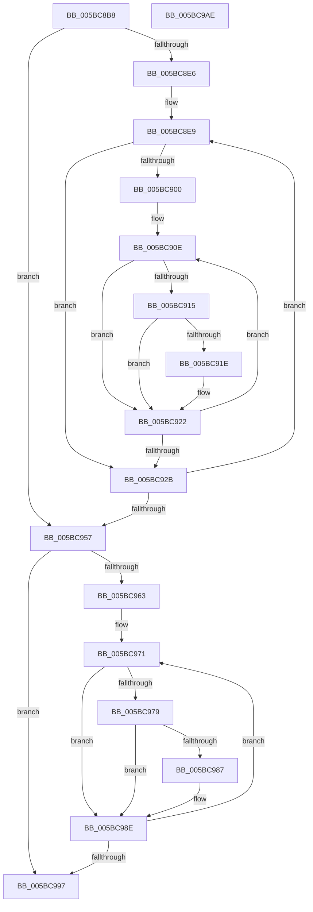

# KiFinalizeGroupAssignment

- RVA: `0x005BC8B8`–`0x005BC9AF` (길이 `247` bytes)
- VA: `0x00000001405BC8B8`
- 실행 섹션: `.text`
- PDB 이름 있음: `예`; PDB Function 태그: `아니요`
- unwind 정보 RVA: `0x000A6CEC`
- 디코드: `69`개 명령, `247/247` bytes 표시
- 미해석 바이트: `0` (있으면 어셈블리에 `.byte`로 보존)

> 이 문서는 커널 이미지의 기계어와 PDB 기호를 분석해 생성했습니다. 4번과 5번은 함수 원형과 자료형을 바이너리 사용 방식에서 추정한 C 해석이며 원본 소스 복구 결과는 아닙니다.

## 1. Dependencies

- 직접 호출 지점: **0**; 고유 호출 대상: **0**
- 직접 호출자로 확인된 함수: **1**
- RIP 상대 이미지 참조: **4**

### Outgoing calls
- 직접 디코드된 call 명령이 없습니다.

### Direct callers
- [KiPerformGroupConfiguration](../../init/C3/KiPerformGroupConfiguration_function_00C38FB0.md) at `0x00C39068`

### Static image references
- `0x005BC8CF` → RVA `0x00FCF6C0` (`CACHEALI`; read)
- `0x005BC8D6` → RVA `0x00FC5000` (`ALMOSTRO`; read)
- `0x005BC8E9` → RVA `0x00F21AC8` (`.data`; read)
- `0x005BC900` → RVA `0x00F21AF0` (`.data`; read)

## 2. Other-region calls and transfers

- 다른 실행 섹션으로 향하는 call: **0**
- 별도 외부 분기/꼬리 이동을 확인하지 못했습니다.

## 3. Assembly (complete function range)

```asm
005BC8B8  48 8B C4                        mov rax, rsp
005BC8BB  48 89 58 08                     mov qword ptr [rax + 8], rbx
005BC8BF  48 89 68 10                     mov qword ptr [rax + 0x10], rbp
005BC8C3  48 89 70 18                     mov qword ptr [rax + 0x18], rsi
005BC8C7  48 89 78 20                     mov qword ptr [rax + 0x20], rdi
005BC8CB  41 56                           push r14
005BC8CD  33 ED                           xor ebp, ebp
005BC8CF  4C 8D 35 EA 2D A1 00            lea r14, [rip + 0xa12dea]
005BC8D6  66 3B 2D 23 87 A0 00            cmp bp, word ptr [rip + 0xa08723]
005BC8DD  44 0F B7 D5                     movzx r10d, bp
005BC8E1  8D 75 01                        lea esi, [rbp + 1]
005BC8E4  73 71                           jae 0x1405bc957
005BC8E6  49 8B DE                        mov rbx, r14
005BC8E9  0F B7 15 D8 51 96 00            movzx edx, word ptr [rip + 0x9651d8]
005BC8F0  44 0F B7 DD                     movzx r11d, bp
005BC8F4  48 8B 3B                        mov rdi, qword ptr [rbx]
005BC8F7  44 0F B7 C5                     movzx r8d, bp
005BC8FB  66 3B EA                        cmp bp, dx
005BC8FE  73 2B                           jae 0x1405bc92b
005BC900  48 8B 0D E9 51 96 00            mov rcx, qword ptr [rip + 0x9651e9]
005BC907  44 8B CA                        mov r9d, edx
005BC90A  48 83 C1 05                     add rcx, 5
005BC90E  66 44 39 51 FD                  cmp word ptr [rcx - 3], r10w
005BC913  75 0D                           jne 0x1405bc922
005BC915  66 44 03 DE                     add r11w, si
005BC919  40 84 31                        test byte ptr [rcx], sil
005BC91C  74 04                           je 0x1405bc922
005BC91E  66 44 03 C6                     add r8w, si
005BC922  48 83 C1 18                     add rcx, 0x18
005BC926  4C 2B CE                        sub r9, rsi
005BC929  75 E3                           jne 0x1405bc90e
005BC92B  8A 4F 0A                        mov cl, byte ptr [rdi + 0xa]
005BC92E  8A C1                           mov al, cl
005BC930  80 C9 02                        or cl, 2
005BC933  24 FD                           and al, 0xfd
005BC935  0F B6 C9                        movzx ecx, cl
005BC938  66 45 3B D8                     cmp r11w, r8w
005BC93C  0F B6 C0                        movzx eax, al
005BC93F  0F 45 C8                        cmovne ecx, eax
005BC942  66 44 03 D6                     add r10w, si
005BC946  48 83 C3 08                     add rbx, 8
005BC94A  88 4F 0A                        mov byte ptr [rdi + 0xa], cl
005BC94D  66 44 3B 15 AB 86 A0 00         cmp r10w, word ptr [rip + 0xa086ab]
005BC955  72 92                           jb 0x1405bc8e9
005BC957  0F B7 0D 6A 51 96 00            movzx ecx, word ptr [rip + 0x96516a]
005BC95E  66 3B E9                        cmp bp, cx
005BC961  73 34                           jae 0x1405bc997
005BC963  48 8B 15 86 51 96 00            mov rdx, qword ptr [rip + 0x965186]
005BC96A  44 8B C9                        mov r9d, ecx
005BC96D  48 83 C2 05                     add rdx, 5
005BC971  44 8A 02                        mov r8b, byte ptr [rdx]
005BC974  44 84 C6                        test sil, r8b
005BC977  74 15                           je 0x1405bc98e
005BC979  0F B7 42 FD                     movzx eax, word ptr [rdx - 3]
005BC97D  49 8B 04 C6                     mov rax, qword ptr [r14 + rax*8]
005BC981  F6 40 0A 02                     test byte ptr [rax + 0xa], 2
005BC985  75 07                           jne 0x1405bc98e
005BC987  41 80 E0 FE                     and r8b, 0xfe
005BC98B  44 88 02                        mov byte ptr [rdx], r8b
005BC98E  48 83 C2 18                     add rdx, 0x18
005BC992  4C 2B CE                        sub r9, rsi
005BC995  75 DA                           jne 0x1405bc971
005BC997  48 8B 5C 24 10                  mov rbx, qword ptr [rsp + 0x10]
005BC99C  48 8B 6C 24 18                  mov rbp, qword ptr [rsp + 0x18]
005BC9A1  48 8B 74 24 20                  mov rsi, qword ptr [rsp + 0x20]
005BC9A6  48 8B 7C 24 28                  mov rdi, qword ptr [rsp + 0x28]
005BC9AB  41 5E                           pop r14
005BC9AD  C3                              ret
005BC9AE  CC                              int3
```

## 4. C-style interpretation (structured pseudocode)

```c
__int64 __fastcall KiFinalizeGroupAssignment(void)
{
    __int64 result;
    __int64 v_r10;
    __int64 v_r11;
    __int64 v_rbp;
    __int64 v_rbx;
    unsigned __int64 v_stack_p10;
    unsigned __int64 v_stack_p18;
    unsigned __int64 v_stack_p20;
    unsigned __int64 v_stack_p8;

    *(unsigned __int64 *)(v_rsp + 8) = v_rbx;
    *(unsigned __int64 *)(v_rsp + 16) = v_rbp;
    *(unsigned __int64 *)(v_rsp + 24) = v_rsi;
    *(unsigned __int64 *)(v_rsp + 32) = v_rdi;
    v_rbp = 0;
    if (0 >= (*(unsigned __int16 *)(v_rip + 10520355))) goto loc_005BC957;
loc_005BC8E9:
    if (0 >= ((unsigned __int16)(*(unsigned __int16 *)(v_rip + 9851352)))) goto loc_005BC92B;
    a1 = (*(unsigned __int64 *)(v_rip + 9851369)) + (5);
loc_005BC90E:
    if ((*(unsigned __int16 *)(a1 - 3)) != 0) goto loc_005BC922;
    v_r11 = (unsigned __int16)((0) + ((unsigned __int16)(v_rbp + 1)));
    if (((*(unsigned __int8 *)(a1)) & ((unsigned __int8)(v_rbp + 1))) != 0) {
        a3 = (unsigned __int16)((0) + ((unsigned __int16)(v_rbp + 1)));
    }
    a1 = (a1) + (24);
    a4 = ((unsigned int)((unsigned int)(*(unsigned __int16 *)(v_rip + 9851352)))) - (v_rbp + 1);
    if (condition_is_not_equal) goto loc_005BC90E;
loc_005BC92B:
    a1 = (unsigned __int8)((*(unsigned __int8 *)(*(unsigned __int64 *)(v_rip + 10563050) + 10)) | (2));
    result = (unsigned __int8)(((unsigned __int8)(*(unsigned __int8 *)(*(unsigned __int64 *)(v_rip + 10563050) + 10))) & (253));
    a1 = (unsigned __int8)(a1);
    if (((unsigned __int16)(v_r11)) != ((unsigned __int16)(a3))) { a1 = (unsigned int)((unsigned __int8)(result)); }
    v_r10 = (unsigned __int16)((0) + ((unsigned __int16)(v_rbp + 1)));
    v_rbx = (v_rip + 10563050) + (8);
    *(unsigned __int8 *)(*(unsigned __int64 *)(v_rip + 10563050) + 10) = (unsigned __int8)(a1);
    if (((unsigned __int16)(v_r10)) < (*(unsigned __int16 *)(v_rip + 10520235))) goto loc_005BC8E9;
loc_005BC957:
    if (0 >= ((unsigned __int16)(*(unsigned __int16 *)(v_rip + 9851242)))) goto loc_005BC997;
    a2 = (*(unsigned __int64 *)(v_rip + 9851270)) + (5);
loc_005BC971:
    if ((((unsigned __int8)(v_rbp + 1)) & ((unsigned __int8)(*(unsigned __int8 *)(a2)))) == 0) goto loc_005BC98E;
    if (((*(unsigned __int8 *)(*(unsigned __int64 *)(v_rip + 10563050 + *(unsigned __int16 *)(a2 - 3) * 8) + 10)) & (2)) == 0) {
        a3 = (unsigned __int8)((*(unsigned __int8 *)(a2)) & (254));
        *(unsigned __int8 *)(a2) = (unsigned __int8)(a3);
    }
    a2 = (a2) + (24);
    a4 = ((unsigned int)((unsigned int)(*(unsigned __int16 *)(v_rip + 9851242)))) - (v_rbp + 1);
    if (condition_is_not_equal) goto loc_005BC971;
loc_005BC997:
    return *(unsigned __int64 *)(v_rip + 10563050 + *(unsigned __int16 *)(a2 - 3) * 8);
}
```

## 5. (Beta) C Style

```c
void KiFinalizeGroupAssignment(void)
{
    int64_t result;
    int64_t local_r10;
    int64_t local_r11;
    int64_t local_rbp;
    int64_t local_rbx;
    uint64_t v_stack_p10;
    uint64_t v_stack_p18;
    uint64_t v_stack_p20;
    uint64_t v_stack_p8;

    *(uint64_t *)(local_rsp + 0x8) = local_rbx;
    *(uint64_t *)(local_rsp + 0x10) = local_rbp;
    *(uint64_t *)(local_rsp + 0x18) = local_rsi;
    *(uint64_t *)(local_rsp + 0x20) = local_rdi;
    local_rbp = 0;
    if (0 >= (*(uint16_t *)(v_rip + 0xA08723))) goto loc_005BC957;
loc_005BC8E9:
    if (0 >= ((uint16_t)(*(uint16_t *)(v_rip + 0x9651D8)))) goto loc_005BC92B;
    a1 = (*(uint64_t *)(v_rip + 0x9651E9)) + (5);
loc_005BC90E:
    if ((*(uint16_t *)(a1 - 0x3)) != 0) goto loc_005BC922;
    local_r11 = (uint16_t)((0) + ((uint16_t)(local_rbp + 1)));
    if (((*(uint8_t *)(a1)) & ((uint8_t)(local_rbp + 1))) != 0) {
        a3 = (uint16_t)((0) + ((uint16_t)(local_rbp + 1)));
    }
    a1 = (a1) + (24);
    a4 = ((uint32_t)((uint32_t)(*(uint16_t *)(v_rip + 0x9651D8)))) - (local_rbp + 1);
    if (condition_is_not_equal) goto loc_005BC90E;
loc_005BC92B:
    a1 = (uint8_t)((*(uint8_t *)(*(uint64_t *)(v_rip + 0xA12DEA) + 0xA)) | (2));
    result = (uint8_t)(((uint8_t)(*(uint8_t *)(*(uint64_t *)(v_rip + 0xA12DEA) + 0xA))) & (253));
    a1 = (uint8_t)(a1);
    if (((uint16_t)(local_r11)) != ((uint16_t)(a3))) { a1 = (uint32_t)((uint8_t)(result)); }
    local_r10 = (uint16_t)((0) + ((uint16_t)(local_rbp + 1)));
    local_rbx = (v_rip + 10563050) + (8);
    *(uint8_t *)(*(uint64_t *)(v_rip + 0xA12DEA) + 0xA) = (uint8_t)(a1);
    if (((uint16_t)(local_r10)) < (*(uint16_t *)(v_rip + 0xA086AB))) goto loc_005BC8E9;
loc_005BC957:
    if (0 >= ((uint16_t)(*(uint16_t *)(v_rip + 0x96516A)))) goto loc_005BC997;
    a2 = (*(uint64_t *)(v_rip + 0x965186)) + (5);
loc_005BC971:
    if ((((uint8_t)(local_rbp + 1)) & ((uint8_t)(*(uint8_t *)(a2)))) == 0) goto loc_005BC98E;
    if (((*(uint8_t *)(*(uint64_t *)(v_rip + 0xA12DEA + *(uint16_t *)(a2 - 0x3) * 8) + 0xA)) & (2)) == 0) {
        a3 = (uint8_t)((*(uint8_t *)(a2)) & (254));
        *(uint8_t *)(a2) = (uint8_t)(a3);
    }
    a2 = (a2) + (24);
    a4 = ((uint32_t)((uint32_t)(*(uint16_t *)(v_rip + 0x96516A)))) - (local_rbp + 1);
    if (condition_is_not_equal) goto loc_005BC971;
loc_005BC997:
    return *(uint64_t *)(v_rip + 0xA12DEA + *(uint16_t *)(a2 - 0x3) * 8);
}
```

## 6. Execution-region graph

[열기: 2D/3D 그래프와 함수 탐색 컨트롤 패널](../../../control-panel.html?section=text&rva=0x005BC8B8&view=graph)

- 2D 그래프는 위에서 아래로 흐르고, 3D 그래프는 빈 공간을 드래그해 회전합니다. Shift+드래그는 이동, 휠은 확대·축소, 함수 노드 선택은 대상 보고서 이동입니다.

### Static fallback


