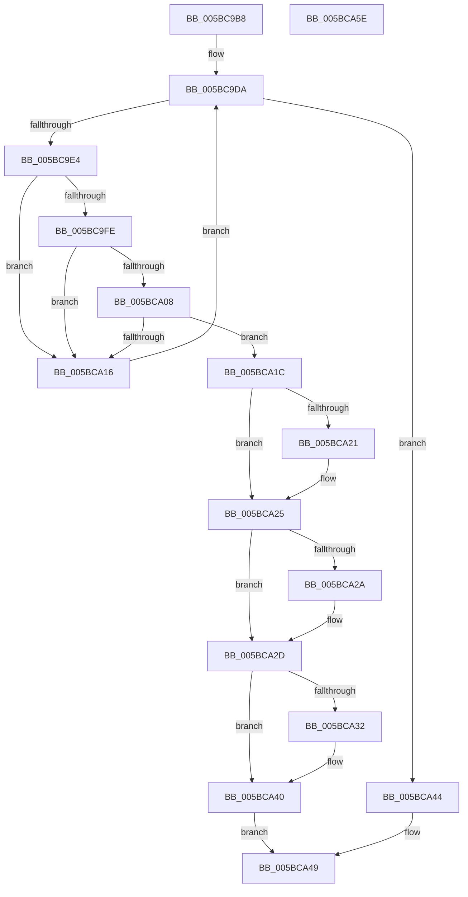

# KiFindSubNodeForProcessorNumber

- RVA: `0x005BC9B8`–`0x005BCA5F` (길이 `167` bytes)
- VA: `0x00000001405BC9B8`
- 실행 섹션: `.text`
- PDB 이름 있음: `예`; PDB Function 태그: `아니요`
- unwind 정보 RVA: `0x000A5A38`
- 디코드: `47`개 명령, `167/167` bytes 표시
- 미해석 바이트: `0` (있으면 어셈블리에 `.byte`로 보존)

> 이 문서는 커널 이미지의 기계어와 PDB 기호를 분석해 생성했습니다. 4번과 5번은 함수 원형과 자료형을 바이너리 사용 방식에서 추정한 C 해석이며 원본 소스 복구 결과는 아닙니다.

## 1. Dependencies

- 직접 호출 지점: **0**; 고유 호출 대상: **0**
- 직접 호출자로 확인된 함수: **2**
- RIP 상대 이미지 참조: **3**

### Outgoing calls
- 직접 디코드된 call 명령이 없습니다.

### Direct callers
- [KiAssignProcessorNumberToPrcb](KiAssignProcessorNumberToPrcb_function_005BC510.md) at `0x005BC53D`
- [KiFreeProcessorNumber](KiFreeProcessorNumber_function_005BCA68.md) at `0x005BCA91`

### Static image references
- `0x005BC9DA` → RVA `0x00F21AC8` (`.data`; read)
- `0x005BC9E4` → RVA `0x00F21AF0` (`.data`; read)
- `0x005BCA32` → RVA `0x00F21AD0` (`.data`; read)

## 2. Other-region calls and transfers

- 다른 실행 섹션으로 향하는 call: **0**
- 별도 외부 분기/꼬리 이동을 확인하지 못했습니다.

## 3. Assembly (complete function range)

```asm
005BC9B8  48 8B C4                        mov rax, rsp
005BC9BB  48 89 58 08                     mov qword ptr [rax + 8], rbx
005BC9BF  48 89 68 10                     mov qword ptr [rax + 0x10], rbp
005BC9C3  48 89 70 18                     mov qword ptr [rax + 0x18], rsi
005BC9C7  48 89 78 20                     mov qword ptr [rax + 0x20], rdi
005BC9CB  33 ED                           xor ebp, ebp
005BC9CD  4D 8B D8                        mov r11, r8
005BC9D0  44 0F B7 D5                     movzx r10d, bp
005BC9D4  48 8B FA                        mov rdi, rdx
005BC9D7  48 8B F1                        mov rsi, rcx
005BC9DA  66 44 3B 15 E6 50 96 00         cmp r10w, word ptr [rip + 0x9650e6]
005BC9E2  73 60                           jae 0x1405bca44
005BC9E4  48 8B 05 05 51 96 00            mov rax, qword ptr [rip + 0x965105]
005BC9EB  41 0F B7 DA                     movzx ebx, r10w
005BC9EF  48 8D 14 5B                     lea rdx, [rbx + rbx*2]
005BC9F3  4C 8D 04 D0                     lea r8, [rax + rdx*8]
005BC9F7  41 F6 40 05 01                  test byte ptr [r8 + 5], 1
005BC9FC  74 18                           je 0x1405bca16
005BC9FE  0F B7 06                        movzx eax, word ptr [rsi]
005BCA01  66 41 39 40 06                  cmp word ptr [r8 + 6], ax
005BCA06  75 0E                           jne 0x1405bca16
005BCA08  0F B6 4E 02                     movzx ecx, byte ptr [rsi + 2]
005BCA0C  49 8B 40 10                     mov rax, qword ptr [r8 + 0x10]
005BCA10  48 0F A3 C8                     bt rax, rcx
005BCA14  72 06                           jb 0x1405bca1c
005BCA16  66 41 FF C2                     inc r10w
005BCA1A  EB BE                           jmp 0x1405bc9da
005BCA1C  48 85 FF                        test rdi, rdi
005BCA1F  74 04                           je 0x1405bca25
005BCA21  66 44 89 17                     mov word ptr [rdi], r10w
005BCA25  4D 85 DB                        test r11, r11
005BCA28  74 03                           je 0x1405bca2d
005BCA2A  4D 89 03                        mov qword ptr [r11], r8
005BCA2D  4D 85 C9                        test r9, r9
005BCA30  74 0E                           je 0x1405bca40
005BCA32  48 8B 05 97 50 96 00            mov rax, qword ptr [rip + 0x965097]
005BCA39  48 8B 0C D8                     mov rcx, qword ptr [rax + rbx*8]
005BCA3D  49 89 09                        mov qword ptr [r9], rcx
005BCA40  33 C0                           xor eax, eax
005BCA42  EB 05                           jmp 0x1405bca49
005BCA44  B8 25 02 00 C0                  mov eax, 0xc0000225
005BCA49  48 8B 5C 24 08                  mov rbx, qword ptr [rsp + 8]
005BCA4E  48 8B 6C 24 10                  mov rbp, qword ptr [rsp + 0x10]
005BCA53  48 8B 74 24 18                  mov rsi, qword ptr [rsp + 0x18]
005BCA58  48 8B 7C 24 20                  mov rdi, qword ptr [rsp + 0x20]
005BCA5D  C3                              ret
005BCA5E  CC                              int3
```

## 4. C-style interpretation (structured pseudocode)

```c
__int64 __fastcall KiFindSubNodeForProcessorNumber(__int64 a1, __int64 a2, __int64 a3, __int64 a4)
{
    __int64 result;
    __int64 v_r10;
    __int64 v_rbp;
    unsigned __int64 v_stack_p10;
    unsigned __int64 v_stack_p18;
    unsigned __int64 v_stack_p20;
    unsigned __int64 v_stack_p8;

    *(unsigned __int64 *)(v_rsp + 8) = v_rbx;
    *(unsigned __int64 *)(v_rsp + 16) = v_rbp;
    *(unsigned __int64 *)(v_rsp + 24) = v_rsi;
    *(unsigned __int64 *)(v_rsp + 32) = v_rdi;
    v_rbp = 0;
loc_005BC9DA:
    if (0 >= (*(unsigned __int16 *)(v_rip + 9851110))) goto loc_005BCA44;
    if (((*(unsigned __int8 *)(*(unsigned __int64 *)(v_rip + 9851141) + 0 + 0 * 2 * 8 + 5)) & (1)) == 0) goto loc_005BCA16;
    if ((*(unsigned __int16 *)(*(unsigned __int64 *)(v_rip + 9851141) + 0 + 0 * 2 * 8 + 6)) != ((unsigned __int16)(*(unsigned __int16 *)(a1)))) goto loc_005BCA16;
    if ((*(unsigned __int16 *)(*(unsigned __int64 *)(v_rip + 9851141) + 0 + 0 * 2 * 8 + 6)) < ((unsigned __int16)(*(unsigned __int16 *)(a1)))) goto loc_005BCA1C;
loc_005BCA16:
    v_r10 = (unsigned __int16)((0) + 1);
    goto loc_005BC9DA;
loc_005BCA1C:
    if (a2 != 0) {
        *(unsigned __int16 *)(a2) = (unsigned __int16)(v_r10);
    }
    if (a3 != 0) {
        *(unsigned __int64 *)(a3) = *(unsigned __int64 *)(v_rip + 9851141) + 0 + 0 * 2 * 8;
    }
    result = *(unsigned __int64 *)(*(unsigned __int64 *)(v_rip + 9851141) + 0 + 0 * 2 * 8 + 16);
    if (a4 != 0) {
        result = *(unsigned __int64 *)(v_rip + 9851031);
        a1 = *(unsigned __int64 *)(result + 0 * 8);
        *(unsigned __int64 *)(a4) = a1;
    }
    result = 0;
    goto loc_005BCA49;
loc_005BCA44:
loc_005BCA49:
    return (unsigned int)(0xC0000225ULL);
}
```

## 5. (Beta) C Style

```c
int64_t KiFindSubNodeForProcessorNumber(void *Arg1, int64_t Arg2, int64_t Arg3, int64_t Arg4)
{
    uint8_t *arg1 = (uint8_t *)Arg1;

    int64_t result;
    int64_t local_r10;
    int64_t local_rbp;
    uint64_t v_stack_p10;
    uint64_t v_stack_p18;
    uint64_t v_stack_p20;
    uint64_t v_stack_p8;

    *(uint64_t *)(local_rsp + 0x8) = local_rbx;
    *(uint64_t *)(local_rsp + 0x10) = local_rbp;
    *(uint64_t *)(local_rsp + 0x18) = local_rsi;
    *(uint64_t *)(local_rsp + 0x20) = local_rdi;
    local_rbp = 0;
loc_005BC9DA:
    if (0 >= (*(uint16_t *)(v_rip + 0x9650E6))) goto loc_005BCA44;
    if (((*(uint8_t *)(*(uint64_t *)(v_rip + 0x965105) + 0x0 + 0x0 * 2 * 8 + 0x5)) & (1)) == 0) goto loc_005BCA16;
    if ((*(uint16_t *)(*(uint64_t *)(v_rip + 0x965105) + 0x0 + 0x0 * 2 * 8 + 0x6)) != ((uint16_t)(*(uint16_t *)(arg1)))) goto loc_005BCA16;
    if ((*(uint16_t *)(*(uint64_t *)(v_rip + 0x965105) + 0x0 + 0x0 * 2 * 8 + 0x6)) < ((uint16_t)(*(uint16_t *)(arg1)))) goto loc_005BCA1C;
loc_005BCA16:
    local_r10 = (uint16_t)((0) + 1);
    goto loc_005BC9DA;
loc_005BCA1C:
    if (Arg2 != 0) {
        *(uint16_t *)(Arg2) = (uint16_t)(local_r10);
    }
    if (Arg3 != 0) {
        *(uint64_t *)(Arg3) = *(uint64_t *)(v_rip + 0x965105) + 0 + 0 * 2 * 8;
    }
    result = *(uint64_t *)(*(uint64_t *)(v_rip + 0x965105) + 0x0 + 0x0 * 2 * 8 + 0x10);
    if (Arg4 != 0) {
        result = *(uint64_t *)(v_rip + 0x965097);
        Arg1 = *(uint64_t *)(result + 0x0 * 8);
        *(void **)(Arg4) = Arg1;
    }
    result = 0;
    goto loc_005BCA49;
loc_005BCA44:
loc_005BCA49:
    return (uint32_t)(0xC0000225ULL);
}
```

### 관측된 메모리 오프셋

구조체 형식이 확인되지 않은 접근은 인자 기준의 오프셋으로만 기록했습니다.

| 기준 인자 | 오프셋 표현 | 폭 (bit) | 접근 |
|---|---:|---:|---|
| `Arg1` | `+ 0x0` | `16` | `R` |
| `Arg1` | `+ 0x2` | `8` | `R` |

## 6. Execution-region graph

[열기: 2D/3D 그래프와 함수 탐색 컨트롤 패널](../../../control-panel.html?section=text&rva=0x005BC9B8&view=graph)

- 2D 그래프는 위에서 아래로 흐르고, 3D 그래프는 빈 공간을 드래그해 회전합니다. Shift+드래그는 이동, 휠은 확대·축소, 함수 노드 선택은 대상 보고서 이동입니다.

### Static fallback


