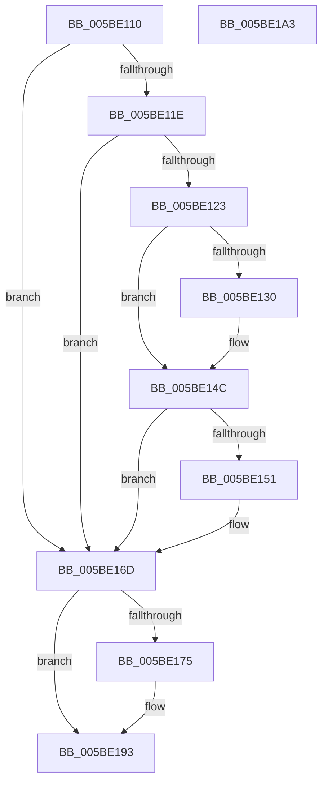

# KiFlushRangeAllCaches

- RVA: `0x005BE110`–`0x005BE1A4` (길이 `148` bytes)
- VA: `0x00000001405BE110`
- 실행 섹션: `.text`
- PDB 이름 있음: `예`; PDB Function 태그: `아니요`
- unwind 정보 RVA: `0x0005D2F4`
- 디코드: `42`개 명령, `148/148` bytes 표시
- 미해석 바이트: `0` (있으면 어셈블리에 `.byte`로 보존)

> 이 문서는 커널 이미지의 기계어와 PDB 기호를 분석해 생성했습니다. 4번과 5번은 함수 원형과 자료형을 바이너리 사용 방식에서 추정한 C 해석이며 원본 소스 복구 결과는 아닙니다.

## 1. Dependencies

- 직접 호출 지점: **4**; 고유 호출 대상: **2**
- 직접 호출자로 확인된 함수: **1**
- RIP 상대 이미지 참조: **1**

### Outgoing calls
- `0x005BE146` → [KeBugCheckEx](../4F/KeBugCheckEx_function_004FD660.md) (function, `0x004FD660`)
- `0x005BE167` → [KeBugCheckEx](../4F/KeBugCheckEx_function_004FD660.md) (function, `0x004FD660`)
- `0x005BE18D` → [KeBugCheckEx](../4F/KeBugCheckEx_function_004FD660.md) (function, `0x004FD660`)
- `0x005BE199` → [KeInvalidateRangeAllCaches](../30/KeInvalidateRangeAllCaches_function_00308880.md) (function, `0x00308880`)

### Direct callers
- [sub_006E9A0A](../6E/Unknown_function_006E9A0A.md) at `0x006E9AAF`

### Static image references
- `0x005BE123` → RVA `0x00FC5120` (`ALMOSTRO`; read)

## 2. Other-region calls and transfers

- 다른 실행 섹션으로 향하는 call: **0**
- 별도 외부 분기/꼬리 이동을 확인하지 못했습니다.

## 3. Assembly (complete function range)

```asm
005BE110  48 83 EC 38                     sub rsp, 0x38
005BE114  80 7C 24 60 00                  cmp byte ptr [rsp + 0x60], 0
005BE119  4C 8B D2                        mov r10, rdx
005BE11C  74 4F                           je 0x1405be16d
005BE11E  45 84 C9                        test r9b, r9b
005BE121  74 4A                           je 0x1405be16d
005BE123  8B 05 F7 6F A0 00               mov eax, dword ptr [rip + 0xa06ff7]
005BE129  FF C8                           dec eax
005BE12B  41 85 C2                        test r10d, eax
005BE12E  74 1C                           je 0x1405be14c
005BE130  4C 8B CA                        mov r9, rdx
005BE133  48 89 4C 24 20                  mov qword ptr [rsp + 0x20], rcx
005BE138  BA 1F 00 00 00                  mov edx, 0x1f
005BE13D  B9 E6 00 00 00                  mov ecx, 0xe6
005BE142  44 8D 42 E5                     lea r8d, [rdx - 0x1b]
005BE146  E8 15 F5 F3 FF                  call 0x1404fd660
005BE14B  CC                              int3
005BE14C  41 85 C0                        test r8d, eax
005BE14F  74 1C                           je 0x1405be16d
005BE151  BA 1F 00 00 00                  mov edx, 0x1f
005BE156  45 8B C8                        mov r9d, r8d
005BE159  48 89 4C 24 20                  mov qword ptr [rsp + 0x20], rcx
005BE15E  B9 E6 00 00 00                  mov ecx, 0xe6
005BE163  44 8D 42 E6                     lea r8d, [rdx - 0x1a]
005BE167  E8 F4 F4 F3 FF                  call 0x1404fd660
005BE16C  CC                              int3
005BE16D  44 0F 20 C0                     mov rax, cr8
005BE171  3C 0F                           cmp al, 0xf
005BE173  75 1E                           jne 0x1405be193
005BE175  48 83 64 24 20 00               and qword ptr [rsp + 0x20], 0
005BE17B  BA 64 00 00 00                  mov edx, 0x64
005BE180  41 B8 AD 0B 00 00               mov r8d, 0xbad
005BE186  8D 4A F1                        lea ecx, [rdx - 0xf]
005BE189  44 8D 4A 9D                     lea r9d, [rdx - 0x63]
005BE18D  E8 CE F4 F3 FF                  call 0x1404fd660
005BE192  CC                              int3
005BE193  41 8B D0                        mov edx, r8d
005BE196  49 8B CA                        mov rcx, r10
005BE199  E8 E2 A6 D4 FF                  call 0x140308880
005BE19E  48 83 C4 38                     add rsp, 0x38
005BE1A2  C3                              ret
005BE1A3  CC                              int3
```

## 4. C-style interpretation (structured pseudocode)

```c
__int64 __fastcall KiFlushRangeAllCaches(__int64 a1, __int64 a2, __int64 a3, unsigned __int8 a4, unsigned __int8 a5)
{
    __int64 result;
    __int64 v_rsp;
    unsigned __int64 v_stack_m18;

    v_rsp = (v_rsp) - (56);
    if (a5 == 0) goto loc_005BE16D;
    if (a4 == 0) goto loc_005BE16D;
    result = (unsigned int)(((unsigned int)(*(unsigned int *)(v_rip + 10514423))) - 1);
    if ((((unsigned int)(a2)) & ((unsigned int)(result))) != 0) {
        a4 = a2;
        v_stack_m18 = a1;
        a2 = 31;
        a1 = 230;
        a3 = a2 - 27;
        result = KeBugCheckEx(a1, a2, a3, a4);
    }
    if ((((unsigned int)(a3)) & ((unsigned int)(result))) != 0) {
        a2 = 31;
        a4 = (unsigned int)(a3);
        v_stack_m18 = a1;
        a1 = 230;
        a3 = a2 - 26;
        result = KeBugCheckEx(a1, a2, a3, a4);
    }
    result = v_cr8;
    if (((unsigned __int8)(v_cr8)) == 15) {
        a2 = 100;
        a3 = 0xBADULL;
        a1 = a2 - 15;
        a4 = a2 - 99;
        result = KeBugCheckEx(a1, a2, a3, a4);
    }
    result = KeInvalidateRangeAllCaches(a2, (unsigned int)((unsigned int)(a3)), a3, a4);
    v_rsp = (v_rsp) + (56);
    return result;
}
```

## 5. (Beta) C Style

```c
int64_t KiFlushRangeAllCaches(int64_t Arg1, int64_t Arg2, int64_t Arg3, uint8_t Arg4, uint8_t Arg5)
{
    int64_t result;
    int64_t local_rsp;
    uint64_t v_stack_m18;

    local_rsp = (local_rsp) - (56);
    if (Arg5 == 0) goto loc_005BE16D;
    if (Arg4 == 0) goto loc_005BE16D;
    result = (uint32_t)(((uint32_t)(*(uint32_t *)(v_rip + 0xA06FF7))) - 1);
    if ((((uint32_t)(Arg2)) & ((uint32_t)(result))) != 0) {
        Arg4 = Arg2;
        v_stack_m18 = Arg1;
        Arg2 = 31;
        Arg1 = 230;
        Arg3 = Arg2 - 27;
        result = KeBugCheckEx(Arg1, Arg2, Arg3, Arg4);
    }
    if ((((uint32_t)(Arg3)) & ((uint32_t)(result))) != 0) {
        Arg2 = 31;
        Arg4 = (uint32_t)(Arg3);
        v_stack_m18 = Arg1;
        Arg1 = 230;
        Arg3 = Arg2 - 26;
        result = KeBugCheckEx(Arg1, Arg2, Arg3, Arg4);
    }
    result = v_cr8;
    if (((uint8_t)(v_cr8)) == 15) {
        Arg2 = 100;
        Arg3 = 0xBADULL;
        Arg1 = Arg2 - 15;
        Arg4 = Arg2 - 99;
        result = KeBugCheckEx(Arg1, Arg2, Arg3, Arg4);
    }
    result = KeInvalidateRangeAllCaches(Arg2, (uint32_t)((uint32_t)(Arg3)), Arg3, Arg4);
    local_rsp = (local_rsp) + (56);
    return result;
}
```

## 6. Execution-region graph

[열기: 2D/3D 그래프와 함수 탐색 컨트롤 패널](../../../control-panel.html?section=text&rva=0x005BE110&view=graph)

- 2D 그래프는 위에서 아래로 흐르고, 3D 그래프는 빈 공간을 드래그해 회전합니다. Shift+드래그는 이동, 휠은 확대·축소, 함수 노드 선택은 대상 보고서 이동입니다.

### Static fallback


