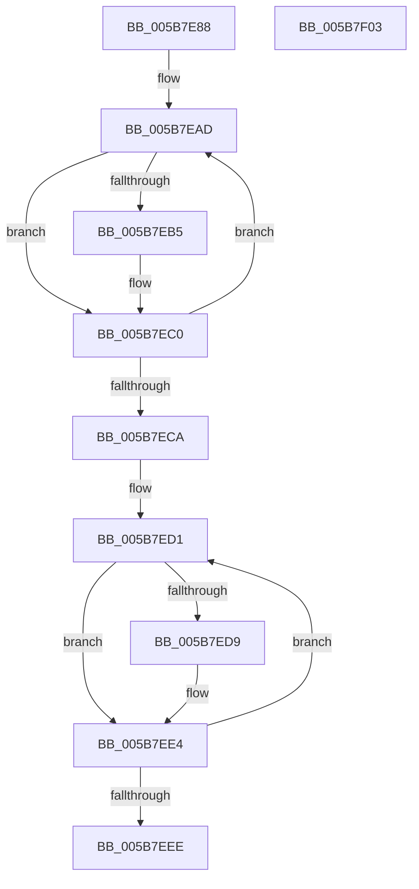

# KiFreeIdleSearchStructures

- RVA: `0x005B7E88`–`0x005B7F04` (길이 `124` bytes)
- VA: `0x00000001405B7E88`
- 실행 섹션: `.text`
- PDB 이름 있음: `예`; PDB Function 태그: `아니요`
- unwind 정보 RVA: `0x0005C954`
- 디코드: `35`개 명령, `124/124` bytes 표시
- 미해석 바이트: `0` (있으면 어셈블리에 `.byte`로 보존)

> 이 문서는 커널 이미지의 기계어와 PDB 기호를 분석해 생성했습니다. 4번과 5번은 함수 원형과 자료형을 바이너리 사용 방식에서 추정한 C 해석이며 원본 소스 복구 결과는 아닙니다.

## 1. Dependencies

- 직접 호출 지점: **2**; 고유 호출 대상: **1**
- 직접 호출자로 확인된 함수: **2**
- RIP 상대 이미지 참조: **0**

### Outgoing calls
- `0x005B7EB7` → [ExFreePoolWithTag](../../poolcode/B8/ExFreePoolWithTag_function_00B82870.md) (function, `0x00B82870`)
- `0x005B7EDB` → [ExFreePoolWithTag](../../poolcode/B8/ExFreePoolWithTag_function_00B82870.md) (function, `0x00B82870`)

### Direct callers
- [KiStartDynamicProcessor](../../page/74/KiStartDynamicProcessor_function_007456C8.md) at `0x00745C76`
- [KeStartAllProcessors](../../init/C3/KeStartAllProcessors_function_00C36F78.md) at `0x00C3743E`

### Static image references
- 디코드된 RIP-relative 메모리 참조가 없습니다.

## 2. Other-region calls and transfers

- 다른 실행 섹션으로 향하는 call: **2**
  - `0x005B7EB7` → [ExFreePoolWithTag](../../poolcode/B8/ExFreePoolWithTag_function_00B82870.md) (`.text` → `POOLCODE`)
  - `0x005B7EDB` → [ExFreePoolWithTag](../../poolcode/B8/ExFreePoolWithTag_function_00B82870.md) (`.text` → `POOLCODE`)
- 별도 외부 분기/꼬리 이동을 확인하지 못했습니다.

## 3. Assembly (complete function range)

```asm
005B7E88  48 89 5C 24 08                  mov qword ptr [rsp + 8], rbx
005B7E8D  48 89 6C 24 10                  mov qword ptr [rsp + 0x10], rbp
005B7E92  48 89 74 24 18                  mov qword ptr [rsp + 0x18], rsi
005B7E97  57                              push rdi
005B7E98  48 83 EC 20                     sub rsp, 0x20
005B7E9C  BF 02 00 00 00                  mov edi, 2
005B7EA1  48 8D 99 08 94 00 00            lea rbx, [rcx + 0x9408]
005B7EA8  8B F7                           mov esi, edi
005B7EAA  48 8B E9                        mov rbp, rcx
005B7EAD  48 8B 0B                        mov rcx, qword ptr [rbx]
005B7EB0  48 85 C9                        test rcx, rcx
005B7EB3  74 0B                           je 0x1405b7ec0
005B7EB5  33 D2                           xor edx, edx
005B7EB7  E8 B4 A9 5C 00                  call 0x140b82870
005B7EBC  48 83 23 00                     and qword ptr [rbx], 0
005B7EC0  48 83 C3 08                     add rbx, 8
005B7EC4  48 83 EE 01                     sub rsi, 1
005B7EC8  75 E3                           jne 0x1405b7ead
005B7ECA  48 8D 9D 28 94 00 00            lea rbx, [rbp + 0x9428]
005B7ED1  48 8B 0B                        mov rcx, qword ptr [rbx]
005B7ED4  48 85 C9                        test rcx, rcx
005B7ED7  74 0B                           je 0x1405b7ee4
005B7ED9  33 D2                           xor edx, edx
005B7EDB  E8 90 A9 5C 00                  call 0x140b82870
005B7EE0  48 83 23 00                     and qword ptr [rbx], 0
005B7EE4  48 83 C3 08                     add rbx, 8
005B7EE8  48 83 EF 01                     sub rdi, 1
005B7EEC  75 E3                           jne 0x1405b7ed1
005B7EEE  48 8B 5C 24 30                  mov rbx, qword ptr [rsp + 0x30]
005B7EF3  48 8B 6C 24 38                  mov rbp, qword ptr [rsp + 0x38]
005B7EF8  48 8B 74 24 40                  mov rsi, qword ptr [rsp + 0x40]
005B7EFD  48 83 C4 20                     add rsp, 0x20
005B7F01  5F                              pop rdi
005B7F02  C3                              ret
005B7F03  CC                              int3
```

## 4. C-style interpretation (structured pseudocode)

```c
__int64 __fastcall KiFreeIdleSearchStructures(__int64 a1, int a2)
{
    __int64 result;
    __int64 v_rbx;
    __int64 v_rdi;
    __int64 v_rsi;
    __int64 v_rsp;
    unsigned __int64 v_stack_p10;
    unsigned __int64 v_stack_p18;
    unsigned __int64 v_stack_p8;

    v_stack_p8 = v_rbx;
    v_stack_p10 = v_rbp;
    v_stack_p18 = v_rsi;
    v_rsp = (v_rsp) - (32);
loc_005B7EAD:
    if (*(unsigned __int64 *)(a1 + 37896) != 0) {
        a2 = 0;
        result = ExFreePoolWithTag(*(unsigned __int64 *)(a1 + 37896), a2, a3, a4);
    }
    v_rbx = (a1 + 37896) + (8);
    v_rsi = (2) - (1);
    if (condition_is_not_equal) goto loc_005B7EAD;
loc_005B7ED1:
    if (*(unsigned __int64 *)(a1 + 37928) != 0) {
        a2 = 0;
        result = ExFreePoolWithTag(*(unsigned __int64 *)(a1 + 37928), a2, a3, a4);
    }
    v_rbx = (a1 + 37928) + (8);
    v_rdi = (2) - (1);
    if (condition_is_not_equal) goto loc_005B7ED1;
    v_rsp = (v_rsp) + (32);
    return result;
}
```

## 5. (Beta) C Style

```c
int64_t KiFreeIdleSearchStructures(void *Arg1, int32_t Arg2)
{
    uint8_t *arg1 = (uint8_t *)Arg1;

    int64_t result;
    int64_t local_rbx;
    int64_t local_rdi;
    int64_t local_rsi;
    int64_t local_rsp;
    uint64_t v_stack_p10;
    uint64_t v_stack_p18;
    uint64_t v_stack_p8;

    v_stack_p8 = local_rbx;
    v_stack_p10 = local_rbp;
    v_stack_p18 = local_rsi;
    local_rsp = (local_rsp) - (32);
loc_005B7EAD:
    if (*(uint64_t *)(arg1 + 0x9408) != 0) {
        Arg2 = 0;
        result = ExFreePoolWithTag(*(uint64_t *)(arg1 + 0x9408), Arg2, a3, a4);
    }
    local_rbx = (Arg1 + 37896) + (8);
    local_rsi = (2) - (1);
    if (condition_is_not_equal) goto loc_005B7EAD;
loc_005B7ED1:
    if (*(uint64_t *)(arg1 + 0x9428) != 0) {
        Arg2 = 0;
        result = ExFreePoolWithTag(*(uint64_t *)(arg1 + 0x9428), Arg2, a3, a4);
    }
    local_rbx = (Arg1 + 37928) + (8);
    local_rdi = (2) - (1);
    if (condition_is_not_equal) goto loc_005B7ED1;
    local_rsp = (local_rsp) + (32);
    return result;
}
```

### 관측된 메모리 오프셋

구조체 형식이 확인되지 않은 접근은 인자 기준의 오프셋으로만 기록했습니다.

| 기준 인자 | 오프셋 표현 | 폭 (bit) | 접근 |
|---|---:|---:|---|
| `Arg1` | `+ 0x0` | `64` | `R` |
| `Arg1` | `+ 0x0` | `64` | `R/W` |
| `Arg1` | `+ 0x9408` | `64` | `R` |
| `Arg1` | `+ 0x9428` | `64` | `R` |

## 6. Execution-region graph

[열기: 2D/3D 그래프와 함수 탐색 컨트롤 패널](../../../control-panel.html?section=text&rva=0x005B7E88&view=graph)

- 2D 그래프는 위에서 아래로 흐르고, 3D 그래프는 빈 공간을 드래그해 회전합니다. Shift+드래그는 이동, 휠은 확대·축소, 함수 노드 선택은 대상 보고서 이동입니다.

### Static fallback


