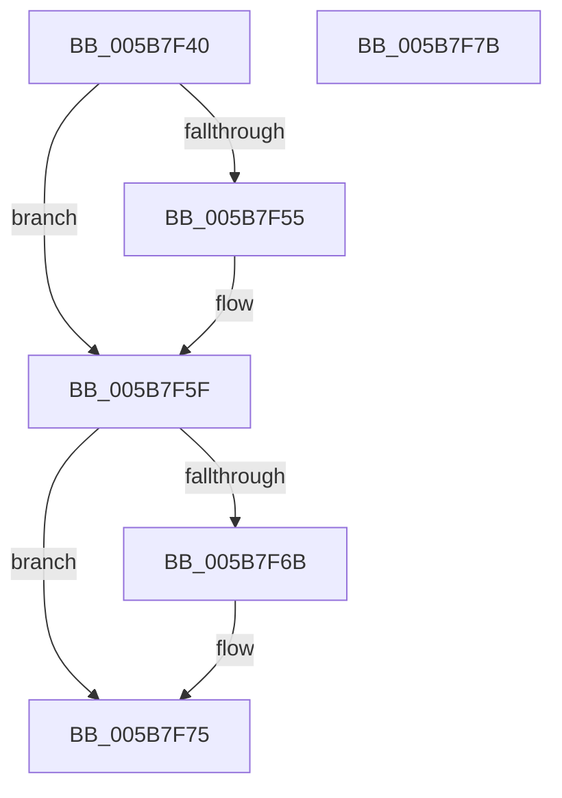

# KiFreePrcbThreads

- RVA: `0x005B7F40`–`0x005B7F7C` (길이 `60` bytes)
- VA: `0x00000001405B7F40`
- 실행 섹션: `.text`
- PDB 이름 있음: `예`; PDB Function 태그: `아니요`
- unwind 정보 RVA: `0x0005CF00`
- 디코드: `17`개 명령, `60/60` bytes 표시
- 미해석 바이트: `0` (있으면 어셈블리에 `.byte`로 보존)

> 이 문서는 커널 이미지의 기계어와 PDB 기호를 분석해 생성했습니다. 4번과 5번은 함수 원형과 자료형을 바이너리 사용 방식에서 추정한 C 해석이며 원본 소스 복구 결과는 아닙니다.

## 1. Dependencies

- 직접 호출 지점: **2**; 고유 호출 대상: **1**
- 직접 호출자로 확인된 함수: **2**
- RIP 상대 이미지 참조: **0**

### Outgoing calls
- `0x005B7F5A` → [ObfDereferenceObjectWithTag](../2F/ObfDereferenceObjectWithTag_function_002F78E0.md) (function, `0x002F78E0`)
- `0x005B7F70` → [ObfDereferenceObjectWithTag](../2F/ObfDereferenceObjectWithTag_function_002F78E0.md) (function, `0x002F78E0`)

### Direct callers
- [KiStartDynamicProcessor](../../page/74/KiStartDynamicProcessor_function_007456C8.md) at `0x00745C8E`
- [KeStartAllProcessors](../../init/C3/KeStartAllProcessors_function_00C36F78.md) at `0x00C37456`

### Static image references
- 디코드된 RIP-relative 메모리 참조가 없습니다.

## 2. Other-region calls and transfers

- 다른 실행 섹션으로 향하는 call: **0**
- 별도 외부 분기/꼬리 이동을 확인하지 못했습니다.

## 3. Assembly (complete function range)

```asm
005B7F40  40 53                           push rbx
005B7F42  48 83 EC 20                     sub rsp, 0x20
005B7F46  48 8B D9                        mov rbx, rcx
005B7F49  48 8B 89 80 8E 00 00            mov rcx, qword ptr [rcx + 0x8e80]
005B7F50  48 85 C9                        test rcx, rcx
005B7F53  74 0A                           je 0x1405b7f5f
005B7F55  BA 44 66 6C 74                  mov edx, 0x746c6644
005B7F5A  E8 81 F9 D3 FF                  call 0x1402f78e0
005B7F5F  48 8B 8B 38 38 00 00            mov rcx, qword ptr [rbx + 0x3838]
005B7F66  48 85 C9                        test rcx, rcx
005B7F69  74 0A                           je 0x1405b7f75
005B7F6B  BA 44 66 6C 74                  mov edx, 0x746c6644
005B7F70  E8 6B F9 D3 FF                  call 0x1402f78e0
005B7F75  48 83 C4 20                     add rsp, 0x20
005B7F79  5B                              pop rbx
005B7F7A  C3                              ret
005B7F7B  CC                              int3
```

## 4. C-style interpretation (structured pseudocode)

```c
__int64 __fastcall KiFreePrcbThreads(__int64 a1)
{
    __int64 result;
    __int64 v_rsp;

    v_rsp = (v_rsp) - (32);
    if (*(unsigned __int64 *)(a1 + 36480) != 0) {
        a2 = 0x746C6644ULL;
        result = ObfDereferenceObjectWithTag(*(unsigned __int64 *)(a1 + 36480), a2, a3, a4);
    }
    if (*(unsigned __int64 *)(a1 + 14392) != 0) {
        a2 = 0x746C6644ULL;
        result = ObfDereferenceObjectWithTag(*(unsigned __int64 *)(a1 + 14392), a2, a3, a4);
    }
    v_rsp = (v_rsp) + (32);
    return result;
}
```

## 5. (Beta) C Style

```c
int64_t KiFreePrcbThreads(void *Arg1)
{
    uint8_t *arg1 = (uint8_t *)Arg1;

    int64_t result;
    int64_t local_rsp;

    local_rsp = (local_rsp) - (32);
    if (*(uint64_t *)(arg1 + 0x8E80) != 0) {
        a2 = 0x746C6644ULL;
        result = ObfDereferenceObjectWithTag(*(uint64_t *)(arg1 + 0x8E80), a2, a3, a4);
    }
    if (*(uint64_t *)(arg1 + 0x3838) != 0) {
        a2 = 0x746C6644ULL;
        result = ObfDereferenceObjectWithTag(*(uint64_t *)(arg1 + 0x3838), a2, a3, a4);
    }
    local_rsp = (local_rsp) + (32);
    return result;
}
```

### 관측된 메모리 오프셋

구조체 형식이 확인되지 않은 접근은 인자 기준의 오프셋으로만 기록했습니다.

| 기준 인자 | 오프셋 표현 | 폭 (bit) | 접근 |
|---|---:|---:|---|
| `Arg1` | `+ 0x3838` | `64` | `R` |
| `Arg1` | `+ 0x8E80` | `64` | `R` |

## 6. Execution-region graph

[열기: 2D/3D 그래프와 함수 탐색 컨트롤 패널](../../../control-panel.html?section=text&rva=0x005B7F40&view=graph)

- 2D 그래프는 위에서 아래로 흐르고, 3D 그래프는 빈 공간을 드래그해 회전합니다. Shift+드래그는 이동, 휠은 확대·축소, 함수 노드 선택은 대상 보고서 이동입니다.

### Static fallback


