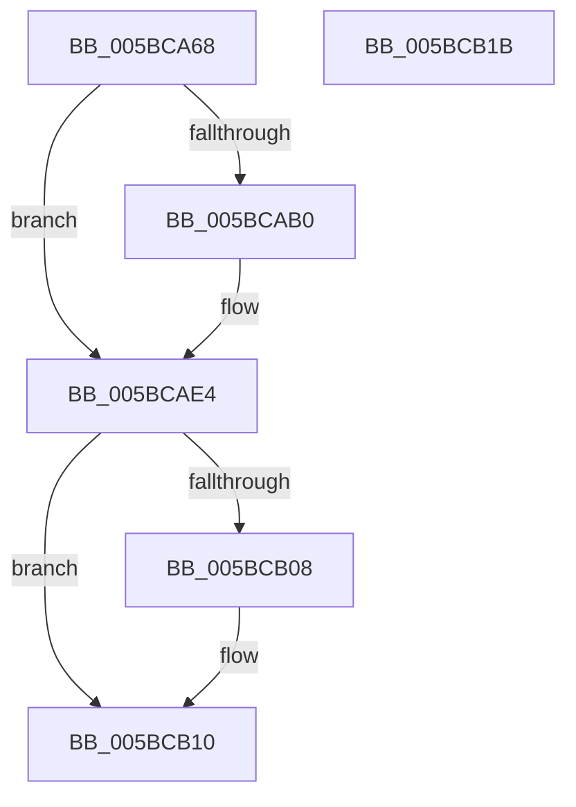

# KiFreeProcessorNumber

- RVA: `0x005BCA68`–`0x005BCB1C` (길이 `180` bytes)
- VA: `0x00000001405BCA68`
- 실행 섹션: `.text`
- PDB 이름 있음: `예`; PDB Function 태그: `아니요`
- unwind 정보 RVA: `0x000CA454`
- 디코드: `48`개 명령, `180/180` bytes 표시
- 미해석 바이트: `0` (있으면 어셈블리에 `.byte`로 보존)

> 이 문서는 커널 이미지의 기계어와 PDB 기호를 분석해 생성했습니다. 4번과 5번은 함수 원형과 자료형을 바이너리 사용 방식에서 추정한 C 해석이며 원본 소스 복구 결과는 아닙니다.

## 1. Dependencies

- 직접 호출 지점: **3**; 고유 호출 대상: **3**
- 직접 호출자로 확인된 함수: **1**
- RIP 상대 이미지 참조: **3**

### Outgoing calls
- `0x005BCA91` → [KiFindSubNodeForProcessorNumber](KiFindSubNodeForProcessorNumber_function_005BC9B8.md) (function, `0x005BC9B8`)
- `0x005BCADF` → [ExFreePoolWithTag](../../poolcode/B8/ExFreePoolWithTag_function_00B82870.md) (function, `0x00B82870`)
- `0x005BCB0B` → [KiUncommitGroupSubNodeAssignments](KiUncommitGroupSubNodeAssignments_function_005BCF10.md) (function, `0x005BCF10`)

### Direct callers
- [KiFreeProcessorStateInitializationParameters](KiFreeProcessorStateInitializationParameters_function_005B80A8.md) at `0x005B80E9`

### Static image references
- `0x005BCAB5` → RVA `0x00FCF6C0` (`CACHEALI`; read)
- `0x005BCACF` → RVA `0x00F21AD0` (`.data`; read)
- `0x005BCAE7` → RVA `0x00FC8820` (`ALMOSTRO`; read)

## 2. Other-region calls and transfers

- 다른 실행 섹션으로 향하는 call: **1**
  - `0x005BCADF` → [ExFreePoolWithTag](../../poolcode/B8/ExFreePoolWithTag_function_00B82870.md) (`.text` → `POOLCODE`)
- 별도 외부 분기/꼬리 이동을 확인하지 못했습니다.

## 3. Assembly (complete function range)

```asm
005BCA68  48 8B C4                        mov rax, rsp
005BCA6B  48 89 58 20                     mov qword ptr [rax + 0x20], rbx
005BCA6F  57                              push rdi
005BCA70  48 83 EC 20                     sub rsp, 0x20
005BCA74  33 FF                           xor edi, edi
005BCA76  4C 8D 48 18                     lea r9, [rax + 0x18]
005BCA7A  4C 8D 40 10                     lea r8, [rax + 0x10]
005BCA7E  48 89 78 10                     mov qword ptr [rax + 0x10], rdi
005BCA82  48 8D 50 08                     lea rdx, [rax + 8]
005BCA86  66 89 78 08                     mov word ptr [rax + 8], di
005BCA8A  48 89 78 18                     mov qword ptr [rax + 0x18], rdi
005BCA8E  48 8B D9                        mov rbx, rcx
005BCA91  E8 22 FF FF FF                  call 0x1405bc9b8
005BCA96  4C 8B 4C 24 38                  mov r9, qword ptr [rsp + 0x38]
005BCA9B  0F B6 43 02                     movzx eax, byte ptr [rbx + 2]
005BCA9F  49 8B 49 10                     mov rcx, qword ptr [r9 + 0x10]
005BCAA3  48 0F B3 C1                     btr rcx, rax
005BCAA7  49 89 49 10                     mov qword ptr [r9 + 0x10], rcx
005BCAAB  48 85 C9                        test rcx, rcx
005BCAAE  75 34                           jne 0x1405bcae4
005BCAB0  41 0F B7 41 02                  movzx eax, word ptr [r9 + 2]
005BCAB5  48 8D 15 04 2C A1 00            lea rdx, [rip + 0xa12c04]
005BCABC  0F B7 0B                        movzx ecx, word ptr [rbx]
005BCABF  48 8B 04 C2                     mov rax, qword ptr [rdx + rax*8]
005BCAC3  33 D2                           xor edx, edx
005BCAC5  48 89 7C C8 20                  mov qword ptr [rax + rcx*8 + 0x20], rdi
005BCACA  0F B7 4C 24 30                  movzx ecx, word ptr [rsp + 0x30]
005BCACF  48 8B 05 FA 4F 96 00            mov rax, qword ptr [rip + 0x964ffa]
005BCAD6  48 89 3C C8                     mov qword ptr [rax + rcx*8], rdi
005BCADA  48 8B 4C 24 40                  mov rcx, qword ptr [rsp + 0x40]
005BCADF  E8 8C 5D 5C 00                  call 0x140b82870
005BCAE4  0F B7 13                        movzx edx, word ptr [rbx]
005BCAE7  48 8D 05 32 BD A0 00            lea rax, [rip + 0xa0bd32]
005BCAEE  48 C1 E2 05                     shl rdx, 5
005BCAF2  48 03 D0                        add rdx, rax
005BCAF5  0F B6 43 02                     movzx eax, byte ptr [rbx + 2]
005BCAF9  48 8B 0A                        mov rcx, qword ptr [rdx]
005BCAFC  48 0F B3 C1                     btr rcx, rax
005BCB00  48 89 0A                        mov qword ptr [rdx], rcx
005BCB03  48 85 C9                        test rcx, rcx
005BCB06  75 08                           jne 0x1405bcb10
005BCB08  0F B7 0B                        movzx ecx, word ptr [rbx]
005BCB0B  E8 00 04 00 00                  call 0x1405bcf10
005BCB10  48 8B 5C 24 48                  mov rbx, qword ptr [rsp + 0x48]
005BCB15  48 83 C4 20                     add rsp, 0x20
005BCB19  5F                              pop rdi
005BCB1A  C3                              ret
005BCB1B  CC                              int3
```

## 4. C-style interpretation (structured pseudocode)

```c
__int64 __fastcall KiFreeProcessorNumber(__int64 a1)
{
    __int64 result;
    __int64 v_rdi;
    __int64 v_rsp;
    unsigned __int64 v_stack_p10;
    unsigned __int64 v_stack_p18;
    unsigned __int64 v_stack_p20;
    unsigned __int16 v_stack_p8;

    *(unsigned __int64 *)(v_rsp + 32) = v_rbx;
    v_rsp = (v_rsp) - (32);
    v_rdi = 0;
    *(unsigned __int64 *)(v_rsp + 16) = 0;
    *(unsigned __int16 *)(v_rsp + 8) = 0;
    *(unsigned __int64 *)(v_rsp + 24) = 0;
    result = KiFindSubNodeForProcessorNumber(a1, v_rsp + 8, v_rsp + 16, v_rsp + 24);
    *(unsigned __int64 *)(v_stack_p10 + 16) = *(unsigned __int64 *)(v_stack_p10 + 16);
    result = *(unsigned __int8 *)(a1 + 2);
    if (*(unsigned __int64 *)(v_stack_p10 + 16) == 0) {
        result = *(unsigned __int16 *)(v_stack_p10 + 2);
        a2 = v_rip + 10562564;
        a1 = *(unsigned __int16 *)(a1);
        result = *(unsigned __int64 *)(a2 + result * 8);
        a2 = 0;
        *(unsigned __int64 *)(result + a1 * 8 + 32) = 0;
        a1 = v_stack_p8;
        result = *(unsigned __int64 *)(v_rip + 9850874);
        *(unsigned __int64 *)(result + a1 * 8) = 0;
        a1 = v_stack_p18;
        result = ExFreePoolWithTag(a1, a2, v_rsp + 16, v_stack_p10);
    }
    a2 = (*(unsigned __int16 *)(a1)) << (5);
    a2 = (a2) + (v_rip + 10534194);
    *(unsigned __int64 *)(a2) = *(unsigned __int64 *)(a2);
    result = *(unsigned __int8 *)(a1 + 2);
    if (*(unsigned __int64 *)(a2) == 0) {
        a1 = *(unsigned __int16 *)(a1);
        result = KiUncommitGroupSubNodeAssignments(a1, a2, v_rsp + 16, v_stack_p10);
    }
    v_rsp = (v_rsp) + (32);
    return result;
}
```

## 5. (Beta) C Style

```c
int64_t KiFreeProcessorNumber(void *Arg1)
{
    uint8_t *arg1 = (uint8_t *)Arg1;

    int64_t result;
    int64_t local_rdi;
    int64_t local_rsp;
    uint64_t v_stack_p10;
    uint64_t v_stack_p18;
    uint64_t v_stack_p20;
    uint16_t v_stack_p8;

    *(uint64_t *)(local_rsp + 0x20) = local_rbx;
    local_rsp = (local_rsp) - (32);
    local_rdi = 0;
    *(uint64_t *)(local_rsp + 0x10) = 0;
    *(uint16_t *)(local_rsp + 0x8) = 0;
    *(uint64_t *)(local_rsp + 0x18) = 0;
    result = KiFindSubNodeForProcessorNumber(Arg1, local_rsp + 8, local_rsp + 16, local_rsp + 24);
    *(uint64_t *)(v_stack_p10 + 0x10) = *(uint64_t *)(v_stack_p10 + 0x10);
    result = *(uint8_t *)(arg1 + 0x2);
    if (*(uint64_t *)(v_stack_p10 + 0x10) == 0) {
        result = *(uint16_t *)(v_stack_p10 + 0x2);
        a2 = v_rip + 10562564;
        Arg1 = *(uint16_t *)(arg1);
        result = *(uint64_t *)(a2 + result * 8);
        a2 = 0;
        *(uint64_t *)(result + arg1 * 8 + 0x20) = 0;
        Arg1 = v_stack_p8;
        result = *(uint64_t *)(v_rip + 0x964FFA);
        *(uint64_t *)(result + arg1 * 8) = 0;
        Arg1 = v_stack_p18;
        result = ExFreePoolWithTag(Arg1, a2, local_rsp + 16, v_stack_p10);
    }
    a2 = (*(uint16_t *)(arg1)) << (5);
    a2 = (a2) + (v_rip + 10534194);
    *(uint64_t *)(a2) = *(uint64_t *)(a2);
    result = *(uint8_t *)(arg1 + 0x2);
    if (*(uint64_t *)(a2) == 0) {
        Arg1 = *(uint16_t *)(arg1);
        result = KiUncommitGroupSubNodeAssignments(Arg1, a2, local_rsp + 16, v_stack_p10);
    }
    local_rsp = (local_rsp) + (32);
    return result;
}
```

### 관측된 메모리 오프셋

구조체 형식이 확인되지 않은 접근은 인자 기준의 오프셋으로만 기록했습니다.

| 기준 인자 | 오프셋 표현 | 폭 (bit) | 접근 |
|---|---:|---:|---|
| `Arg1` | `+ 0x0` | `16` | `R` |
| `Arg1` | `+ 0x2` | `8` | `R` |

## 6. Execution-region graph

[열기: 2D/3D 그래프와 함수 탐색 컨트롤 패널](../../../control-panel.html?section=text&rva=0x005BCA68&view=graph)

- 2D 그래프는 위에서 아래로 흐르고, 3D 그래프는 빈 공간을 드래그해 회전합니다. Shift+드래그는 이동, 휠은 확대·축소, 함수 노드 선택은 대상 보고서 이동입니다.

### Static fallback


