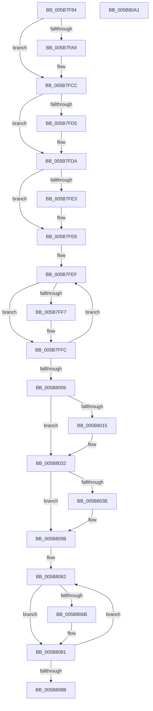

# KiFreeProcessorStacks

- RVA: `0x005B7F84`–`0x005B80A2` (길이 `286` bytes)
- VA: `0x00000001405B7F84`
- 실행 섹션: `.text`
- PDB 이름 있음: `예`; PDB Function 태그: `아니요`
- unwind 정보 RVA: `0x000BE9D0`
- 디코드: `78`개 명령, `286/286` bytes 표시
- 미해석 바이트: `0` (있으면 어셈블리에 `.byte`로 보존)

> 이 문서는 커널 이미지의 기계어와 PDB 기호를 분석해 생성했습니다. 4번과 5번은 함수 원형과 자료형을 바이너리 사용 방식에서 추정한 C 해석이며 원본 소스 복구 결과는 아닙니다.

## 1. Dependencies

- 직접 호출 지점: **8**; 고유 호출 대상: **5**
- 직접 호출자로 확인된 함수: **1**
- RIP 상대 이미지 참조: **0**

### Outgoing calls
- `0x005B7FC7` → [MmDeleteKernelStack](../33/MmDeleteKernelStack_function_0033A960.md) (function, `0x0033A960`)
- `0x005B7FD5` → [MmFreeIsrStack](../../page/80/MmFreeIsrStack_function_00807FC0.md) (function, `0x00807FC0`)
- `0x005B7FE3` → [MmFreeIsrStack](../../page/80/MmFreeIsrStack_function_00807FC0.md) (function, `0x00807FC0`)
- `0x005B7FF7` → [MmFreeIsrStack](../../page/80/MmFreeIsrStack_function_00807FC0.md) (function, `0x00807FC0`)
- `0x005B802D` → [KiDeleteKernelShadowStack](../../page/A2/KiDeleteKernelShadowStack_function_00A25DC8.md) (function, `0x00A25DC8`)
- `0x005B8048` → [MmSetPageProtection](../4E/MmSetPageProtection_function_004E1580.md) (function, `0x004E1580`)
- `0x005B8056` → [MmFreeIndependentPages](../2A/MmFreeIndependentPages_function_002A2510.md) (function, `0x002A2510`)
- `0x005B807C` → [KiDeleteKernelShadowStack](../../page/A2/KiDeleteKernelShadowStack_function_00A25DC8.md) (function, `0x00A25DC8`)

### Direct callers
- [KiFreeProcessorStateInitializationParameters](KiFreeProcessorStateInitializationParameters_function_005B80A8.md) at `0x005B80F1`

### Static image references
- 디코드된 RIP-relative 메모리 참조가 없습니다.

## 2. Other-region calls and transfers

- 다른 실행 섹션으로 향하는 call: **5**
  - `0x005B7FD5` → [MmFreeIsrStack](../../page/80/MmFreeIsrStack_function_00807FC0.md) (`.text` → `PAGE`)
  - `0x005B7FE3` → [MmFreeIsrStack](../../page/80/MmFreeIsrStack_function_00807FC0.md) (`.text` → `PAGE`)
  - `0x005B7FF7` → [MmFreeIsrStack](../../page/80/MmFreeIsrStack_function_00807FC0.md) (`.text` → `PAGE`)
  - `0x005B802D` → [KiDeleteKernelShadowStack](../../page/A2/KiDeleteKernelShadowStack_function_00A25DC8.md) (`.text` → `PAGE`)
  - `0x005B807C` → [KiDeleteKernelShadowStack](../../page/A2/KiDeleteKernelShadowStack_function_00A25DC8.md) (`.text` → `PAGE`)
- 별도 외부 분기/꼬리 이동을 확인하지 못했습니다.

## 3. Assembly (complete function range)

```asm
005B7F84  4C 8B DC                        mov r11, rsp
005B7F87  49 89 5B 08                     mov qword ptr [r11 + 8], rbx
005B7F8B  49 89 6B 10                     mov qword ptr [r11 + 0x10], rbp
005B7F8F  49 89 73 18                     mov qword ptr [r11 + 0x18], rsi
005B7F93  57                              push rdi
005B7F94  48 83 EC 60                     sub rsp, 0x60
005B7F98  48 8B 41 40                     mov rax, qword ptr [rcx + 0x40]
005B7F9C  48 8B D9                        mov rbx, rcx
005B7F9F  BF 05 00 00 00                  mov edi, 5
005B7FA4  48 85 C0                        test rax, rax
005B7FA7  74 23                           je 0x1405b7fcc
005B7FA9  0F 57 C0                        xorps xmm0, xmm0
005B7FAC  49 8D 4B C8                     lea rcx, [r11 - 0x38]
005B7FB0  0F 11 44 24 30                  movups xmmword ptr [rsp + 0x30], xmm0
005B7FB5  89 7C 24 34                     mov dword ptr [rsp + 0x34], edi
005B7FB9  0F 11 44 24 40                  movups xmmword ptr [rsp + 0x40], xmm0
005B7FBE  0F 11 44 24 50                  movups xmmword ptr [rsp + 0x50], xmm0
005B7FC3  49 89 43 E0                     mov qword ptr [r11 - 0x20], rax
005B7FC7  E8 94 29 D8 FF                  call 0x14033a960
005B7FCC  48 8B 4B 48                     mov rcx, qword ptr [rbx + 0x48]
005B7FD0  48 85 C9                        test rcx, rcx
005B7FD3  74 05                           je 0x1405b7fda
005B7FD5  E8 E6 FF 24 00                  call 0x140807fc0
005B7FDA  48 8B 4B 50                     mov rcx, qword ptr [rbx + 0x50]
005B7FDE  48 85 C9                        test rcx, rcx
005B7FE1  74 05                           je 0x1405b7fe8
005B7FE3  E8 D8 FF 24 00                  call 0x140807fc0
005B7FE8  48 8D 73 58                     lea rsi, [rbx + 0x58]
005B7FEC  48 8B EF                        mov rbp, rdi
005B7FEF  48 8B 0E                        mov rcx, qword ptr [rsi]
005B7FF2  48 85 C9                        test rcx, rcx
005B7FF5  74 05                           je 0x1405b7ffc
005B7FF7  E8 C4 FF 24 00                  call 0x140807fc0
005B7FFC  48 83 C6 08                     add rsi, 8
005B8000  48 83 ED 01                     sub rbp, 1
005B8004  75 E9                           jne 0x1405b7fef
005B8006  48 8B 83 80 00 00 00            mov rax, qword ptr [rbx + 0x80]
005B800D  8D 75 04                        lea esi, [rbp + 4]
005B8010  48 85 C0                        test rax, rax
005B8013  74 1D                           je 0x1405b8032
005B8015  48 8B 93 88 00 00 00            mov rdx, qword ptr [rbx + 0x88]
005B801C  48 83 C0 08                     add rax, 8
005B8020  45 33 C9                        xor r9d, r9d
005B8023  48 89 44 24 20                  mov qword ptr [rsp + 0x20], rax
005B8028  44 8B C6                        mov r8d, esi
005B802B  33 C9                           xor ecx, ecx
005B802D  E8 96 DD 46 00                  call 0x140a25dc8
005B8032  48 8B 8B E0 00 00 00            mov rcx, qword ptr [rbx + 0xe0]
005B8039  48 85 C9                        test rcx, rcx
005B803C  74 1D                           je 0x1405b805b
005B803E  44 8B C6                        mov r8d, esi
005B8041  BE 00 10 00 00                  mov esi, 0x1000
005B8046  8B D6                           mov edx, esi
005B8048  E8 33 95 F2 FF                  call 0x1404e1580
005B804D  48 8B 8B E0 00 00 00            mov rcx, qword ptr [rbx + 0xe0]
005B8054  8B D6                           mov edx, esi
005B8056  E8 B5 A4 CE FF                  call 0x1402a2510
005B805B  48 81 C3 B8 00 00 00            add rbx, 0xb8
005B8062  48 8B 43 D8                     mov rax, qword ptr [rbx - 0x28]
005B8066  48 85 C0                        test rax, rax
005B8069  74 16                           je 0x1405b8081
005B806B  48 8B 13                        mov rdx, qword ptr [rbx]
005B806E  45 33 C9                        xor r9d, r9d
005B8071  33 C9                           xor ecx, ecx
005B8073  48 89 44 24 20                  mov qword ptr [rsp + 0x20], rax
005B8078  45 8D 41 03                     lea r8d, [r9 + 3]
005B807C  E8 47 DD 46 00                  call 0x140a25dc8
005B8081  48 83 C3 08                     add rbx, 8
005B8085  48 83 EF 01                     sub rdi, 1
005B8089  75 D7                           jne 0x1405b8062
005B808B  4C 8D 5C 24 60                  lea r11, [rsp + 0x60]
005B8090  49 8B 5B 10                     mov rbx, qword ptr [r11 + 0x10]
005B8094  49 8B 6B 18                     mov rbp, qword ptr [r11 + 0x18]
005B8098  49 8B 73 20                     mov rsi, qword ptr [r11 + 0x20]
005B809C  49 8B E3                        mov rsp, r11
005B809F  5F                              pop rdi
005B80A0  C3                              ret
005B80A1  CC                              int3
```

## 4. C-style interpretation (structured pseudocode)

```c
__int64 __fastcall KiFreeProcessorStacks(__int64 a1, __int64 a2, __int64 a3, int a4)
{
    __int64 result;
    __int64 v_rbp;
    __int64 v_rbx;
    __int64 v_rdi;
    __int64 v_rsi;
    __int64 v_rsp;
    unsigned __int64 v_stack_m18;
    unsigned __int64 v_stack_m28;
    unsigned int v_stack_m34;
    unsigned __int64 v_stack_m38;
    unsigned __int64 v_stack_m48;
    unsigned __int64 v_stack_m8;

    *(unsigned __int64 *)(v_rsp + 8) = v_rbx;
    *(unsigned __int64 *)(v_rsp + 16) = v_rbp;
    *(unsigned __int64 *)(v_rsp + 24) = v_rsi;
    v_rsp = (v_rsp) - (96);
    result = *(unsigned __int64 *)(a1 + 64);
    if (*(unsigned __int64 *)(a1 + 64) != 0) {
        a1 = v_rsp - 56;
        v_stack_m38 = v_xmm0;
        v_stack_m34 = 5;
        v_stack_m28 = v_xmm0;
        v_stack_m18 = v_xmm0;
        *(unsigned __int64 *)(v_rsp - 32) = *(unsigned __int64 *)(a1 + 64);
        result = MmDeleteKernelStack(a1, a2, a3, a4);
    }
    if (*(unsigned __int64 *)(a1 + 72) != 0) {
        result = MmFreeIsrStack(*(unsigned __int64 *)(a1 + 72), a2, a3, a4);
    }
    if (*(unsigned __int64 *)(a1 + 80) != 0) {
        result = MmFreeIsrStack(*(unsigned __int64 *)(a1 + 80), a2, a3, a4);
    }
loc_005B7FEF:
    if (*(unsigned __int64 *)(a1 + 88) != 0) {
        result = MmFreeIsrStack(*(unsigned __int64 *)(a1 + 88), a2, a3, a4);
    }
    v_rsi = (a1 + 88) + (8);
    v_rbp = (5) - (1);
    if (condition_is_not_equal) goto loc_005B7FEF;
    result = *(unsigned __int64 *)(a1 + 128);
    if (*(unsigned __int64 *)(a1 + 128) != 0) {
        a2 = *(unsigned __int64 *)(a1 + 136);
        result = (*(unsigned __int64 *)(a1 + 128)) + (8);
        a4 = 0;
        v_stack_m48 = result;
        a3 = (unsigned int)(v_rbp + 4);
        a1 = 0;
        result = KiDeleteKernelShadowStack(a1, a2, a3, a4);
    }
    v_rsi = v_rbp + 4;
    if (*(unsigned __int64 *)(a1 + 224) != 0) {
        a3 = (unsigned int)(v_rbp + 4);
        v_rsi = 0x1000ULL;
        a2 = (unsigned int)(v_rsi);
        result = MmSetPageProtection(*(unsigned __int64 *)(a1 + 224), a2, a3, a4);
        a1 = *(unsigned __int64 *)(a1 + 224);
        a2 = (unsigned int)(v_rsi);
        result = MmFreeIndependentPages(a1, a2, a3, a4);
    }
    v_rbx = (a1) + (184);
loc_005B8062:
    result = *(unsigned __int64 *)(v_rbx - 40);
    if (*(unsigned __int64 *)(v_rbx - 40) != 0) {
        a2 = *(unsigned __int64 *)(v_rbx);
        a4 = 0;
        a1 = 0;
        v_stack_m48 = *(unsigned __int64 *)(v_rbx - 40);
        a3 = a4 + 3;
        result = KiDeleteKernelShadowStack(a1, a2, a3, a4);
    }
    v_rbx = (v_rbx) + (8);
    v_rdi = (5) - (1);
    if (condition_is_not_equal) goto loc_005B8062;
    return result;
}
```

## 5. (Beta) C Style

```c
int64_t KiFreeProcessorStacks(void *Arg1, int64_t Arg2, int64_t Arg3, int32_t Arg4)
{
    uint8_t *arg1 = (uint8_t *)Arg1;

    int64_t result;
    int64_t local_rbp;
    int64_t local_rbx;
    int64_t local_rdi;
    int64_t local_rsi;
    int64_t local_rsp;
    uint64_t v_stack_m18;
    uint64_t v_stack_m28;
    uint32_t v_stack_m34;
    uint64_t v_stack_m38;
    uint64_t v_stack_m48;
    uint64_t v_stack_m8;

    *(uint64_t *)(local_rsp + 0x8) = local_rbx;
    *(uint64_t *)(local_rsp + 0x10) = local_rbp;
    *(uint64_t *)(local_rsp + 0x18) = local_rsi;
    local_rsp = (local_rsp) - (96);
    result = *(uint64_t *)(arg1 + 0x40);
    if (*(uint64_t *)(arg1 + 0x40) != 0) {
        Arg1 = local_rsp - 56;
        v_stack_m38 = v_xmm0;
        v_stack_m34 = 5;
        v_stack_m28 = v_xmm0;
        v_stack_m18 = v_xmm0;
        *(uint64_t *)(local_rsp - 0x20) = *(uint64_t *)(arg1 + 0x40);
        result = MmDeleteKernelStack(Arg1, Arg2, Arg3, Arg4);
    }
    if (*(uint64_t *)(arg1 + 0x48) != 0) {
        result = MmFreeIsrStack(*(uint64_t *)(arg1 + 0x48), Arg2, Arg3, Arg4);
    }
    if (*(uint64_t *)(arg1 + 0x50) != 0) {
        result = MmFreeIsrStack(*(uint64_t *)(arg1 + 0x50), Arg2, Arg3, Arg4);
    }
loc_005B7FEF:
    if (*(uint64_t *)(arg1 + 0x58) != 0) {
        result = MmFreeIsrStack(*(uint64_t *)(arg1 + 0x58), Arg2, Arg3, Arg4);
    }
    local_rsi = (Arg1 + 88) + (8);
    local_rbp = (5) - (1);
    if (condition_is_not_equal) goto loc_005B7FEF;
    result = *(uint64_t *)(arg1 + 0x80);
    if (*(uint64_t *)(arg1 + 0x80) != 0) {
        Arg2 = *(uint64_t *)(arg1 + 0x88);
        result = (*(uint64_t *)(arg1 + 0x80)) + (8);
        Arg4 = 0;
        v_stack_m48 = result;
        Arg3 = (uint32_t)(local_rbp + 4);
        Arg1 = 0;
        result = KiDeleteKernelShadowStack(Arg1, Arg2, Arg3, Arg4);
    }
    local_rsi = local_rbp + 4;
    if (*(uint64_t *)(arg1 + 0xE0) != 0) {
        Arg3 = (uint32_t)(local_rbp + 4);
        local_rsi = 0x1000ULL;
        Arg2 = (uint32_t)(local_rsi);
        result = MmSetPageProtection(*(uint64_t *)(arg1 + 0xE0), Arg2, Arg3, Arg4);
        Arg1 = *(uint64_t *)(arg1 + 0xE0);
        Arg2 = (uint32_t)(local_rsi);
        result = MmFreeIndependentPages(Arg1, Arg2, Arg3, Arg4);
    }
    local_rbx = (Arg1) + (184);
loc_005B8062:
    result = *(uint64_t *)(local_rbx - 0x28);
    if (*(uint64_t *)(local_rbx - 0x28) != 0) {
        Arg2 = *(uint64_t *)(local_rbx);
        Arg4 = 0;
        Arg1 = 0;
        v_stack_m48 = *(uint64_t *)(local_rbx - 0x28);
        Arg3 = Arg4 + 3;
        result = KiDeleteKernelShadowStack(Arg1, Arg2, Arg3, Arg4);
    }
    local_rbx = (local_rbx) + (8);
    local_rdi = (5) - (1);
    if (condition_is_not_equal) goto loc_005B8062;
    return result;
}
```

### 관측된 메모리 오프셋

구조체 형식이 확인되지 않은 접근은 인자 기준의 오프셋으로만 기록했습니다.

| 기준 인자 | 오프셋 표현 | 폭 (bit) | 접근 |
|---|---:|---:|---|
| `Arg1` | `- 0x28` | `64` | `R` |
| `Arg1` | `+ 0x0` | `64` | `R` |
| `Arg1` | `+ 0x40` | `64` | `R` |
| `Arg1` | `+ 0x48` | `64` | `R` |
| `Arg1` | `+ 0x50` | `64` | `R` |
| `Arg1` | `+ 0x58` | `64` | `R` |
| `Arg1` | `+ 0x80` | `64` | `R` |
| `Arg1` | `+ 0x88` | `64` | `R` |
| `Arg1` | `+ 0xE0` | `64` | `R` |

## 6. Execution-region graph

[열기: 2D/3D 그래프와 함수 탐색 컨트롤 패널](../../../control-panel.html?section=text&rva=0x005B7F84&view=graph)

- 2D 그래프는 위에서 아래로 흐르고, 3D 그래프는 빈 공간을 드래그해 회전합니다. Shift+드래그는 이동, 휠은 확대·축소, 함수 노드 선택은 대상 보고서 이동입니다.

### Static fallback


