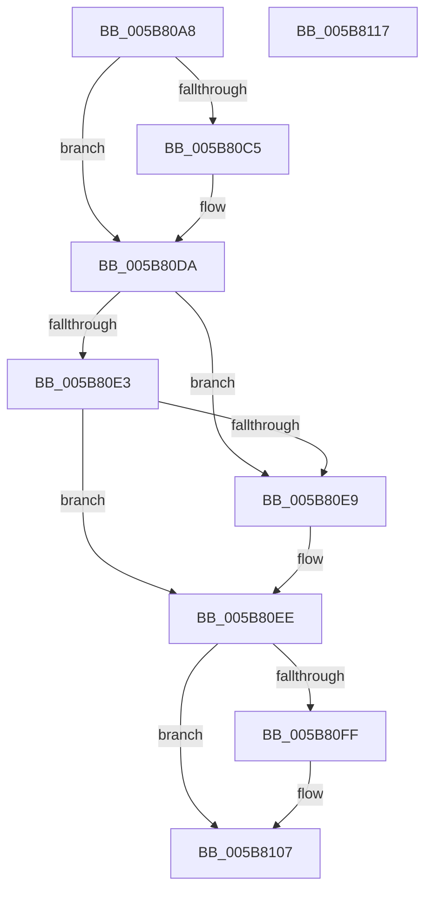

# KiFreeProcessorStateInitializationParameters

- RVA: `0x005B80A8`–`0x005B8118` (길이 `112` bytes)
- VA: `0x00000001405B80A8`
- 실행 섹션: `.text`
- PDB 이름 있음: `예`; PDB Function 태그: `아니요`
- unwind 정보 RVA: `0x00060BC4`
- 디코드: `33`개 명령, `112/112` bytes 표시
- 미해석 바이트: `0` (있으면 어셈블리에 `.byte`로 보존)

> 이 문서는 커널 이미지의 기계어와 PDB 기호를 분석해 생성했습니다. 4번과 5번은 함수 원형과 자료형을 바이너리 사용 방식에서 추정한 C 해석이며 원본 소스 복구 결과는 아닙니다.

## 1. Dependencies

- 직접 호출 지점: **5**; 고유 호출 대상: **5**
- 직접 호출자로 확인된 함수: **2**
- RIP 상대 이미지 참조: **0**

### Outgoing calls
- `0x005B80C8` → [KeUninitThread](../../page/A2/KeUninitThread_function_00A25D2C.md) (function, `0x00A25D2C`)
- `0x005B80D5` → [ObfDereferenceObjectWithTag](../2F/ObfDereferenceObjectWithTag_function_002F78E0.md) (function, `0x002F78E0`)
- `0x005B80E9` → [KiFreeProcessorNumber](KiFreeProcessorNumber_function_005BCA68.md) (function, `0x005BCA68`)
- `0x005B80F1` → [KiFreeProcessorStacks](KiFreeProcessorStacks_function_005B7F84.md) (function, `0x005B7F84`)
- `0x005B8102` → [MmFreeIndependentPages](../2A/MmFreeIndependentPages_function_002A2510.md) (function, `0x002A2510`)

### Direct callers
- [KiStartDynamicProcessor](../../page/74/KiStartDynamicProcessor_function_007456C8.md) at `0x00745D00`
- [KeStartAllProcessors](../../init/C3/KeStartAllProcessors_function_00C36F78.md) at `0x00C374CB`

### Static image references
- 디코드된 RIP-relative 메모리 참조가 없습니다.

## 2. Other-region calls and transfers

- 다른 실행 섹션으로 향하는 call: **1**
  - `0x005B80C8` → [KeUninitThread](../../page/A2/KeUninitThread_function_00A25D2C.md) (`.text` → `PAGE`)
- 별도 외부 분기/꼬리 이동을 확인하지 못했습니다.

## 3. Assembly (complete function range)

```asm
005B80A8  48 89 5C 24 08                  mov qword ptr [rsp + 8], rbx
005B80AD  48 89 74 24 10                  mov qword ptr [rsp + 0x10], rsi
005B80B2  57                              push rdi
005B80B3  48 83 EC 20                     sub rsp, 0x20
005B80B7  48 8B 79 30                     mov rdi, qword ptr [rcx + 0x30]
005B80BB  33 F6                           xor esi, esi
005B80BD  48 8B D9                        mov rbx, rcx
005B80C0  48 85 FF                        test rdi, rdi
005B80C3  74 15                           je 0x1405b80da
005B80C5  48 8B CF                        mov rcx, rdi
005B80C8  E8 5F DC 46 00                  call 0x140a25d2c
005B80CD  BA 44 66 6C 74                  mov edx, 0x746c6644
005B80D2  48 8B CF                        mov rcx, rdi
005B80D5  E8 06 F8 D3 FF                  call 0x1402f78e0
005B80DA  48 8D 4B 20                     lea rcx, [rbx + 0x20]
005B80DE  66 39 31                        cmp word ptr [rcx], si
005B80E1  75 06                           jne 0x1405b80e9
005B80E3  40 38 73 22                     cmp byte ptr [rbx + 0x22], sil
005B80E7  74 05                           je 0x1405b80ee
005B80E9  E8 7A 49 00 00                  call 0x1405bca68
005B80EE  48 8B CB                        mov rcx, rbx
005B80F1  E8 8E FE FF FF                  call 0x1405b7f84
005B80F6  48 8B 4B 08                     mov rcx, qword ptr [rbx + 8]
005B80FA  48 85 C9                        test rcx, rcx
005B80FD  74 08                           je 0x1405b8107
005B80FF  8B 53 10                        mov edx, dword ptr [rbx + 0x10]
005B8102  E8 09 A4 CE FF                  call 0x1402a2510
005B8107  48 8B 5C 24 30                  mov rbx, qword ptr [rsp + 0x30]
005B810C  48 8B 74 24 38                  mov rsi, qword ptr [rsp + 0x38]
005B8111  48 83 C4 20                     add rsp, 0x20
005B8115  5F                              pop rdi
005B8116  C3                              ret
005B8117  CC                              int3
```

## 4. C-style interpretation (structured pseudocode)

```c
__int64 __fastcall KiFreeProcessorStateInitializationParameters(__int64 a1)
{
    __int64 result;
    __int64 v_rsi;
    __int64 v_rsp;
    unsigned __int64 v_stack_p10;
    unsigned __int64 v_stack_p8;

    v_stack_p8 = v_rbx;
    v_stack_p10 = v_rsi;
    v_rsp = (v_rsp) - (32);
    v_rsi = 0;
    if (*(unsigned __int64 *)(a1 + 48) != 0) {
        a1 = *(unsigned __int64 *)(a1 + 48);
        result = KeUninitThread(a1, a2, a3, a4);
        a2 = 0x746C6644ULL;
        a1 = *(unsigned __int64 *)(a1 + 48);
        result = ObfDereferenceObjectWithTag(a1, a2, a3, a4);
    }
    if ((*(unsigned __int16 *)(a1 + 32)) != 0) goto loc_005B80E9;
    if ((*(unsigned __int8 *)(a1 + 34)) != 0) {
        result = KiFreeProcessorNumber(a1 + 32, a2, a3, a4);
    }
    result = KiFreeProcessorStacks(a1, a2, a3, a4);
    if (*(unsigned __int64 *)(a1 + 8) != 0) {
        a2 = *(unsigned int *)(a1 + 16);
        result = MmFreeIndependentPages(*(unsigned __int64 *)(a1 + 8), a2, a3, a4);
    }
    v_rsp = (v_rsp) + (32);
    return result;
}
```

## 5. (Beta) C Style

```c
int64_t KiFreeProcessorStateInitializationParameters(void *Arg1)
{
    uint8_t *arg1 = (uint8_t *)Arg1;

    int64_t result;
    int64_t local_rsi;
    int64_t local_rsp;
    uint64_t v_stack_p10;
    uint64_t v_stack_p8;

    v_stack_p8 = local_rbx;
    v_stack_p10 = local_rsi;
    local_rsp = (local_rsp) - (32);
    local_rsi = 0;
    if (*(uint64_t *)(arg1 + 0x30) != 0) {
        Arg1 = *(uint64_t *)(arg1 + 0x30);
        result = KeUninitThread(Arg1, a2, a3, a4);
        a2 = 0x746C6644ULL;
        Arg1 = *(uint64_t *)(arg1 + 0x30);
        result = ObfDereferenceObjectWithTag(Arg1, a2, a3, a4);
    }
    if ((*(uint16_t *)(arg1 + 0x20)) != 0) goto loc_005B80E9;
    if ((*(uint8_t *)(arg1 + 0x22)) != 0) {
        result = KiFreeProcessorNumber(Arg1 + 32, a2, a3, a4);
    }
    result = KiFreeProcessorStacks(Arg1, a2, a3, a4);
    if (*(uint64_t *)(arg1 + 0x8) != 0) {
        a2 = *(uint32_t *)(arg1 + 0x10);
        result = MmFreeIndependentPages(*(uint64_t *)(arg1 + 0x8), a2, a3, a4);
    }
    local_rsp = (local_rsp) + (32);
    return result;
}
```

### 관측된 메모리 오프셋

구조체 형식이 확인되지 않은 접근은 인자 기준의 오프셋으로만 기록했습니다.

| 기준 인자 | 오프셋 표현 | 폭 (bit) | 접근 |
|---|---:|---:|---|
| `Arg1` | `+ 0x0` | `16` | `R` |
| `Arg1` | `+ 0x8` | `64` | `R` |
| `Arg1` | `+ 0x10` | `32` | `R` |
| `Arg1` | `+ 0x20` | `64` | `R` |
| `Arg1` | `+ 0x22` | `8` | `R` |
| `Arg1` | `+ 0x30` | `64` | `R` |

## 6. Execution-region graph

[열기: 2D/3D 그래프와 함수 탐색 컨트롤 패널](../../../control-panel.html?section=text&rva=0x005B80A8&view=graph)

- 2D 그래프는 위에서 아래로 흐르고, 3D 그래프는 빈 공간을 드래그해 회전합니다. Shift+드래그는 이동, 휠은 확대·축소, 함수 노드 선택은 대상 보고서 이동입니다.

### Static fallback


