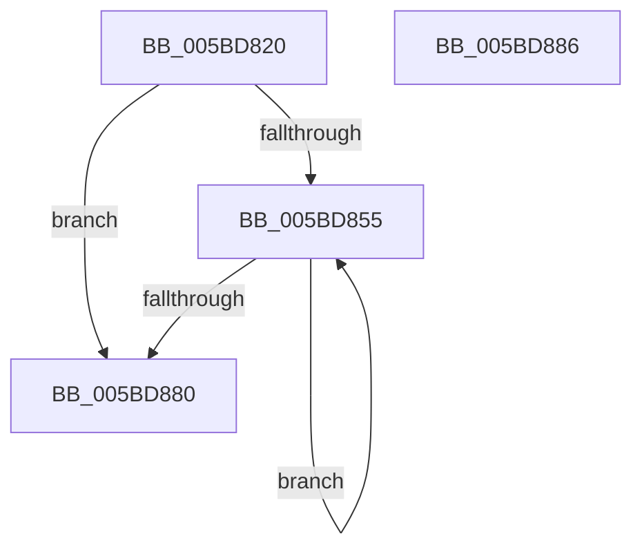

# KiFreeTemporaryStacks

- RVA: `0x005BD820`–`0x005BD887` (길이 `103` bytes)
- VA: `0x00000001405BD820`
- 실행 섹션: `.text`
- PDB 이름 있음: `예`; PDB Function 태그: `아니요`
- unwind 정보 RVA: `0x00071A74`
- 디코드: `25`개 명령, `103/103` bytes 표시
- 미해석 바이트: `0` (있으면 어셈블리에 `.byte`로 보존)

> 이 문서는 커널 이미지의 기계어와 PDB 기호를 분석해 생성했습니다. 4번과 5번은 함수 원형과 자료형을 바이너리 사용 방식에서 추정한 C 해석이며 원본 소스 복구 결과는 아닙니다.

## 1. Dependencies

- 직접 호출 지점: **2**; 고유 호출 대상: **2**
- 직접 호출자로 확인된 함수: **0**
- RIP 상대 이미지 참조: **0**

### Outgoing calls
- `0x005BD848` → [ExpInterlockedFlushSList](../6B/ExpInterlockedFlushSList_function_006BA5F0.md) (function, `0x006BA5F0`)
- `0x005BD876` → [MmDeleteKernelStack](../33/MmDeleteKernelStack_function_0033A960.md) (function, `0x0033A960`)

### Direct callers
- 이 함수 시작 RVA로 연결되는 직접 call은 확인되지 않았습니다. 간접 호출은 완전히 역산할 수 없습니다.

### Static image references
- 디코드된 RIP-relative 메모리 참조가 없습니다.

## 2. Other-region calls and transfers

- 다른 실행 섹션으로 향하는 call: **0**
- 별도 외부 분기/꼬리 이동을 확인하지 못했습니다.

## 3. Assembly (complete function range)

```asm
005BD820  40 53                           push rbx
005BD822  48 83 EC 50                     sub rsp, 0x50
005BD826  65 48 8B 0C 25 20 00 00 00      mov rcx, qword ptr gs:[0x20]
005BD82F  0F 57 C0                        xorps xmm0, xmm0
005BD832  0F 57 C9                        xorps xmm1, xmm1
005BD835  48 81 C1 D0 A1 00 00            add rcx, 0xa1d0
005BD83C  F3 0F 7F 44 24 28               movdqu xmmword ptr [rsp + 0x28], xmm0
005BD842  F3 0F 7F 4C 24 40               movdqu xmmword ptr [rsp + 0x40], xmm1
005BD848  E8 A3 CD 0F 00                  call 0x1406ba5f0
005BD84D  48 8B D8                        mov rbx, rax
005BD850  48 85 C0                        test rax, rax
005BD853  74 2B                           je 0x1405bd880
005BD855  48 8D 4B 10                     lea rcx, [rbx + 0x10]
005BD859  C7 44 24 20 04 00 00 00         mov dword ptr [rsp + 0x20], 4
005BD861  48 8B 1B                        mov rbx, qword ptr [rbx]
005BD864  48 89 4C 24 38                  mov qword ptr [rsp + 0x38], rcx
005BD869  48 8D 4C 24 20                  lea rcx, [rsp + 0x20]
005BD86E  C7 44 24 24 05 00 00 00         mov dword ptr [rsp + 0x24], 5
005BD876  E8 E5 D0 D7 FF                  call 0x14033a960
005BD87B  48 85 DB                        test rbx, rbx
005BD87E  75 D5                           jne 0x1405bd855
005BD880  48 83 C4 50                     add rsp, 0x50
005BD884  5B                              pop rbx
005BD885  C3                              ret
005BD886  CC                              int3
```

## 4. C-style interpretation (structured pseudocode)

```c
__int64 __fastcall KiFreeTemporaryStacks(void)
{
    __int64 result;
    __int64 v_rsp;
    unsigned __int64 v_stack_m18;
    unsigned __int64 v_stack_m20;
    unsigned __int64 v_stack_m30;
    unsigned int v_stack_m34;
    unsigned int v_stack_m38;

    v_rsp = (v_rsp) - (80);
    a1 = (*(unsigned __int64 *)(gs_base + (0 + 32))) + (0xA1D0ULL);
    v_stack_m30 = v_xmm0;
    v_stack_m18 = v_xmm1;
    result = ExpInterlockedFlushSList(a1, a2, a3, a4);
    if (result == 0) goto loc_005BD880;
loc_005BD855:
    v_stack_m38 = 4;
    v_stack_m20 = result + 16;
    v_stack_m34 = 5;
    result = MmDeleteKernelStack(v_stack_m38, a2, a3, a4);
    if (*(unsigned __int64 *)(result) != 0) goto loc_005BD855;
loc_005BD880:
    v_rsp = (v_rsp) + (80);
    return result;
}
```

## 5. (Beta) C Style

```c
void KiFreeTemporaryStacks(void)
{
    int64_t result;
    int64_t local_rsp;
    uint64_t v_stack_m18;
    uint64_t v_stack_m20;
    uint64_t v_stack_m30;
    uint32_t v_stack_m34;
    uint32_t v_stack_m38;

    local_rsp = (local_rsp) - (80);
    a1 = (*(uint64_t *)(gs_base + (0 + 0x20))) + (0xA1D0ULL);
    v_stack_m30 = v_xmm0;
    v_stack_m18 = v_xmm1;
    result = ExpInterlockedFlushSList(a1, a2, a3, a4);
    if (result == 0) goto loc_005BD880;
loc_005BD855:
    v_stack_m38 = 4;
    v_stack_m20 = result + 16;
    v_stack_m34 = 5;
    result = MmDeleteKernelStack(v_stack_m38, a2, a3, a4);
    if (*(uint64_t *)(result) != 0) goto loc_005BD855;
loc_005BD880:
    local_rsp = (local_rsp) + (80);
    return result;
}
```

## 6. Execution-region graph

[열기: 2D/3D 그래프와 함수 탐색 컨트롤 패널](../../../control-panel.html?section=text&rva=0x005BD820&view=graph)

- 2D 그래프는 위에서 아래로 흐르고, 3D 그래프는 빈 공간을 드래그해 회전합니다. Shift+드래그는 이동, 휠은 확대·축소, 함수 노드 선택은 대상 보고서 이동입니다.

### Static fallback


