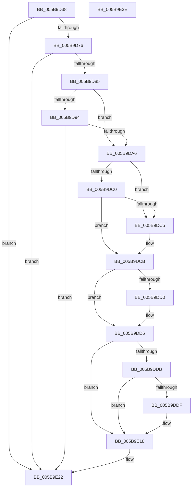

# KiGetIptInfo

- RVA: `0x005B9D38`–`0x005B9E3F` (길이 `263` bytes)
- VA: `0x00000001405B9D38`
- 실행 섹션: `.text`
- PDB 이름 있음: `예`; PDB Function 태그: `아니요`
- unwind 정보 RVA: `0x000CA0E8`
- 디코드: `84`개 명령, `263/263` bytes 표시
- 미해석 바이트: `0` (있으면 어셈블리에 `.byte`로 보존)

> 이 문서는 커널 이미지의 기계어와 PDB 기호를 분석해 생성했습니다. 4번과 5번은 함수 원형과 자료형을 바이너리 사용 방식에서 추정한 C 해석이며 원본 소스 복구 결과는 아닙니다.

## 1. Dependencies

- 직접 호출 지점: **3**; 고유 호출 대상: **3**
- 직접 호출자로 확인된 함수: **1**
- RIP 상대 이미지 참조: **1**

### Outgoing calls
- `0x005B9D68` → [KiGetCpuVendor](../../pagelk/B7/KiGetCpuVendor_function_00B7D5B4.md) (function, `0x00B7D5B4`)
- `0x005B9D98` → [HviGetIptFeatures](../66/HviGetIptFeatures_function_006667A8.md) (function, `0x006667A8`)
- `0x005B9E29` → [_security_check_cookie](../6A/_security_check_cookie_function_006AC640.md) (function, `0x006AC640`)

### Direct callers
- [KiInitializeXSaveConfiguration](../../pagelk/B6/KiInitializeXSaveConfiguration_function_00B66F10.md) at `0x00B66F80`

### Static image references
- `0x005B9D47` → RVA `0x00E0A740` (`.data`; read)

## 2. Other-region calls and transfers

- 다른 실행 섹션으로 향하는 call: **1**
  - `0x005B9D68` → [KiGetCpuVendor](../../pagelk/B7/KiGetCpuVendor_function_00B7D5B4.md) (`.text` → `PAGELK`)
- 별도 외부 분기/꼬리 이동을 확인하지 못했습니다.

## 3. Assembly (complete function range)

```asm
005B9D38  48 89 5C 24 18                  mov qword ptr [rsp + 0x18], rbx
005B9D3D  55                              push rbp
005B9D3E  56                              push rsi
005B9D3F  57                              push rdi
005B9D40  48 8B EC                        mov rbp, rsp
005B9D43  48 83 EC 50                     sub rsp, 0x50
005B9D47  48 8B 05 F2 09 85 00            mov rax, qword ptr [rip + 0x8509f2]
005B9D4E  48 33 C4                        xor rax, rsp
005B9D51  48 89 45 F0                     mov qword ptr [rbp - 0x10], rax
005B9D55  83 21 00                        and dword ptr [rcx], 0
005B9D58  0F 57 C9                        xorps xmm1, xmm1
005B9D5B  83 22 00                        and dword ptr [rdx], 0
005B9D5E  48 8B F2                        mov rsi, rdx
005B9D61  0F 11 4D E0                     movups xmmword ptr [rbp - 0x20], xmm1
005B9D65  48 8B F9                        mov rdi, rcx
005B9D68  E8 47 38 5C 00                  call 0x140b7d5b4
005B9D6D  83 F8 02                        cmp eax, 2
005B9D70  0F 85 AC 00 00 00               jne 0x1405b9e22
005B9D76  33 C0                           xor eax, eax
005B9D78  33 C9                           xor ecx, ecx
005B9D7A  0F A2                           cpuid
005B9D7C  83 F8 14                        cmp eax, 0x14
005B9D7F  0F 82 9D 00 00 00               jb 0x1405b9e22
005B9D85  33 C9                           xor ecx, ecx
005B9D87  B8 07 00 00 00                  mov eax, 7
005B9D8C  0F A2                           cpuid
005B9D8E  0F BA E3 19                     bt ebx, 0x19
005B9D92  72 12                           jb 0x1405b9da6
005B9D94  48 8D 4D E0                     lea rcx, [rbp - 0x20]
005B9D98  E8 0B CA 0A 00                  call 0x1406667a8
005B9D9D  F7 45 E0 00 F0 FF FF            test dword ptr [rbp - 0x20], 0xfffff000
005B9DA4  74 7C                           je 0x1405b9e22
005B9DA6  33 C9                           xor ecx, ecx
005B9DA8  C7 07 10 00 00 00               mov dword ptr [rdi], 0x10
005B9DAE  83 0E 09                        or dword ptr [rsi], 9
005B9DB1  B8 14 00 00 00                  mov eax, 0x14
005B9DB6  0F A2                           cpuid
005B9DB8  41 B1 04                        mov r9b, 4
005B9DBB  F6 C1 01                        test cl, 1
005B9DBE  75 05                           jne 0x1405b9dc5
005B9DC0  41 84 C9                        test r9b, cl
005B9DC3  74 06                           je 0x1405b9dcb
005B9DC5  83 07 10                        add dword ptr [rdi], 0x10
005B9DC8  83 0E 06                        or dword ptr [rsi], 6
005B9DCB  F6 C3 01                        test bl, 1
005B9DCE  74 06                           je 0x1405b9dd6
005B9DD0  83 07 08                        add dword ptr [rdi], 8
005B9DD3  83 0E 10                        or dword ptr [rsi], 0x10
005B9DD6  41 84 D9                        test r9b, bl
005B9DD9  74 3D                           je 0x1405b9e18
005B9DDB  85 C0                           test eax, eax
005B9DDD  74 39                           je 0x1405b9e18
005B9DDF  B8 14 00 00 00                  mov eax, 0x14
005B9DE4  8D 48 ED                        lea ecx, [rax - 0x13]
005B9DE7  0F A2                           cpuid
005B9DE9  8A C8                           mov cl, al
005B9DEB  44 8B C0                        mov r8d, eax
005B9DEE  80 E1 07                        and cl, 7
005B9DF1  B8 FC FF FF FF                  mov eax, 0xfffffffc
005B9DF6  41 3A C9                        cmp cl, r9b
005B9DF9  44 0F 47 C0                     cmova r8d, eax
005B9DFD  41 83 E0 07                     and r8d, 7
005B9E01  41 8B C0                        mov eax, r8d
005B9E04  41 8B C8                        mov ecx, r8d
005B9E07  C1 E0 04                        shl eax, 4
005B9E0A  01 07                           add dword ptr [rdi], eax
005B9E0C  B8 20 00 00 00                  mov eax, 0x20
005B9E11  D3 E0                           shl eax, cl
005B9E13  83 E8 20                        sub eax, 0x20
005B9E16  09 06                           or dword ptr [rsi], eax
005B9E18  8B 07                           mov eax, dword ptr [rdi]
005B9E1A  83 C0 3F                        add eax, 0x3f
005B9E1D  83 E0 C0                        and eax, 0xffffffc0
005B9E20  89 07                           mov dword ptr [rdi], eax
005B9E22  48 8B 4D F0                     mov rcx, qword ptr [rbp - 0x10]
005B9E26  48 33 CC                        xor rcx, rsp
005B9E29  E8 12 28 0F 00                  call 0x1406ac640
005B9E2E  48 8B 9C 24 80 00 00 00         mov rbx, qword ptr [rsp + 0x80]
005B9E36  48 83 C4 50                     add rsp, 0x50
005B9E3A  5F                              pop rdi
005B9E3B  5E                              pop rsi
005B9E3C  5D                              pop rbp
005B9E3D  C3                              ret
005B9E3E  CC                              int3
```

## 4. C-style interpretation (structured pseudocode)

```c
__int64 __fastcall KiGetIptInfo(__int64 a1, __int64 a2)
{
    __int64 result;
    __int64 v_rsp;
    unsigned __int64 v_stack_m28;
    unsigned __int64 v_stack_m38;
    unsigned __int64 v_stack_p18;

    v_stack_p18 = v_rbx;
    v_rsp = (v_rsp) - (80);
    result = (*(unsigned __int64 *)(v_rip + 8718834)) ^ (v_rsp);
    v_stack_m28 = result;
    v_stack_m38 = v_xmm1;
    result = KiGetCpuVendor(a1, a2, a3, a4);
    if (((unsigned int)(result)) != 2) goto loc_005B9E22;
    result = 0;
    a1 = 0;
    if (0 < 20) goto loc_005B9E22;
    a1 = 0;
    if (condition_is_below) goto loc_005B9DA6;
    result = HviGetIptFeatures(v_stack_m38, a2, a3, a4);
    if (((v_stack_m38) & (0xFFFFF000ULL)) == 0) goto loc_005B9E22;
loc_005B9DA6:
    a1 = 0;
    *(unsigned int *)(a1) = 16;
    if (((0) & (1)) != 0) goto loc_005B9DC5;
    if (((4) & (0)) != 0) {
    }
    if ((((unsigned __int8)(v_rbx)) & (1)) != 0) {
    }
    if (((4) & ((unsigned __int8)(v_rbx))) == 0) goto loc_005B9E18;
    result = 20;
    if (20 != 0) {
        result = 20;
        a1 = result - 19;
        a1 = (unsigned __int8)(result);
        a3 = (unsigned int)(result);
        a1 = (unsigned __int8)((a1) & (7));
        result = 0xFFFFFFFCULL;
        if (((unsigned __int8)(a1)) > 4) { a3 = (unsigned int)(result); }
        a3 = (unsigned int)((a3) & (7));
        result = (unsigned int)(a3);
        a1 = (unsigned int)(a3);
        result = (unsigned int)((result) << (4));
        result = 32;
        result = (unsigned int)((result) << ((unsigned __int8)(a1)));
        result = (unsigned int)((result) - (32));
    }
    result = (unsigned int)(((unsigned int)(*(unsigned int *)(a1))) + (63));
    result = (unsigned int)((result) & (0xFFFFFFC0ULL));
    *(unsigned int *)(a1) = (unsigned int)(result);
loc_005B9E22:
    a1 = (v_stack_m28) ^ (v_rsp);
    result = _security_check_cookie(a1, a2, a3, 4);
    v_rsp = (v_rsp) + (80);
    return result;
}
```

## 5. (Beta) C Style

```c
int64_t KiGetIptInfo(void *Arg1, void *Arg2)
{
    uint8_t *arg1 = (uint8_t *)Arg1;
    uint8_t *arg2 = (uint8_t *)Arg2;

    int64_t result;
    int64_t local_rsp;
    uint64_t v_stack_m28;
    uint64_t v_stack_m38;
    uint64_t v_stack_p18;

    v_stack_p18 = local_rbx;
    local_rsp = (local_rsp) - (80);
    result = (*(uint64_t *)(v_rip + 0x8509F2)) ^ (local_rsp);
    v_stack_m28 = result;
    v_stack_m38 = v_xmm1;
    result = KiGetCpuVendor(Arg1, Arg2, a3, a4);
    if (((uint32_t)(result)) != 2) goto loc_005B9E22;
    result = 0;
    Arg1 = 0;
    if (0 < 20) goto loc_005B9E22;
    Arg1 = 0;
    if (condition_is_below) goto loc_005B9DA6;
    result = HviGetIptFeatures(v_stack_m38, Arg2, a3, a4);
    if (((v_stack_m38) & (0xFFFFF000ULL)) == 0) goto loc_005B9E22;
loc_005B9DA6:
    Arg1 = 0;
    *(uint32_t *)(arg1) = 16;
    if (((0) & (1)) != 0) goto loc_005B9DC5;
    if (((4) & (0)) != 0) {
    }
    if ((((uint8_t)(local_rbx)) & (1)) != 0) {
    }
    if (((4) & ((uint8_t)(local_rbx))) == 0) goto loc_005B9E18;
    result = 20;
    if (20 != 0) {
        result = 20;
        Arg1 = result - 19;
        Arg1 = (uint8_t)(result);
        a3 = (uint32_t)(result);
        Arg1 = (uint8_t)((Arg1) & (7));
        result = 0xFFFFFFFCULL;
        if (((uint8_t)(Arg1)) > 4) { a3 = (uint32_t)(result); }
        a3 = (uint32_t)((a3) & (7));
        result = (uint32_t)(a3);
        Arg1 = (uint32_t)(a3);
        result = (uint32_t)((result) << (4));
        result = 32;
        result = (uint32_t)((result) << ((uint8_t)(Arg1)));
        result = (uint32_t)((result) - (32));
    }
    result = (uint32_t)(((uint32_t)(*(uint32_t *)(arg1))) + (63));
    result = (uint32_t)((result) & (0xFFFFFFC0ULL));
    *(uint32_t *)(arg1) = (uint32_t)(result);
loc_005B9E22:
    Arg1 = (v_stack_m28) ^ (local_rsp);
    result = _security_check_cookie(Arg1, Arg2, a3, 4);
    local_rsp = (local_rsp) + (80);
    return result;
}
```

### 관측된 메모리 오프셋

구조체 형식이 확인되지 않은 접근은 인자 기준의 오프셋으로만 기록했습니다.

| 기준 인자 | 오프셋 표현 | 폭 (bit) | 접근 |
|---|---:|---:|---|
| `Arg1` | `+ 0x0` | `32` | `R` |
| `Arg1` | `+ 0x0` | `32` | `R/W` |
| `Arg1` | `+ 0x0` | `32` | `W` |
| `Arg2` | `+ 0x0` | `32` | `R/W` |

## 6. Execution-region graph

[열기: 2D/3D 그래프와 함수 탐색 컨트롤 패널](../../../control-panel.html?section=text&rva=0x005B9D38&view=graph)

- 2D 그래프는 위에서 아래로 흐르고, 3D 그래프는 빈 공간을 드래그해 회전합니다. Shift+드래그는 이동, 휠은 확대·축소, 함수 노드 선택은 대상 보고서 이동입니다.

### Static fallback


