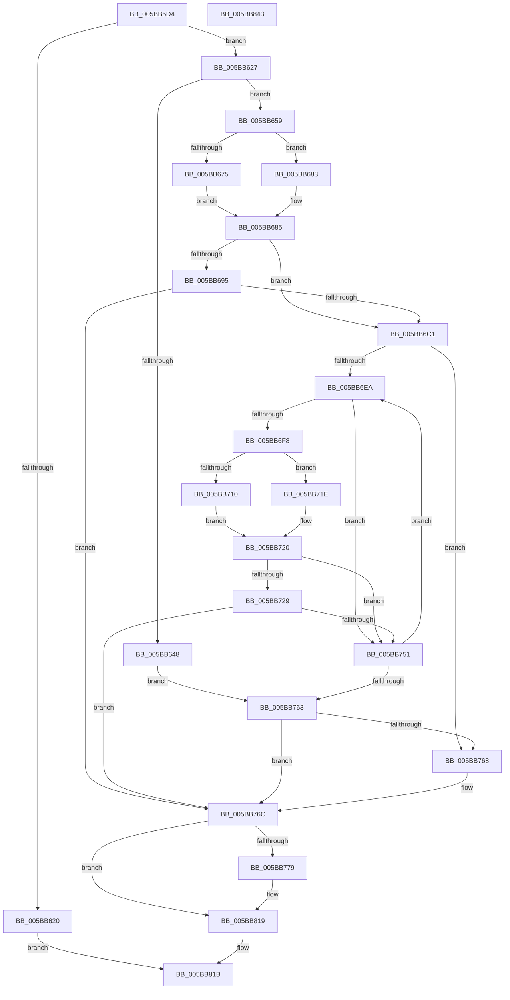

# KiGetNextClockOwner

- RVA: `0x005BB5D4`–`0x005BB844` (길이 `624` bytes)
- VA: `0x00000001405BB5D4`
- 실행 섹션: `.text`
- PDB 이름 있음: `예`; PDB Function 태그: `아니요`
- unwind 정보 RVA: `0x000CA17C`
- 디코드: `152`개 명령, `624/624` bytes 표시
- 미해석 바이트: `0` (있으면 어셈블리에 `.byte`로 보존)

> 이 문서는 커널 이미지의 기계어와 PDB 기호를 분석해 생성했습니다. 4번과 5번은 함수 원형과 자료형을 바이너리 사용 방식에서 추정한 C 해석이며 원본 소스 복구 결과는 아닙니다.

## 1. Dependencies

- 직접 호출 지점: **10**; 고유 호출 대상: **7**
- 직접 호출자로 확인된 함수: **1**
- RIP 상대 이미지 참조: **6**

### Outgoing calls
- `0x005BB63F` → [KeCheckProcessorAffinityEx](../30/KeCheckProcessorAffinityEx_function_00305150.md) (function, `0x00305150`)
- `0x005BB69F` → [KiHeteroReduceToMaximallyPreferredByClass](../41/KiHeteroReduceToMaximallyPreferredByClass_function_00414A48.md) (function, `0x00414A48`)
- `0x005BB6B1` → [KeFindFirstSetRightGroupAffinity](../2C/KeFindFirstSetRightGroupAffinity_function_002CFB10.md) (function, `0x002CFB10`)
- `0x005BB6D3` → [KiInitializeSystemSubNodeEnumerationContext](../42/KiInitializeSystemSubNodeEnumerationContext_function_0042798C.md) (function, `0x0042798C`)
- `0x005BB6E1` → [KiEnumerateNextSchedulerSubNodeInSystem](../25/KiEnumerateNextSchedulerSubNodeInSystem_function_002569C0.md) (function, `0x002569C0`)
- `0x005BB733` → [KiHeteroReduceToMaximallyPreferredByClass](../41/KiHeteroReduceToMaximallyPreferredByClass_function_00414A48.md) (function, `0x00414A48`)
- `0x005BB745` → [KeFindFirstSetRightGroupAffinity](../2C/KeFindFirstSetRightGroupAffinity_function_002CFB10.md) (function, `0x002CFB10`)
- `0x005BB75A` → [KiEnumerateNextSchedulerSubNodeInSystem](../25/KiEnumerateNextSchedulerSubNodeInSystem_function_002569C0.md) (function, `0x002569C0`)
- `0x005BB814` → [tlgWriteTransfer_EtwWriteTransfer](../42/tlgWriteTransfer_EtwWriteTransfer_function_004260E0.md) (function, `0x004260E0`)
- `0x005BB822` → [_security_check_cookie](../6A/_security_check_cookie_function_006AC640.md) (function, `0x006AC640`)

### Direct callers
- [KeResumeClockTimerFromIdle](KeResumeClockTimerFromIdle_function_005BACC4.md) at `0x005BAF10`

### Static image references
- `0x005BB5F2` → RVA `0x00E0A740` (`.data`; read)
- `0x005BB609` → RVA `0x00FC6ABF` (`ALMOSTRO`; read)
- `0x005BB62B` → RVA `0x00F10BE0` (`.data`; read)
- `0x005BB76C` → RVA `0x00E070D8` (`.data`; read)
- `0x005BB779` → RVA `0x00F21FB0` (`.data`; read)
- `0x005BB77F` → RVA `0x00048297` (`.rdata`; read)

## 2. Other-region calls and transfers

- 다른 실행 섹션으로 향하는 call: **0**
- 별도 외부 분기/꼬리 이동을 확인하지 못했습니다.

## 3. Assembly (complete function range)

```asm
005BB5D4  48 89 5C 24 10                  mov qword ptr [rsp + 0x10], rbx
005BB5D9  48 89 74 24 18                  mov qword ptr [rsp + 0x18], rsi
005BB5DE  55                              push rbp
005BB5DF  57                              push rdi
005BB5E0  41 55                           push r13
005BB5E2  41 56                           push r14
005BB5E4  41 57                           push r15
005BB5E6  48 8D 6C 24 C9                  lea rbp, [rsp - 0x37]
005BB5EB  48 81 EC 00 01 00 00            sub rsp, 0x100
005BB5F2  48 8B 05 47 F1 84 00            mov rax, qword ptr [rip + 0x84f147]
005BB5F9  48 33 C4                        xor rax, rsp
005BB5FC  48 89 45 27                     mov qword ptr [rbp + 0x27], rax
005BB600  48 83 64 24 38 00               and qword ptr [rsp + 0x38], 0
005BB606  0F 57 C0                        xorps xmm0, xmm0
005BB609  80 3D AF B4 A0 00 00            cmp byte ptr [rip + 0xa0b4af], 0
005BB610  4C 8B F1                        mov r14, rcx
005BB613  8B 59 24                        mov ebx, dword ptr [rcx + 0x24]
005BB616  0F 11 45 8F                     movups xmmword ptr [rbp - 0x71], xmm0
005BB61A  0F 11 45 9F                     movups xmmword ptr [rbp - 0x61], xmm0
005BB61E  75 07                           jne 0x1405bb627
005BB620  8B C3                           mov eax, ebx
005BB622  E9 F4 01 00 00                  jmp 0x1405bb81b
005BB627  41 83 CD FF                     or r13d, 0xffffffff
005BB62B  48 8D 0D AE 55 95 00            lea rcx, [rip + 0x9555ae]
005BB632  8B D3                           mov edx, ebx
005BB634  41 8B F5                        mov esi, r13d
005BB637  0F 11 44 24 40                  movups xmmword ptr [rsp + 0x40], xmm0
005BB63C  45 33 FF                        xor r15d, r15d
005BB63F  E8 0C 9B D4 FF                  call 0x140305150
005BB644  85 C0                           test eax, eax
005BB646  74 11                           je 0x1405bb659
005BB648  0F B7 7C 24 48                  movzx edi, word ptr [rsp + 0x48]
005BB64D  8B F3                           mov esi, ebx
005BB64F  48 8B 5C 24 40                  mov rbx, qword ptr [rsp + 0x40]
005BB654  E9 0A 01 00 00                  jmp 0x1405bb763
005BB659  41 0F B6 BE D0 00 00 00         movzx edi, byte ptr [r14 + 0xd0]
005BB661  41 BF 01 00 00 00               mov r15d, 1
005BB667  66 3B 3D 72 55 95 00            cmp di, word ptr [rip + 0x955572]
005BB66E  66 89 7C 24 48                  mov word ptr [rsp + 0x48], di
005BB673  73 0E                           jae 0x1405bb683
005BB675  48 8D 0D 64 55 95 00            lea rcx, [rip + 0x955564]
005BB67C  48 8B 5C F9 08                  mov rbx, qword ptr [rcx + rdi*8 + 8]
005BB681  EB 02                           jmp 0x1405bb685
005BB683  33 DB                           xor ebx, ebx
005BB685  49 8B 8E C0 00 00 00            mov rcx, qword ptr [r14 + 0xc0]
005BB68C  48 23 99 80 00 00 00            and rbx, qword ptr [rcx + 0x80]
005BB693  74 2C                           je 0x1405bb6c1
005BB695  45 33 C9                        xor r9d, r9d
005BB698  48 8B D3                        mov rdx, rbx
005BB69B  45 8D 41 04                     lea r8d, [r9 + 4]
005BB69F  E8 A4 93 E5 FF                  call 0x140414a48
005BB6A4  48 8D 4C 24 40                  lea rcx, [rsp + 0x40]
005BB6A9  48 89 44 24 40                  mov qword ptr [rsp + 0x40], rax
005BB6AE  48 8B D8                        mov rbx, rax
005BB6B1  E8 5A 44 D1 FF                  call 0x1402cfb10
005BB6B6  8B F0                           mov esi, eax
005BB6B8  41 3B C5                        cmp eax, r13d
005BB6BB  0F 85 AB 00 00 00               jne 0x1405bb76c
005BB6C1  49 8B 8E C0 00 00 00            mov rcx, qword ptr [r14 + 0xc0]
005BB6C8  0F B7 91 8A 00 00 00            movzx edx, word ptr [rcx + 0x8a]
005BB6CF  48 8D 4D 8F                     lea rcx, [rbp - 0x71]
005BB6D3  E8 B4 C2 E6 FF                  call 0x14042798c
005BB6D8  48 8D 54 24 38                  lea rdx, [rsp + 0x38]
005BB6DD  48 8D 4D 8F                     lea rcx, [rbp - 0x71]
005BB6E1  E8 DA B2 C9 FF                  call 0x1402569c0
005BB6E6  85 C0                           test eax, eax
005BB6E8  75 7E                           jne 0x1405bb768
005BB6EA  48 8B 4C 24 38                  mov rcx, qword ptr [rsp + 0x38]
005BB6EF  49 3B 8E C0 00 00 00            cmp rcx, qword ptr [r14 + 0xc0]
005BB6F6  74 59                           je 0x1405bb751
005BB6F8  0F B7 B9 88 00 00 00            movzx edi, word ptr [rcx + 0x88]
005BB6FF  41 FF C7                        inc r15d
005BB702  66 3B 3D D7 54 95 00            cmp di, word ptr [rip + 0x9554d7]
005BB709  66 89 7C 24 48                  mov word ptr [rsp + 0x48], di
005BB70E  73 0E                           jae 0x1405bb71e
005BB710  48 8D 15 C9 54 95 00            lea rdx, [rip + 0x9554c9]
005BB717  48 8B 5C FA 08                  mov rbx, qword ptr [rdx + rdi*8 + 8]
005BB71C  EB 02                           jmp 0x1405bb720
005BB71E  33 DB                           xor ebx, ebx
005BB720  48 23 99 80 00 00 00            and rbx, qword ptr [rcx + 0x80]
005BB727  74 28                           je 0x1405bb751
005BB729  45 33 C9                        xor r9d, r9d
005BB72C  48 8B D3                        mov rdx, rbx
005BB72F  45 8D 41 04                     lea r8d, [r9 + 4]
005BB733  E8 10 93 E5 FF                  call 0x140414a48
005BB738  48 8D 4C 24 40                  lea rcx, [rsp + 0x40]
005BB73D  48 89 44 24 40                  mov qword ptr [rsp + 0x40], rax
005BB742  48 8B D8                        mov rbx, rax
005BB745  E8 C6 43 D1 FF                  call 0x1402cfb10
005BB74A  8B F0                           mov esi, eax
005BB74C  41 3B C5                        cmp eax, r13d
005BB74F  75 1B                           jne 0x1405bb76c
005BB751  48 8D 54 24 38                  lea rdx, [rsp + 0x38]
005BB756  48 8D 4D 8F                     lea rcx, [rbp - 0x71]
005BB75A  E8 61 B2 C9 FF                  call 0x1402569c0
005BB75F  85 C0                           test eax, eax
005BB761  74 87                           je 0x1405bb6ea
005BB763  41 3B F5                        cmp esi, r13d
005BB766  75 04                           jne 0x1405bb76c
005BB768  41 8B 76 24                     mov esi, dword ptr [r14 + 0x24]
005BB76C  83 3D 65 B9 84 00 05            cmp dword ptr [rip + 0x84b965], 5
005BB773  0F 86 A0 00 00 00               jbe 0x1405bb819
005BB779  8B 05 31 68 96 00               mov eax, dword ptr [rip + 0x966831]
005BB77F  48 8D 15 11 CB A8 FF            lea rdx, [rip - 0x5734ef]
005BB786  83 65 E3 00                     and dword ptr [rbp - 0x1d], 0
005BB78A  B9 04 00 00 00                  mov ecx, 4
005BB78F  83 65 F3 00                     and dword ptr [rbp - 0xd], 0
005BB793  45 33 C9                        xor r9d, r9d
005BB796  83 65 03 00                     and dword ptr [rbp + 3], 0
005BB79A  45 33 C0                        xor r8d, r8d
005BB79D  83 65 13 00                     and dword ptr [rbp + 0x13], 0
005BB7A1  83 65 23 00                     and dword ptr [rbp + 0x23], 0
005BB7A5  89 45 87                        mov dword ptr [rbp - 0x79], eax
005BB7A8  48 8D 45 87                     lea rax, [rbp - 0x79]
005BB7AC  48 89 45 D7                     mov qword ptr [rbp - 0x29], rax
005BB7B0  48 8D 45 8B                     lea rax, [rbp - 0x75]
005BB7B4  48 89 45 E7                     mov qword ptr [rbp - 0x19], rax
005BB7B8  48 8D 44 24 38                  lea rax, [rsp + 0x38]
005BB7BD  48 89 45 F7                     mov qword ptr [rbp - 9], rax
005BB7C1  48 8D 44 24 30                  lea rax, [rsp + 0x30]
005BB7C6  48 89 45 07                     mov qword ptr [rbp + 7], rax
005BB7CA  48 8D 44 24 40                  lea rax, [rsp + 0x40]
005BB7CF  48 89 45 17                     mov qword ptr [rbp + 0x17], rax
005BB7D3  48 8D 45 B7                     lea rax, [rbp - 0x49]
005BB7D7  89 4D DF                        mov dword ptr [rbp - 0x21], ecx
005BB7DA  89 4D EF                        mov dword ptr [rbp - 0x11], ecx
005BB7DD  89 4D FF                        mov dword ptr [rbp - 1], ecx
005BB7E0  48 8D 0D F1 B8 84 00            lea rcx, [rip + 0x84b8f1]
005BB7E7  48 89 44 24 28                  mov qword ptr [rsp + 0x28], rax
005BB7EC  C7 44 24 20 07 00 00 00         mov dword ptr [rsp + 0x20], 7
005BB7F4  89 75 8B                        mov dword ptr [rbp - 0x75], esi
005BB7F7  44 89 7C 24 38                  mov dword ptr [rsp + 0x38], r15d
005BB7FC  66 89 7C 24 30                  mov word ptr [rsp + 0x30], di
005BB801  C7 45 0F 02 00 00 00            mov dword ptr [rbp + 0xf], 2
005BB808  48 89 5C 24 40                  mov qword ptr [rsp + 0x40], rbx
005BB80D  C7 45 1F 08 00 00 00            mov dword ptr [rbp + 0x1f], 8
005BB814  E8 C7 A8 E6 FF                  call 0x1404260e0
005BB819  8B C6                           mov eax, esi
005BB81B  48 8B 4D 27                     mov rcx, qword ptr [rbp + 0x27]
005BB81F  48 33 CC                        xor rcx, rsp
005BB822  E8 19 0E 0F 00                  call 0x1406ac640
005BB827  4C 8D 9C 24 00 01 00 00         lea r11, [rsp + 0x100]
005BB82F  49 8B 5B 38                     mov rbx, qword ptr [r11 + 0x38]
005BB833  49 8B 73 40                     mov rsi, qword ptr [r11 + 0x40]
005BB837  49 8B E3                        mov rsp, r11
005BB83A  41 5F                           pop r15
005BB83C  41 5E                           pop r14
005BB83E  41 5D                           pop r13
005BB840  5F                              pop rdi
005BB841  5D                              pop rbp
005BB842  C3                              ret
005BB843  CC                              int3
```

## 4. C-style interpretation (structured pseudocode)

```c
__int64 __fastcall KiGetNextClockOwner(__int64 a1, __int64 a2, __int64 a3, int a4)
{
    __int64 result;
    __int64 v_r13;
    __int64 v_r15;
    __int64 v_rbx;
    __int64 v_rsi;
    __int64 v_rsp;
    unsigned __int64 v_stack_m100;
    unsigned int v_stack_m108;
    unsigned __int64 v_stack_m28;
    unsigned __int64 v_stack_m38;
    unsigned int v_stack_m3C;
    unsigned int v_stack_m40;
    unsigned __int64 v_stack_m48;
    unsigned int v_stack_m4C;
    unsigned int v_stack_m50;
    unsigned __int64 v_stack_m58;
    unsigned int v_stack_m5C;
    unsigned __int64 v_stack_m5F;
    unsigned int v_stack_m60;
    unsigned __int64 v_stack_m68;
    unsigned int v_stack_m6C;
    unsigned int v_stack_m70;
    unsigned __int64 v_stack_m78;
    unsigned int v_stack_m7C;
    unsigned int v_stack_m80;
    unsigned __int64 v_stack_m88;
    unsigned __int64 v_stack_mA8;
    unsigned __int64 v_stack_mC0;
    unsigned __int64 v_stack_mD0;
    unsigned __int64 v_stack_mD4;
    unsigned int v_stack_mD8;
    unsigned __int16 v_stack_mE0;
    unsigned __int64 v_stack_mE8;
    unsigned __int64 v_stack_mF0;
    unsigned __int64 v_stack_mF8;
    unsigned __int64 v_stack_p10;
    unsigned __int64 v_stack_p18;

    v_stack_p10 = v_rbx;
    v_stack_p18 = v_rsi;
    v_rsp = (v_rsp) - (256);
    result = (*(unsigned __int64 *)(v_rip + 8712519)) ^ (v_rsp);
    v_stack_m38 = result;
    v_stack_mD0 = v_xmm0;
    v_stack_mC0 = v_xmm0;
    if ((*(unsigned __int8 *)(v_rip + 10532015)) != 0) goto loc_005BB627;
    goto loc_005BB81B;
loc_005BB627:
    v_r13 = (unsigned int)((v_r13) | (0xFFFFFFFFULL));
    v_stack_mE8 = v_xmm0;
    v_r15 = 0;
    result = KeCheckProcessorAffinityEx(v_rip + 9786798, (unsigned int)((unsigned int)((unsigned int)(*(unsigned int *)(a1 + 36)))), a3, a4);
    if ((unsigned int)(result) == 0) goto loc_005BB659;
    goto loc_005BB763;
loc_005BB659:
    v_stack_mE0 = (unsigned __int16)(*(unsigned __int8 *)(a1 + 208));
    if (((unsigned __int16)(*(unsigned __int8 *)(a1 + 208))) >= (*(unsigned __int16 *)(v_rip + 9786738))) goto loc_005BB683;
    goto loc_005BB685;
loc_005BB683:
    v_rbx = 0;
loc_005BB685:
    v_rbx = (v_rbx) & (*(unsigned __int64 *)(*(unsigned __int64 *)(a1 + 192) + 128));
    if (condition_is_equal) goto loc_005BB6C1;
    a4 = 0;
    result = KiHeteroReduceToMaximallyPreferredByClass(*(unsigned __int64 *)(a1 + 192), v_rbx, a4 + 4, a4);
    v_stack_mE8 = result;
    result = KeFindFirstSetRightGroupAffinity(v_stack_mE8, v_rbx, a4 + 4, a4);
    if (((unsigned int)(result)) != ((unsigned int)(v_r13))) goto loc_005BB76C;
loc_005BB6C1:
    result = KiInitializeSystemSubNodeEnumerationContext(v_stack_mD0, *(unsigned __int16 *)(*(unsigned __int64 *)(a1 + 192) + 138), a4 + 4, a4);
    result = KiEnumerateNextSchedulerSubNodeInSystem(v_stack_mD0, v_stack_mF0, a4 + 4, a4);
    if ((unsigned int)(result) != 0) goto loc_005BB768;
loc_005BB6EA:
    if (v_stack_mF0 == (*(unsigned __int64 *)(a1 + 192))) goto loc_005BB751;
    v_r15 = (unsigned int)((1) + 1);
    v_stack_mE0 = (unsigned __int16)(*(unsigned __int16 *)(v_stack_mF0 + 136));
    if (((unsigned __int16)(*(unsigned __int16 *)(v_stack_mF0 + 136))) >= (*(unsigned __int16 *)(v_rip + 9786583))) goto loc_005BB71E;
    goto loc_005BB720;
loc_005BB71E:
    v_rbx = 0;
loc_005BB720:
    v_rbx = (v_rbx) & (*(unsigned __int64 *)(v_stack_mF0 + 128));
    if (condition_is_equal) goto loc_005BB751;
    a4 = 0;
    result = KiHeteroReduceToMaximallyPreferredByClass(v_stack_mF0, v_rbx, a4 + 4, a4);
    v_stack_mE8 = result;
    result = KeFindFirstSetRightGroupAffinity(v_stack_mE8, v_rbx, a4 + 4, a4);
    if (((unsigned int)(result)) != ((unsigned int)(v_r13))) goto loc_005BB76C;
loc_005BB751:
    result = KiEnumerateNextSchedulerSubNodeInSystem(v_stack_mD0, v_stack_mF0, a4 + 4, a4);
    if ((unsigned int)(result) == 0) goto loc_005BB6EA;
loc_005BB763:
    v_rsi = (unsigned int)((unsigned int)(result));
    if (((unsigned int)((unsigned int)((unsigned int)(result)))) == ((unsigned int)(v_r13))) {
        v_rsi = *(unsigned int *)(a1 + 36);
    }
    if ((*(unsigned int *)(v_rip + 8698213)) >= = 5) {
        result = *(unsigned int *)(v_rip + 9857073);
        a2 = v_rip - 5715183;
        a1 = 4;
        a4 = 0;
        a3 = 0;
        v_stack_mD8 = (unsigned int)(result);
        result = v_stack_mD8;
        v_stack_m88 = result;
        result = v_stack_mD4;
        v_stack_m78 = result;
        result = v_stack_mF0;
        v_stack_m68 = result;
        result = v_stack_mF8;
        v_stack_m58 = result;
        result = v_stack_mE8;
        v_stack_m48 = result;
        result = v_stack_mA8;
        v_stack_m80 = (unsigned int)(a1);
        v_stack_m70 = (unsigned int)(a1);
        v_stack_m60 = (unsigned int)(a1);
        a1 = v_rip + 8698097;
        v_stack_m100 = result;
        v_stack_m108 = 7;
        v_stack_mD4 = (unsigned int)(v_rsi);
        v_stack_mF0 = (unsigned int)(v_r15);
        v_stack_mF8 = (unsigned __int16)(*(unsigned __int16 *)(v_stack_mF0 + 136));
        v_stack_m50 = 2;
        v_stack_mE8 = result;
        v_stack_m40 = 8;
        result = tlgWriteTransfer_EtwWriteTransfer(a1, a2, a3, a4);
    }
loc_005BB81B:
    a1 = (v_stack_m38) ^ (v_rsp);
    result = _security_check_cookie(a1, a2, a3, a4);
    return result;
}
```

## 5. (Beta) C Style

```c
int64_t KiGetNextClockOwner(void *Arg1, int64_t Arg2, int64_t Arg3, int32_t Arg4)
{
    uint8_t *arg1 = (uint8_t *)Arg1;

    int64_t result;
    int64_t local_r13;
    int64_t local_r15;
    int64_t local_rbx;
    int64_t local_rsi;
    int64_t local_rsp;
    uint64_t v_stack_m100;
    uint32_t v_stack_m108;
    uint64_t v_stack_m28;
    uint64_t v_stack_m38;
    uint32_t v_stack_m3C;
    uint32_t v_stack_m40;
    uint64_t v_stack_m48;
    uint32_t v_stack_m4C;
    uint32_t v_stack_m50;
    uint64_t v_stack_m58;
    uint32_t v_stack_m5C;
    uint64_t v_stack_m5F;
    uint32_t v_stack_m60;
    uint64_t v_stack_m68;
    uint32_t v_stack_m6C;
    uint32_t v_stack_m70;
    uint64_t v_stack_m78;
    uint32_t v_stack_m7C;
    uint32_t v_stack_m80;
    uint64_t v_stack_m88;
    uint64_t v_stack_mA8;
    uint64_t v_stack_mC0;
    uint64_t v_stack_mD0;
    uint64_t v_stack_mD4;
    uint32_t v_stack_mD8;
    uint16_t v_stack_mE0;
    uint64_t v_stack_mE8;
    uint64_t v_stack_mF0;
    uint64_t v_stack_mF8;
    uint64_t v_stack_p10;
    uint64_t v_stack_p18;

    v_stack_p10 = local_rbx;
    v_stack_p18 = local_rsi;
    local_rsp = (local_rsp) - (256);
    result = (*(uint64_t *)(v_rip + 0x84F147)) ^ (local_rsp);
    v_stack_m38 = result;
    v_stack_mD0 = v_xmm0;
    v_stack_mC0 = v_xmm0;
    if ((*(uint8_t *)(v_rip + 0xA0B4AF)) != 0) goto loc_005BB627;
    goto loc_005BB81B;
loc_005BB627:
    local_r13 = (uint32_t)((local_r13) | (0xFFFFFFFFULL));
    v_stack_mE8 = v_xmm0;
    local_r15 = 0;
    result = KeCheckProcessorAffinityEx(v_rip + 9786798, (uint32_t)((uint32_t)((uint32_t)(*(uint32_t *)(arg1 + 0x24)))), Arg3, Arg4);
    if ((uint32_t)(result) == 0) goto loc_005BB659;
    goto loc_005BB763;
loc_005BB659:
    v_stack_mE0 = (uint16_t)(*(uint8_t *)(arg1 + 0xD0));
    if (((uint16_t)(*(uint8_t *)(arg1 + 0xD0))) >= (*(uint16_t *)(v_rip + 0x955572))) goto loc_005BB683;
    goto loc_005BB685;
loc_005BB683:
    local_rbx = 0;
loc_005BB685:
    local_rbx = (local_rbx) & (*(uint64_t *)(*(uint64_t *)(arg1 + 0xC0) + 0x80));
    if (condition_is_equal) goto loc_005BB6C1;
    Arg4 = 0;
    result = KiHeteroReduceToMaximallyPreferredByClass(*(uint64_t *)(arg1 + 0xC0), local_rbx, Arg4 + 4, Arg4);
    v_stack_mE8 = result;
    result = KeFindFirstSetRightGroupAffinity(v_stack_mE8, local_rbx, Arg4 + 4, Arg4);
    if (((uint32_t)(result)) != ((uint32_t)(local_r13))) goto loc_005BB76C;
loc_005BB6C1:
    result = KiInitializeSystemSubNodeEnumerationContext(v_stack_mD0, *(uint16_t *)(*(uint64_t *)(arg1 + 0xC0) + 0x8A), Arg4 + 4, Arg4);
    result = KiEnumerateNextSchedulerSubNodeInSystem(v_stack_mD0, v_stack_mF0, Arg4 + 4, Arg4);
    if ((uint32_t)(result) != 0) goto loc_005BB768;
loc_005BB6EA:
    if (v_stack_mF0 == (*(uint64_t *)(arg1 + 0xC0))) goto loc_005BB751;
    local_r15 = (uint32_t)((1) + 1);
    v_stack_mE0 = (uint16_t)(*(uint16_t *)(v_stack_mF0 + 0x88));
    if (((uint16_t)(*(uint16_t *)(v_stack_mF0 + 0x88))) >= (*(uint16_t *)(v_rip + 0x9554D7))) goto loc_005BB71E;
    goto loc_005BB720;
loc_005BB71E:
    local_rbx = 0;
loc_005BB720:
    local_rbx = (local_rbx) & (*(uint64_t *)(v_stack_mF0 + 0x80));
    if (condition_is_equal) goto loc_005BB751;
    Arg4 = 0;
    result = KiHeteroReduceToMaximallyPreferredByClass(v_stack_mF0, local_rbx, Arg4 + 4, Arg4);
    v_stack_mE8 = result;
    result = KeFindFirstSetRightGroupAffinity(v_stack_mE8, local_rbx, Arg4 + 4, Arg4);
    if (((uint32_t)(result)) != ((uint32_t)(local_r13))) goto loc_005BB76C;
loc_005BB751:
    result = KiEnumerateNextSchedulerSubNodeInSystem(v_stack_mD0, v_stack_mF0, Arg4 + 4, Arg4);
    if ((uint32_t)(result) == 0) goto loc_005BB6EA;
loc_005BB763:
    local_rsi = (uint32_t)((uint32_t)(result));
    if (((uint32_t)((uint32_t)((uint32_t)(result)))) == ((uint32_t)(local_r13))) {
        local_rsi = *(uint32_t *)(arg1 + 0x24);
    }
    if ((*(uint32_t *)(v_rip + 0x84B965)) >= = 5) {
        result = *(uint32_t *)(v_rip + 0x966831);
        Arg2 = v_rip - 5715183;
        Arg1 = 4;
        Arg4 = 0;
        Arg3 = 0;
        v_stack_mD8 = (uint32_t)(result);
        result = v_stack_mD8;
        v_stack_m88 = result;
        result = v_stack_mD4;
        v_stack_m78 = result;
        result = v_stack_mF0;
        v_stack_m68 = result;
        result = v_stack_mF8;
        v_stack_m58 = result;
        result = v_stack_mE8;
        v_stack_m48 = result;
        result = v_stack_mA8;
        v_stack_m80 = (uint32_t)(Arg1);
        v_stack_m70 = (uint32_t)(Arg1);
        v_stack_m60 = (uint32_t)(Arg1);
        Arg1 = v_rip + 8698097;
        v_stack_m100 = result;
        v_stack_m108 = 7;
        v_stack_mD4 = (uint32_t)(local_rsi);
        v_stack_mF0 = (uint32_t)(local_r15);
        v_stack_mF8 = (uint16_t)(*(uint16_t *)(v_stack_mF0 + 0x88));
        v_stack_m50 = 2;
        v_stack_mE8 = result;
        v_stack_m40 = 8;
        result = tlgWriteTransfer_EtwWriteTransfer(Arg1, Arg2, Arg3, Arg4);
    }
loc_005BB81B:
    Arg1 = (v_stack_m38) ^ (local_rsp);
    result = _security_check_cookie(Arg1, Arg2, Arg3, Arg4);
    return result;
}
```

### 관측된 메모리 오프셋

구조체 형식이 확인되지 않은 접근은 인자 기준의 오프셋으로만 기록했습니다.

| 기준 인자 | 오프셋 표현 | 폭 (bit) | 접근 |
|---|---:|---:|---|
| `Arg1` | `+ 0x24` | `32` | `R` |
| `Arg1` | `+ 0xC0` | `64` | `R` |
| `Arg1` | `+ 0xD0` | `8` | `R` |

## 6. Execution-region graph

[열기: 2D/3D 그래프와 함수 탐색 컨트롤 패널](../../../control-panel.html?section=text&rva=0x005BB5D4&view=graph)

- 2D 그래프는 위에서 아래로 흐르고, 3D 그래프는 빈 공간을 드래그해 회전합니다. Shift+드래그는 이동, 휠은 확대·축소, 함수 노드 선택은 대상 보고서 이동입니다.

### Static fallback


