# KiGetNextTimerExpirationDueTime

- RVA: `0x005BCF60`–`0x005BD24B` (길이 `747` bytes)
- VA: `0x00000001405BCF60`
- 실행 섹션: `.text`
- PDB 이름 있음: `예`; PDB Function 태그: `아니요`
- unwind 정보 RVA: `0x000CA464`
- 디코드: `212`개 명령, `747/747` bytes 표시
- 미해석 바이트: `0` (있으면 어셈블리에 `.byte`로 보존)

> 이 문서는 커널 이미지의 기계어와 PDB 기호를 분석해 생성했습니다. 4번과 5번은 함수 원형과 자료형을 바이너리 사용 방식에서 추정한 C 해석이며 원본 소스 복구 결과는 아닙니다.

## 1. Dependencies

- 직접 호출 지점: **7**; 고유 호출 대상: **7**
- 직접 호출자로 확인된 함수: **2**
- RIP 상대 이미지 참조: **16**

### Outgoing calls
- `0x005BCFF4` → [KiFindNextTimerDueTime](../5C/KiFindNextTimerDueTime_function_005C5EF8.md) (function, `0x005C5EF8`)
- `0x005BD037` → [KeQueryTimerDueTime](../49/KeQueryTimerDueTime_function_00499CC0.md) (function, `0x00499CC0`)
- `0x005BD075` → [KeIsEmptyAffinityEx](../2D/KeIsEmptyAffinityEx_function_002D1580.md) (function, `0x002D1580`)
- `0x005BD084` → [KeCheckProcessorAffinityEx](../30/KeCheckProcessorAffinityEx_function_00305150.md) (function, `0x00305150`)
- `0x005BD0CB` → [KiGetNextTimer2ExpirationDueTime](../5C/KiGetNextTimer2ExpirationDueTime_function_005C644C.md) (function, `0x005C644C`)
- `0x005BD10A` → [KiGetPastDueIRTimerInfo](../5C/KiGetPastDueIRTimerInfo_function_005C64F8.md) (function, `0x005C64F8`)
- `0x005BD1D7` → [guard_dispatch_icall](../6B/guard_dispatch_icall_function_006BAAD0.md) (function, `0x006BAAD0`)

### Direct callers
- [KeEstimateClockTickDuration](../4C/KeEstimateClockTickDuration_function_004C7CCC.md) at `0x004C7DFE`
- [KeEstimateClockTickDuration](../4C/KeEstimateClockTickDuration_function_004C7CCC.md) at `0x004C7E62`
- [KePrepareClockTimerForPlatformIdle](KePrepareClockTimerForPlatformIdle_function_005BA820.md) at `0x005BA959`

### Static image references
- `0x005BCFC2` → RVA `0x00FC5030` (`ALMOSTRO`; read)
- `0x005BCFCA` → RVA `0x00FC50DC` (`ALMOSTRO`; read)
- `0x005BD002` → RVA `0x00EFAB90` (`.data`; read)
- `0x005BD05F` → RVA `0x00FC6ABC` (`ALMOSTRO`; read)
- `0x005BD06C` → RVA `0x00E0AFD0` (`.data`; read)
- `0x005BD08D` → RVA `0x00FC6AA0` (`ALMOSTRO`; read)
- `0x005BD093` → RVA `0x00F23150` (`.data`; read)
- `0x005BD114` → RVA `0x00FC6C48` (`ALMOSTRO`; read)
- `0x005BD11D` → RVA `0x00E668B0` (`.data`; read)
- `0x005BD124` → RVA `0x00FC6BEC` (`ALMOSTRO`; read)
- `0x005BD12A` → RVA `0x00FC6B3C` (`ALMOSTRO`; read)
- `0x005BD142` → RVA `0x00FC6BB8` (`ALMOSTRO`; read)
- `0x005BD191` → RVA `0x00F475DC` (`.data`; read)
- `0x005BD19A` → RVA `0x00F475F8` (`.data`; read)
- `0x005BD1A8` → RVA `0x00FC5370` (`ALMOSTRO`; read)
- `0x005BD1CD` → RVA `0x00E00BC8` (`.data`; read)

## 2. Other-region calls and transfers

- 다른 실행 섹션으로 향하는 call: **0**
- 별도 외부 분기/꼬리 이동을 확인하지 못했습니다.

## 3. Assembly (complete function range)

```asm
005BCF60  48 89 5C 24 18                  mov qword ptr [rsp + 0x18], rbx
005BCF65  44 88 4C 24 20                  mov byte ptr [rsp + 0x20], r9b
005BCF6A  88 54 24 10                     mov byte ptr [rsp + 0x10], dl
005BCF6E  55                              push rbp
005BCF6F  56                              push rsi
005BCF70  57                              push rdi
005BCF71  41 54                           push r12
005BCF73  41 55                           push r13
005BCF75  41 56                           push r14
005BCF77  41 57                           push r15
005BCF79  48 8B EC                        mov rbp, rsp
005BCF7C  48 83 EC 50                     sub rsp, 0x50
005BCF80  48 83 65 F8 00                  and qword ptr [rbp - 8], 0
005BCF85  33 F6                           xor esi, esi
005BCF87  48 83 65 F0 00                  and qword ptr [rbp - 0x10], 0
005BCF8C  48 83 CB FF                     or rbx, 0xffffffffffffffff
005BCF90  33 FF                           xor edi, edi
005BCF92  C6 45 40 00                     mov byte ptr [rbp + 0x40], 0
005BCF96  45 33 E4                        xor r12d, r12d
005BCF99  48 89 5D E8                     mov qword ptr [rbp - 0x18], rbx
005BCF9D  45 8A F1                        mov r14b, r9b
005BCFA0  4D 8B F8                        mov r15, r8
005BCFA3  4C 8B E9                        mov r13, rcx
005BCFA6  40 88 75 E0                     mov byte ptr [rbp - 0x20], sil
005BCFAA  40 88 75 E1                     mov byte ptr [rbp - 0x1f], sil
005BCFAE  48 39 71 10                     cmp qword ptr [rcx + 0x10], rsi
005BCFB2  74 08                           je 0x1405bcfbc
005BCFB4  8D 77 01                        lea esi, [rdi + 1]
005BCFB7  E9 39 02 00 00                  jmp 0x1405bd1f5
005BCFBC  40 38 71 21                     cmp byte ptr [rcx + 0x21], sil
005BCFC0  75 1B                           jne 0x1405bcfdd
005BCFC2  39 35 68 80 A0 00               cmp dword ptr [rip + 0xa08068], esi
005BCFC8  75 13                           jne 0x1405bcfdd
005BCFCA  83 3D 0B 81 A0 00 02            cmp dword ptr [rip + 0xa0810b], 2
005BCFD1  75 0A                           jne 0x1405bcfdd
005BCFD3  BE 02 00 00 00                  mov esi, 2
005BCFD8  E9 18 02 00 00                  jmp 0x1405bd1f5
005BCFDD  48 8B FB                        mov rdi, rbx
005BCFE0  45 84 C9                        test r9b, r9b
005BCFE3  75 1D                           jne 0x1405bd002
005BCFE5  44 8A C2                        mov r8b, dl
005BCFE8  4C 8D 4D E8                     lea r9, [rbp - 0x18]
005BCFEC  49 8B D7                        mov rdx, r15
005BCFEF  BE 04 00 00 00                  mov esi, 4
005BCFF4  E8 FF 8E 00 00                  call 0x1405c5ef8
005BCFF9  48 8B 5D E8                     mov rbx, qword ptr [rbp - 0x18]
005BCFFD  48 8B F8                        mov rdi, rax
005BD000  EB 5D                           jmp 0x1405bd05f
005BD002  4C 8B 35 87 DB 93 00            mov r14, qword ptr [rip + 0x93db87]
005BD009  4C 8D 05 80 DB 93 00            lea r8, [rip + 0x93db80]
005BD010  41 BC 0C 00 00 00               mov r12d, 0xc
005BD016  48 8B D3                        mov rdx, rbx
005BD019  EB 37                           jmp 0x1405bd052
005BD01B  49 8D 8E F8 FE FF FF            lea rcx, [r14 - 0x108]
005BD022  4D 8B 36                        mov r14, qword ptr [r14]
005BD025  F6 81 30 01 00 00 04            test byte ptr [rcx + 0x130], 4
005BD02C  74 24                           je 0x1405bd052
005BD02E  48 39 B1 00 01 00 00            cmp qword ptr [rcx + 0x100], rsi
005BD035  74 0F                           je 0x1405bd046
005BD037  E8 84 CC ED FF                  call 0x140499cc0
005BD03C  48 8B D0                        mov rdx, rax
005BD03F  4C 8D 05 4A DB 93 00            lea r8, [rip + 0x93db4a]
005BD046  48 85 D2                        test rdx, rdx
005BD049  74 07                           je 0x1405bd052
005BD04B  48 3B D3                        cmp rdx, rbx
005BD04E  48 0F 42 DA                     cmovb rbx, rdx
005BD052  4D 3B F0                        cmp r14, r8
005BD055  75 C4                           jne 0x1405bd01b
005BD057  44 8A 75 58                     mov r14b, byte ptr [rbp + 0x58]
005BD05B  48 89 5D E8                     mov qword ptr [rbp - 0x18], rbx
005BD05F  80 3D 56 9A A0 00 00            cmp byte ptr [rip + 0xa09a56], 0
005BD066  74 45                           je 0x1405bd0ad
005BD068  80 7D 48 00                     cmp byte ptr [rbp + 0x48], 0
005BD06C  48 8D 0D 5D DF 84 00            lea rcx, [rip + 0x84df5d]
005BD073  74 0B                           je 0x1405bd080
005BD075  E8 06 45 D1 FF                  call 0x1402d1580
005BD07A  85 C0                           test eax, eax
005BD07C  75 2F                           jne 0x1405bd0ad
005BD07E  EB 0D                           jmp 0x1405bd08d
005BD080  41 8B 55 24                     mov edx, dword ptr [r13 + 0x24]
005BD084  E8 C7 80 D4 FF                  call 0x140305150
005BD089  85 C0                           test eax, eax
005BD08B  74 20                           je 0x1405bd0ad
005BD08D  8B 05 0D 9A A0 00               mov eax, dword ptr [rip + 0xa09a0d]
005BD093  48 0F AF 05 B5 60 96 00         imul rax, qword ptr [rip + 0x9660b5]
005BD09B  48 3B C3                        cmp rax, rbx
005BD09E  73 0D                           jae 0x1405bd0ad
005BD0A0  48 8B D8                        mov rbx, rax
005BD0A3  48 89 45 E8                     mov qword ptr [rbp - 0x18], rax
005BD0A7  41 BC 05 00 00 00               mov r12d, 5
005BD0AD  41 80 7D 21 00                  cmp byte ptr [r13 + 0x21], 0
005BD0B2  74 60                           je 0x1405bd114
005BD0B4  8A 55 68                        mov dl, byte ptr [rbp + 0x68]
005BD0B7  48 8D 45 40                     lea rax, [rbp + 0x40]
005BD0BB  4C 8D 4D F8                     lea r9, [rbp - 8]
005BD0BF  48 89 44 24 20                  mov qword ptr [rsp + 0x20], rax
005BD0C4  4C 8D 45 F0                     lea r8, [rbp - 0x10]
005BD0C8  41 8A CE                        mov cl, r14b
005BD0CB  E8 7C 93 00 00                  call 0x1405c644c
005BD0D0  41 B9 06 00 00 00               mov r9d, 6
005BD0D6  48 39 7D F0                     cmp qword ptr [rbp - 0x10], rdi
005BD0DA  73 07                           jae 0x1405bd0e3
005BD0DC  48 8B 7D F0                     mov rdi, qword ptr [rbp - 0x10]
005BD0E0  41 8B F1                        mov esi, r9d
005BD0E3  48 8B 4D F8                     mov rcx, qword ptr [rbp - 8]
005BD0E7  48 3B CB                        cmp rcx, rbx
005BD0EA  73 28                           jae 0x1405bd114
005BD0EC  80 7D 40 00                     cmp byte ptr [rbp + 0x40], 0
005BD0F0  48 8B D9                        mov rbx, rcx
005BD0F3  48 89 4D E8                     mov qword ptr [rbp - 0x18], rcx
005BD0F7  74 18                           je 0x1405bd111
005BD0F9  8A 55 68                        mov dl, byte ptr [rbp + 0x68]
005BD0FC  4C 8D 4D E1                     lea r9, [rbp - 0x1f]
005BD100  4C 8D 45 E0                     lea r8, [rbp - 0x20]
005BD104  41 BC 07 00 00 00               mov r12d, 7
005BD10A  E8 E9 93 00 00                  call 0x1405c64f8
005BD10F  EB 03                           jmp 0x1405bd114
005BD111  45 8B E1                        mov r12d, r9d
005BD114  83 3D 2D 9B A0 00 00            cmp dword ptr [rip + 0xa09b2d], 0
005BD11B  75 63                           jne 0x1405bd180
005BD11D  4C 8B 05 8C 97 8A 00            mov r8, qword ptr [rip + 0x8a978c]
005BD124  8B 05 C2 9A A0 00               mov eax, dword ptr [rip + 0xa09ac2]
005BD12A  8B 0D 0C 9A A0 00               mov ecx, dword ptr [rip + 0xa09a0c]
005BD130  48 8B 5D E8                     mov rbx, qword ptr [rbp - 0x18]
005BD134  FF C9                           dec ecx
005BD136  48 2B C1                        sub rax, rcx
005BD139  8B 0D AD 9A A0 00               mov ecx, dword ptr [rip + 0xa09aad]
005BD13F  4C 03 C0                        add r8, rax
005BD142  8B 05 70 9A A0 00               mov eax, dword ptr [rip + 0xa09a70]
005BD148  3B C1                           cmp eax, ecx
005BD14A  73 34                           jae 0x1405bd180
005BD14C  49 3B D8                        cmp rbx, r8
005BD14F  73 2F                           jae 0x1405bd180
005BD151  4C 8D 14 0B                     lea r10, [rbx + rcx]
005BD155  8B D0                           mov edx, eax
005BD157  4A 8D 1C 38                     lea rbx, [rax + r15]
005BD15B  49 3B D8                        cmp rbx, r8
005BD15E  73 20                           jae 0x1405bd180
005BD160  48 8B C3                        mov rax, rbx
005BD163  4C 8B CB                        mov r9, rbx
005BD166  48 03 C2                        add rax, rdx
005BD169  4A 8D 0C 0A                     lea rcx, [rdx + r9]
005BD16D  4C 8B C9                        mov r9, rcx
005BD170  49 3B C2                        cmp rax, r10
005BD173  77 0B                           ja 0x1405bd180
005BD175  48 8B D9                        mov rbx, rcx
005BD178  48 8B C1                        mov rax, rcx
005BD17B  49 3B C8                        cmp rcx, r8
005BD17E  72 E6                           jb 0x1405bd166
005BD180  48 3B DF                        cmp rbx, rdi
005BD183  73 06                           jae 0x1405bd18b
005BD185  48 8B FB                        mov rdi, rbx
005BD188  41 8B F4                        mov esi, r12d
005BD18B  80 7D 48 00                     cmp byte ptr [rbp + 0x48], 0
005BD18F  74 35                           je 0x1405bd1c6
005BD191  80 3D 44 A4 98 00 00            cmp byte ptr [rip + 0x98a444], 0
005BD198  75 2C                           jne 0x1405bd1c6
005BD19A  80 3D 57 A4 98 00 00            cmp byte ptr [rip + 0x98a457], 0
005BD1A1  74 23                           je 0x1405bd1c6
005BD1A3  4C 3B FF                        cmp r15, rdi
005BD1A6  73 1E                           jae 0x1405bd1c6
005BD1A8  69 0D BE 81 A0 00 10 27 00 00   imul ecx, dword ptr [rip + 0xa081be], 0x2710
005BD1B2  48 8B C7                        mov rax, rdi
005BD1B5  49 2B C7                        sub rax, r15
005BD1B8  48 3B C1                        cmp rax, rcx
005BD1BB  76 09                           jbe 0x1405bd1c6
005BD1BD  4A 8D 3C 39                     lea rdi, [rcx + r15]
005BD1C1  BE 08 00 00 00                  mov esi, 8
005BD1C6  41 80 7D 21 00                  cmp byte ptr [r13 + 0x21], 0
005BD1CB  74 28                           je 0x1405bd1f5
005BD1CD  48 8B 05 F4 39 84 00            mov rax, qword ptr [rip + 0x8439f4]
005BD1D4  8A 4D 60                        mov cl, byte ptr [rbp + 0x60]
005BD1D7  E8 F4 D8 0F 00                  call 0x1406baad0
005BD1DC  48 85 C0                        test rax, rax
005BD1DF  74 14                           je 0x1405bd1f5
005BD1E1  48 3B F8                        cmp rdi, rax
005BD1E4  76 0F                           jbe 0x1405bd1f5
005BD1E6  4C 3B F8                        cmp r15, rax
005BD1E9  48 8B F8                        mov rdi, rax
005BD1EC  BE 09 00 00 00                  mov esi, 9
005BD1F1  49 0F 47 FF                     cmova rdi, r15
005BD1F5  48 8B 45 70                     mov rax, qword ptr [rbp + 0x70]
005BD1F9  48 8B 8D 80 00 00 00            mov rcx, qword ptr [rbp + 0x80]
005BD200  48 89 38                        mov qword ptr [rax], rdi
005BD203  48 8B 45 78                     mov rax, qword ptr [rbp + 0x78]
005BD207  89 30                           mov dword ptr [rax], esi
005BD209  48 85 C9                        test rcx, rcx
005BD20C  74 24                           je 0x1405bd232
005BD20E  33 C0                           xor eax, eax
005BD210  48 89 01                        mov qword ptr [rcx], rax
005BD213  89 31                           mov dword ptr [rcx], esi
005BD215  83 FE 07                        cmp esi, 7
005BD218  75 0E                           jne 0x1405bd228
005BD21A  8A 45 E0                        mov al, byte ptr [rbp - 0x20]
005BD21D  88 41 04                        mov byte ptr [rcx + 4], al
005BD220  8A 45 E1                        mov al, byte ptr [rbp - 0x1f]
005BD223  88 41 05                        mov byte ptr [rcx + 5], al
005BD226  EB 0A                           jmp 0x1405bd232
005BD228  85 F6                           test esi, esi
005BD22A  75 06                           jne 0x1405bd232
005BD22C  C7 01 0B 00 00 00               mov dword ptr [rcx], 0xb
005BD232  48 8B 9C 24 A0 00 00 00         mov rbx, qword ptr [rsp + 0xa0]
005BD23A  48 83 C4 50                     add rsp, 0x50
005BD23E  41 5F                           pop r15
005BD240  41 5E                           pop r14
005BD242  41 5D                           pop r13
005BD244  41 5C                           pop r12
005BD246  5F                              pop rdi
005BD247  5E                              pop rsi
005BD248  5D                              pop rbp
005BD249  C3                              ret
005BD24A  CC                              int3
```

## 4. C-style interpretation (structured pseudocode)

```c
__int64 __fastcall KiGetNextTimerExpirationDueTime(__int64 a1, unsigned __int8 a2, __int64 a3, unsigned __int8 a4, unsigned __int8 a5, unsigned __int8 a6, __int64 a7, __int64 a8, __int64 a9)
{
    __int64 result;
    __int64 v_r12;
    __int64 v_rbx;
    __int64 v_rdi;
    __int64 v_rsi;
    __int64 v_rsp;
    unsigned __int64 v_stack_m40;
    unsigned __int64 v_stack_m48;
    unsigned __int64 v_stack_m50;
    unsigned __int8 v_stack_m57;
    unsigned __int8 v_stack_m58;
    unsigned __int64 v_stack_m68;
    unsigned __int8 v_stack_p10;
    unsigned __int64 v_stack_p18;
    unsigned __int8 v_stack_p20;
    unsigned __int8 v_stack_p8;

    v_stack_p18 = v_rbx;
    v_stack_p20 = a4;
    v_stack_p10 = a2;
    v_rsp = (v_rsp) - (80);
    v_rsi = 0;
    v_rbx = (v_rbx) | (-1);
    v_rdi = 0;
    v_stack_p8 = 0;
    v_r12 = 0;
    v_stack_m50 = v_rbx;
    v_stack_m58 = 0;
    v_stack_m57 = 0;
    if ((*(unsigned __int64 *)(a1 + 16)) == 0) goto loc_005BCFBC;
    goto loc_005BD1F5;
loc_005BCFBC:
    if ((*(unsigned __int8 *)(a1 + 33)) != ((unsigned __int8)(v_rdi + 1))) goto loc_005BCFDD;
    if ((*(unsigned int *)(v_rip + 10518632)) != ((unsigned int)(v_rdi + 1))) goto loc_005BCFDD;
    if ((*(unsigned int *)(v_rip + 10518795)) != 2) goto loc_005BCFDD;
    goto loc_005BD1F5;
loc_005BCFDD:
    if (a4 != 0) goto loc_005BD002;
    result = KiFindNextTimerDueTime(a1, a3, a2, v_stack_m50);
    goto loc_005BD05F;
loc_005BD002:
    goto loc_005BD052;
loc_005BD01B:
    if (((*(unsigned __int8 *)(*(unsigned __int64 *)(v_rip + 9689991) - 264 + 304)) & (4)) == 0) goto loc_005BD052;
    if ((*(unsigned __int64 *)(*(unsigned __int64 *)(v_rip + 9689991) - 264 + 256)) != 4) {
        result = KeQueryTimerDueTime(*(unsigned __int64 *)(v_rip + 9689991) - 264, v_stack_m50, v_rip + 9689984, v_stack_m50);
        a2 = result;
        a3 = v_rip + 9689930;
    }
    v_rbx = v_stack_m50;
    if (a2 != 0) {
        v_rbx = v_stack_m50;
        if (a2 < v_stack_m50) { v_rbx = a2; }
    }
    if ((*(unsigned __int64 *)(*(unsigned __int64 *)(v_rip + 9689991))) != a3) goto loc_005BD01B;
    v_stack_m50 = v_rbx;
loc_005BD05F:
    if ((*(unsigned __int8 *)(v_rip + 10525270)) == 0) goto loc_005BD0AD;
    if (v_stack_p10 == 0) goto loc_005BD080;
    result = KeIsEmptyAffinityEx(v_rip + 8707933, a2, a3, v_stack_m50);
    if ((unsigned int)(result) != 0) goto loc_005BD0AD;
    goto loc_005BD08D;
loc_005BD080:
    result = KeCheckProcessorAffinityEx(v_rip + 8707933, (unsigned int)(*(unsigned int *)(a1 + 36)), a3, v_stack_m50);
    if ((unsigned int)(result) == 0) goto loc_005BD0AD;
loc_005BD08D:
    result = ((unsigned int)(*(unsigned int *)(v_rip + 10525197))) * (*(unsigned __int64 *)(v_rip + 9855157));
    v_r12 = 12;
    if (result < v_rbx) {
        v_rbx = result;
        v_stack_m50 = result;
        v_r12 = 5;
    }
    if ((*(unsigned __int8 *)(a1 + 33)) == 0) goto loc_005BD114;
    v_stack_m68 = v_stack_p8;
    result = KiGetNextTimer2ExpirationDueTime((unsigned __int8)(v_stack_p20), a6, v_stack_m48, v_stack_m40);
    v_rsi = 4;
    v_rdi = result;
    if (v_stack_m48 < result) {
        v_rdi = v_stack_m48;
        v_rsi = 6;
    }
    if (v_stack_m40 >= v_rbx) goto loc_005BD114;
    v_stack_m50 = v_stack_m40;
    if (v_stack_p8 == 0) goto loc_005BD111;
    result = KiGetPastDueIRTimerInfo(v_stack_m40, a6, v_stack_m58, v_stack_m57);
    goto loc_005BD114;
loc_005BD111:
loc_005BD114:
    if ((*(unsigned int *)(v_rip + 10525485)) != 0) goto loc_005BD180;
    a1 = (unsigned int)(((unsigned int)(*(unsigned int *)(v_rip + 10525196))) - 1);
    result = ((unsigned int)(*(unsigned int *)(v_rip + 10525378))) - (a1);
    a3 = (*(unsigned __int64 *)(v_rip + 9082764)) + (result);
    if (((unsigned int)((unsigned int)(*(unsigned int *)(v_rip + 10525296)))) >= ((unsigned int)((unsigned int)(*(unsigned int *)(v_rip + 10525357))))) goto loc_005BD180;
    if (v_stack_m50 >= a3) goto loc_005BD180;
    if (((unsigned int)(*(unsigned int *)(v_rip + 10525296)) + a3 * 1) >= a3) goto loc_005BD180;
loc_005BD166:
    result = ((unsigned int)(*(unsigned int *)(v_rip + 10525296)) + a3 * 1) + ((unsigned int)((unsigned int)((unsigned int)(*(unsigned int *)(v_rip + 10525296)))));
    if (result > (v_stack_m50 + (unsigned int)(*(unsigned int *)(v_rip + 10525357)) * 1)) goto loc_005BD180;
    if (((unsigned int)((unsigned int)((unsigned int)(*(unsigned int *)(v_rip + 10525296)))) + (unsigned int)(*(unsigned int *)(v_rip + 10525296)) + a3 * 1 * 1) < a3) goto loc_005BD166;
loc_005BD180:
    if (((unsigned int)((unsigned int)((unsigned int)(*(unsigned int *)(v_rip + 10525296)))) + (unsigned int)(*(unsigned int *)(v_rip + 10525296)) + a3 * 1 * 1) < v_rdi) {
        v_rdi = (unsigned int)((unsigned int)((unsigned int)(*(unsigned int *)(v_rip + 10525296)))) + (unsigned int)(*(unsigned int *)(v_rip + 10525296)) + a3 * 1 * 1;
        v_rsi = (unsigned int)((unsigned int)((unsigned int)(v_stack_m57)));
    }
    if (v_stack_p10 == 0) goto loc_005BD1C6;
    if ((*(unsigned __int8 *)(v_rip + 10003524)) != 0) goto loc_005BD1C6;
    if ((*(unsigned __int8 *)(v_rip + 10003543)) == 0) goto loc_005BD1C6;
    if (a3 >= v_rdi) goto loc_005BD1C6;
    a1 = (unsigned int)(((unsigned int)((unsigned int)((unsigned int)(*(unsigned int *)(v_rip + 10525296)))) + (unsigned int)(*(unsigned int *)(v_rip + 10525296)) + a3 * 1 * 1) * (*(unsigned int *)(v_rip + 10518974)));
    result = (v_rdi) - (a3);
    if (result >= = a1) {
        v_rdi = a1 + a3 * 1;
        v_rsi = 8;
    }
    if ((*(unsigned __int8 *)(a1 + 33)) == 0) goto loc_005BD1F5;
    result = guard_dispatch_icall(a5, (unsigned int)((unsigned int)((unsigned int)(*(unsigned int *)(v_rip + 10525296)))), a3, (unsigned int)((unsigned int)((unsigned int)(*(unsigned int *)(v_rip + 10525296)))) + (unsigned int)(*(unsigned int *)(v_rip + 10525296)) + a3 * 1 * 1);
    if (result == 0) goto loc_005BD1F5;
    if (v_rdi >= = result) {
        v_rdi = result;
        v_rsi = 9;
        if (a3 > result) { v_rdi = a3; }
    }
    *(unsigned __int64 *)(a7) = v_rdi;
    *(unsigned int *)(a8) = (unsigned int)(v_rsi);
    if (a9 == 0) goto loc_005BD232;
    result = 0;
    *(unsigned __int64 *)(a9) = 0;
    *(unsigned int *)(a9) = (unsigned int)(v_rsi);
    if (((unsigned int)(v_rsi)) != 7) goto loc_005BD228;
    *(unsigned __int8 *)(a9 + 4) = (unsigned __int8)(v_stack_m58);
    *(unsigned __int8 *)(a9 + 5) = (unsigned __int8)(v_stack_m57);
    goto loc_005BD232;
loc_005BD228:
    if ((unsigned int)(v_rsi) == 0) {
        *(unsigned int *)(a9) = 11;
    }
    v_rsp = (v_rsp) + (80);
    return v_stack_m57;
}
```

## 5. (Beta) C Style

```c
int64_t KiGetNextTimerExpirationDueTime(void *Arg1, uint8_t Arg2, int64_t Arg3, uint8_t Arg4, uint8_t Arg5, uint8_t Arg6, void *Arg7, void *Arg8, int64_t Arg9)
{
    uint8_t *arg1 = (uint8_t *)Arg1;
    uint8_t *arg7 = (uint8_t *)Arg7;
    uint8_t *arg8 = (uint8_t *)Arg8;

    int64_t result;
    int64_t local_r12;
    int64_t local_rbx;
    int64_t local_rdi;
    int64_t local_rsi;
    int64_t local_rsp;
    uint64_t v_stack_m40;
    uint64_t v_stack_m48;
    uint64_t v_stack_m50;
    uint8_t v_stack_m57;
    uint8_t v_stack_m58;
    uint64_t v_stack_m68;
    uint8_t v_stack_p10;
    uint64_t v_stack_p18;
    uint8_t v_stack_p20;
    uint8_t v_stack_p8;

    v_stack_p18 = local_rbx;
    v_stack_p20 = Arg4;
    v_stack_p10 = Arg2;
    local_rsp = (local_rsp) - (80);
    local_rsi = 0;
    local_rbx = (local_rbx) | (-1);
    local_rdi = 0;
    v_stack_p8 = 0;
    local_r12 = 0;
    v_stack_m50 = local_rbx;
    v_stack_m58 = 0;
    v_stack_m57 = 0;
    if ((*(uint64_t *)(arg1 + 0x10)) == 0) goto loc_005BCFBC;
    goto loc_005BD1F5;
loc_005BCFBC:
    if ((*(uint8_t *)(arg1 + 0x21)) != ((uint8_t)(local_rdi + 1))) goto loc_005BCFDD;
    if ((*(uint32_t *)(v_rip + 0xA08068)) != ((uint32_t)(local_rdi + 1))) goto loc_005BCFDD;
    if ((*(uint32_t *)(v_rip + 0xA0810B)) != 2) goto loc_005BCFDD;
    goto loc_005BD1F5;
loc_005BCFDD:
    if (Arg4 != 0) goto loc_005BD002;
    result = KiFindNextTimerDueTime(Arg1, Arg3, Arg2, v_stack_m50);
    goto loc_005BD05F;
loc_005BD002:
    goto loc_005BD052;
loc_005BD01B:
    if (((*(uint8_t *)(*(uint64_t *)(v_rip + 0x93DB87) - 0x108 + 0x130)) & (4)) == 0) goto loc_005BD052;
    if ((*(uint64_t *)(*(uint64_t *)(v_rip + 0x93DB87) - 0x108 + 0x100)) != 4) {
        result = KeQueryTimerDueTime(*(uint64_t *)(v_rip + 0x93DB87) - 264, v_stack_m50, v_rip + 9689984, v_stack_m50);
        Arg2 = result;
        Arg3 = v_rip + 9689930;
    }
    local_rbx = v_stack_m50;
    if (Arg2 != 0) {
        local_rbx = v_stack_m50;
        if (Arg2 < v_stack_m50) { local_rbx = Arg2; }
    }
    if ((*(uint64_t *)(*(uint64_t *)(v_rip + 0x93DB87))) != Arg3) goto loc_005BD01B;
    v_stack_m50 = local_rbx;
loc_005BD05F:
    if ((*(uint8_t *)(v_rip + 0xA09A56)) == 0) goto loc_005BD0AD;
    if (v_stack_p10 == 0) goto loc_005BD080;
    result = KeIsEmptyAffinityEx(v_rip + 8707933, Arg2, Arg3, v_stack_m50);
    if ((uint32_t)(result) != 0) goto loc_005BD0AD;
    goto loc_005BD08D;
loc_005BD080:
    result = KeCheckProcessorAffinityEx(v_rip + 8707933, (uint32_t)(*(uint32_t *)(arg1 + 0x24)), Arg3, v_stack_m50);
    if ((uint32_t)(result) == 0) goto loc_005BD0AD;
loc_005BD08D:
    result = ((uint32_t)(*(uint32_t *)(v_rip + 0xA09A0D))) * (*(uint64_t *)(v_rip + 0x9660B5));
    local_r12 = 12;
    if (result < local_rbx) {
        local_rbx = result;
        v_stack_m50 = result;
        local_r12 = 5;
    }
    if ((*(uint8_t *)(arg1 + 0x21)) == 0) goto loc_005BD114;
    v_stack_m68 = v_stack_p8;
    result = KiGetNextTimer2ExpirationDueTime((uint8_t)(v_stack_p20), Arg6, v_stack_m48, v_stack_m40);
    local_rsi = 4;
    local_rdi = result;
    if (v_stack_m48 < result) {
        local_rdi = v_stack_m48;
        local_rsi = 6;
    }
    if (v_stack_m40 >= local_rbx) goto loc_005BD114;
    v_stack_m50 = v_stack_m40;
    if (v_stack_p8 == 0) goto loc_005BD111;
    result = KiGetPastDueIRTimerInfo(v_stack_m40, Arg6, v_stack_m58, v_stack_m57);
    goto loc_005BD114;
loc_005BD111:
loc_005BD114:
    if ((*(uint32_t *)(v_rip + 0xA09B2D)) != 0) goto loc_005BD180;
    Arg1 = (uint32_t)(((uint32_t)(*(uint32_t *)(v_rip + 0xA09A0C))) - 1);
    result = ((uint32_t)(*(uint32_t *)(v_rip + 0xA09AC2))) - (Arg1);
    Arg3 = (*(uint64_t *)(v_rip + 0x8A978C)) + (result);
    if (((uint32_t)((uint32_t)(*(uint32_t *)(v_rip + 0xA09A70)))) >= ((uint32_t)((uint32_t)(*(uint32_t *)(v_rip + 0xA09AAD))))) goto loc_005BD180;
    if (v_stack_m50 >= Arg3) goto loc_005BD180;
    if (((uint32_t)(*(uint32_t *)(v_rip + 0xA09A70)) + Arg3 * 1) >= Arg3) goto loc_005BD180;
loc_005BD166:
    result = ((uint32_t)(*(uint32_t *)(v_rip + 0xA09A70)) + Arg3 * 1) + ((uint32_t)((uint32_t)((uint32_t)(*(uint32_t *)(v_rip + 0xA09A70)))));
    if (result > (v_stack_m50 + (uint32_t)(*(uint32_t *)(v_rip + 0xA09AAD)) * 1)) goto loc_005BD180;
    if (((uint32_t)((uint32_t)((uint32_t)(*(uint32_t *)(v_rip + 0xA09A70)))) + (uint32_t)(*(uint32_t *)(v_rip + 0xA09A70)) + Arg3 * 1 * 1) < Arg3) goto loc_005BD166;
loc_005BD180:
    if (((uint32_t)((uint32_t)((uint32_t)(*(uint32_t *)(v_rip + 0xA09A70)))) + (uint32_t)(*(uint32_t *)(v_rip + 0xA09A70)) + Arg3 * 1 * 1) < local_rdi) {
        local_rdi = (uint32_t)((uint32_t)((uint32_t)(*(uint32_t *)(v_rip + 0xA09A70)))) + (uint32_t)(*(uint32_t *)(v_rip + 0xA09A70)) + Arg3 * 1 * 1;
        local_rsi = (uint32_t)((uint32_t)((uint32_t)(v_stack_m57)));
    }
    if (v_stack_p10 == 0) goto loc_005BD1C6;
    if ((*(uint8_t *)(v_rip + 0x98A444)) != 0) goto loc_005BD1C6;
    if ((*(uint8_t *)(v_rip + 0x98A457)) == 0) goto loc_005BD1C6;
    if (Arg3 >= local_rdi) goto loc_005BD1C6;
    Arg1 = (uint32_t)(((uint32_t)((uint32_t)((uint32_t)(*(uint32_t *)(v_rip + 0xA09A70)))) + (uint32_t)(*(uint32_t *)(v_rip + 0xA09A70)) + Arg3 * 1 * 1) * (*(uint32_t *)(v_rip + 0xA081BE)));
    result = (local_rdi) - (Arg3);
    if (result >= = Arg1) {
        local_rdi = Arg1 + Arg3 * 1;
        local_rsi = 8;
    }
    if ((*(uint8_t *)(arg1 + 0x21)) == 0) goto loc_005BD1F5;
    result = guard_dispatch_icall(Arg5, (uint32_t)((uint32_t)((uint32_t)(*(uint32_t *)(v_rip + 0xA09A70)))), Arg3, (uint32_t)((uint32_t)((uint32_t)(*(uint32_t *)(v_rip + 0xA09A70)))) + (uint32_t)(*(uint32_t *)(v_rip + 0xA09A70)) + Arg3 * 1 * 1);
    if (result == 0) goto loc_005BD1F5;
    if (local_rdi >= = result) {
        local_rdi = result;
        local_rsi = 9;
        if (Arg3 > result) { local_rdi = Arg3; }
    }
    *(uint64_t *)(arg7) = local_rdi;
    *(uint32_t *)(arg8) = (uint32_t)(local_rsi);
    if (Arg9 == 0) goto loc_005BD232;
    result = 0;
    *(uint64_t *)(Arg9) = 0;
    *(uint32_t *)(Arg9) = (uint32_t)(local_rsi);
    if (((uint32_t)(local_rsi)) != 7) goto loc_005BD228;
    *(uint8_t *)(Arg9 + 0x4) = (uint8_t)(v_stack_m58);
    *(uint8_t *)(Arg9 + 0x5) = (uint8_t)(v_stack_m57);
    goto loc_005BD232;
loc_005BD228:
    if ((uint32_t)(local_rsi) == 0) {
        *(uint32_t *)(Arg9) = 11;
    }
    local_rsp = (local_rsp) + (80);
    return v_stack_m57;
}
```

### 관측된 메모리 오프셋

구조체 형식이 확인되지 않은 접근은 인자 기준의 오프셋으로만 기록했습니다.

| 기준 인자 | 오프셋 표현 | 폭 (bit) | 접근 |
|---|---:|---:|---|
| `Arg1` | `+ 0x10` | `64` | `R` |
| `Arg1` | `+ 0x21` | `8` | `R` |
| `Arg1` | `+ 0x24` | `32` | `R` |
| `Arg7` | `+ 0x0` | `64` | `W` |
| `Arg8` | `+ 0x0` | `32` | `W` |

## 6. Execution-region graph

[열기: 2D/3D 그래프와 함수 탐색 컨트롤 패널](../../../control-panel.html?section=text&rva=0x005BCF60&view=graph)

- 2D 그래프는 위에서 아래로 흐르고, 3D 그래프는 빈 공간을 드래그해 회전합니다. Shift+드래그는 이동, 휠은 확대·축소, 함수 노드 선택은 대상 보고서 이동입니다.

### Static fallback

```mermaid
flowchart TD
  bb_005BCF60[BB_005BCF60]
  bb_005BCFB4[BB_005BCFB4]
  bb_005BCFBC[BB_005BCFBC]
  bb_005BCFC2[BB_005BCFC2]
  bb_005BCFCA[BB_005BCFCA]
  bb_005BCFD3[BB_005BCFD3]
  bb_005BCFDD[BB_005BCFDD]
  bb_005BCFE5[BB_005BCFE5]
  bb_005BD002[BB_005BD002]
  bb_005BD01B[BB_005BD01B]
  bb_005BD02E[BB_005BD02E]
  bb_005BD037[BB_005BD037]
  bb_005BD046[BB_005BD046]
  bb_005BD04B[BB_005BD04B]
  bb_005BD052[BB_005BD052]
  bb_005BD057[BB_005BD057]
  bb_005BD05F[BB_005BD05F]
  bb_005BD068[BB_005BD068]
  bb_005BD075[BB_005BD075]
  bb_005BD07E[BB_005BD07E]
  bb_005BD080[BB_005BD080]
  bb_005BD08D[BB_005BD08D]
  bb_005BD0A0[BB_005BD0A0]
  bb_005BD0AD[BB_005BD0AD]
  bb_005BD0B4[BB_005BD0B4]
  bb_005BD0DC[BB_005BD0DC]
  bb_005BD0E3[BB_005BD0E3]
  bb_005BD0EC[BB_005BD0EC]
  bb_005BD0F9[BB_005BD0F9]
  bb_005BD111[BB_005BD111]
  bb_005BD114[BB_005BD114]
  bb_005BD11D[BB_005BD11D]
  bb_005BD14C[BB_005BD14C]
  bb_005BD151[BB_005BD151]
  bb_005BD160[BB_005BD160]
  bb_005BD166[BB_005BD166]
  bb_005BD175[BB_005BD175]
  bb_005BD180[BB_005BD180]
  bb_005BD185[BB_005BD185]
  bb_005BD18B[BB_005BD18B]
  bb_005BD191[BB_005BD191]
  bb_005BD19A[BB_005BD19A]
  bb_005BD1A3[BB_005BD1A3]
  bb_005BD1A8[BB_005BD1A8]
  bb_005BD1BD[BB_005BD1BD]
  bb_005BD1C6[BB_005BD1C6]
  bb_005BD1CD[BB_005BD1CD]
  bb_005BD1E1[BB_005BD1E1]
  bb_005BD1E6[BB_005BD1E6]
  bb_005BD1F5[BB_005BD1F5]
  bb_005BD20E[BB_005BD20E]
  bb_005BD21A[BB_005BD21A]
  bb_005BD228[BB_005BD228]
  bb_005BD22C[BB_005BD22C]
  bb_005BD232[BB_005BD232]
  bb_005BD24A[BB_005BD24A]
  bb_005BCF60 -->|branch| bb_005BCFBC
  bb_005BCF60 -->|fallthrough| bb_005BCFB4
  bb_005BCFB4 -->|branch| bb_005BD1F5
  bb_005BCFBC -->|branch| bb_005BCFDD
  bb_005BCFBC -->|fallthrough| bb_005BCFC2
  bb_005BCFC2 -->|branch| bb_005BCFDD
  bb_005BCFC2 -->|fallthrough| bb_005BCFCA
  bb_005BCFCA -->|branch| bb_005BCFDD
  bb_005BCFCA -->|fallthrough| bb_005BCFD3
  bb_005BCFD3 -->|branch| bb_005BD1F5
  bb_005BCFDD -->|branch| bb_005BD002
  bb_005BCFDD -->|fallthrough| bb_005BCFE5
  bb_005BCFE5 -->|branch| bb_005BD05F
  bb_005BD002 -->|branch| bb_005BD052
  bb_005BD01B -->|branch| bb_005BD052
  bb_005BD01B -->|fallthrough| bb_005BD02E
  bb_005BD02E -->|branch| bb_005BD046
  bb_005BD02E -->|fallthrough| bb_005BD037
  bb_005BD037 -->|flow| bb_005BD046
  bb_005BD046 -->|branch| bb_005BD052
  bb_005BD046 -->|fallthrough| bb_005BD04B
  bb_005BD04B -->|flow| bb_005BD052
  bb_005BD052 -->|branch| bb_005BD01B
  bb_005BD052 -->|fallthrough| bb_005BD057
  bb_005BD057 -->|flow| bb_005BD05F
  bb_005BD05F -->|branch| bb_005BD0AD
  bb_005BD05F -->|fallthrough| bb_005BD068
  bb_005BD068 -->|branch| bb_005BD080
  bb_005BD068 -->|fallthrough| bb_005BD075
  bb_005BD075 -->|branch| bb_005BD0AD
  bb_005BD075 -->|fallthrough| bb_005BD07E
  bb_005BD07E -->|branch| bb_005BD08D
  bb_005BD080 -->|branch| bb_005BD0AD
  bb_005BD080 -->|fallthrough| bb_005BD08D
  bb_005BD08D -->|branch| bb_005BD0AD
  bb_005BD08D -->|fallthrough| bb_005BD0A0
  bb_005BD0A0 -->|flow| bb_005BD0AD
  bb_005BD0AD -->|branch| bb_005BD114
  bb_005BD0AD -->|fallthrough| bb_005BD0B4
  bb_005BD0B4 -->|branch| bb_005BD0E3
  bb_005BD0B4 -->|fallthrough| bb_005BD0DC
  bb_005BD0DC -->|flow| bb_005BD0E3
  bb_005BD0E3 -->|branch| bb_005BD114
  bb_005BD0E3 -->|fallthrough| bb_005BD0EC
  bb_005BD0EC -->|branch| bb_005BD111
  bb_005BD0EC -->|fallthrough| bb_005BD0F9
  bb_005BD0F9 -->|branch| bb_005BD114
  bb_005BD111 -->|flow| bb_005BD114
  bb_005BD114 -->|branch| bb_005BD180
  bb_005BD114 -->|fallthrough| bb_005BD11D
  bb_005BD11D -->|branch| bb_005BD180
  bb_005BD11D -->|fallthrough| bb_005BD14C
  bb_005BD14C -->|branch| bb_005BD180
  bb_005BD14C -->|fallthrough| bb_005BD151
  bb_005BD151 -->|branch| bb_005BD180
  bb_005BD151 -->|fallthrough| bb_005BD160
  bb_005BD160 -->|flow| bb_005BD166
  bb_005BD166 -->|branch| bb_005BD180
  bb_005BD166 -->|fallthrough| bb_005BD175
  bb_005BD175 -->|branch| bb_005BD166
  bb_005BD175 -->|fallthrough| bb_005BD180
  bb_005BD180 -->|branch| bb_005BD18B
  bb_005BD180 -->|fallthrough| bb_005BD185
  bb_005BD185 -->|flow| bb_005BD18B
  bb_005BD18B -->|branch| bb_005BD1C6
  bb_005BD18B -->|fallthrough| bb_005BD191
  bb_005BD191 -->|branch| bb_005BD1C6
  bb_005BD191 -->|fallthrough| bb_005BD19A
  bb_005BD19A -->|branch| bb_005BD1C6
  bb_005BD19A -->|fallthrough| bb_005BD1A3
  bb_005BD1A3 -->|branch| bb_005BD1C6
  bb_005BD1A3 -->|fallthrough| bb_005BD1A8
  bb_005BD1A8 -->|branch| bb_005BD1C6
  bb_005BD1A8 -->|fallthrough| bb_005BD1BD
  bb_005BD1BD -->|flow| bb_005BD1C6
  bb_005BD1C6 -->|branch| bb_005BD1F5
  bb_005BD1C6 -->|fallthrough| bb_005BD1CD
  bb_005BD1CD -->|branch| bb_005BD1F5
  bb_005BD1CD -->|fallthrough| bb_005BD1E1
  bb_005BD1E1 -->|branch| bb_005BD1F5
  bb_005BD1E1 -->|fallthrough| bb_005BD1E6
  bb_005BD1E6 -->|flow| bb_005BD1F5
  bb_005BD1F5 -->|branch| bb_005BD232
  bb_005BD1F5 -->|fallthrough| bb_005BD20E
  bb_005BD20E -->|branch| bb_005BD228
  bb_005BD20E -->|fallthrough| bb_005BD21A
  bb_005BD21A -->|branch| bb_005BD232
  bb_005BD228 -->|branch| bb_005BD232
  bb_005BD228 -->|fallthrough| bb_005BD22C
  bb_005BD22C -->|flow| bb_005BD232
```


