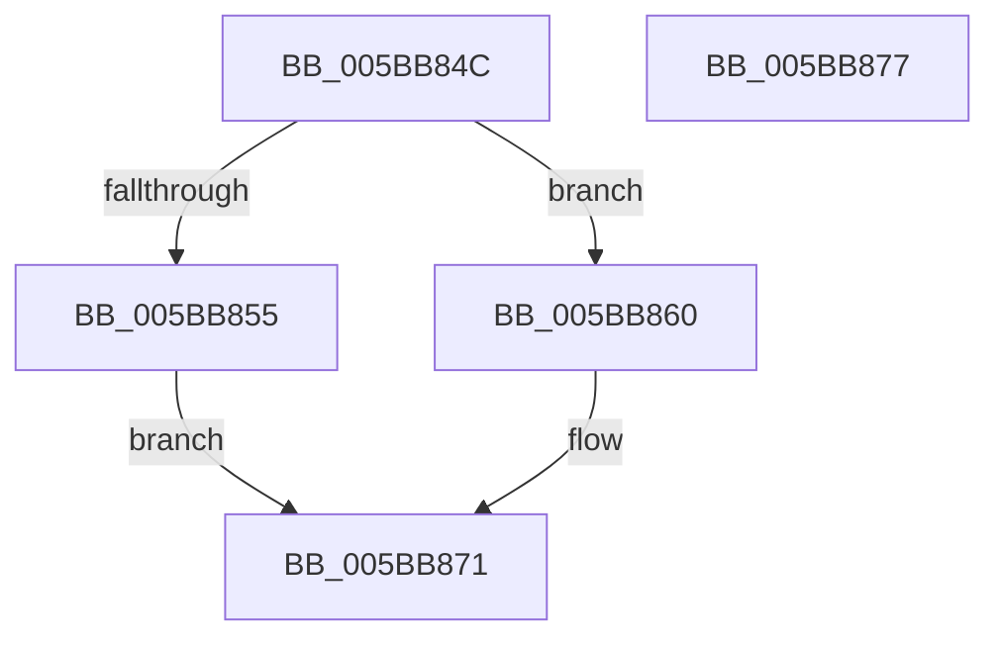

# KiGetPendingTick

- RVA: `0x005BB84C`–`0x005BB878` (길이 `44` bytes)
- VA: `0x00000001405BB84C`
- 실행 섹션: `.text`
- PDB 이름 있음: `예`; PDB Function 태그: `아니요`
- unwind 정보 RVA: `0x000DB714`
- 디코드: `11`개 명령, `44/44` bytes 표시
- 미해석 바이트: `0` (있으면 어셈블리에 `.byte`로 보존)

> 이 문서는 커널 이미지의 기계어와 PDB 기호를 분석해 생성했습니다. 4번과 5번은 함수 원형과 자료형을 바이너리 사용 방식에서 추정한 C 해석이며 원본 소스 복구 결과는 아닙니다.

## 1. Dependencies

- 직접 호출 지점: **0**; 고유 호출 대상: **0**
- 직접 호출자로 확인된 함수: **1**
- RIP 상대 이미지 참조: **3**

### Outgoing calls
- 직접 디코드된 call 명령이 없습니다.

### Direct callers
- [KeResumeClockTimerFromIdle](KeResumeClockTimerFromIdle_function_005BACC4.md) at `0x005BB037`
- [KeResumeClockTimerFromIdle](KeResumeClockTimerFromIdle_function_005BACC4.md) at `0x005BB148`

### Static image references
- `0x005BB84C` → RVA `0x00FC6ABF` (`ALMOSTRO`; read)
- `0x005BB860` → RVA `0x00F21FB0` (`.data`; read)
- `0x005BB866` → RVA `0x00FC8C40` (`ALMOSTRO`; read)

## 2. Other-region calls and transfers

- 다른 실행 섹션으로 향하는 call: **0**
- 별도 외부 분기/꼬리 이동을 확인하지 못했습니다.

## 3. Assembly (complete function range)

```asm
005BB84C  80 3D 6C B2 A0 00 00            cmp byte ptr [rip + 0xa0b26c], 0
005BB853  74 0B                           je 0x1405bb860
005BB855  65 48 8B 04 25 20 00 00 00      mov rax, qword ptr gs:[0x20]
005BB85E  EB 11                           jmp 0x1405bb871
005BB860  8B 05 4A 67 96 00               mov eax, dword ptr [rip + 0x96674a]
005BB866  48 8D 0D D3 D3 A0 00            lea rcx, [rip + 0xa0d3d3]
005BB86D  48 8B 04 C1                     mov rax, qword ptr [rcx + rax*8]
005BB871  8A 40 22                        mov al, byte ptr [rax + 0x22]
005BB874  24 01                           and al, 1
005BB876  C3                              ret
005BB877  CC                              int3
```

## 4. C-style interpretation (structured pseudocode)

```c
__int64 __fastcall KiGetPendingTick(void)
{
    __int64 result;

    if ((*(unsigned __int8 *)(v_rip + 10531436)) == 0) goto loc_005BB860;
    goto loc_005BB871;
loc_005BB860:
loc_005BB871:
    result = (unsigned __int8)((*(unsigned __int8 *)(*(unsigned __int64 *)(v_rip + 10539987 + (unsigned int)(*(unsigned int *)(v_rip + 9856842)) * 8) + 34)) & (1));
    return result;
}
```

## 5. (Beta) C Style

```c
void KiGetPendingTick(void)
{
    int64_t result;

    if ((*(uint8_t *)(v_rip + 0xA0B26C)) == 0) goto loc_005BB860;
    goto loc_005BB871;
loc_005BB860:
loc_005BB871:
    result = (uint8_t)((*(uint8_t *)(*(uint64_t *)(v_rip + 0xA0D3D3 + (uint32_t)(*(uint32_t *)(v_rip + 0x96674A)) * 8) + 0x22)) & (1));
    return result;
}
```

## 6. Execution-region graph

[열기: 2D/3D 그래프와 함수 탐색 컨트롤 패널](../../../control-panel.html?section=text&rva=0x005BB84C&view=graph)

- 2D 그래프는 위에서 아래로 흐르고, 3D 그래프는 빈 공간을 드래그해 회전합니다. Shift+드래그는 이동, 휠은 확대·축소, 함수 노드 선택은 대상 보고서 이동입니다.

### Static fallback


