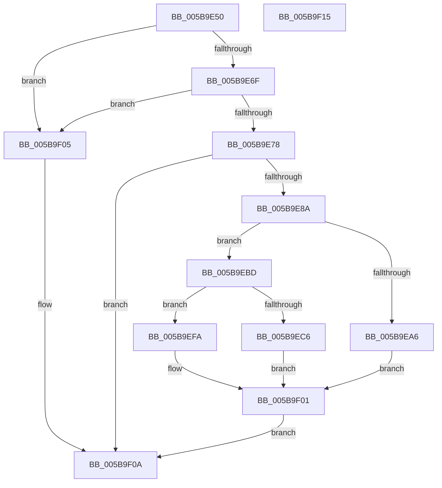

# KiGetSavedIptState

- RVA: `0x005B9E50`–`0x005B9F16` (길이 `198` bytes)
- VA: `0x00000001405B9E50`
- 실행 섹션: `.text`
- PDB 이름 있음: `예`; PDB Function 태그: `아니요`
- unwind 정보 RVA: `0x0005CAAC`
- 디코드: `50`개 명령, `198/198` bytes 표시
- 미해석 바이트: `0` (있으면 어셈블리에 `.byte`로 보존)

> 이 문서는 커널 이미지의 기계어와 PDB 기호를 분석해 생성했습니다. 4번과 5번은 함수 원형과 자료형을 바이너리 사용 방식에서 추정한 C 해석이며 원본 소스 복구 결과는 아닙니다.

## 1. Dependencies

- 직접 호출 지점: **2**; 고유 호출 대상: **2**
- 직접 호출자로 확인된 함수: **0**
- RIP 상대 이미지 참조: **4**

### Outgoing calls
- `0x005B9E7D` → [KiGetSavedSupervisorState](KiGetSavedSupervisorState_function_005B9F20.md) (function, `0x005B9F20`)
- `0x005B9EB3` → [RtlLocateSupervisorFeature](../3D/RtlLocateSupervisorFeature_function_003D6E00.md) (function, `0x003D6E00`)

### Direct callers
- 이 함수 시작 RVA로 연결되는 직접 call은 확인되지 않았습니다. 간접 호출은 완전히 역산할 수 없습니다.

### Static image references
- `0x005B9E8A` → RVA `0x00FC6C60` (`ALMOSTRO`; read)
- `0x005B9E96` → RVA `0x00FC6B30` (`ALMOSTRO`; read)
- `0x005B9EBD` → RVA `0x00FC6B94` (`ALMOSTRO`; read)
- `0x005B9EED` → RVA `0x00FC6C30` (`ALMOSTRO`; read)

## 2. Other-region calls and transfers

- 다른 실행 섹션으로 향하는 call: **0**
- 별도 외부 분기/꼬리 이동을 확인하지 못했습니다.

## 3. Assembly (complete function range)

```asm
005B9E50  48 89 5C 24 08                  mov qword ptr [rsp + 8], rbx
005B9E55  57                              push rdi
005B9E56  48 83 EC 20                     sub rsp, 0x20
005B9E5A  48 83 64 24 38 00               and qword ptr [rsp + 0x38], 0
005B9E60  49 8B D8                        mov rbx, r8
005B9E63  48 8B FA                        mov rdi, rdx
005B9E66  48 85 D2                        test rdx, rdx
005B9E69  0F 84 96 00 00 00               je 0x1405b9f05
005B9E6F  48 85 DB                        test rbx, rbx
005B9E72  0F 84 8D 00 00 00               je 0x1405b9f05
005B9E78  48 8D 54 24 38                  lea rdx, [rsp + 0x38]
005B9E7D  E8 9E 00 00 00                  call 0x1405b9f20
005B9E82  85 C0                           test eax, eax
005B9E84  0F 88 80 00 00 00               js 0x1405b9f0a
005B9E8A  48 0F BA 25 CD CD A0 00 08      bt qword ptr [rip + 0xa0cdcd], 8
005B9E93  0F 92 C1                        setb cl
005B9E96  48 0F BA 25 91 CC A0 00 17      bt qword ptr [rip + 0xa0cc91], 0x17
005B9E9F  0F 92 C0                        setb al
005B9EA2  84 C8                           test al, cl
005B9EA4  74 17                           je 0x1405b9ebd
005B9EA6  48 8B 4C 24 38                  mov rcx, qword ptr [rsp + 0x38]
005B9EAB  4C 8B C3                        mov r8, rbx
005B9EAE  BA 08 00 00 00                  mov edx, 8
005B9EB3  E8 48 CF E1 FF                  call 0x1403d6e00
005B9EB8  48 89 07                        mov qword ptr [rdi], rax
005B9EBB  EB 44                           jmp 0x1405b9f01
005B9EBD  83 3D D0 CC A0 00 00            cmp dword ptr [rip + 0xa0ccd0], 0
005B9EC4  74 34                           je 0x1405b9efa
005B9EC6  48 B8 00 06 00 00 80 F7 FF FF   movabs rax, 0xfffff78000000600
005B9ED0  8B 08                           mov ecx, dword ptr [rax]
005B9ED2  48 B8 E8 03 00 00 80 F7 FF FF   movabs rax, 0xfffff780000003e8
005B9EDC  8B 00                           mov eax, dword ptr [rax]
005B9EDE  48 2B C8                        sub rcx, rax
005B9EE1  48 8B 44 24 38                  mov rax, qword ptr [rsp + 0x38]
005B9EE6  48 83 C0 40                     add rax, 0x40
005B9EEA  48 03 C8                        add rcx, rax
005B9EED  8B 05 3D CD A0 00               mov eax, dword ptr [rip + 0xa0cd3d]
005B9EF3  48 89 0F                        mov qword ptr [rdi], rcx
005B9EF6  89 03                           mov dword ptr [rbx], eax
005B9EF8  EB 07                           jmp 0x1405b9f01
005B9EFA  48 83 27 00                     and qword ptr [rdi], 0
005B9EFE  83 23 00                        and dword ptr [rbx], 0
005B9F01  33 C0                           xor eax, eax
005B9F03  EB 05                           jmp 0x1405b9f0a
005B9F05  B8 0D 00 00 C0                  mov eax, 0xc000000d
005B9F0A  48 8B 5C 24 30                  mov rbx, qword ptr [rsp + 0x30]
005B9F0F  48 83 C4 20                     add rsp, 0x20
005B9F13  5F                              pop rdi
005B9F14  C3                              ret
005B9F15  CC                              int3
```

## 4. C-style interpretation (structured pseudocode)

```c
__int64 __fastcall KiGetSavedIptState(__int64 a1, __int64 a2, __int64 a3)
{
    __int64 result;
    __int64 v_rsp;
    unsigned __int64 v_stack_p10;
    unsigned __int64 v_stack_p8;

    v_stack_p8 = v_rbx;
    v_rsp = (v_rsp) - (32);
    if (a2 == 0) goto loc_005B9F05;
    if (a3 == 0) goto loc_005B9F05;
    result = KiGetSavedSupervisorState(a1, v_stack_p10, a3, a4);
    if (sign_flag) goto loc_005B9F0A;
    a1 = (condition_is_below) ? 1 : 0;
    result = (condition_is_below) ? 1 : 0;
    if ((((unsigned __int8)(result)) & ((unsigned __int8)(a1))) == 0) goto loc_005B9EBD;
    result = RtlLocateSupervisorFeature(v_stack_p10, 8, a3, a4);
    *(unsigned __int64 *)(a2) = result;
    goto loc_005B9F01;
loc_005B9EBD:
    if ((*(unsigned int *)(v_rip + 10538192)) == 0) goto loc_005B9EFA;
    a1 = ((unsigned int)(*(unsigned int *)(result))) - ((unsigned int)(*(unsigned int *)(result)));
    result = (v_stack_p10) + (64);
    a1 = (a1) + (result);
    *(unsigned __int64 *)(a2) = a1;
    *(unsigned int *)(a3) = (unsigned int)((unsigned int)(*(unsigned int *)(v_rip + 10538301)));
    goto loc_005B9F01;
loc_005B9EFA:
loc_005B9F01:
    result = 0;
    goto loc_005B9F0A;
loc_005B9F05:
loc_005B9F0A:
    v_rsp = (v_rsp) + (32);
    return (unsigned int)(0xC000000DULL);
}
```

## 5. (Beta) C Style

```c
int64_t KiGetSavedIptState(int64_t Arg1, void *Arg2, int64_t Arg3)
{
    uint8_t *arg2 = (uint8_t *)Arg2;

    int64_t result;
    int64_t local_rsp;
    uint64_t v_stack_p10;
    uint64_t v_stack_p8;

    v_stack_p8 = local_rbx;
    local_rsp = (local_rsp) - (32);
    if (Arg2 == NULL) goto loc_005B9F05;
    if (Arg3 == 0) goto loc_005B9F05;
    result = KiGetSavedSupervisorState(Arg1, v_stack_p10, Arg3, a4);
    if (sign_flag) goto loc_005B9F0A;
    Arg1 = (condition_is_below) ? 1 : 0;
    result = (condition_is_below) ? 1 : 0;
    if ((((uint8_t)(result)) & ((uint8_t)(Arg1))) == 0) goto loc_005B9EBD;
    result = RtlLocateSupervisorFeature(v_stack_p10, 8, Arg3, a4);
    *(uint64_t *)(arg2) = result;
    goto loc_005B9F01;
loc_005B9EBD:
    if ((*(uint32_t *)(v_rip + 0xA0CCD0)) == 0) goto loc_005B9EFA;
    Arg1 = ((uint32_t)(*(uint32_t *)(result))) - ((uint32_t)(*(uint32_t *)(result)));
    result = (v_stack_p10) + (64);
    Arg1 = (Arg1) + (result);
    *(uint64_t *)(arg2) = Arg1;
    *(uint32_t *)(Arg3) = (uint32_t)((uint32_t)(*(uint32_t *)(v_rip + 0xA0CD3D)));
    goto loc_005B9F01;
loc_005B9EFA:
loc_005B9F01:
    result = 0;
    goto loc_005B9F0A;
loc_005B9F05:
loc_005B9F0A:
    local_rsp = (local_rsp) + (32);
    return (uint32_t)(0xC000000DULL);
}
```

### 관측된 메모리 오프셋

구조체 형식이 확인되지 않은 접근은 인자 기준의 오프셋으로만 기록했습니다.

| 기준 인자 | 오프셋 표현 | 폭 (bit) | 접근 |
|---|---:|---:|---|
| `Arg2` | `+ 0x0` | `64` | `R/W` |
| `Arg2` | `+ 0x0` | `64` | `W` |

## 6. Execution-region graph

[열기: 2D/3D 그래프와 함수 탐색 컨트롤 패널](../../../control-panel.html?section=text&rva=0x005B9E50&view=graph)

- 2D 그래프는 위에서 아래로 흐르고, 3D 그래프는 빈 공간을 드래그해 회전합니다. Shift+드래그는 이동, 휠은 확대·축소, 함수 노드 선택은 대상 보고서 이동입니다.

### Static fallback


