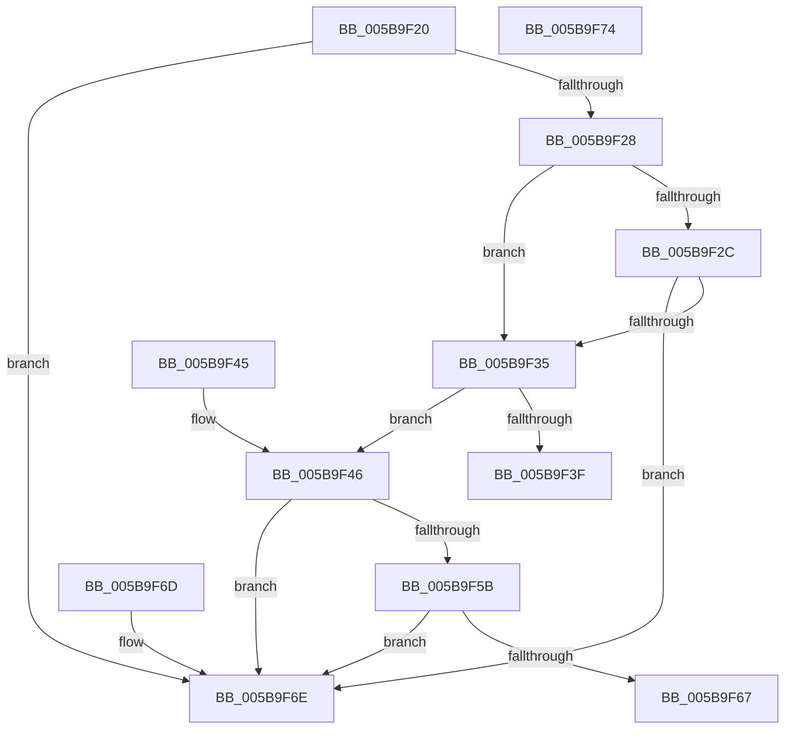

# KiGetSavedSupervisorState

- RVA: `0x005B9F20`–`0x005B9F75` (길이 `85` bytes)
- VA: `0x00000001405B9F20`
- 실행 섹션: `.text`
- PDB 이름 있음: `예`; PDB Function 태그: `아니요`
- unwind 정보 RVA: `0x000DB714`
- 디코드: `29`개 명령, `85/85` bytes 표시
- 미해석 바이트: `0` (있으면 어셈블리에 `.byte`로 보존)

> 이 문서는 커널 이미지의 기계어와 PDB 기호를 분석해 생성했습니다. 4번과 5번은 함수 원형과 자료형을 바이너리 사용 방식에서 추정한 C 해석이며 원본 소스 복구 결과는 아닙니다.

## 1. Dependencies

- 직접 호출 지점: **0**; 고유 호출 대상: **0**
- 직접 호출자로 확인된 함수: **1**
- RIP 상대 이미지 참조: **3**

### Outgoing calls
- 직접 디코드된 call 명령이 없습니다.

### Direct callers
- [KiGetSavedIptState](KiGetSavedIptState_function_005B9E50.md) at `0x005B9E7D`

### Static image references
- `0x005B9F2C` → RVA `0x00F0BD23` (`.data`; read)
- `0x005B9F35` → RVA `0x00FC6A80` (`ALMOSTRO`; read)
- `0x005B9F4B` → RVA `0x00FC8C40` (`ALMOSTRO`; read)

## 2. Other-region calls and transfers

- 다른 실행 섹션으로 향하는 call: **0**
- 별도 외부 분기/꼬리 이동을 확인하지 못했습니다.

## 3. Assembly (complete function range)

```asm
005B9F20  44 0F 20 C0                     mov rax, cr8
005B9F24  3C 02                           cmp al, 2
005B9F26  72 46                           jb 0x1405b9f6e
005B9F28  3C 0F                           cmp al, 0xf
005B9F2A  73 09                           jae 0x1405b9f35
005B9F2C  80 3D F0 1D 95 00 00            cmp byte ptr [rip + 0x951df0], 0
005B9F33  74 39                           je 0x1405b9f6e
005B9F35  8B 05 45 CB A0 00               mov eax, dword ptr [rip + 0xa0cb45]
005B9F3B  3B C8                           cmp ecx, eax
005B9F3D  72 07                           jb 0x1405b9f46
005B9F3F  B8 0D 00 00 C0                  mov eax, 0xc000000d
005B9F44  C3                              ret
005B9F45  CC                              int3
005B9F46  0F AE E8                        lfence
005B9F49  8B C1                           mov eax, ecx
005B9F4B  48 8D 0D EE EC A0 00            lea rcx, [rip + 0xa0ecee]
005B9F52  48 8B 04 C1                     mov rax, qword ptr [rcx + rax*8]
005B9F56  48 85 C0                        test rax, rax
005B9F59  74 13                           je 0x1405b9f6e
005B9F5B  48 8B 80 C0 06 00 00            mov rax, qword ptr [rax + 0x6c0]
005B9F62  48 85 C0                        test rax, rax
005B9F65  74 07                           je 0x1405b9f6e
005B9F67  48 89 02                        mov qword ptr [rdx], rax
005B9F6A  33 C0                           xor eax, eax
005B9F6C  C3                              ret
005B9F6D  CC                              int3
005B9F6E  B8 01 00 00 C0                  mov eax, 0xc0000001
005B9F73  C3                              ret
005B9F74  CC                              int3
```

## 4. C-style interpretation (structured pseudocode)

```c
__int64 __fastcall KiGetSavedSupervisorState(int a1, __int64 a2)
{
    __int64 result;

    if (((unsigned __int8)(v_cr8)) < 2) goto loc_005B9F6E;
    if (((unsigned __int8)(v_cr8)) >= 15) goto loc_005B9F35;
    if ((*(unsigned __int8 *)(v_rip + 9772528)) == 0) goto loc_005B9F6E;
loc_005B9F35:
    if (a1 < ((unsigned int)((unsigned int)(*(unsigned int *)(v_rip + 10537797))))) goto loc_005B9F46;
    return (unsigned int)(0xC000000DULL);
loc_005B9F46:
    if (*(unsigned __int64 *)(v_rip + 10546414 + (unsigned int)(a1) * 8) == 0) goto loc_005B9F6E;
    if (*(unsigned __int64 *)(*(unsigned __int64 *)(v_rip + 10546414 + (unsigned int)(a1) * 8) + 1728) == 0) goto loc_005B9F6E;
    *(unsigned __int64 *)(a2) = *(unsigned __int64 *)(*(unsigned __int64 *)(v_rip + 10546414 + (unsigned int)(a1) * 8) + 1728);
    result = 0;
    return result;
loc_005B9F6E:
    return (unsigned int)(0xC0000001ULL);
}
```

## 5. (Beta) C Style

```c
int64_t KiGetSavedSupervisorState(int32_t Arg1, void *Arg2)
{
    uint8_t *arg2 = (uint8_t *)Arg2;

    int64_t result;

    if (((uint8_t)(v_cr8)) < 2) goto loc_005B9F6E;
    if (((uint8_t)(v_cr8)) >= 15) goto loc_005B9F35;
    if ((*(uint8_t *)(v_rip + 0x951DF0)) == 0) goto loc_005B9F6E;
loc_005B9F35:
    if (Arg1 < ((uint32_t)((uint32_t)(*(uint32_t *)(v_rip + 0xA0CB45))))) goto loc_005B9F46;
    return (uint32_t)(0xC000000DULL);
loc_005B9F46:
    if (*(uint64_t *)(v_rip + 0xA0ECEE + (uint32_t)(Arg1) * 8) == 0) goto loc_005B9F6E;
    if (*(uint64_t *)(*(uint64_t *)(v_rip + 0xA0ECEE + (uint32_t)(Arg1) * 8) + 0x6C0) == 0) goto loc_005B9F6E;
    *(uint64_t *)(arg2) = *(uint64_t *)(*(uint64_t *)(v_rip + 0xA0ECEE + (uint32_t)(Arg1) * 8) + 0x6C0);
    result = 0;
    return result;
loc_005B9F6E:
    return (uint32_t)(0xC0000001ULL);
}
```

### 관측된 메모리 오프셋

구조체 형식이 확인되지 않은 접근은 인자 기준의 오프셋으로만 기록했습니다.

| 기준 인자 | 오프셋 표현 | 폭 (bit) | 접근 |
|---|---:|---:|---|
| `Arg2` | `+ 0x0` | `64` | `W` |

## 6. Execution-region graph

[열기: 2D/3D 그래프와 함수 탐색 컨트롤 패널](../../../control-panel.html?section=text&rva=0x005B9F20&view=graph)

- 2D 그래프는 위에서 아래로 흐르고, 3D 그래프는 빈 공간을 드래그해 회전합니다. Shift+드래그는 이동, 휠은 확대·축소, 함수 노드 선택은 대상 보고서 이동입니다.

### Static fallback


