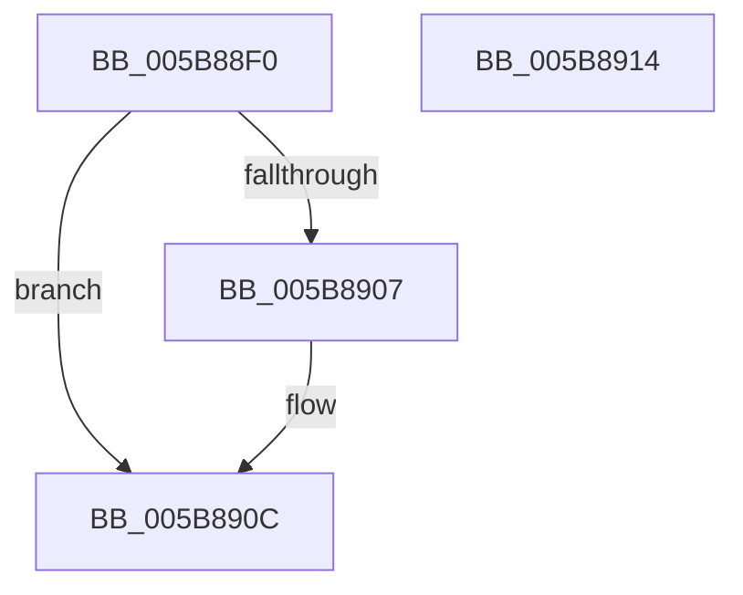

# KiHandleMcheck

- RVA: `0x005B88F0`–`0x005B8915` (길이 `37` bytes)
- VA: `0x00000001405B88F0`
- 실행 섹션: `.text`
- PDB 이름 있음: `예`; PDB Function 태그: `아니요`
- unwind 정보 RVA: `0x0005C788`
- 디코드: `10`개 명령, `37/37` bytes 표시
- 미해석 바이트: `0` (있으면 어셈블리에 `.byte`로 보존)

> 이 문서는 커널 이미지의 기계어와 PDB 기호를 분석해 생성했습니다. 4번과 5번은 함수 원형과 자료형을 바이너리 사용 방식에서 추정한 C 해석이며 원본 소스 복구 결과는 아닙니다.

## 1. Dependencies

- 직접 호출 지점: **2**; 고유 호출 대상: **2**
- 직접 호출자로 확인된 함수: **1**
- RIP 상대 이미지 참조: **1**

### Outgoing calls
- `0x005B88F4` → [HalHandleMcheck](../54/HalHandleMcheck_function_00544D40.md) (function, `0x00544D40`)
- `0x005B8907` → [KiFlushCurrentRsb](../6C/KiFlushCurrentRsb_function_006C6540.md) (function, `0x006C6540`)

### Direct callers
- [KxMcheckAbort](../6C/KxMcheckAbort_function_006C1D00.md) at `0x006C1D79`

### Static image references
- `0x005B88F9` → RVA `0x00FC6B48` (`ALMOSTRO`; read)

## 2. Other-region calls and transfers

- 다른 실행 섹션으로 향하는 call: **0**
- 별도 외부 분기/꼬리 이동을 확인하지 못했습니다.

## 3. Assembly (complete function range)

```asm
005B88F0  48 83 EC 28                     sub rsp, 0x28
005B88F4  E8 47 C4 F8 FF                  call 0x140544d40
005B88F9  48 8B 05 48 E2 A0 00            mov rax, qword ptr [rip + 0xa0e248]
005B8900  48 0F BA E0 29                  bt rax, 0x29
005B8905  73 05                           jae 0x1405b890c
005B8907  E8 34 DC 10 00                  call 0x1406c6540
005B890C  0F AE E8                        lfence
005B890F  48 83 C4 28                     add rsp, 0x28
005B8913  C3                              ret
005B8914  CC                              int3
```

## 4. C-style interpretation (structured pseudocode)

```c
__int64 __fastcall KiHandleMcheck(void)
{
    __int64 result;
    __int64 v_rsp;

    v_rsp = (v_rsp) - (40);
    result = HalHandleMcheck(a1, a2, a3, a4);
    result = *(unsigned __int64 *)(v_rip + 10543688);
    if (!(condition_is_above_or_equal)) {
        result = KiFlushCurrentRsb(a1, a2, a3, a4);
    }
    v_rsp = (v_rsp) + (40);
    return result;
}
```

## 5. (Beta) C Style

```c
void KiHandleMcheck(void)
{
    int64_t result;
    int64_t local_rsp;

    local_rsp = (local_rsp) - (40);
    result = HalHandleMcheck(a1, a2, a3, a4);
    result = *(uint64_t *)(v_rip + 0xA0E248);
    if (!(condition_is_above_or_equal)) {
        result = KiFlushCurrentRsb(a1, a2, a3, a4);
    }
    local_rsp = (local_rsp) + (40);
    return result;
}
```

## 6. Execution-region graph

[열기: 2D/3D 그래프와 함수 탐색 컨트롤 패널](../../../control-panel.html?section=text&rva=0x005B88F0&view=graph)

- 2D 그래프는 위에서 아래로 흐르고, 3D 그래프는 빈 공간을 드래그해 회전합니다. Shift+드래그는 이동, 휠은 확대·축소, 함수 노드 선택은 대상 보고서 이동입니다.

### Static fallback


