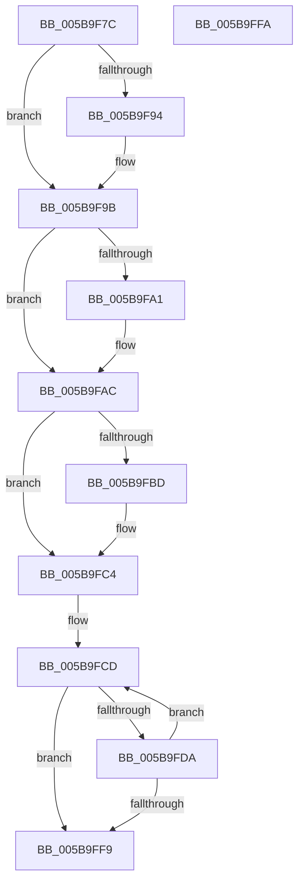

# KiInitIptState

- RVA: `0x005B9F7C`–`0x005B9FFB` (길이 `127` bytes)
- VA: `0x00000001405B9F7C`
- 실행 섹션: `.text`
- PDB 이름 있음: `예`; PDB Function 태그: `아니요`
- unwind 정보 RVA: `0x000DB714`
- 디코드: `41`개 명령, `127/127` bytes 표시
- 미해석 바이트: `0` (있으면 어셈블리에 `.byte`로 보존)

> 이 문서는 커널 이미지의 기계어와 PDB 기호를 분석해 생성했습니다. 4번과 5번은 함수 원형과 자료형을 바이너리 사용 방식에서 추정한 C 해석이며 원본 소스 복구 결과는 아닙니다.

## 1. Dependencies

- 직접 호출 지점: **0**; 고유 호출 대상: **0**
- 직접 호출자로 확인된 함수: **1**
- RIP 상대 이미지 참조: **1**

### Outgoing calls
- 직접 디코드된 call 명령이 없습니다.

### Direct callers
- [KiRestoreThreadIptState](KiRestoreThreadIptState_function_005BA0F0.md) at `0x005BA101`

### Static image references
- `0x005B9F87` → RVA `0x00FC6B94` (`ALMOSTRO`; read)

## 2. Other-region calls and transfers

- 다른 실행 섹션으로 향하는 call: **0**
- 별도 외부 분기/꼬리 이동을 확인하지 못했습니다.

## 3. Assembly (complete function range)

```asm
005B9F7C  33 C0                           xor eax, eax
005B9F7E  B9 70 05 00 00                  mov ecx, 0x570
005B9F83  33 D2                           xor edx, edx
005B9F85  0F 30                           wrmsr
005B9F87  44 8B 05 06 CC A0 00            mov r8d, dword ptr [rip + 0xa0cc06]
005B9F8E  41 F6 C0 02                     test r8b, 2
005B9F92  74 07                           je 0x1405b9f9b
005B9F94  B9 60 05 00 00                  mov ecx, 0x560
005B9F99  0F 30                           wrmsr
005B9F9B  41 F6 C0 04                     test r8b, 4
005B9F9F  74 0B                           je 0x1405b9fac
005B9FA1  33 C0                           xor eax, eax
005B9FA3  B9 61 05 00 00                  mov ecx, 0x561
005B9FA8  33 D2                           xor edx, edx
005B9FAA  0F 30                           wrmsr
005B9FAC  33 C0                           xor eax, eax
005B9FAE  B9 71 05 00 00                  mov ecx, 0x571
005B9FB3  33 D2                           xor edx, edx
005B9FB5  0F 30                           wrmsr
005B9FB7  41 F6 C0 10                     test r8b, 0x10
005B9FBB  74 07                           je 0x1405b9fc4
005B9FBD  B9 72 05 00 00                  mov ecx, 0x572
005B9FC2  0F 30                           wrmsr
005B9FC4  45 33 D2                        xor r10d, r10d
005B9FC7  41 B9 81 05 00 00               mov r9d, 0x581
005B9FCD  41 8D 4A 05                     lea ecx, [r10 + 5]
005B9FD1  0F B6 C1                        movzx eax, cl
005B9FD4  41 0F A3 C0                     bt r8d, eax
005B9FD8  73 1F                           jae 0x1405b9ff9
005B9FDA  33 C0                           xor eax, eax
005B9FDC  41 8D 49 FF                     lea ecx, [r9 - 1]
005B9FE0  33 D2                           xor edx, edx
005B9FE2  0F 30                           wrmsr
005B9FE4  41 8B C9                        mov ecx, r9d
005B9FE7  0F 30                           wrmsr
005B9FE9  41 FF C2                        inc r10d
005B9FEC  41 83 C1 02                     add r9d, 2
005B9FF0  41 81 F9 89 05 00 00            cmp r9d, 0x589
005B9FF7  72 D4                           jb 0x1405b9fcd
005B9FF9  C3                              ret
005B9FFA  CC                              int3
```

## 4. C-style interpretation (structured pseudocode)

```c
__int64 __fastcall KiInitIptState(__int64 a1, int a2)
{
    __int64 result;
    __int64 v_r10;

    result = 0;
    a2 = 0;
    if ((((unsigned __int8)((unsigned int)(*(unsigned int *)(v_rip + 10537990)))) & (2)) != 0) {
        a1 = 0x560ULL;
    }
    if ((((unsigned __int8)((unsigned int)(*(unsigned int *)(v_rip + 10537990)))) & (4)) != 0) {
        result = 0;
        a1 = 0x561ULL;
        a2 = 0;
    }
    result = 0;
    a2 = 0;
    if ((((unsigned __int8)((unsigned int)(*(unsigned int *)(v_rip + 10537990)))) & (16)) != 0) {
        a1 = 0x572ULL;
    }
    v_r10 = 0;
loc_005B9FCD:
    if (condition_is_above_or_equal) goto loc_005B9FF9;
    result = 0;
    a2 = 0;
    v_r10 = (unsigned int)((v_r10) + 1);
    a4 = (unsigned int)(((unsigned int)(0x581ULL)) + (2));
    if (((unsigned int)(a4)) < 0x589ULL) goto loc_005B9FCD;
loc_005B9FF9:
    return result;
}
```

## 5. (Beta) C Style

```c
int64_t KiInitIptState(int64_t Arg1, int32_t Arg2)
{
    int64_t result;
    int64_t local_r10;

    result = 0;
    Arg2 = 0;
    if ((((uint8_t)((uint32_t)(*(uint32_t *)(v_rip + 0xA0CC06)))) & (2)) != 0) {
        Arg1 = 0x560ULL;
    }
    if ((((uint8_t)((uint32_t)(*(uint32_t *)(v_rip + 0xA0CC06)))) & (4)) != 0) {
        result = 0;
        Arg1 = 0x561ULL;
        Arg2 = 0;
    }
    result = 0;
    Arg2 = 0;
    if ((((uint8_t)((uint32_t)(*(uint32_t *)(v_rip + 0xA0CC06)))) & (16)) != 0) {
        Arg1 = 0x572ULL;
    }
    local_r10 = 0;
loc_005B9FCD:
    if (condition_is_above_or_equal) goto loc_005B9FF9;
    result = 0;
    Arg2 = 0;
    local_r10 = (uint32_t)((local_r10) + 1);
    a4 = (uint32_t)(((uint32_t)(0x581ULL)) + (2));
    if (((uint32_t)(a4)) < 0x589ULL) goto loc_005B9FCD;
loc_005B9FF9:
    return result;
}
```

## 6. Execution-region graph

[열기: 2D/3D 그래프와 함수 탐색 컨트롤 패널](../../../control-panel.html?section=text&rva=0x005B9F7C&view=graph)

- 2D 그래프는 위에서 아래로 흐르고, 3D 그래프는 빈 공간을 드래그해 회전합니다. Shift+드래그는 이동, 휠은 확대·축소, 함수 노드 선택은 대상 보고서 이동입니다.

### Static fallback


